# SDLC (Software Development Life Cycle)

---

## Section 1

### 🔹 Software Engineer

- A **software engineer** is responsible for designing, creating, testing, and maintaining software.
- The role involves a **systematic approach** that includes development, operations, and continuous maintenance.
- Key methodologies and practices such as **Agile, Waterfall, DevOps, Scrum, Software Design, Programming, Testing, Product Management, and Version Control** are all interconnected to make the software development process effective.

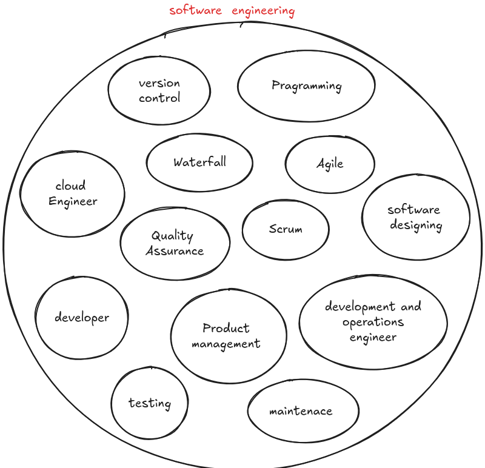

---

### 🔹 Software Development

- Software development is more than just **writing code**; it is essentially about **problem-solving and automating tasks**.
- The process typically consists of:
    - Requirement gathering
    - Finding solutions
    - Implementing the solution
    - Testing the software
    - Deploying it for users
    - Maintaining and upgrading the system

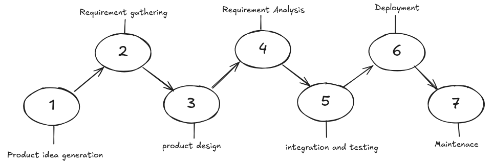

---

### 🔹 Product Management

- **Product management** refers to planning, coordinating, and overseeing the development of a software product.
- It involves checking the **scope, schedule, and budget** to ensure successful delivery.
- Strong communication, leadership, and problem-solving skills are essential for a product manager.

**How project ideas emerge:**

- Need within an organization
- Gap in the market
- Personal requirements
- Ultimately, the goal is to **automate tasks or solve a specific problem**.

**After finalizing the idea:**

- The first step is to check for **resources and feasibility**.
- Example: If a company like *Yummy Food* wants to go online, they may collaborate with an IT service company.
- Before collaboration, certifications like **ISO, ISO/IEC, SOC 2** are checked along with company expertise, technology availability, and relevant experience.

---

## Section 2

### 🔹 Types of Software Development

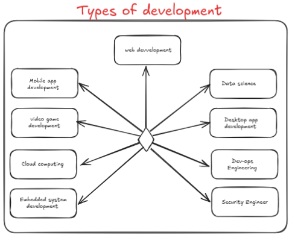

1. **Front-End Development**
    - Focuses on the **user interface and experience** (client-side).
    - Should be **accessible, interactive, and efficient**, ensuring tasks can be completed quickly with minimal clicks.
    - Uses technologies like **HTML, CSS, JavaScript**.
2. **Back-End Development**
    - Manages **server-side logic, APIs, and databases**.
    - Ensures scalability, efficiency, and security.
    - Acts as the “engine” that powers the front-end.
3. **API Development**
    - APIs act as **digital glue** that connects different software systems.
    - Two ways of use: **Architectural APIs** (REST, SOAP, GraphQL, gRPC, WebSockets) and **Programmatic APIs** (built using different programming languages).

    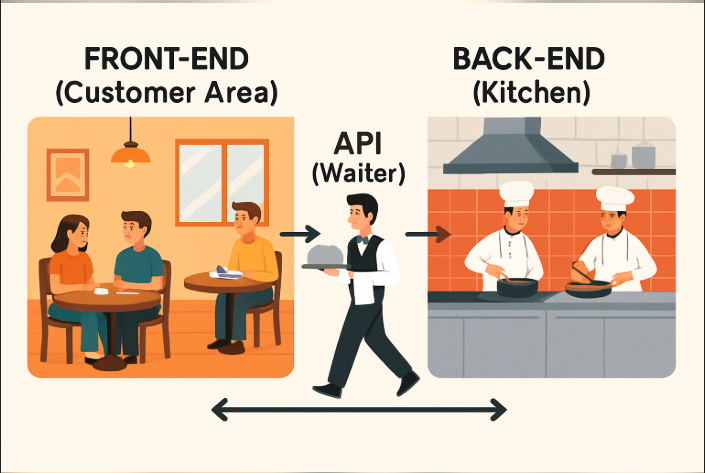

4. **Data Science Development**
    - Uses data to derive insights, predict outcomes, and make decisions.
    - Involves **statistical analysis, programming, data visualization, machine learning, and storytelling**.
5. **Mobile App Development**
    - Builds applications for iOS and Android.
    - Two types: **Native apps** (separate codebases for iOS & Android) and **Hybrid apps** (single codebase but reduced performance).
6. **Desktop Development**
    - Applications installed directly on desktops.
    - Many such functions are now accessible via web browsers.
7. **Cloud Computing Development**
    - Stores data securely on the **cloud instead of local devices**.
    - Uses technologies like **AWS, Docker, Kubernetes**, ensuring scalability and security.
8. **Full-Stack Development**
    - A full-stack developer has knowledge of both **front-end and back-end development**, along with APIs, databases, and mobile technologies.
9. **Game Development**
    - Involves **graphics design, programming, and production**.
    - Technologies used: **C++, Unity, Unreal Engine**.
10. **Embedded Systems Development**
    - Development of software for **microprocessors and microcontrollers** embedded in devices.
    - Languages commonly used: **C and Assembly**.
11. **Progressive Web App (PWA) Development**
    - PWAs combine the best of web and native apps.
    - They work offline, load faster, and are accessible across devices.
    - Use **service workers, web APIs, and web app manifests**.
12. **Open Source Development**
    - Involves building software that is **openly shared, modifiable, and collaborative**.
    - Encourages community contributions.
13. **Enterprise App Development**
    - Focuses on creating custom apps for businesses, such as **HR tools or project management apps**.
14. **E-commerce App Development**
    - Specialized apps for **online shopping, order tracking, and payments**.
    - Requires expertise in mobile, front-end, back-end, database, and testing.
15. **Database Development**
    - Organizes and manages data efficiently.
    - Types:
        - Relational (tabular format)
        - Non-relational (unstructured, internet-scale)
        - Object-oriented (uses OOP principles)
        - Document databases (for unstructured data)
16. **AI/ML Development**
    - Involves building models that can **mimic human intelligence**.
    - Uses algorithms and training data to perform automated tasks and predictions.

---

# Real Life Case Study on why different types of software development require

Let’s take **Amazon** as a case study because it covers almost every software development domain

## **How Amazon Uses Different Types of Software Development**

### 1. **Front-End Development**

- **Use at Amazon:** The **Amazon website and mobile site UI** where customers browse products, add to cart, and check out.
- **Why needed:** To make the shopping experience smooth, accessible, with fewer clicks to order.
- **Tech:** HTML, CSS, JavaScript, React.

---

### 2. **Back-End Development**

- **Use at Amazon:** Handles order processing, payment validation, recommendation engines, user authentication, inventory management.
- **Why needed:** Ensures the system is **scalable, efficient, and secure**.
- **Tech:** Java, Node.js, Python, Scala, Microservices.

---

### 3. **API Development**

- **Use at Amazon:** APIs connect the front-end web app to back-end systems like payments, shipping, seller dashboards, and even Alexa.
- **Example:** When you track your Amazon delivery, the app hits an **Order Status API** to fetch real-time updates.
- **Types Used:** REST APIs, GraphQL for data queries, WebSockets for live tracking.

---

### 4. **Data Science Development**

- **Use at Amazon:** Personalized recommendations (“Customers who bought this also bought”), predicting delivery times, fraud detection, demand forecasting.
- **Why needed:** Data enriches decision-making and enhances customer satisfaction.
- **Tools:** Python, R, Pandas, Machine Learning models.

---

### 5. **Mobile App Development**

- **Use at Amazon:** The **Amazon Shopping app** on iOS & Android lets customers shop anywhere with push notifications.
- **Native vs Hybrid:** Amazon generally uses **native apps** for better performance.

---

### 6. **Desktop Development**

- **Use at Amazon:** Internal tools (like customer service support dashboards, logistics tracking software) often run as **desktop apps**.
- Example: An Amazon warehouse worker might use a desktop app for barcode scanning and shipment processing.

---

### 7. **Cloud Computing Development**

- **Use at Amazon:** Amazon Web Services (AWS) is not only the provider but also the backbone of Amazon’s own platform.
- **Why needed:** To scale massively for peak events like **Prime Day** when millions of users shop simultaneously.
- **Tech:** AWS, Docker, Kubernetes, Serverless Lambda functions.

---

### 8. **Full-Stack Development**

- **Use at Amazon:** A **full-stack developer** at Amazon might build a new feature like “Multi-address delivery”:
    - **Front-end:** UI for users to select multiple addresses.
    - **Back-end:** Service to split orders.
    - **API:** Connects front-end with logistics.
    - **Database:** Stores multi-shipment info.

---

### 9. **Game Development**

- **Use at Amazon:** Not obvious at first, but Amazon owns **Twitch** and **Amazon Games**.
- **Why needed:** To build engaging gaming experiences, streaming overlays, and production of AAA games.
- **Tech:** C++, Unity, Unreal Engine.

---

### 10. **Embedded Systems Development**

- **Use at Amazon:** In devices like **Amazon Echo (Alexa), Kindle, Fire TV, Ring Doorbell**.
- **Why needed:** Embedded software runs on the microcontrollers inside these consumer devices.
- **Tech:** C, Assembly, IoT firmware.

---

### 11. **Progressive Web App (PWA) Development**

- **Use at Amazon:** Amazon India once tested a **lite version of its app** using PWA for users with slower internet speeds.
- **Why needed:** PWAs work offline, load faster, good for regions with limited connectivity.

---

### 12. **Open Source Development**

- **Use at Amazon:** Amazon contributes to many open-source tools (e.g., **AWS SDKs, Deep Java Library, Firecracker microVMs**).
- **Why needed:** Encourages community contributions and improves developer adoption.

---

### 13. **Enterprise App Development**

- **Use at Amazon:** Internal HR systems (for employee onboarding, payroll), tools for vendor management, massive workflow apps for supply chain.
- **Why needed:** Smoothens management of a **hyper-large enterprise**.

---

### 14. **E-commerce App Development**

- **Use at Amazon:** The **core Amazon shopping app and website** fall under this.
- Features: Product browsing, reviews, shopping cart, order placement, payments, and returns.
- Requires **testing across front-end, back-end, mobile, and payment systems**.

---

### 15. **Database Development**

- **Use at Amazon:**
    - **Relational DB:** Orders, payments (e.g., MySQL, Aurora).
    - **NoSQL (DynamoDB):** Product catalog at internet scale.
    - **Document DB:** User preferences, search history.
    - **Graph DB:** Recommendation engine connections.

---

### 16. **AI/ML Development**

- **Use at Amazon:**
    - **Alexa Voice Assistant** (Speech Recognition + NLP).
    - **Amazon Rekognition** (AI for image/video analysis used in Ring & AWS).
    - **Recommendation systems** (personalized shopping).
    - **Warehouse robots** powered by **Computer Vision + ML**.
    - **Fraud detection** in payment systems.

---

### **Summary Visualization**

If we put it together:

- **Customer facing:** Front-End, Mobile, PWA, E-Commerce Dev.
- **Behind the scenes:** Back-End, APIs, Databases, Full-Stack.
- **Scalable infrastructure:** Cloud Computing, Enterprise Apps.
- **Advanced experiences:** AI/ML, Data Science, Game Dev (Twitch).
- **Devices:** Embedded Systems.
- **Cultural/engineering contributions:** Open Source.

---

## Section 3

### 🔹 Analysis and Planning Phase of SDLC

- This phase identifies the **problem** the software will solve and defines **requirements and specifications**.
- It involves:
    - **High-level requirement gathering** to define features.
    - **Feasibility analysis** to check if the project is realistic.
    - **Project scope** to define inclusions and exclusions.
    - **Project plan** with timelines and resource allocation.
    - **Risk assessment** to identify possible hurdles.
    - **Cost considerations** for efficiency.
- Tools such as **use case diagrams and flowcharts** help in understanding workflow.
- A **Statement of Work (SOW)** documents the project plan, schedule, and scope.

**Challenges:**

1. Gathering complete and accurate information
2. Changes in requirements
3. Estimating time for complex projects

---

### Real-Life Example: Food Delivery App

- **Requirements:** Restaurant listings, food ordering, payments, tracking.
- **Feasibility:** Check GPS integration, budget, delivery partner availability.
- **Scope:** In – user app, restaurant dashboard, delivery app, admin panel. Out – drone delivery.
- **Plan:** 6 months for MVP, small dev team with testers & PM.
- **Risks:** Partner delays, peak traffic issues, payment downtime.
- **Cost:** Dev ₹20L, infra ₹5L/year, marketing ₹10L.

---

## Section 4

### 🔹 Cost Estimation Methods

1. **Bottom-up Estimation**
    - Breaks down costs into smaller components and combines them.
    - Accurate but time-consuming and resource-intensive.

    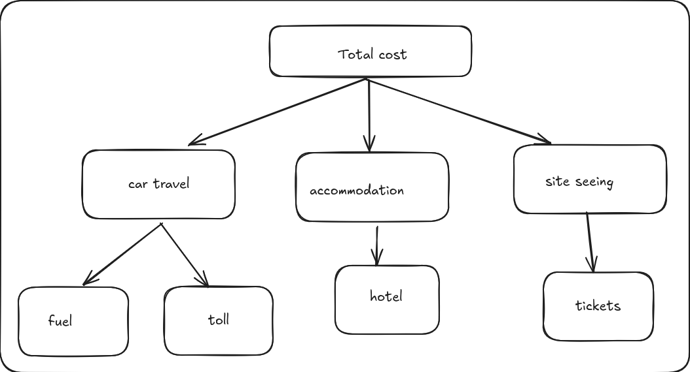

2. **Top-down Estimation**
    - Estimates overall project cost at a high level and then divides into components.
    - Faster but less detailed.

    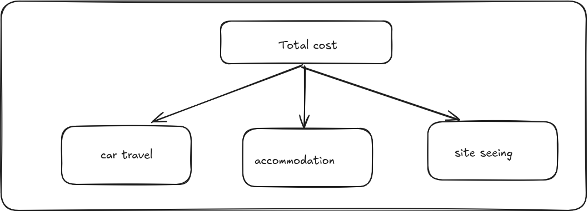

3. **Three-point Estimation (PERT Method)**
    - Considers **best-case, most likely, and worst-case** scenarios.
    - Uses averaging to identify realistic expectations.

   ## FORMULA

    ### = (best case + 4*most likely + worst case/ 6 )

4. **Analogous Estimation**
    - Uses **historical data** from similar projects for cost prediction.
    - Example: Using past e-commerce app budgets to estimate a new one.
5. **Parametric Estimation**
    - Based on **historical data and statistical models**.
    - Relates cost with project parameters using mathematical models.

---

## Section 5

### 🔹 Requirement Gathering Phase

- **Requirements** → What the customer *wants* (simple language).
- **Specifications** → How developers will *build it* (technical details).

**How requirements are captured:**

- Stakeholder meetings, surveys, interviews
- User personas (who will use it)
- User stories (what they need)
- Validation with stakeholders

**Types of requirements:**

- **Functional:** What the system does → *“App should allow users to order food.”*
- **Non-functional:** Quality → *“Orders must be processed in < 3 sec.”*
- **System/Business:** Broader → *“App must support iOS & Android.”*

---

###  Real-Life Example: Online Shopping App

- A business wants an app for **clothes shopping**.
- **Functional:** App should have *search bar, cart, payments*.
- **Non-functional:** App should load in *under 2 seconds*.
- **System:** Must support *UPI & card payments*.
- **Business:** Should handle *10,000 users during sales*.

 All requirements are documented in an **SRS (Software Requirement Specification)**, which the client signs before development starts.

---

## Section 6

### 🔹 UML (Unified Modeling Language)

- UML is a **standardized modeling language** used to visualize, specify, construct, and document software systems.
- It helps in representing **workflows, system design, and interactions** through diagrams like **use case, class, sequence, and activity diagrams**.

## Types of diagrams

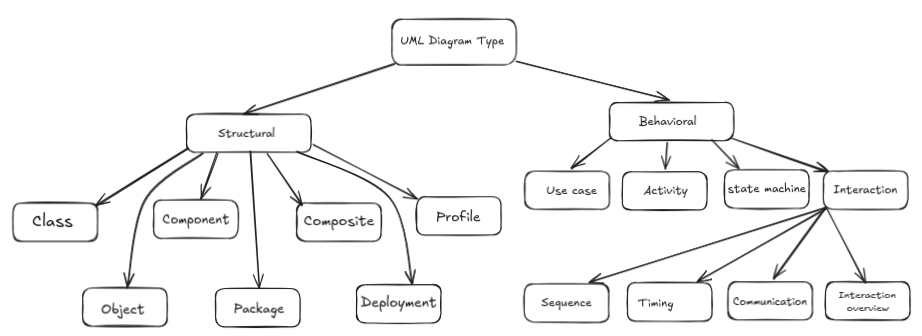

### Structure Diagrams

Structure diagrams illustrate the **static aspects** of a system—how elements relate to each other at rest.

1. **Class Diagram**
    - Shows classes, their attributes, operations, and relationships. Central for object-oriented design.
2. **Object Diagram**
    - Snapshot of instances (objects) in a system at a particular moment; shows example data structures.
3. **Component Diagram**
    - Depicts the logical components/modules, their interfaces, and dependencies, supporting modular design.
4. **Composite Structure Diagram**
    - Breaks down internal structure of classes (classifiers) and collaborations.
5. **Deployment Diagram**
    - Models the runtime deployment of software (artifacts) onto hardware nodes.
6. **Package Diagram**
    - Shows how model elements are grouped into packages and inter-package dependencies.
7. **Profile Diagram**
    - Allows customization of UML models by specifying stereotypes, tagged values, and constraints.

---

### Behavior Diagrams

Behavior diagrams illustrate the **dynamic aspects** of a system—how it behaves and interacts over time.

1. **Activity Diagram**
    - Represents workflows and activities (like a flowchart showing process logic).
2. **Use Case Diagram**
    - Models functionality from a user's perspective, showing actors and their interactions with the system.
3. **State Machine Diagram**
    - Shows lifecycle of an object, the states it goes through, and what triggers transitions.

---

### Interaction Diagrams (Sub-type of Behavior Diagrams)

Interaction diagrams focus on how components or objects collaborate and exchange messages.

1. **Sequence Diagram**
    - Shows object interactions arranged in a time sequence (who calls whom and in what order).
2. **Communication Diagram** (formerly Collaboration Diagram)
    - Emphasizes relationships between objects and the messages they pass.
3. **Interaction Overview Diagram**
    - Mixes elements from activity and sequence diagrams to give a high-level view of control flow.
4. **Timing Diagram**
    - Focuses on the timing constraints and changes in state or condition of objects over time.

### Tools used for creating such diagrams

- **Visual Paradigm:**
    
    A comprehensive UML tool supporting all UML diagram types. Provides powerful modeling, code generation, and collaboration features.
    
- **StarUML:**
    
    Open-source UML modeling tool supporting UML 2.x standards. Allows easy diagram creation with extensibility through plugins.
    
- **Lucidchart:**
    
    Web-based diagramming tool offering intuitive drag-and-drop UML diagram creation with real-time collaboration.
    
- **Draw.io (Diagrams.net):**
    
    Free, web-based diagramming tool supporting UML diagrams. Integrates with cloud storage and has offline capabilities.
    
- **Enterprise Architect (Sparx Systems):**
    
    A powerful commercial UML modeling and design tool used for enterprise-level projects with extensive features in modeling, simulation, and documentation
    

### Class Uml diagram

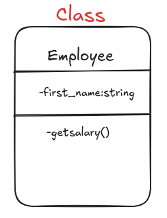

1. **Class**
    - Represents a blueprint or template for objects (instances).
    - Depicted as a rectangle divided into three compartments:
        - **Top compartment:** Contains the class name (centered, bold, first letter capitalized)
        - **Middle compartment:** Lists the attributes (properties/data members) of the class
        - **Bottom compartment:** Lists the operations (methods/functions) the class can perform.
2. **Attributes**
    - Describe the properties or data of the class.
    - Usually shown with visibility (+ public, - private, # protected), name, type, and optionally default values or multiplicity,
3. **Operations (Methods)**
    - Describe the behavior or functions of the class.
    - Include visibility, method name, parameters, and return type.
4. **Relationships Between Classes**
    - **Association:** General "uses-a" relationship indicating interaction.
    - **Aggregation:** A "has-a" relationship where parts can exist independently.
    - **Composition:** Stronger "has-a" where parts cannot exist without the whole.
    - **Inheritance (Generalization):** "Is-a" relationship where a subclass inherits from a superclass.
    - **Realization:** Implementation of an interface by a class.
    - **Dependency:** Represents a "uses" relationship where one class depends on another.
5. **Visibility Notations**
    - Symbols indicating access level:
        - **`+`** Public (accessible everywhere)
        - **`-`** Private (within class only)
        - **`#`** Protected (within class and subclasses)
        - **`~`** Package (within package/module).
        
        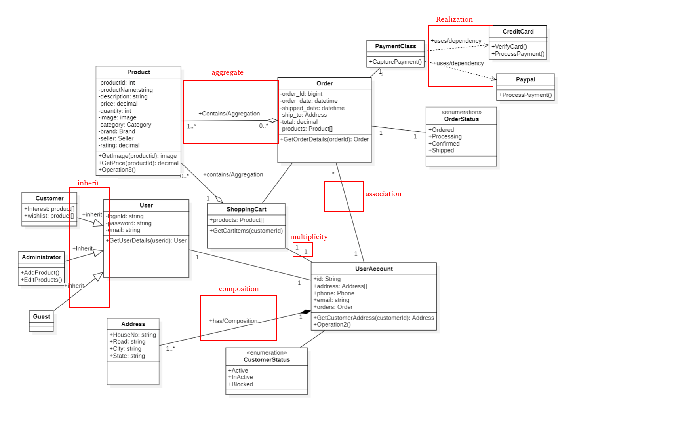
        

---

### Purpose of a UML Class Diagram

- Helps visualize the static structure of an application by showing how classes relate.
- Facilitates communication among developers and stakeholders.
- Serves as a blueprint for coding and design.
- Useful for both conceptual modeling and detailed design of object-oriented systems.

### Object uml diagram

it is the snapshot taken at some instance of a time

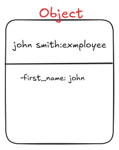

### Key Characteristics of UML Object Diagrams

- **Objects:** Represent specific instances of classes. Each object is shown as a rectangle containing the object name and class name
- **Attributes:** Objects display attribute values at the time the snapshot is taken, showing the object's state.
- **Links:** Represent relationships between objects, which are instances of associations defined in class diagrams.
- **Purpose:** Used to visually illustrate how objects interrelate, to verify class diagrams, understand system behavior at runtime, or model examples/test cases.

### Differences from Class Diagrams

- Class diagrams show the blueprint with classes, attributes, operations, and static relationships.
- Object diagrams show instantiated objects with actual data values and current links at a point in time.
- Object diagrams provide a concrete "snapshot" view of the system's structure during execution.

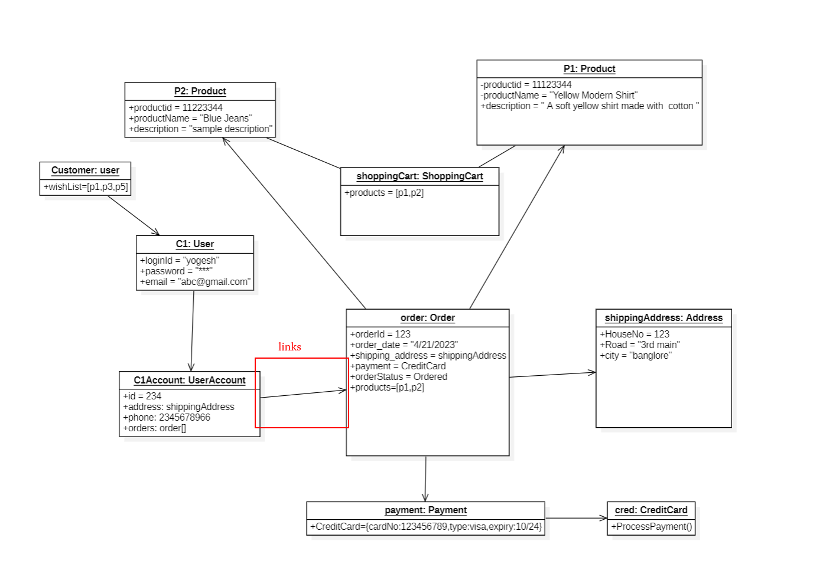

### Component uml diagram

It is a structural diagram used to visualize the organization, modular parts (components), and relationships within a software system

1. **Component**
    - Represents a modular part of the system encapsulating functionality.
    - Can be a software module, collection of classes, or subsystem.
    - Shown as a rectangle with the stereotype **`<<component>>`** or with a small component icon.
2. **Interfaces**
    - Define a set of operations that components provide or require.
    - **Provided Interface:** Services a component offers, shown as a "lollipop" circle attached to the component.
    - **Required Interface:** Services needed by a component, shown as a "socket" (half circle) that connects to a provided interface.
    
    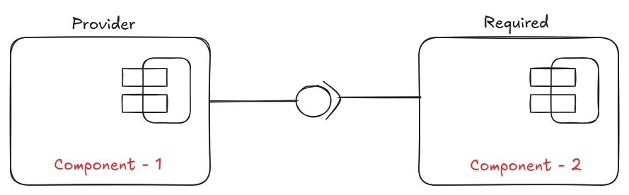
    
3. **Ports**
    - Interaction points on the boundary of a component where interfaces are accessed. Represented as small squares on the component boundary

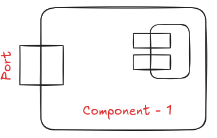

4.**Relationships and Connectors**

- Dependency (dashed arrow): One component relies on another.
- Association (solid line): Permanent relationship between components.
- Assembly Connector: Connects a required interface of one component to a provided interface of another, showing communication paths.

### Package uml diagram

Package Diagram is a type of structural diagram used in UML to visualize the organization and grouping of model elements such as classes, interfaces, components, and other packages within a system

### **Key Components of Package Diagrams**

- **Package:**
    
    A container for related UML elements like classes, interfaces, or even other packages. Depicted as a tabbed folder icon with the package name on it.
    
- **Packageable Element:**
    
    Individual elements inside a package, such as classes or components.
    
- **Dependencies:**
    
    Directed relationships showing how one package depends on or influences another. Dependencies are illustrated with dashed arrows.
    
- **Package Import:**
    
    A relationship where one package imports the contents of another, indicated by a dashed arrow with an open arrowhead.
    
- **Package Merge:**
    
    Indicates that the contents of one package are merged with another to combine their elements.
    

---

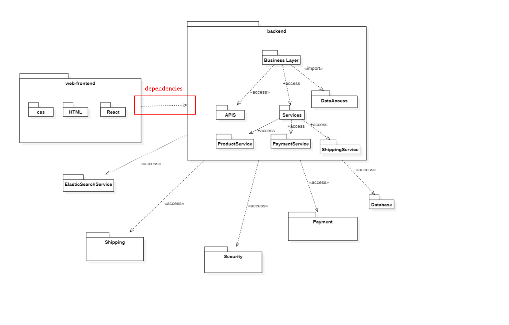

### Deployment uml diagram

Deployment Diagram is a structural diagram that illustrates the physical deployment of software components on hardware nodes.

### Key Components of a UML Deployment Diagram

- **Nodes:**
    
    Represent physical hardware or software execution environments where artifacts are deployed, such as servers, workstations, routers, or virtual machines. Nodes are depicted as three-dimensional boxes or cubes.
    
- **Artifacts:**
    
    Physical files or software components deployed on nodes, including executable files, libraries, databases, or configuration files. Artifacts are usually shown as rectangles with a folded corner or cylinder icons.
    
- **Relationships:**
    - **Dependencies:** Dashed arrows indicating that one artifact relies on another.
    - **Associations:** Solid lines showing deployment relationships between nodes and artifacts or between nodes.
    - **Communication Paths:** Lines representing communication links like network connections between nodes.
- **Deployment Specifications:**
    
    Details about hardware and software setup, including configurations and interaction protocols.
    

---

### Example Use Case

A deployment diagram for a web application might show:

- A Web Server Node hosting the web application artifact.
- An Application Server Node hosting business logic components.
- A Database Server Node where the database artifact is deployed.
- Communication paths between the web server, application server, and database server nodes.

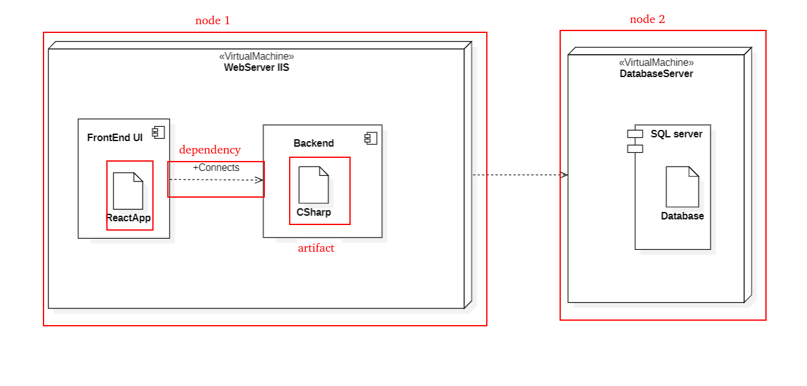

## Composite uml diagram

Composite Structure Diagram is a type of structural UML diagram that shows the internal structure of a classifier (such as a class, component, or deployment node) and the interactions between its parts at runtime

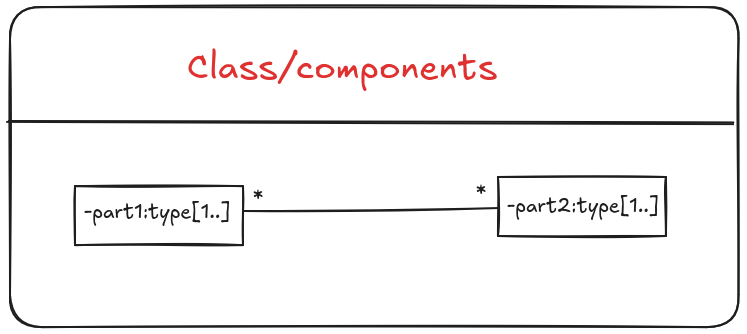

### Key Components of a Composite Structure Diagram

- **Structured Classifier:**
    
    A classifier like a class or component that contains internal parts and ports.
    
- **Parts:**
    
    Instances or roles of classes that are contained within the structured classifier. Parts represent the building blocks that make up the internal structure.
    
- **Ports:**
    
    Interaction points on the boundary of a classifier or part, through which communication with other parts or the environment occurs. Ports may specify provided or required interfaces.
    
- **Connectors:**
    
    Links or communication pathways that connect parts or ports, allowing interactions among them.
    

## Example Scenario

Imagine a **Smartphone** as a class (structured classifier). Inside this class, there are several parts working together:

- **Screen** (part: handles display)
- **Battery** (part: supplies power)
- **Processor** (part: runs apps and system)
- **Camera** (part: takes photos)

Each part communicates with one another through connectors:

- The **Processor** connects to the **Screen** to display images.
- The **Processor** connects to the **Battery** to get power.
- The **Processor** connects to the **Camera** to capture photos.

Ports represent interaction points on the smartphone where other devices or users can interact, like:

- A **Charging Port** connected to the battery for charging.
- A **Headphone Port** connected to the processor for audio output

## Profile uml diagram

A Profile Diagram in UML is a specialized structural diagram used to extend and customize the standard UML language to fit specific domains, platforms, or methodologies. It provides a mechanism to add new building blocks, properties, and semantics tailored to particular needs without changing the core UML metamodel.

### Key Concepts of Profile Diagrams

- **Profile:**
    
    A package that contains a set of extensions (stereotypes, tagged values, constraints) aimed at customizing UML for a specific domain or platform.
    
- **Stereotypes:**
    
    Custom model elements derived from existing UML elements but with additional semantic meaning. They are shown with guillemets (<< >>), such as **`<<Entity>>`** or **`<<Service>>`**. Stereotypes can add domain-specific properties and graphical symbols to UML elements.
    
- **Metaclasses:**
    
    Standard UML elements (like Class, Component, Interface) that the stereotypes extend or customize.
    
- **Tagged Values:**
    
    Attributes added to stereotypes to hold additional data or properties specific to the customization.
    
- **Constraints:**
    
    Rules and conditions applied to stereotypes or model elements, often expressed in Object Constraint Language (OCL), to enforce correct usage.
    

### Example

Suppose you are modeling a network system and want to represent network-specific elements like routers or switches:

- Define stereotypes like **`<<Router>>`**, **`<<Switch>>`** that extend the UML **`Node`** metaclass.
- Add tagged values such as **`manufacturer`** or **`IP address`** to these stereotypes.
- Use these stereotypes in your model to clearly indicate network components with domain-specific semantics.

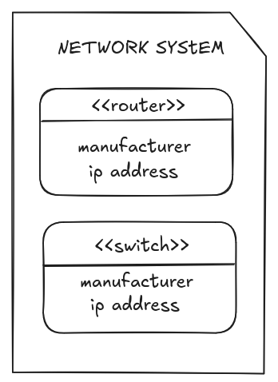

## Use case uml Diagram

A Use Case Diagram in UML is a behavioral diagram that illustrates the functional requirements of a system from the user's perspective. It shows how different types of users (actors) interact with the system to achieve specific goals (use cases)

### Key Elements of Use Case Diagrams

- **Actors:**
    
    Represent users or external systems interacting with the system. Depicted as stick figures or named roles outside the system boundary.
    

1. Primary Actor

- The main user or external entity that initiates an interaction with the system to achieve a goal.
- Usually a human user but can also be an external system.

2. Secondary Actor

- An actor that provides a service or support to the system or primary actor.
- They are not the initiators but assist in completing the use case (e.g., a payment gateway in an e-commerce system).

- **Use Cases:**
    
    Represent functionalities or services provided by the system. Displayed as ovals inside the system boundary labeled with the use case name.
    

**1.**Business Use Case

- Represents a business process that the organization performs, often capturing high-level goals beyond a single system.
- Focuses on organizational-level interactions rather than software system specifics.

- **System Boundary:**
    - A rectangle that defines the scope or boundary of the system being modeled.
    - Use cases reside inside this boundary, showing what the system does, while actors remain outside.

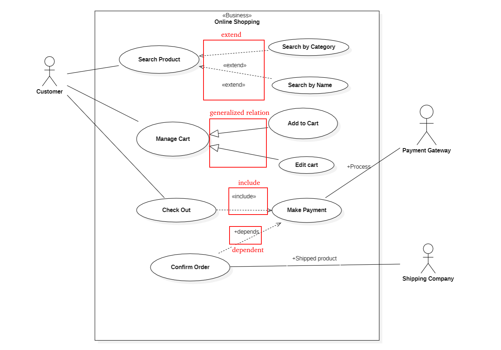

## Activity uml diagram

An Activity Diagram in UML is a behavioral diagram that models the workflow or the sequence of activities and actions in a system or process. It is similar to a flowchart and is used to represent the dynamic aspects of the system, focusing on the flow of control or data.

### Key Components of Activity Diagrams

- **Activity (Action):**
    
    Represents a single step or task in the process, depicted as a rounded rectangle.
    
- **Initial Node:**
    
    Indicates the starting point of the workflow, shown as a filled black circle.
    
- **Final Node:**
    
    Marks the end of the workflow, shown as a filled black circle surrounded by an outer circle.
    
- **Decision Node:**
    
    Represents a branching point where the flow diverges based on conditions, shown as a diamond shape.
    
- **Merge Node:**
    
    Combines multiple alternative flows back into one, also shown as a diamond shape.
    it does not wait both incoming side to come together and doesnt synchronize them
    
- **Fork Node:**
    
    Splits the flow into concurrent parallel paths, depicted as a thick horizontal or vertical bar.
    
- **Join Node:**
    
    Synchronizes parallel paths back into one, also a thick bar.
    it wait for both incoming nodes and synchronize them
    
- **Control Flow:**
    
    Arrows showing the direction of flow from one activity to another.
    
- **Object Flow:**
    
    Arrows depicting the flow of objects or data between activities.
    
- **Swimlanes:**
    
    Vertical or horizontal partitions that represent different actors, departments, or systems responsible for performing actions.
    

### Example Use Case: Online Order Processing

- Initial Node → Browse Products → Add to Cart → Place Order → Decision (Payment Method: Credit Card or PayPal) → Payment → Final Node.

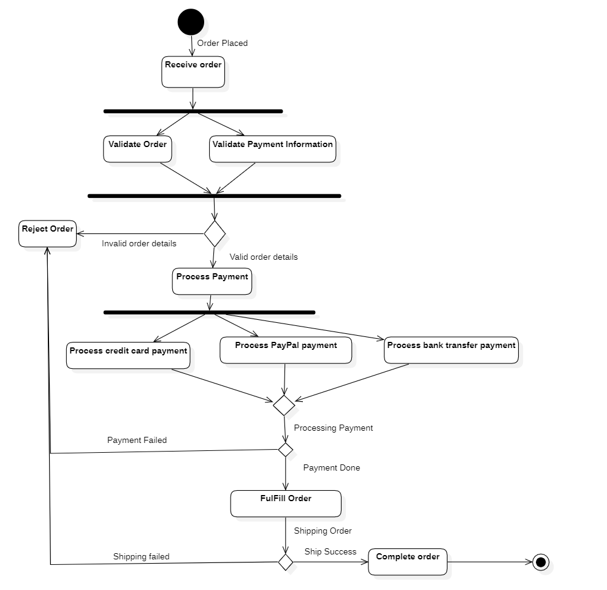

## State machine diagram

A UML State Machine Diagram (also called a state diagram or statechart) is a behavioral diagram that models the different states of an object or system and how it transitions from one state to another in response to specific events

### Key Components

- **States:**
    
    Depict the different conditions or situations an object/system can be in, drawn as rounded rectangles—e.g., "Idle," "Processing," "Completed".
    
- **Transitions:**
    
    Show movement from one state to another, triggered by events. Represented by arrows labeled with triggering events or conditions.
    
- **Initial State:**
    
    Marks where the lifecycle begins; shown as a filled black circle.
    
- **Final State:**
    
    Indicates closure or completion; shown as a filled black circle with an outer ring.
    
- **Events:**
    
    Specific occurrences that cause transitions—e.g., "Order Submitted," "Timeout Occurs."
    
- **Actions:**
    
    Activities performed during transitions or within states—e.g., "Validate Data," "Send Notification."
    
- **Decision/Fork/Join Nodes:**
    
    Used to split or merge transitions, enabling concurrent or conditional paths.
    
- **Self-transition:**
    
    An arrow going back to the same state, modeling behavior that doesn’t change state.
    
- **Composite State:**
    
    States containing nested substates for complex behaviors.
    

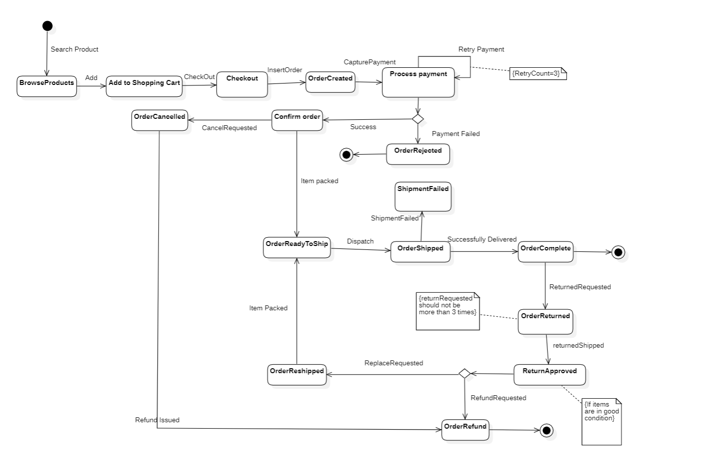

## Sequence Diagram

A Sequence Diagram in UML is a type of interaction diagram that models how objects or components in a system communicate with each other over time. It visually represents the sequence of messages exchanged between actors and system elements to achieve a specific functionality or scenario.

### Key Components of Sequence Diagrams

- **Lifelines:**
    
    Vertical dashed lines representing objects, components, or actors involved in the scenario. Each lifeline is labeled at the top (e.g., **`User`**, **`Order Service`**).
    
- **Activation Bars:**
    
    Narrow rectangles on lifelines showing when an object is active and executing an operation.
    
- **Messages:**
    
    Horizontal arrows between lifelines showing communication—method calls, returns, signals. Solid arrows for synchronous calls, open arrows for return, dashed arrows for asynchronous messages.
    
- **Actors:**
    
    External entities or users interacting with the system, typically drawn as stick figures at the edge of the diagram.
    
- **Fragments:**
    - **Alternative/Optional:** Frames that represent branching behavior (e.g., alt for alternatives, opt for optional scenarios).
    - **Loop:** Frames showing repeated behavior.
- **Return Messages:**
    
    Arrows indicating responses or return values from calls.
    
- **Object Creation/Destruction:**
    
    Creation is shown by a message arrow pointing to the bottom of the lifeline; destruction by an 'X' at the bottom.
    
    ### Example Scenario: Online Order Placement
    
    Actors and lifelines:
    
    - User
    - Shopping Cart
    - Order Service
    - Payment Gateway
    
    Sequence of steps:
    
    1. User sends "addProduct()" to Shopping Cart
    2. Shopping Cart sends "createOrder()" to Order Service
    3. Order Service sends "processPayment()" to Payment Gateway
    4. Payment Gateway returns "success" to Order Service
    5. Order Service returns "orderConfirmed" to User

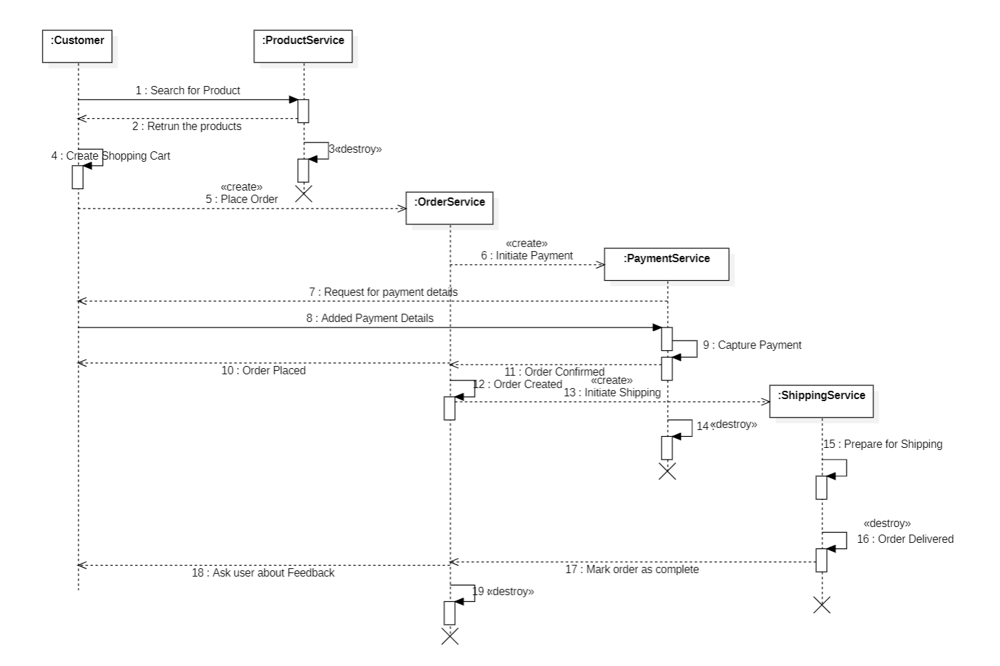

## Communication Uml diagram

A UML Communication Diagram is an interaction diagram that visually represents how objects and actors collaborate within a system by passing sequenced messages to achieve a specific function or scenario. It emphasizes the structural relationships and the flow of information between objects, focusing both on the configuration of links and the messages exchanged.

### Key Components of Communication Diagrams

- **Objects/Roles:**
    
    Depicted as rectangles, these represent the system’s objects, components, or actors participating in the interaction.
    
- **Links:**
    
    Lines connecting objects to show their relationships or ability to communicate.
    
- **Messages:**
    
    Arrows placed along the links with the message name and its sequence number (such as 1.0, 1.1, 2.0) indicating the order of communication. They specify which object sends a message to which object and in what sequence.
    
- **Sequence Numbers:**
    
    Decimal numbering (e.g., 1.1, 1.2) clarifies the order and dependencies among multiple messages, useful for complex interactions.
    
- **Frame (Optional):**
    
    Encloses the diagram, sometimes labeled to describe the interaction scenario.
    

---

### Differences from Sequence Diagram

- Focuses on the **structural relationships** and links between objects rather than on message timing.
- Sequence numbers indicate message order rather than vertical position.
- Layout is more free-form, not strictly top-to-bottom.

### Example Scenario: ATM Withdrawal

- **Objects/Roles:** User, ATM, Bank
- **Links:** User—ATM, ATM—Bank
- **Messages (with sequence numbers):**
    - 1.0: User inserts card to ATM
    - 2.0: ATM requests account info from Bank
    - 2.1: Bank returns account info to ATM
    - 3.0: ATM dispenses cash to User

Objects are connected, and arrows with numbers show who sends each message, in what sequence.

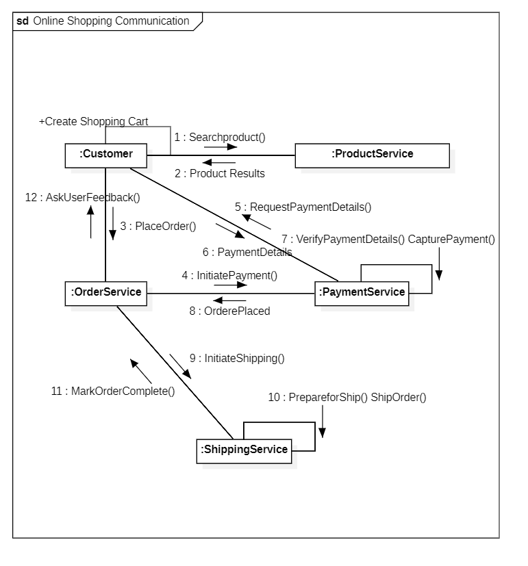

## Timing Uml diagram

A UML Timing Diagram is a specialized interaction diagram that focuses on the behavior of objects over time, particularly emphasizing the timing constraints and changes in state or condition during a process. It is useful to represent time-based behaviors and the changes within or among different objects or system components

### Key Components of Timing Diagrams

- **Lifelines:**
    
    Represent the objects or components whose behavior is being timed, shown as vertical dashed lines.
    
- **State or Condition Lifeline:**
    
    Shows the states or conditions of an object/part over time, represented as a waveform or state changes along the lifeline.
    
- **Time Axis:**
    
    The horizontal axis represents time flowing from left to right.
    
- **Events and Messages:**
    
    Represent change points where states transition or interactions occur.
    
- **Duration Constraints:**
    
    Specify time intervals or constraints on how long a state lasts.
    
- **Focus of Control:**
    
    Indicated by a narrow rectangle on a lifeline, showing the period an object is active or controlling the flow.
    

### Example Scenario: Traffic Light Control

- Lifelines for traffic light controller and traffic signal lights.
- States changing between "Red," "Green," and "Yellow" over time.
- Timing constraints specify duration for each state (e.g., green lasts 60 seconds).

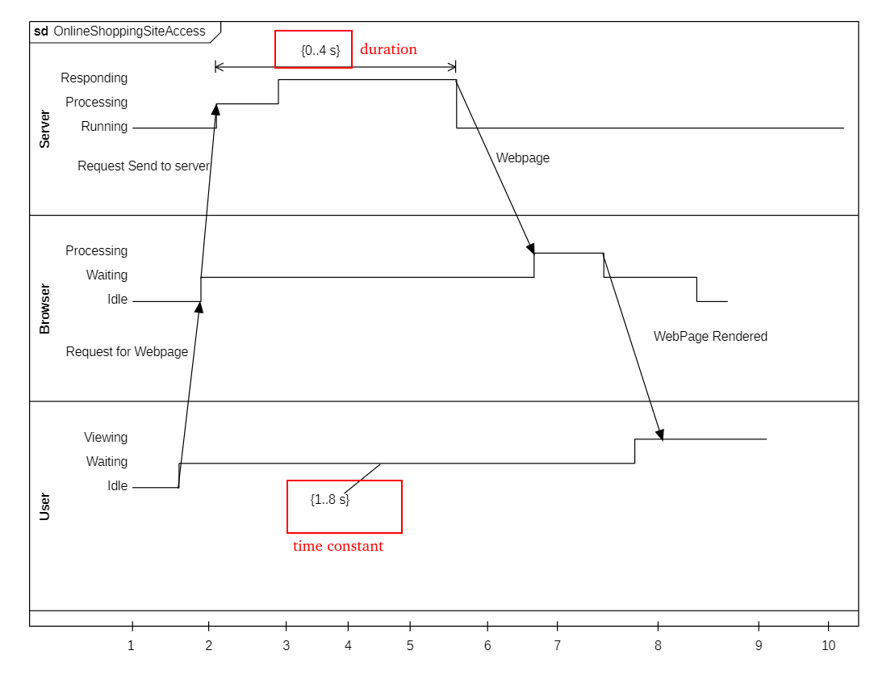

## **Interaction Overview Diagram**

An Interaction Overview Diagram in UML is a type of behavioral diagram that combines elements of activity diagrams and sequence diagrams to provide a high-level view of the control flow between various interactions or interaction fragments within a system. It organizes complex interactions into manageable sections, showing the sequence and flow among them.

---

### Key Features of Interaction Overview Diagrams

- **Combination of Diagrams:**
    
    It blends activity diagram elements (such as decision nodes, forks, joins) with interaction diagrams (like sequence diagrams and communication diagrams) as interaction occurrences or fragments.
    
- **Interaction Occurrences:**
    
    Represented as rectangles with a sequence diagram’s frame notation (e.g., **`ref`** keyword), these call other interaction diagrams or fragments.
    
- **Control Flow:**
    
    Arrows show the flow from one interaction occurrence to another, similar to activity diagram flows.
    
- **Decision and Merge Nodes:**
    
    Used to branch and merge flows, managing alternative and concurrent paths.
    
- **Initial and Final Nodes:**
    
    Represent the start and end of the interaction overview.
    

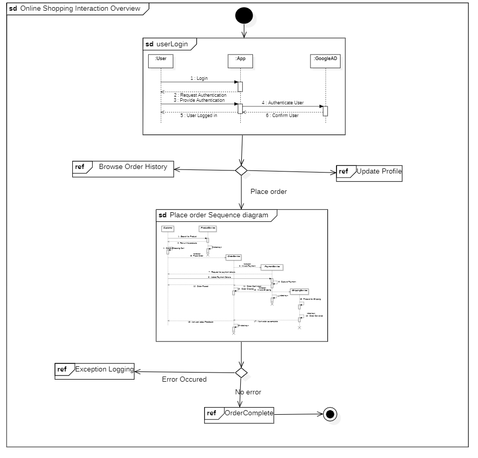

## Section 7

## Designing and Prototypes

In the Software Development Life Cycle (SDLC), the Design and Prototyping phases are critical for transforming gathered requirements into a blueprint for building the system and for creating early models to validate concepts and gather user feedback.

---

### Design Phase

### Purpose

- To create a detailed plan or blueprint that specifies how the system will fulfill the requirements gathered.
- Establishes system architecture, components, interfaces, and data structures.

### Activities

- **Architectural Design:** Defining the overall system structure, major components, their relationships, and technologies to be used.
- **Detailed Design:** Designing individual modules, database schema, user interfaces, algorithms, and data flows.
- **Interface Design:** Specifying how different system components and users interact.
- **Design Documentation:** Producing design documents like software design specifications, UML diagrams (class, sequence, activity diagrams), and interface mockups.

### Outcome

- A comprehensive design document guiding developers during implementation.
- Clear specifications to ensure consistency, reduce ambiguities, and facilitate maintenance.

---

### Prototyping Phase

### Purpose

- To create an early, simplified version or model of parts of the system to visualize features, validate requirements, and gather user feedback.
- Helps in refining requirements before full-scale development.

### Types of Prototypes

- **Throwaway/Rapid Prototyping:** Quickly built to explore ideas and discarded after feedback.
- **Evolutionary Prototyping:** Developed incrementally and refined into the final system.
- **Incremental Prototyping:** Built in parts and integrated later.
- **Extreme Prototyping:** Often used in web development with three phases — static mockup, interactive UI, and working system.

### Benefits

- Clarifies user requirements and expectations.
- Improves user involvement and satisfaction.
- Reduces risks and miscommunication by validating ideas early.
- Guides design improvement and better system usability.

---

### Relationship Between Design and Prototyping

- Prototyping may be integrated within or precede detailed design.
- Prototypes act as a proof of concept that informs and influences system design decisions.
- Both phases promote iterative refinement and validation.

## what actually happens during the phase?

### Design Phase

- The system’s overall architecture and blueprint are created based on the requirements gathered.
- Detailed plans are made for components, data structures, user interfaces, and system interactions.
- UML diagrams and technical documentation are produced to guide developers.
- Decisions about technologies, platforms, and standards to be used are finalized.
- The design ensures the system will meet functional and non-functional requirements efficiently and reliably.

### Prototyping Phase

- A simplified version or model of the system (or parts of it) is built quickly.
- This prototype shows how the system will work, allowing users and stakeholders to visualize features early.
- Feedback is gathered from users to refine and clarify requirements and design.
- Prototypes help detect issues early, reducing risks and improving user satisfaction.
- Based on feedback, designs and requirements may be adjusted before the full development begins.

---

## Why this is important?

1. **Ensure Clear Understanding of Requirements:**
    
    Design translates user requirements into detailed plans, reducing ambiguities and misunderstandings that could lead to project failures.
    
2. **Provide a Blueprint for Development:**
    
    A well-defined design guides developers on what to build, how components interact, and how the system functions as a whole, ensuring consistency and quality.
    
3. **Identify and Resolve Problems Early:**
    
    Prototyping allows early visualization and testing of features, helping catch issues, misunderstandings, or usability problems before costly coding begins.
    
4. **Reduce Risks and Costs:**
    
    Detecting and fixing design or requirement issues early in these phases is much less expensive than later during implementation or after deployment.
    
5. **Improve User Involvement and Satisfaction:**
    
    Prototypes engage users by showing tangible models of the system early on, enabling feedback and adjustments that make the final product more aligned with user needs.
    
6. **Facilitate Communication Among Stakeholders:**
    
    Design documents and prototypes provide common references for developers, users, and managers, enhancing collaboration and shared understanding.
    
7. **Enhance Flexibility and Iterative Improvement:**
    
    These phases support iterative refinement, allowing changes and improvements without derailing the entire project.
    

## Challenges

### Challenges in Design Phase

1. **Incomplete or Ambiguous Requirements:**
    
    Unclear, changing, or missing requirements make it difficult to create an accurate and comprehensive design.
    
2. **Complexity Management:**
    
    Designing complex systems with many interacting components requires balancing detail and simplicity, which can be challenging.
    
3. **Technology Constraints:**
    
    Choosing appropriate technologies and ensuring compatibility may limit design options.
    
4. **Communication Gaps:**
    
    Misunderstandings between business stakeholders, designers, and developers can lead to flawed designs.
    
5. **Scalability and Flexibility:**
    
    Designing systems that can evolve and scale over time while meeting current needs is difficult.
    

---

### Challenges in Prototyping Phase

1. **Scope Creep:**
    
    Prototypes might lead to expanded expectations and additional features beyond initial requirements.
    
2. **Resource and Time Constraints:**
    
    Rapid development of prototypes can strain resources, especially if multiple iterations are needed.
    
3. **User Feedback Misinterpretation:**
    
    Feedback can sometimes be vague or contradictory, making it hard to translate into design improvements.
    
4. **Prototype Misuse:**
    
    Treating prototypes as final products or neglecting proper design documentation can cause problems in later phases.
    
5. **Balancing Detail:**
    
    Creating prototypes too detailed can waste effort, while too simple prototypes may not provide sufficient insights.
    

## High level Diagram

A High-Level Design (HLD) Diagram is a visual representation that outlines the overall system architecture and major components of a software application without delving into detailed internal functionalities. It provides a big-picture view of the system, illustrating how different modules, services, or subsystems interact with each other and with external entities.

---

### Key Characteristics of High-Level Design Diagram

- **Focus on Structure:**
    
    Shows primary system components or modules and their relationships.
    
- **Abstraction:**
    
    Avoids low-level details like internal class structures or specific algorithms.
    
- **Interface Definition:**
    
    Highlights the interfaces between modules and with external systems.
    
- **Technology Overview:**
    
    May indicate technologies, platforms, or databases used by components.
    
- **Communication:**
    
    Displays data flow or communication paths between components.
    

### Purpose of High-Level Design

- To give stakeholders and developers a clear overview of system architecture.
- To facilitate understanding of the system’s organization and major interactions.
- To identify dependencies and integration points early.
- To serve as a reference for detailed design and development phases.

### Key Features of High-Level Design Diagrams:

- Focus on system architecture and main components
- Display modules, external systems, and their relationships
- Show data flow and interfaces between components
- Abstract and technology-agnostic, avoiding implementation details

### Example (E-commerce System HLD):

- Web Application Module interacts with
- Payment Gateway Service,
- Product Catalog Service,
- Inventory Database,
- User Authentication Service,
    
    with arrows showing interface and data flow between them.
    

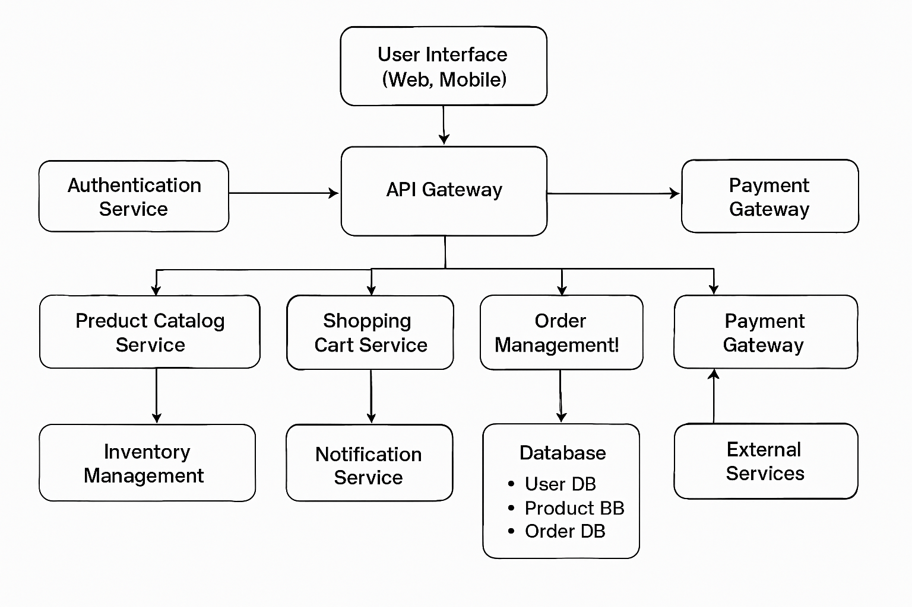

## Data flow diagram

A Data Flow Diagram (DFD) is a graphical representation used to visualize the flow of data within a system. It shows how data moves from external sources into the system, how it is processed by various components, and how it is stored or outputted. DFDs focus on the processes that transform data and the data stores within the system, making them useful for understanding system functions and data handling.

---

### Key Components of a Data Flow Diagram

- **External Entities:**
    
    Sources or destinations of data outside the system (e.g., customers, suppliers). Represented by rectangles.
    
- **Processes:**
    
    Activities or functions that receive input data, process it, and produce output. Shown as circles or rounded rectangles.
    
- **Data Stores:**
    
    Places where data is stored within the system (e.g., databases, files). Depicted as open-ended rectangles or parallel lines.
    
- **Data Flows:**
    
    Arrows illustrating the movement of data between external entities, processes, and data stores.
    

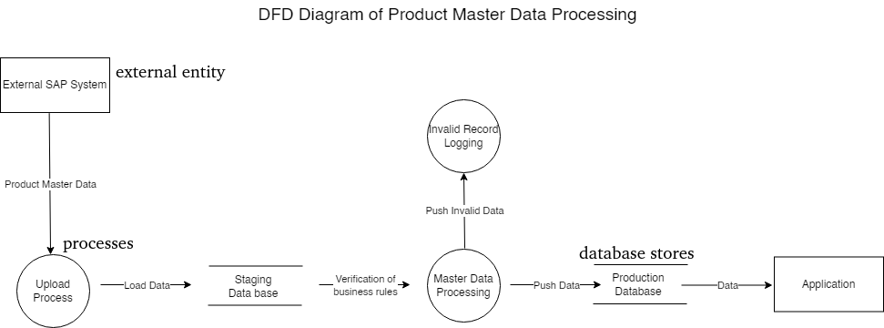

## Low level diagram

Low-Level Design (LLD) is the detailed design phase in the Software Development Life Cycle (SDLC) where the system's components and modules are designed at a very granular level. It builds upon the High-Level Design (HLD) by specifying the internal logic, data structures, algorithms, and interfaces required for implementation.

---

### Key Characteristics of Low-Level Design

- **Detailed Component Design:**
    
    Defines the internal workings of each module or class including methods, attributes, and internal workflows.
    
- **Focus on Implementation:**
    
    Specifies data types, function signatures, control flow, and error handling.
    
- **Class and Object Design:**
    
    Includes UML class diagrams, sequence diagrams, and state diagrams for modules.
    
- **Database Design:**
    
    Describes detailed database schemas, tables, relationships, and queries.
    
- **Interface Details:**
    
    Specifies APIs, data formats, protocols, and interaction contracts between components.
    
- **Algorithm Descriptions:**
    
    Documents detailed logic, pseudocode, or flowcharts for complex operations.
    

## UI/UX

UI (User Interface) and UX (User Experience) are closely related but distinct concepts in the design of digital products such as websites, applications, and software.

---

### User Interface (UI)

- **Definition:**
    
    UI refers to the visual elements with which users interact. It includes the layout, buttons, icons, text fields, colors, fonts, images, and overall aesthetics.
    
- **Focus:**
    
    Designing the look and feel of the product to make it visually appealing and easy to navigate.
    
- **Components:**
    - Screens, pages, and visual elements
    - Interactive components like buttons, sliders, checkboxes
    - Layouts and typography
    - Responsive design for different devices
- **Goal:**
    
    Create an intuitive, attractive interface that helps users accomplish tasks efficiently.
    

---

### User Experience (UX)

- **Definition:**
    
    UX encompasses the overall experience a user has when interacting with a product, including usability, accessibility, performance, and emotional satisfaction.
    
- **Focus:**
    
    Enhancing users’ satisfaction by improving the ease of use, efficiency, and pleasure in interacting with the system.
    
- **Goal:**
    
    Ensure the product meets the needs of users, solves problems effectively, and provides a positive emotional experience.
    

---

### Relationship Between UI and UX

- UI is a part of UX, focusing specifically on the product’s surface and interactive elements.
- UX covers the broader context of the user’s interaction, including UI but also factors like functionality, performance, and overall satisfaction.
- Good UI contributes to good UX, but great UX requires thoughtful design beyond just UI.

---

### Importance of UI/UX

- Better UI/UX leads to increased user engagement, satisfaction, and retention.
- Affects brand perception positively.
- Reduces support costs by minimizing user errors and confusion.
- Drives business success through better conversion and customer loyalty.

## wireframe diagram

A Wireframe Diagram is a simple, skeletal visual guide that represents the layout and structure of a user interface (UI) for a website, software application, or mobile app. It outlines the placement and arrangement of elements like headers, buttons, images, content areas, and navigation without focusing on color, graphics, or detailed design.

---

### Characteristics of Wireframe Diagrams

- Use basic shapes (boxes, lines, placeholders) to indicate UI components.
- Focus on functionality, content hierarchy, and interaction flow rather than aesthetics.
- Include annotations or notes to describe functionality or behavior of elements.
- Typically low-fidelity and quick to create for easy changes and feedback.

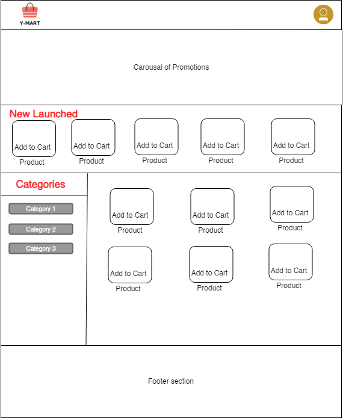

## **High-Fidelity (Hi-Fi) and Low-Fidelity (Lo-Fi) Diagrams**

High-Fidelity (Hi-Fi) and Low-Fidelity (Lo-Fi) Diagrams are terms used in design and prototyping to describe different levels of detail and realism in visual representations of user interfaces or systems.

---

### Low-Fidelity (Lo-Fi) Diagrams

- **Definition:**
    
    Simplified, basic sketches or wireframes that focus on structure, layout, and functionality without detailed graphics.
    
- **Characteristics:**
    - Use simple shapes and placeholders (boxes, lines).
    - Minimal or no color, typography, or images.
    - Quick to create and easy to modify.
    - Represent broad concepts and workflows rather than specifics.
- **Purpose:**
    - Explore ideas and concepts rapidly.
    - Facilitate early feedback and brainstorming.
    - Communicate basic layout and interaction flow.
- **Examples:**
    
    Rough sketches on paper, basic wireframes, block diagrams.
    

### High-Fidelity (Hi-Fi) Diagrams

- **Definition:**
    
    Detailed, polished, and interactive representations that closely resemble the final product visually and functionally.
    
- **Characteristics:**
    - Include real content, colors, fonts, images, and detailed graphics.
    - Interactive elements for usability testing and demonstration.
    - Require more time and effort to develop.
    - Simulate user experience accurately.
- **Purpose:**
    - Validate detailed design and UI elements.
    - Conduct user testing and gather precise feedback.
    - Serve as a blueprint for developers during implementation.
- **Examples:**
    
    Interactive prototypes, pixel-perfect mockups, detailed UI designs.
    

| **Aspect** | **Low Fidelity Diagram** | **High Fidelity Diagram** |
| --- | --- | --- |
| Detail Level | Basic, minimal detail | Comprehensive, detailed |
| Visuals | Simple shapes, placeholders | Full color, typography, images |
| Interactivity | Usually static | Often interactive |
| Development Speed | Fast | Slower |
| Purpose | Early idea exploration, layout | Final design validation |
| Use Case | Conceptual discussion, quick feedback | Usability testing, client presentations |

## Database schema design diagram

A Database Schema Design Diagram visually represents the structure of a database, outlining tables, fields, data types, and relationships among tables. It is essential for designing and documenting how data is organized and accessed within a database.

---

### Key Components of Database Schema Design Diagrams

- **Tables (Entities):**
    
    Represent data objects or concepts, shown as rectangles with the table name at the top.
    
- **Columns (Attributes):**
    
    Listed inside tables, defining fields with their data types and constraints (e.g., primary key, NOT NULL).
    
- **Primary Keys (PK):**
    
    Unique identifiers for records in a table, often underlined or marked.
    
- **Foreign Keys (FK):**
    
    Fields that link to primary keys in other tables, defining relationships.
    
- **Relationships:**
    
    Lines connecting tables, often annotated to show cardinality (one-to-one, one-to-many, many-to-many).
    
- **Cardinality and Participation:**
    
    Indicate how many records in one table relate to records in another (e.g., one customer can have many orders).
    

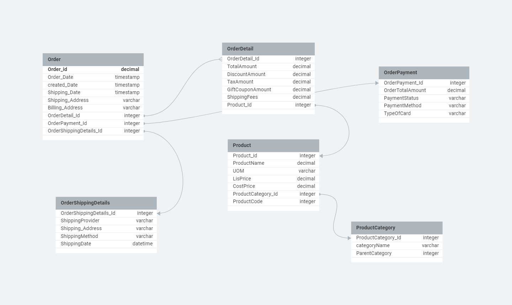

## Software Architecture

**Software Architecture** refers to the high-level structure of a software system, encompassing the organization of its components, their relationships, and the principles guiding its design and evolution. It serves as a blueprint that defines how the system will meet functional and non-functional requirements, ensuring scalability, maintainability, performance, and security.

---

### Key Aspects of Software Architecture

- **Components:**
    
    Modular building blocks such as services, modules, classes, or subsystems.
    
- **Relationships:**
    
    Connections and communication paths between components.
    
- **Architectural Styles and Patterns:**
    
    Common approaches like Client-Server, Layered Architecture, Microservices, Event-Driven, MVC (Model-View-Controller), etc.
    
- **Design Principles:**
    
    Guidelines such as separation of concerns, modularity, loose coupling, and high cohesion.
    
- **Quality Attributes:**
    
    Non-functional requirements like scalability, reliability, performance, security, and usability influencing architectural decisions.
    

### Signs of good architecuture

1. **Modularity:**
    
    The system is divided into well-defined, independent modules or components, making it easier to develop, test, understand, and maintain.
    
2. **Scalability:**
    
    The architecture can handle increased loads or expand functionality without major redesign.
    
3. **Maintainability:**
    
    The design allows for easy updates, bug fixes, and enhancements with minimal impact on other parts.
    
4. **Reusability:**
    
    Components or modules can be reused across different parts of the application or in other projects.
    
5. **Performance Efficiency:**
    
    The system meets its required performance criteria, such as response time, throughput, and resource utilization.
    
6. **Flexibility/Extensibility:**
    
    It can adapt to changing requirements or technologies with minimal effort.
    
7. **Reliability and Availability:**
    
    The architecture supports consistent and dependable operation, minimizing downtime or failures.
    
8. **Security:**
    
    It includes mechanisms for protecting data and controlling access according to requirements.
    
9. **Simplicity and Clarity:**
    
    The design is clear, straightforward, and easy to understand, avoiding unnecessary complexity.
    

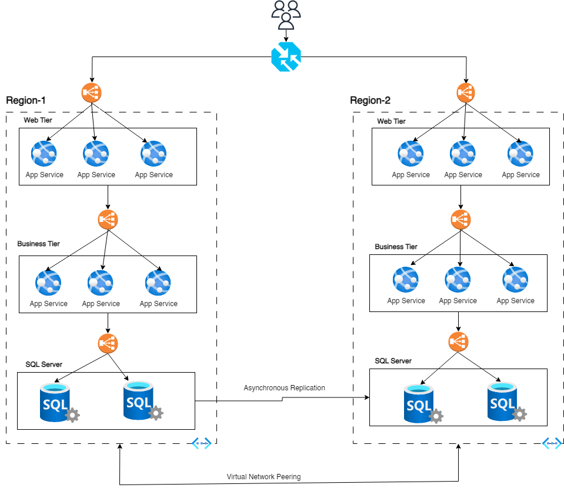