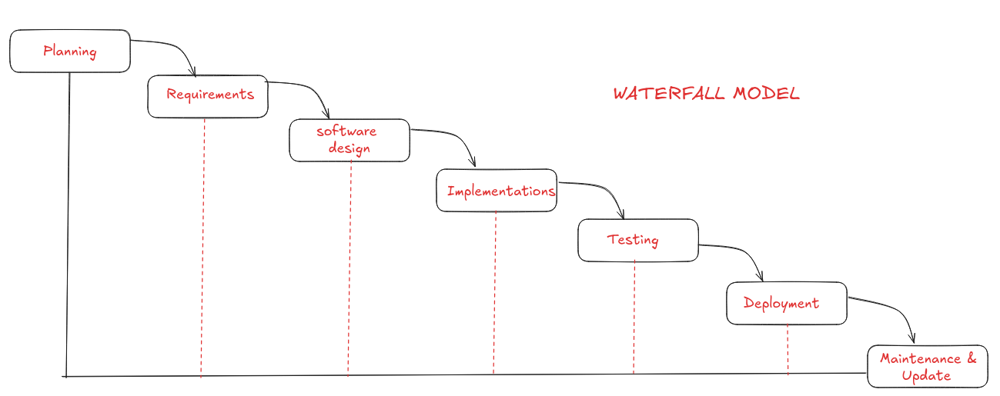
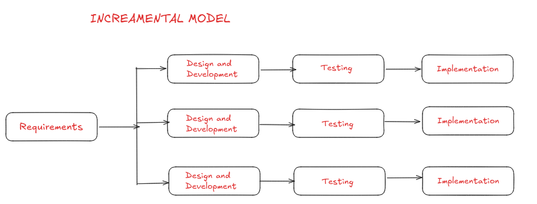
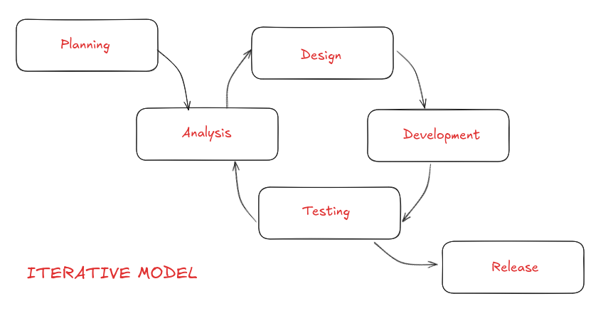
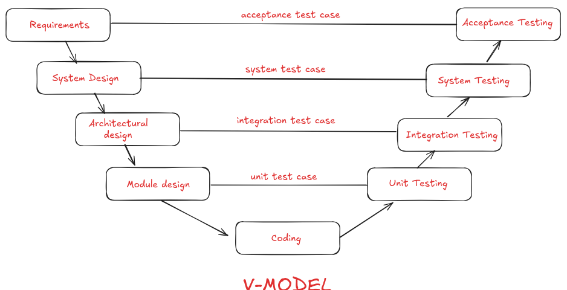
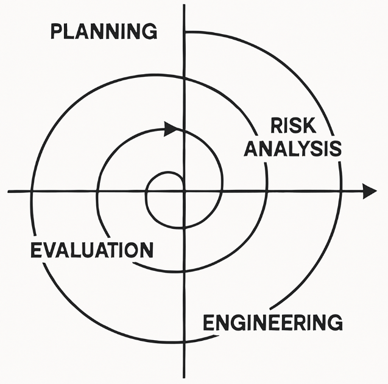
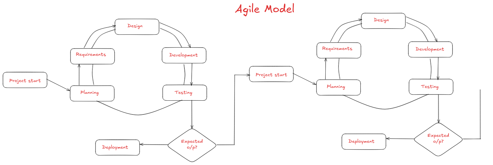
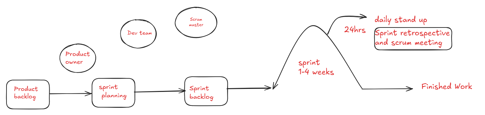

# SDLC (Software Development Life Cycle)

---

## Section 1

### 🔹 Software Engineer

- A **software engineer** is responsible for designing, creating, testing, and maintaining software.
- The role involves a **systematic approach** that includes development, operations, and continuous maintenance.
- Key methodologies and practices such as **Agile, Waterfall, DevOps, Scrum, Software Design, Programming, Testing, Product Management, and Version Control** are all interconnected to make the software development process effective.

---

### 🔹 Software Development

- Software development is more than just **writing code**; it is essentially about **problem-solving and automating tasks**.
- The process typically consists of:
    - Requirement gathering
    - Finding solutions
    - Implementing the solution
    - Testing the software
    - Deploying it for users
    - Maintaining and upgrading the system

---

### 🔹 Product Management

- **Product management** refers to planning, coordinating, and overseeing the development of a software product.
- It involves checking the **scope, schedule, and budget** to ensure successful delivery.
- Strong communication, leadership, and problem-solving skills are essential for a product manager.

**How project ideas emerge:**

- Need within an organization
- Gap in the market
- Personal requirements
- Ultimately, the goal is to **automate tasks or solve a specific problem**.

**After finalizing the idea:**

- The first step is to check for **resources and feasibility**.
- Example: If a company like *Yummy Food* wants to go online, they may collaborate with an IT service company.
- Before collaboration, certifications like **ISO, ISO/IEC, SOC 2** are checked along with company expertise, technology availability, and relevant experience.

---

## Section 2

### 🔹 Types of Software Development

1. **Front-End Development**
    - Focuses on the **user interface and experience** (client-side).
    - Should be **accessible, interactive, and efficient**, ensuring tasks can be completed quickly with minimal clicks.
    - Uses technologies like **HTML, CSS, JavaScript**.
2. **Back-End Development**
    - Manages **server-side logic, APIs, and databases**.
    - Ensures scalability, efficiency, and security.
    - Acts as the “engine” that powers the front-end.
3. **API Development**
    - APIs act as **digital glue** that connects different software systems.
    - Two ways of use: **Architectural APIs** (REST, SOAP, GraphQL, gRPC, WebSockets) and **Programmatic APIs** (built using different programming languages).

    

4. **Data Science Development**
    - Uses data to derive insights, predict outcomes, and make decisions.
    - Involves **statistical analysis, programming, data visualization, machine learning, and storytelling**.
5. **Mobile App Development**
    - Builds applications for iOS and Android.
    - Two types: **Native apps** (separate codebases for iOS & Android) and **Hybrid apps** (single codebase but reduced performance).
6. **Desktop Development**
    - Applications installed directly on desktops.
    - Many such functions are now accessible via web browsers.
7. **Cloud Computing Development**
    - Stores data securely on the **cloud instead of local devices**.
    - Uses technologies like **AWS, Docker, Kubernetes**, ensuring scalability and security.
8. **Full-Stack Development**
    - A full-stack developer has knowledge of both **front-end and back-end development**, along with APIs, databases, and mobile technologies.
9. **Game Development**
    - Involves **graphics design, programming, and production**.
    - Technologies used: **C++, Unity, Unreal Engine**.
10. **Embedded Systems Development**
    - Development of software for **microprocessors and microcontrollers** embedded in devices.
    - Languages commonly used: **C and Assembly**.
11. **Progressive Web App (PWA) Development**
    - PWAs combine the best of web and native apps.
    - They work offline, load faster, and are accessible across devices.
    - Use **service workers, web APIs, and web app manifests**.
12. **Open Source Development**
    - Involves building software that is **openly shared, modifiable, and collaborative**.
    - Encourages community contributions.
13. **Enterprise App Development**
    - Focuses on creating custom apps for businesses, such as **HR tools or project management apps**.
14. **E-commerce App Development**
    - Specialized apps for **online shopping, order tracking, and payments**.
    - Requires expertise in mobile, front-end, back-end, database, and testing.
15. **Database Development**
    - Organizes and manages data efficiently.
    - Types:
        - Relational (tabular format)
        - Non-relational (unstructured, internet-scale)
        - Object-oriented (uses OOP principles)
        - Document databases (for unstructured data)
16. **AI/ML Development**
    - Involves building models that can **mimic human intelligence**.
    - Uses algorithms and training data to perform automated tasks and predictions.

---

# Real Life Case Study on why different types of software development require

Let’s take **Amazon** as a case study because it covers almost every software development domain

## **How Amazon Uses Different Types of Software Development**

### 1. **Front-End Development**

- **Use at Amazon:** The **Amazon website and mobile site UI** where customers browse products, add to cart, and check out.
- **Why needed:** To make the shopping experience smooth, accessible, with fewer clicks to order.
- **Tech:** HTML, CSS, JavaScript, React.

---

### 2. **Back-End Development**

- **Use at Amazon:** Handles order processing, payment validation, recommendation engines, user authentication, inventory management.
- **Why needed:** Ensures the system is **scalable, efficient, and secure**.
- **Tech:** Java, Node.js, Python, Scala, Microservices.

---

### 3. **API Development**

- **Use at Amazon:** APIs connect the front-end web app to back-end systems like payments, shipping, seller dashboards, and even Alexa.
- **Example:** When you track your Amazon delivery, the app hits an **Order Status API** to fetch real-time updates.
- **Types Used:** REST APIs, GraphQL for data queries, WebSockets for live tracking.

---

### 4. **Data Science Development**

- **Use at Amazon:** Personalized recommendations (“Customers who bought this also bought”), predicting delivery times, fraud detection, demand forecasting.
- **Why needed:** Data enriches decision-making and enhances customer satisfaction.
- **Tools:** Python, R, Pandas, Machine Learning models.

---

### 5. **Mobile App Development**

- **Use at Amazon:** The **Amazon Shopping app** on iOS & Android lets customers shop anywhere with push notifications.
- **Native vs Hybrid:** Amazon generally uses **native apps** for better performance.

---

### 6. **Desktop Development**

- **Use at Amazon:** Internal tools (like customer service support dashboards, logistics tracking software) often run as **desktop apps**.
- Example: An Amazon warehouse worker might use a desktop app for barcode scanning and shipment processing.

---

### 7. **Cloud Computing Development**

- **Use at Amazon:** Amazon Web Services (AWS) is not only the provider but also the backbone of Amazon’s own platform.
- **Why needed:** To scale massively for peak events like **Prime Day** when millions of users shop simultaneously.
- **Tech:** AWS, Docker, Kubernetes, Serverless Lambda functions.

---

### 8. **Full-Stack Development**

- **Use at Amazon:** A **full-stack developer** at Amazon might build a new feature like “Multi-address delivery”:
    - **Front-end:** UI for users to select multiple addresses.
    - **Back-end:** Service to split orders.
    - **API:** Connects front-end with logistics.
    - **Database:** Stores multi-shipment info.

---

### 9. **Game Development**

- **Use at Amazon:** Not obvious at first, but Amazon owns **Twitch** and **Amazon Games**.
- **Why needed:** To build engaging gaming experiences, streaming overlays, and production of AAA games.
- **Tech:** C++, Unity, Unreal Engine.

---

### 10. **Embedded Systems Development**

- **Use at Amazon:** In devices like **Amazon Echo (Alexa), Kindle, Fire TV, Ring Doorbell**.
- **Why needed:** Embedded software runs on the microcontrollers inside these consumer devices.
- **Tech:** C, Assembly, IoT firmware.

---

### 11. **Progressive Web App (PWA) Development**

- **Use at Amazon:** Amazon India once tested a **lite version of its app** using PWA for users with slower internet speeds.
- **Why needed:** PWAs work offline, load faster, good for regions with limited connectivity.

---

### 12. **Open Source Development**

- **Use at Amazon:** Amazon contributes to many open-source tools (e.g., **AWS SDKs, Deep Java Library, Firecracker microVMs**).
- **Why needed:** Encourages community contributions and improves developer adoption.

---

### 13. **Enterprise App Development**

- **Use at Amazon:** Internal HR systems (for employee onboarding, payroll), tools for vendor management, massive workflow apps for supply chain.
- **Why needed:** Smoothens management of a **hyper-large enterprise**.

---

### 14. **E-commerce App Development**

- **Use at Amazon:** The **core Amazon shopping app and website** fall under this.
- Features: Product browsing, reviews, shopping cart, order placement, payments, and returns.
- Requires **testing across front-end, back-end, mobile, and payment systems**.

---

### 15. **Database Development**

- **Use at Amazon:**
    - **Relational DB:** Orders, payments (e.g., MySQL, Aurora).
    - **NoSQL (DynamoDB):** Product catalog at internet scale.
    - **Document DB:** User preferences, search history.
    - **Graph DB:** Recommendation engine connections.

---

### 16. **AI/ML Development**

- **Use at Amazon:**
    - **Alexa Voice Assistant** (Speech Recognition + NLP).
    - **Amazon Rekognition** (AI for image/video analysis used in Ring & AWS).
    - **Recommendation systems** (personalized shopping).
    - **Warehouse robots** powered by **Computer Vision + ML**.
    - **Fraud detection** in payment systems.

---

### **Summary Visualization**

If we put it together:

- **Customer facing:** Front-End, Mobile, PWA, E-Commerce Dev.
- **Behind the scenes:** Back-End, APIs, Databases, Full-Stack.
- **Scalable infrastructure:** Cloud Computing, Enterprise Apps.
- **Advanced experiences:** AI/ML, Data Science, Game Dev (Twitch).
- **Devices:** Embedded Systems.
- **Cultural/engineering contributions:** Open Source.

---

## Section 3

### 🔹 Analysis and Planning Phase of SDLC

- This phase identifies the **problem** the software will solve and defines **requirements and specifications**.
- It involves:
    - **High-level requirement gathering** to define features.
    - **Feasibility analysis** to check if the project is realistic.
    - **Project scope** to define inclusions and exclusions.
    - **Project plan** with timelines and resource allocation.
    - **Risk assessment** to identify possible hurdles.
    - **Cost considerations** for efficiency.
- Tools such as **use case diagrams and flowcharts** help in understanding workflow.
- A **Statement of Work (SOW)** documents the project plan, schedule, and scope.

**Challenges:**

1. Gathering complete and accurate information
2. Changes in requirements
3. Estimating time for complex projects

---

### Real-Life Example: Food Delivery App

- **Requirements:** Restaurant listings, food ordering, payments, tracking.
- **Feasibility:** Check GPS integration, budget, delivery partner availability.
- **Scope:** In – user app, restaurant dashboard, delivery app, admin panel. Out – drone delivery.
- **Plan:** 6 months for MVP, small dev team with testers & PM.
- **Risks:** Partner delays, peak traffic issues, payment downtime.
- **Cost:** Dev ₹20L, infra ₹5L/year, marketing ₹10L.

---

## Section 4

### 🔹 Cost Estimation Methods

1. **Bottom-up Estimation**
    - Breaks down costs into smaller components and combines them.
    - Accurate but time-consuming and resource-intensive.

    

2. **Top-down Estimation**
    - Estimates overall project cost at a high level and then divides into components.
    - Faster but less detailed.

    

3. **Three-point Estimation (PERT Method)**
    - Considers **best-case, most likely, and worst-case** scenarios.
    - Uses averaging to identify realistic expectations.

   ## FORMULA

    ### = (best case + 4*most likely + worst case/ 6 )

4. **Analogous Estimation**
    - Uses **historical data** from similar projects for cost prediction.
    - Example: Using past e-commerce app budgets to estimate a new one.
5. **Parametric Estimation**
    - Based on **historical data and statistical models**.
    - Relates cost with project parameters using mathematical models.

---

## Section 5

### 🔹 Requirement Gathering Phase

- **Requirements** → What the customer *wants* (simple language).
- **Specifications** → How developers will *build it* (technical details).

**How requirements are captured:**

- Stakeholder meetings, surveys, interviews
- User personas (who will use it)
- User stories (what they need)
- Validation with stakeholders

**Types of requirements:**

- **Functional:** What the system does → *“App should allow users to order food.”*
- **Non-functional:** Quality → *“Orders must be processed in < 3 sec.”*
- **System/Business:** Broader → *“App must support iOS & Android.”*

---

###  Real-Life Example: Online Shopping App

- A business wants an app for **clothes shopping**.
- **Functional:** App should have *search bar, cart, payments*.
- **Non-functional:** App should load in *under 2 seconds*.
- **System:** Must support *UPI & card payments*.
- **Business:** Should handle *10,000 users during sales*.

 All requirements are documented in an **SRS (Software Requirement Specification)**, which the client signs before development starts.

---

## Section 6

### 🔹 UML (Unified Modeling Language)

- UML is a **standardized modeling language** used to visualize, specify, construct, and document software systems.
- It helps in representing **workflows, system design, and interactions** through diagrams like **use case, class, sequence, and activity diagrams**.

## Types of diagrams

### Structure Diagrams

Structure diagrams illustrate the **static aspects** of a system—how elements relate to each other at rest.

1. **Class Diagram**
    - Shows classes, their attributes, operations, and relationships. Central for object-oriented design.
2. **Object Diagram**
    - Snapshot of instances (objects) in a system at a particular moment; shows example data structures.
3. **Component Diagram**
    - Depicts the logical components/modules, their interfaces, and dependencies, supporting modular design.
4. **Composite Structure Diagram**
    - Breaks down internal structure of classes (classifiers) and collaborations.
5. **Deployment Diagram**
    - Models the runtime deployment of software (artifacts) onto hardware nodes.
6. **Package Diagram**
    - Shows how model elements are grouped into packages and inter-package dependencies.
7. **Profile Diagram**
    - Allows customization of UML models by specifying stereotypes, tagged values, and constraints.

---

### Behavior Diagrams

Behavior diagrams illustrate the **dynamic aspects** of a system—how it behaves and interacts over time.

1. **Activity Diagram**
    - Represents workflows and activities (like a flowchart showing process logic).
2. **Use Case Diagram**
    - Models functionality from a user's perspective, showing actors and their interactions with the system.
3. **State Machine Diagram**
    - Shows lifecycle of an object, the states it goes through, and what triggers transitions.

---

### Interaction Diagrams (Sub-type of Behavior Diagrams)

Interaction diagrams focus on how components or objects collaborate and exchange messages.

1. **Sequence Diagram**
    - Shows object interactions arranged in a time sequence (who calls whom and in what order).
2. **Communication Diagram** (formerly Collaboration Diagram)
    - Emphasizes relationships between objects and the messages they pass.
3. **Interaction Overview Diagram**
    - Mixes elements from activity and sequence diagrams to give a high-level view of control flow.
4. **Timing Diagram**
    - Focuses on the timing constraints and changes in state or condition of objects over time.

### Tools used for creating such diagrams

- **Visual Paradigm:**
    
    A comprehensive UML tool supporting all UML diagram types. Provides powerful modeling, code generation, and collaboration features.
    
- **StarUML:**
    
    Open-source UML modeling tool supporting UML 2.x standards. Allows easy diagram creation with extensibility through plugins.
    
- **Lucidchart:**
    
    Web-based diagramming tool offering intuitive drag-and-drop UML diagram creation with real-time collaboration.
    
- **Draw.io (Diagrams.net):**
    
    Free, web-based diagramming tool supporting UML diagrams. Integrates with cloud storage and has offline capabilities.
    
- **Enterprise Architect (Sparx Systems):**
    
    A powerful commercial UML modeling and design tool used for enterprise-level projects with extensive features in modeling, simulation, and documentation
    

### Class Uml diagram

1. **Class**
    - Represents a blueprint or template for objects (instances).
    - Depicted as a rectangle divided into three compartments:
        - **Top compartment:** Contains the class name (centered, bold, first letter capitalized)
        - **Middle compartment:** Lists the attributes (properties/data members) of the class
        - **Bottom compartment:** Lists the operations (methods/functions) the class can perform.
2. **Attributes**
    - Describe the properties or data of the class.
    - Usually shown with visibility (+ public, - private, # protected), name, type, and optionally default values or multiplicity,
3. **Operations (Methods)**
    - Describe the behavior or functions of the class.
    - Include visibility, method name, parameters, and return type.
4. **Relationships Between Classes**
    - **Association:** General "uses-a" relationship indicating interaction.
    - **Aggregation:** A "has-a" relationship where parts can exist independently.
    - **Composition:** Stronger "has-a" where parts cannot exist without the whole.
    - **Inheritance (Generalization):** "Is-a" relationship where a subclass inherits from a superclass.
    - **Realization:** Implementation of an interface by a class.
    - **Dependency:** Represents a "uses" relationship where one class depends on another.
5. **Visibility Notations**
    - Symbols indicating access level:
        - **`+`** Public (accessible everywhere)
        - **`-`** Private (within class only)
        - **`#`** Protected (within class and subclasses)
        - **`~`** Package (within package/module).
        
        
        

---

### Purpose of a UML Class Diagram

- Helps visualize the static structure of an application by showing how classes relate.
- Facilitates communication among developers and stakeholders.
- Serves as a blueprint for coding and design.
- Useful for both conceptual modeling and detailed design of object-oriented systems.

### Object uml diagram

it is the snapshot taken at some instance of a time

### Key Characteristics of UML Object Diagrams

- **Objects:** Represent specific instances of classes. Each object is shown as a rectangle containing the object name and class name
- **Attributes:** Objects display attribute values at the time the snapshot is taken, showing the object's state.
- **Links:** Represent relationships between objects, which are instances of associations defined in class diagrams.
- **Purpose:** Used to visually illustrate how objects interrelate, to verify class diagrams, understand system behavior at runtime, or model examples/test cases.

### Differences from Class Diagrams

- Class diagrams show the blueprint with classes, attributes, operations, and static relationships.
- Object diagrams show instantiated objects with actual data values and current links at a point in time.
- Object diagrams provide a concrete "snapshot" view of the system's structure during execution.

### Component uml diagram

It is a structural diagram used to visualize the organization, modular parts (components), and relationships within a software system

1. **Component**
    - Represents a modular part of the system encapsulating functionality.
    - Can be a software module, collection of classes, or subsystem.
    - Shown as a rectangle with the stereotype **`<<component>>`** or with a small component icon.
2. **Interfaces**
    - Define a set of operations that components provide or require.
    - **Provided Interface:** Services a component offers, shown as a "lollipop" circle attached to the component.
    - **Required Interface:** Services needed by a component, shown as a "socket" (half circle) that connects to a provided interface.
    
    
    
3. **Ports**
    - Interaction points on the boundary of a component where interfaces are accessed. Represented as small squares on the component boundary

4.**Relationships and Connectors**

- Dependency (dashed arrow): One component relies on another.
- Association (solid line): Permanent relationship between components.
- Assembly Connector: Connects a required interface of one component to a provided interface of another, showing communication paths.

### Package uml diagram

Package Diagram is a type of structural diagram used in UML to visualize the organization and grouping of model elements such as classes, interfaces, components, and other packages within a system

### **Key Components of Package Diagrams**

- **Package:**
    
    A container for related UML elements like classes, interfaces, or even other packages. Depicted as a tabbed folder icon with the package name on it.
    
- **Packageable Element:**
    
    Individual elements inside a package, such as classes or components.
    
- **Dependencies:**
    
    Directed relationships showing how one package depends on or influences another. Dependencies are illustrated with dashed arrows.
    
- **Package Import:**
    
    A relationship where one package imports the contents of another, indicated by a dashed arrow with an open arrowhead.
    
- **Package Merge:**
    
    Indicates that the contents of one package are merged with another to combine their elements.
    

---

### Deployment uml diagram

Deployment Diagram is a structural diagram that illustrates the physical deployment of software components on hardware nodes.

### Key Components of a UML Deployment Diagram

- **Nodes:**
    
    Represent physical hardware or software execution environments where artifacts are deployed, such as servers, workstations, routers, or virtual machines. Nodes are depicted as three-dimensional boxes or cubes.
    
- **Artifacts:**
    
    Physical files or software components deployed on nodes, including executable files, libraries, databases, or configuration files. Artifacts are usually shown as rectangles with a folded corner or cylinder icons.
    
- **Relationships:**
    - **Dependencies:** Dashed arrows indicating that one artifact relies on another.
    - **Associations:** Solid lines showing deployment relationships between nodes and artifacts or between nodes.
    - **Communication Paths:** Lines representing communication links like network connections between nodes.
- **Deployment Specifications:**
    
    Details about hardware and software setup, including configurations and interaction protocols.
    

---

### Example Use Case

A deployment diagram for a web application might show:

- A Web Server Node hosting the web application artifact.
- An Application Server Node hosting business logic components.
- A Database Server Node where the database artifact is deployed.
- Communication paths between the web server, application server, and database server nodes.

## Composite uml diagram

Composite Structure Diagram is a type of structural UML diagram that shows the internal structure of a classifier (such as a class, component, or deployment node) and the interactions between its parts at runtime

### Key Components of a Composite Structure Diagram

- **Structured Classifier:**
    
    A classifier like a class or component that contains internal parts and ports.
    
- **Parts:**
    
    Instances or roles of classes that are contained within the structured classifier. Parts represent the building blocks that make up the internal structure.
    
- **Ports:**
    
    Interaction points on the boundary of a classifier or part, through which communication with other parts or the environment occurs. Ports may specify provided or required interfaces.
    
- **Connectors:**
    
    Links or communication pathways that connect parts or ports, allowing interactions among them.
    

## Example Scenario

Imagine a **Smartphone** as a class (structured classifier). Inside this class, there are several parts working together:

- **Screen** (part: handles display)
- **Battery** (part: supplies power)
- **Processor** (part: runs apps and system)
- **Camera** (part: takes photos)

Each part communicates with one another through connectors:

- The **Processor** connects to the **Screen** to display images.
- The **Processor** connects to the **Battery** to get power.
- The **Processor** connects to the **Camera** to capture photos.

Ports represent interaction points on the smartphone where other devices or users can interact, like:

- A **Charging Port** connected to the battery for charging.
- A **Headphone Port** connected to the processor for audio output

## Profile uml diagram

A Profile Diagram in UML is a specialized structural diagram used to extend and customize the standard UML language to fit specific domains, platforms, or methodologies. It provides a mechanism to add new building blocks, properties, and semantics tailored to particular needs without changing the core UML metamodel.

### Key Concepts of Profile Diagrams

- **Profile:**
    
    A package that contains a set of extensions (stereotypes, tagged values, constraints) aimed at customizing UML for a specific domain or platform.
    
- **Stereotypes:**
    
    Custom model elements derived from existing UML elements but with additional semantic meaning. They are shown with guillemets (<< >>), such as **`<<Entity>>`** or **`<<Service>>`**. Stereotypes can add domain-specific properties and graphical symbols to UML elements.
    
- **Metaclasses:**
    
    Standard UML elements (like Class, Component, Interface) that the stereotypes extend or customize.
    
- **Tagged Values:**
    
    Attributes added to stereotypes to hold additional data or properties specific to the customization.
    
- **Constraints:**
    
    Rules and conditions applied to stereotypes or model elements, often expressed in Object Constraint Language (OCL), to enforce correct usage.
    

### Example

Suppose you are modeling a network system and want to represent network-specific elements like routers or switches:

- Define stereotypes like **`<<Router>>`**, **`<<Switch>>`** that extend the UML **`Node`** metaclass.
- Add tagged values such as **`manufacturer`** or **`IP address`** to these stereotypes.
- Use these stereotypes in your model to clearly indicate network components with domain-specific semantics.

## Use case uml Diagram

A Use Case Diagram in UML is a behavioral diagram that illustrates the functional requirements of a system from the user's perspective. It shows how different types of users (actors) interact with the system to achieve specific goals (use cases)

### Key Elements of Use Case Diagrams

- **Actors:**
    
    Represent users or external systems interacting with the system. Depicted as stick figures or named roles outside the system boundary.
    

1. Primary Actor

- The main user or external entity that initiates an interaction with the system to achieve a goal.
- Usually a human user but can also be an external system.

2. Secondary Actor

- An actor that provides a service or support to the system or primary actor.
- They are not the initiators but assist in completing the use case (e.g., a payment gateway in an e-commerce system).

- **Use Cases:**
    
    Represent functionalities or services provided by the system. Displayed as ovals inside the system boundary labeled with the use case name.
    

**1.**Business Use Case

- Represents a business process that the organization performs, often capturing high-level goals beyond a single system.
- Focuses on organizational-level interactions rather than software system specifics.

- **System Boundary:**
    - A rectangle that defines the scope or boundary of the system being modeled.
    - Use cases reside inside this boundary, showing what the system does, while actors remain outside.

## Activity uml diagram

An Activity Diagram in UML is a behavioral diagram that models the workflow or the sequence of activities and actions in a system or process. It is similar to a flowchart and is used to represent the dynamic aspects of the system, focusing on the flow of control or data.

### Key Components of Activity Diagrams

- **Activity (Action):**
    
    Represents a single step or task in the process, depicted as a rounded rectangle.
    
- **Initial Node:**
    
    Indicates the starting point of the workflow, shown as a filled black circle.
    
- **Final Node:**
    
    Marks the end of the workflow, shown as a filled black circle surrounded by an outer circle.
    
- **Decision Node:**
    
    Represents a branching point where the flow diverges based on conditions, shown as a diamond shape.
    
- **Merge Node:**
    
    Combines multiple alternative flows back into one, also shown as a diamond shape.
    it does not wait both incoming side to come together and doesnt synchronize them
    
- **Fork Node:**
    
    Splits the flow into concurrent parallel paths, depicted as a thick horizontal or vertical bar.
    
- **Join Node:**
    
    Synchronizes parallel paths back into one, also a thick bar.
    it wait for both incoming nodes and synchronize them
    
- **Control Flow:**
    
    Arrows showing the direction of flow from one activity to another.
    
- **Object Flow:**
    
    Arrows depicting the flow of objects or data between activities.
    
- **Swimlanes:**
    
    Vertical or horizontal partitions that represent different actors, departments, or systems responsible for performing actions.
    

### Example Use Case: Online Order Processing

- Initial Node → Browse Products → Add to Cart → Place Order → Decision (Payment Method: Credit Card or PayPal) → Payment → Final Node.

## State machine diagram

A UML State Machine Diagram (also called a state diagram or statechart) is a behavioral diagram that models the different states of an object or system and how it transitions from one state to another in response to specific events

### Key Components

- **States:**
    
    Depict the different conditions or situations an object/system can be in, drawn as rounded rectangles—e.g., "Idle," "Processing," "Completed".
    
- **Transitions:**
    
    Show movement from one state to another, triggered by events. Represented by arrows labeled with triggering events or conditions.
    
- **Initial State:**
    
    Marks where the lifecycle begins; shown as a filled black circle.
    
- **Final State:**
    
    Indicates closure or completion; shown as a filled black circle with an outer ring.
    
- **Events:**
    
    Specific occurrences that cause transitions—e.g., "Order Submitted," "Timeout Occurs."
    
- **Actions:**
    
    Activities performed during transitions or within states—e.g., "Validate Data," "Send Notification."
    
- **Decision/Fork/Join Nodes:**
    
    Used to split or merge transitions, enabling concurrent or conditional paths.
    
- **Self-transition:**
    
    An arrow going back to the same state, modeling behavior that doesn’t change state.
    
- **Composite State:**
    
    States containing nested substates for complex behaviors.
    

## Sequence Diagram

A Sequence Diagram in UML is a type of interaction diagram that models how objects or components in a system communicate with each other over time. It visually represents the sequence of messages exchanged between actors and system elements to achieve a specific functionality or scenario.

### Key Components of Sequence Diagrams

- **Lifelines:**
    
    Vertical dashed lines representing objects, components, or actors involved in the scenario. Each lifeline is labeled at the top (e.g., **`User`**, **`Order Service`**).
    
- **Activation Bars:**
    
    Narrow rectangles on lifelines showing when an object is active and executing an operation.
    
- **Messages:**
    
    Horizontal arrows between lifelines showing communication—method calls, returns, signals. Solid arrows for synchronous calls, open arrows for return, dashed arrows for asynchronous messages.
    
- **Actors:**
    
    External entities or users interacting with the system, typically drawn as stick figures at the edge of the diagram.
    
- **Fragments:**
    - **Alternative/Optional:** Frames that represent branching behavior (e.g., alt for alternatives, opt for optional scenarios).
    - **Loop:** Frames showing repeated behavior.
- **Return Messages:**
    
    Arrows indicating responses or return values from calls.
    
- **Object Creation/Destruction:**
    
    Creation is shown by a message arrow pointing to the bottom of the lifeline; destruction by an 'X' at the bottom.
    
    ### Example Scenario: Online Order Placement
    
    Actors and lifelines:
    
    - User
    - Shopping Cart
    - Order Service
    - Payment Gateway
    
    Sequence of steps:
    
    1. User sends "addProduct()" to Shopping Cart
    2. Shopping Cart sends "createOrder()" to Order Service
    3. Order Service sends "processPayment()" to Payment Gateway
    4. Payment Gateway returns "success" to Order Service
    5. Order Service returns "orderConfirmed" to User

## Communication Uml diagram

A UML Communication Diagram is an interaction diagram that visually represents how objects and actors collaborate within a system by passing sequenced messages to achieve a specific function or scenario. It emphasizes the structural relationships and the flow of information between objects, focusing both on the configuration of links and the messages exchanged.

### Key Components of Communication Diagrams

- **Objects/Roles:**
    
    Depicted as rectangles, these represent the system’s objects, components, or actors participating in the interaction.
    
- **Links:**
    
    Lines connecting objects to show their relationships or ability to communicate.
    
- **Messages:**
    
    Arrows placed along the links with the message name and its sequence number (such as 1.0, 1.1, 2.0) indicating the order of communication. They specify which object sends a message to which object and in what sequence.
    
- **Sequence Numbers:**
    
    Decimal numbering (e.g., 1.1, 1.2) clarifies the order and dependencies among multiple messages, useful for complex interactions.
    
- **Frame (Optional):**
    
    Encloses the diagram, sometimes labeled to describe the interaction scenario.
    

---

### Differences from Sequence Diagram

- Focuses on the **structural relationships** and links between objects rather than on message timing.
- Sequence numbers indicate message order rather than vertical position.
- Layout is more free-form, not strictly top-to-bottom.

### Example Scenario: ATM Withdrawal

- **Objects/Roles:** User, ATM, Bank
- **Links:** User—ATM, ATM—Bank
- **Messages (with sequence numbers):**
    - 1.0: User inserts card to ATM
    - 2.0: ATM requests account info from Bank
    - 2.1: Bank returns account info to ATM
    - 3.0: ATM dispenses cash to User

Objects are connected, and arrows with numbers show who sends each message, in what sequence.

## Timing Uml diagram

A UML Timing Diagram is a specialized interaction diagram that focuses on the behavior of objects over time, particularly emphasizing the timing constraints and changes in state or condition during a process. It is useful to represent time-based behaviors and the changes within or among different objects or system components

### Key Components of Timing Diagrams

- **Lifelines:**
    
    Represent the objects or components whose behavior is being timed, shown as vertical dashed lines.
    
- **State or Condition Lifeline:**
    
    Shows the states or conditions of an object/part over time, represented as a waveform or state changes along the lifeline.
    
- **Time Axis:**
    
    The horizontal axis represents time flowing from left to right.
    
- **Events and Messages:**
    
    Represent change points where states transition or interactions occur.
    
- **Duration Constraints:**
    
    Specify time intervals or constraints on how long a state lasts.
    
- **Focus of Control:**
    
    Indicated by a narrow rectangle on a lifeline, showing the period an object is active or controlling the flow.
    

### Example Scenario: Traffic Light Control

- Lifelines for traffic light controller and traffic signal lights.
- States changing between "Red," "Green," and "Yellow" over time.
- Timing constraints specify duration for each state (e.g., green lasts 60 seconds).

## **Interaction Overview Diagram**

An Interaction Overview Diagram in UML is a type of behavioral diagram that combines elements of activity diagrams and sequence diagrams to provide a high-level view of the control flow between various interactions or interaction fragments within a system. It organizes complex interactions into manageable sections, showing the sequence and flow among them.

---

### Key Features of Interaction Overview Diagrams

- **Combination of Diagrams:**
    
    It blends activity diagram elements (such as decision nodes, forks, joins) with interaction diagrams (like sequence diagrams and communication diagrams) as interaction occurrences or fragments.
    
- **Interaction Occurrences:**
    
    Represented as rectangles with a sequence diagram’s frame notation (e.g., **`ref`** keyword), these call other interaction diagrams or fragments.
    
- **Control Flow:**
    
    Arrows show the flow from one interaction occurrence to another, similar to activity diagram flows.
    
- **Decision and Merge Nodes:**
    
    Used to branch and merge flows, managing alternative and concurrent paths.
    
- **Initial and Final Nodes:**
    
    Represent the start and end of the interaction overview.
    

## Section 7

## Designing and Prototypes

In the Software Development Life Cycle (SDLC), the Design and Prototyping phases are critical for transforming gathered requirements into a blueprint for building the system and for creating early models to validate concepts and gather user feedback.

---

### Design Phase

### Purpose

- To create a detailed plan or blueprint that specifies how the system will fulfill the requirements gathered.
- Establishes system architecture, components, interfaces, and data structures.

### Activities

- **Architectural Design:** Defining the overall system structure, major components, their relationships, and technologies to be used.
- **Detailed Design:** Designing individual modules, database schema, user interfaces, algorithms, and data flows.
- **Interface Design:** Specifying how different system components and users interact.
- **Design Documentation:** Producing design documents like software design specifications, UML diagrams (class, sequence, activity diagrams), and interface mockups.

### Outcome

- A comprehensive design document guiding developers during implementation.
- Clear specifications to ensure consistency, reduce ambiguities, and facilitate maintenance.

---

### Prototyping Phase

### Purpose

- To create an early, simplified version or model of parts of the system to visualize features, validate requirements, and gather user feedback.
- Helps in refining requirements before full-scale development.

### Types of Prototypes

- **Throwaway/Rapid Prototyping:** Quickly built to explore ideas and discarded after feedback.
- **Evolutionary Prototyping:** Developed incrementally and refined into the final system.
- **Incremental Prototyping:** Built in parts and integrated later.
- **Extreme Prototyping:** Often used in web development with three phases — static mockup, interactive UI, and working system.

### Benefits

- Clarifies user requirements and expectations.
- Improves user involvement and satisfaction.
- Reduces risks and miscommunication by validating ideas early.
- Guides design improvement and better system usability.

---

### Relationship Between Design and Prototyping

- Prototyping may be integrated within or precede detailed design.
- Prototypes act as a proof of concept that informs and influences system design decisions.
- Both phases promote iterative refinement and validation.

## what actually happens during the phase?

### Design Phase

- The system’s overall architecture and blueprint are created based on the requirements gathered.
- Detailed plans are made for components, data structures, user interfaces, and system interactions.
- UML diagrams and technical documentation are produced to guide developers.
- Decisions about technologies, platforms, and standards to be used are finalized.
- The design ensures the system will meet functional and non-functional requirements efficiently and reliably.

### Prototyping Phase

- A simplified version or model of the system (or parts of it) is built quickly.
- This prototype shows how the system will work, allowing users and stakeholders to visualize features early.
- Feedback is gathered from users to refine and clarify requirements and design.
- Prototypes help detect issues early, reducing risks and improving user satisfaction.
- Based on feedback, designs and requirements may be adjusted before the full development begins.

---

## Why this is important?

1. **Ensure Clear Understanding of Requirements:**
    
    Design translates user requirements into detailed plans, reducing ambiguities and misunderstandings that could lead to project failures.
    
2. **Provide a Blueprint for Development:**
    
    A well-defined design guides developers on what to build, how components interact, and how the system functions as a whole, ensuring consistency and quality.
    
3. **Identify and Resolve Problems Early:**
    
    Prototyping allows early visualization and testing of features, helping catch issues, misunderstandings, or usability problems before costly coding begins.
    
4. **Reduce Risks and Costs:**
    
    Detecting and fixing design or requirement issues early in these phases is much less expensive than later during implementation or after deployment.
    
5. **Improve User Involvement and Satisfaction:**
    
    Prototypes engage users by showing tangible models of the system early on, enabling feedback and adjustments that make the final product more aligned with user needs.
    
6. **Facilitate Communication Among Stakeholders:**
    
    Design documents and prototypes provide common references for developers, users, and managers, enhancing collaboration and shared understanding.
    
7. **Enhance Flexibility and Iterative Improvement:**
    
    These phases support iterative refinement, allowing changes and improvements without derailing the entire project.
    

## Challenges

### Challenges in Design Phase

1. **Incomplete or Ambiguous Requirements:**
    
    Unclear, changing, or missing requirements make it difficult to create an accurate and comprehensive design.
    
2. **Complexity Management:**
    
    Designing complex systems with many interacting components requires balancing detail and simplicity, which can be challenging.
    
3. **Technology Constraints:**
    
    Choosing appropriate technologies and ensuring compatibility may limit design options.
    
4. **Communication Gaps:**
    
    Misunderstandings between business stakeholders, designers, and developers can lead to flawed designs.
    
5. **Scalability and Flexibility:**
    
    Designing systems that can evolve and scale over time while meeting current needs is difficult.
    

---

### Challenges in Prototyping Phase

1. **Scope Creep:**
    
    Prototypes might lead to expanded expectations and additional features beyond initial requirements.
    
2. **Resource and Time Constraints:**
    
    Rapid development of prototypes can strain resources, especially if multiple iterations are needed.
    
3. **User Feedback Misinterpretation:**
    
    Feedback can sometimes be vague or contradictory, making it hard to translate into design improvements.
    
4. **Prototype Misuse:**
    
    Treating prototypes as final products or neglecting proper design documentation can cause problems in later phases.
    
5. **Balancing Detail:**
    
    Creating prototypes too detailed can waste effort, while too simple prototypes may not provide sufficient insights.
    

## High level Diagram

A High-Level Design (HLD) Diagram is a visual representation that outlines the overall system architecture and major components of a software application without delving into detailed internal functionalities. It provides a big-picture view of the system, illustrating how different modules, services, or subsystems interact with each other and with external entities.

---

### Key Characteristics of High-Level Design Diagram

- **Focus on Structure:**
    
    Shows primary system components or modules and their relationships.
    
- **Abstraction:**
    
    Avoids low-level details like internal class structures or specific algorithms.
    
- **Interface Definition:**
    
    Highlights the interfaces between modules and with external systems.
    
- **Technology Overview:**
    
    May indicate technologies, platforms, or databases used by components.
    
- **Communication:**
    
    Displays data flow or communication paths between components.
    

### Purpose of High-Level Design

- To give stakeholders and developers a clear overview of system architecture.
- To facilitate understanding of the system’s organization and major interactions.
- To identify dependencies and integration points early.
- To serve as a reference for detailed design and development phases.

### Key Features of High-Level Design Diagrams:

- Focus on system architecture and main components
- Display modules, external systems, and their relationships
- Show data flow and interfaces between components
- Abstract and technology-agnostic, avoiding implementation details

### Example (E-commerce System HLD):

- Web Application Module interacts with
- Payment Gateway Service,
- Product Catalog Service,
- Inventory Database,
- User Authentication Service,
    
    with arrows showing interface and data flow between them.
    

## Data flow diagram

A Data Flow Diagram (DFD) is a graphical representation used to visualize the flow of data within a system. It shows how data moves from external sources into the system, how it is processed by various components, and how it is stored or outputted. DFDs focus on the processes that transform data and the data stores within the system, making them useful for understanding system functions and data handling.

---

### Key Components of a Data Flow Diagram

- **External Entities:**
    
    Sources or destinations of data outside the system (e.g., customers, suppliers). Represented by rectangles.
    
- **Processes:**
    
    Activities or functions that receive input data, process it, and produce output. Shown as circles or rounded rectangles.
    
- **Data Stores:**
    
    Places where data is stored within the system (e.g., databases, files). Depicted as open-ended rectangles or parallel lines.
    
- **Data Flows:**
    
    Arrows illustrating the movement of data between external entities, processes, and data stores.
    

## Low level diagram

Low-Level Design (LLD) is the detailed design phase in the Software Development Life Cycle (SDLC) where the system's components and modules are designed at a very granular level. It builds upon the High-Level Design (HLD) by specifying the internal logic, data structures, algorithms, and interfaces required for implementation.

---

### Key Characteristics of Low-Level Design

- **Detailed Component Design:**
    
    Defines the internal workings of each module or class including methods, attributes, and internal workflows.
    
- **Focus on Implementation:**
    
    Specifies data types, function signatures, control flow, and error handling.
    
- **Class and Object Design:**
    
    Includes UML class diagrams, sequence diagrams, and state diagrams for modules.
    
- **Database Design:**
    
    Describes detailed database schemas, tables, relationships, and queries.
    
- **Interface Details:**
    
    Specifies APIs, data formats, protocols, and interaction contracts between components.
    
- **Algorithm Descriptions:**
    
    Documents detailed logic, pseudocode, or flowcharts for complex operations.
    

## UI/UX

UI (User Interface) and UX (User Experience) are closely related but distinct concepts in the design of digital products such as websites, applications, and software.

---

### User Interface (UI)

- **Definition:**
    
    UI refers to the visual elements with which users interact. It includes the layout, buttons, icons, text fields, colors, fonts, images, and overall aesthetics.
    
- **Focus:**
    
    Designing the look and feel of the product to make it visually appealing and easy to navigate.
    
- **Components:**
    - Screens, pages, and visual elements
    - Interactive components like buttons, sliders, checkboxes
    - Layouts and typography
    - Responsive design for different devices
- **Goal:**
    
    Create an intuitive, attractive interface that helps users accomplish tasks efficiently.
    

---

### User Experience (UX)

- **Definition:**
    
    UX encompasses the overall experience a user has when interacting with a product, including usability, accessibility, performance, and emotional satisfaction.
    
- **Focus:**
    
    Enhancing users’ satisfaction by improving the ease of use, efficiency, and pleasure in interacting with the system.
    
- **Goal:**
    
    Ensure the product meets the needs of users, solves problems effectively, and provides a positive emotional experience.
    

---

### Relationship Between UI and UX

- UI is a part of UX, focusing specifically on the product’s surface and interactive elements.
- UX covers the broader context of the user’s interaction, including UI but also factors like functionality, performance, and overall satisfaction.
- Good UI contributes to good UX, but great UX requires thoughtful design beyond just UI.

---

### Importance of UI/UX

- Better UI/UX leads to increased user engagement, satisfaction, and retention.
- Affects brand perception positively.
- Reduces support costs by minimizing user errors and confusion.
- Drives business success through better conversion and customer loyalty.

## wireframe diagram

A Wireframe Diagram is a simple, skeletal visual guide that represents the layout and structure of a user interface (UI) for a website, software application, or mobile app. It outlines the placement and arrangement of elements like headers, buttons, images, content areas, and navigation without focusing on color, graphics, or detailed design.

---

### Characteristics of Wireframe Diagrams

- Use basic shapes (boxes, lines, placeholders) to indicate UI components.
- Focus on functionality, content hierarchy, and interaction flow rather than aesthetics.
- Include annotations or notes to describe functionality or behavior of elements.
- Typically low-fidelity and quick to create for easy changes and feedback.

## **High-Fidelity (Hi-Fi) and Low-Fidelity (Lo-Fi) Diagrams**

High-Fidelity (Hi-Fi) and Low-Fidelity (Lo-Fi) Diagrams are terms used in design and prototyping to describe different levels of detail and realism in visual representations of user interfaces or systems.

---

### Low-Fidelity (Lo-Fi) Diagrams

- **Definition:**
    
    Simplified, basic sketches or wireframes that focus on structure, layout, and functionality without detailed graphics.
    
- **Characteristics:**
    - Use simple shapes and placeholders (boxes, lines).
    - Minimal or no color, typography, or images.
    - Quick to create and easy to modify.
    - Represent broad concepts and workflows rather than specifics.
- **Purpose:**
    - Explore ideas and concepts rapidly.
    - Facilitate early feedback and brainstorming.
    - Communicate basic layout and interaction flow.
- **Examples:**
    
    Rough sketches on paper, basic wireframes, block diagrams.
    

### High-Fidelity (Hi-Fi) Diagrams

- **Definition:**
    
    Detailed, polished, and interactive representations that closely resemble the final product visually and functionally.
    
- **Characteristics:**
    - Include real content, colors, fonts, images, and detailed graphics.
    - Interactive elements for usability testing and demonstration.
    - Require more time and effort to develop.
    - Simulate user experience accurately.
- **Purpose:**
    - Validate detailed design and UI elements.
    - Conduct user testing and gather precise feedback.
    - Serve as a blueprint for developers during implementation.
- **Examples:**
    
    Interactive prototypes, pixel-perfect mockups, detailed UI designs.
    

| **Aspect** | **Low Fidelity Diagram** | **High Fidelity Diagram** |
| --- | --- | --- |
| Detail Level | Basic, minimal detail | Comprehensive, detailed |
| Visuals | Simple shapes, placeholders | Full color, typography, images |
| Interactivity | Usually static | Often interactive |
| Development Speed | Fast | Slower |
| Purpose | Early idea exploration, layout | Final design validation |
| Use Case | Conceptual discussion, quick feedback | Usability testing, client presentations |

## Database schema design diagram

A Database Schema Design Diagram visually represents the structure of a database, outlining tables, fields, data types, and relationships among tables. It is essential for designing and documenting how data is organized and accessed within a database.

---

### Key Components of Database Schema Design Diagrams

- **Tables (Entities):**
    
    Represent data objects or concepts, shown as rectangles with the table name at the top.
    
- **Columns (Attributes):**
    
    Listed inside tables, defining fields with their data types and constraints (e.g., primary key, NOT NULL).
    
- **Primary Keys (PK):**
    
    Unique identifiers for records in a table, often underlined or marked.
    
- **Foreign Keys (FK):**
    
    Fields that link to primary keys in other tables, defining relationships.
    
- **Relationships:**
    
    Lines connecting tables, often annotated to show cardinality (one-to-one, one-to-many, many-to-many).
    
- **Cardinality and Participation:**
    
    Indicate how many records in one table relate to records in another (e.g., one customer can have many orders).
    

## Software Architecture

**Software Architecture** refers to the high-level structure of a software system, encompassing the organization of its components, their relationships, and the principles guiding its design and evolution. It serves as a blueprint that defines how the system will meet functional and non-functional requirements, ensuring scalability, maintainability, performance, and security.

---

### Key Aspects of Software Architecture

- **Components:**
    
    Modular building blocks such as services, modules, classes, or subsystems.
    
- **Relationships:**
    
    Connections and communication paths between components.
    
- **Architectural Styles and Patterns:**
    
    Common approaches like Client-Server, Layered Architecture, Microservices, Event-Driven, MVC (Model-View-Controller), etc.
    
- **Design Principles:**
    
    Guidelines such as separation of concerns, modularity, loose coupling, and high cohesion.
    
- **Quality Attributes:**
    
    Non-functional requirements like scalability, reliability, performance, security, and usability influencing architectural decisions.
    

### Signs of good architecuture

1. **Modularity:**
    
    The system is divided into well-defined, independent modules or components, making it easier to develop, test, understand, and maintain.
    
2. **Scalability:**
    
    The architecture can handle increased loads or expand functionality without major redesign.
    
3. **Maintainability:**
    
    The design allows for easy updates, bug fixes, and enhancements with minimal impact on other parts.
    
4. **Reusability:**
    
    Components or modules can be reused across different parts of the application or in other projects.
    
5. **Performance Efficiency:**
    
    The system meets its required performance criteria, such as response time, throughput, and resource utilization.
    
6. **Flexibility/Extensibility:**
    
    It can adapt to changing requirements or technologies with minimal effort.
    
7. **Reliability and Availability:**
    
    The architecture supports consistent and dependable operation, minimizing downtime or failures.
    
8. **Security:**
    
    It includes mechanisms for protecting data and controlling access according to requirements.
    
9. **Simplicity and Clarity:**
    
    The design is clear, straightforward, and easy to understand, avoiding unnecessary complexity.
    

## Different Types of architecture

## Monolithic architecture

Monolithic Architecture is a traditional software architecture style where an entire application is built as a single, unified unit. All functions, such as user interface, business logic, and data access, are combined and managed together within one codebase and deployed as a single artifact.

---

### Characteristics of Monolithic Architecture

- Single deployable unit containing all application components.
- Tight coupling between modules.
- Shared memory and database.
- Typically built with layered structure (e.g., presentation, business, data layers).

---

### Challenges of Monolithic Architecture

1. **Limited Scalability:**
    
    Scaling requires replicating the entire application rather than individual components, making efficient resource use difficult.
    
2. **Complexity and Maintenance:**
    
    As the codebase grows, the application becomes harder to understand, modify, and maintain; changes in one part may affect unrelated parts.
    
3. **Slow Deployment:**
    
    Even small changes require rebuilding and redeploying the whole application, increasing downtime risks.
    
4. **Technology Lock-in:**
    
    Difficult to use different technologies or frameworks for different components since everything is tightly integrated.
    
5. **Reduced Fault Isolation:**
    
    A bug or failure in one component can potentially crash the whole application.
    

---

### Example of Monolithic Architecture

Imagine a **Restaurant Management System** developed as a monolithic application:

- All features—Table Booking, Order Management, Billing, Inventory, Staff Scheduling—are part of one single application.
- All business logic (e.g., order processing, payment calculations), user interface (front-end for waiters and managers), and database interactions are tightly integrated.
- If the developer wants to update the Billing module, they need to test and redeploy the entire application.
- Scaling the system to handle more orders during peak hours means replicating the entire application even though only Order Management is heavily used.

---

## **Layered Architecture**

**Layered Architecture** organizes a system into hierarchical layers where each layer has a specific responsibility and only communicates with the adjacent layers directly. It promotes separation of concerns by dividing the system into layers such as presentation, business logic, and data access.

---

### Key Characteristics

- Layers are stacked vertically.
- Each layer serves the layer above it and is served by the layer below.
- Common layers include:
    - **Presentation Layer** (UI)
    - **Business Logic Layer** (Domain logic, rules)
    - **Data Access Layer** (Database or external services)
- Promotes modularity and maintainability.
- Layers communicate through defined interfaces.

---

### Difference from Monolithic Architecture

- **Monolithic** is one single unit where all components exist and run together without strict separation.
- **Layered** splits the application into logical layers, promoting clean separation and easier maintenance.
- Layered architecture can be part of a monolith but organizes the code internally better.

---

### Restaurant Example in Layered Architecture

- **Presentation Layer:**
    
    User interfaces for customers booking tables online or waiters placing orders via tablet apps.
    
- **Business Logic Layer:**
    
    Handles processing bookings, managing orders, calculating bills, applying discounts, and enforcing business rules (e.g., no bookings beyond capacity).
    
- **Data Access Layer:**
    
    Interacts with the database storing tables, orders, customers, menu items, staff schedules, and payments.
    

Each layer interacts only with the layer directly below or above it. For example, the presentation layer doesn’t access the database directly but calls the business logic layer, which in turn interacts with the data access layer.

---

## **3-Tier Architecture**

**3-Tier Architecture** is a client-server software architecture pattern that divides an application into three distinct physical and logical layers or tiers:

1. **Presentation Tier (Client Tier):**
    
    The user interface, where users interact with the system. This tier runs on the client device (e.g., web browser, mobile app).
    
2. **Application Tier (Business Logic Tier):**
    
    Contains the business logic, application processing, and decisions. This tier acts as the intermediary between the presentation and data tiers and usually runs on an application server.
    
3. **Data Tier (Database Tier):**
    
    Responsible for data storage, retrieval, and management. It includes the database servers.
    

---

### Key Characteristics

- Tiers are typically deployed on separate physical servers, enabling better scalability and management.
- Strict separation of concerns for easier maintenance and upgrades.
- Communication between tiers usually happens over a network using standard protocols.
- Allows independent scaling of each tier.

### Difference from Layered Architecture

- In **Layered Architecture**, layers are logical divisions within a single application or system and might reside on the same physical machine.
- In **3-Tier Architecture**, each tier often runs on separate physical machines, distributing workload and enhancing scalability and security.
- 3-tier explicitly separates deployment as well as logical concerns.

---

### Restaurant Example in 3-Tier Architecture

- **Presentation Tier:**
    
    The web or mobile app customers use to browse menus, book tables, and place orders.
    
- **Application Tier:**
    
    The restaurant’s order processing server that manages business logic such as validating orders, checking table availability, handling payments, and sending orders to the kitchen.
    
- **Data Tier:**
    
    The database server storing customer information, reservations, menu items, order history, and inventory data.
    

### Challenges

1. **Increased Complexity:**
    
    Managing multiple tiers across different servers and networks adds complexity to development, deployment, and maintenance.
    
2. **Performance Overhead:**
    
    Communication between tiers over a network can introduce latency and slow down response times compared to a single-tier system.
    
3. **Deployment and Configuration:**
    
    Requires careful configuration and coordination of different tiers, which can be complicated and error-prone.
    
4. **Testing Difficulties:**
    
    Testing interactions across tiers may require more sophisticated testing environments and tools to simulate real network conditions.
    
5. **Security Management:**
    
    Although security is improved by isolation, securing communication channels and proper authentication between tiers adds overhead.
    
6. **Cost:**
    
    Running separate servers or cloud instances for each tier may increase infrastructure and operational costs.
    
7. **Scalability Imbalance:**
    
    Uneven load distribution can cause bottlenecks if one tier scales poorly compared to others.
    

---

## Microservices Architecture

### Definition & Components

**Microservices architecture** is an approach to software design where an application is composed of small, independent services that communicate via APIs. Each microservice is responsible for a specific business function (e.g., order handling, authentication) and can be developed, deployed, and scaled independently.

**Key components:**

- Microservices: Independent modules for distinct business logic
- API Gateway: One entry point that routes requests, manages authentication, and response aggregation
- Service Registry & Discovery: Keeps track of where services are, enabling dynamic communication
- Load Balancer: Distributes traffic among service instances
- Database per Service: Each microservice has its own database for data autonomy
- Containerization & Orchestration: Uses tools like Docker/Kubernetes for deployment and scaling
- Messaging/Event Bus: Supports asynchronous communication between services
- Monitoring & Observability: Tools for health checks, logging, and performance tracing
- Fault Tolerance Components: Circuit breakers and retry mechanisms for system stability

---

### Key Characteristics

- **Loose Coupling & Autonomy:** Services are independently deployable, with minimal dependencies.
- **Polyglot Persistence:** Each service can use the database best suited for its data needs.
- **Scalability:** Individual services can be scaled as needed, avoiding bottlenecks typical in monolithic systems.
- **Technology Diversity:** Different services can use different programming languages or frameworks.
- **Resilience:** Faults are isolated, preventing widespread system failures.
- **Continuous Deployment:** Allows for frequent, independent updates to services.
- **Real-time Monitoring:** Enhanced visibility across the distributed application.

---

### Restaurant Example in Microservices Architecture

Mapping a restaurant to microservices:

| **Component** | **Restaurant Analogy** | **Function** |
| --- | --- | --- |
| Microservices | Individual kitchen stations (grill, salad, desserts) | Each station is an expert at its dish; manages its recipes, orders, and process |
| API Gateway | Order desk or lead waiter | Takes all orders from customers and distributes them to the right kitchen station |
| Service Registry | Chalkboard/map listing station locations | Allows stations and waiters to locate each other for order updates and delivery |
| Messaging/Event Bus | Bell or display system for ready dishes | Notifies waiters as soon as a dish or part of an order is ready |
| Database per Service | Separate pantry/storage for each station | Ingredients managed individually; stations operate independently |
| Containerization | Movable kitchen modules | Stations can be installed or relocated as needed |
| Monitoring | Manager overseeing station health, timelines | Tracks station efficiency, cooking times, and errors |
| Fault Tolerance | Backup chef or temporary menu changes | If a station fails, the restaurant reroutes orders or updates the menu |

---

### Challenges

- **Increased Complexity:** Managing many independently deployed and maintained services is hard; requires good orchestration and monitoring.
- **Distributed System Issues:** Network latency, message loss, and service discovery add technical challenges.
- **Data Consistency:** Each station/service manages its own inventory (database), so sharing and coordinating data requires extra effort.
- **Testing Complexity:** Simulating real-world scenarios requires advanced setups to mock interactions between all services.
- **Deployment Overhead:** Containerization and orchestration need robust tools, skills, and constant monitoring.
- **Security Management:** Protecting API gateways and each microservice independently increases security complexity.
- **Operational Cost:** More resources needed for multiple deployments, monitoring, load balancing, and networking.
- **Scalability Balance:** The need to scale different kitchen stations (services) based on customer demand requires granular monitoring and adjustment.

---

## Serverless Architecture

### Definition & Components

**Serverless architecture** is a cloud computing design model where developers build and run applications without managing the underlying server infrastructure. Though servers exist, the cloud provider completely manages provisioning, scaling, patching, and maintenance. Developers focus solely on writing event-driven functions that are executed on demand.

**Key components:**

- **API Gateway:** Acts as the communication layer between clients (presentation) and serverless functions, routing requests.
- **Function as a Service (FaaS):** Cloud-executed functions containing business logic, triggered by events (HTTP requests, file uploads, etc.).
- **Backend as a Service (BaaS):** Fully managed cloud services like databases, authentication, storage that back the application without server management.
- **Event Triggers:** Events that automatically invoke serverless functions (e.g., database changes, scheduled jobs).
- **Monitoring & Logging:** Tools for visibility into function execution, performance, and errors managed by the cloud provider.

---

### Key Characteristics

- **No Server Management:** Server provisioning, OS, and runtime are abstracted completely.
- **Event-Driven:** Functions are executed in response to specific triggers or events.
- **Automatic Scaling:** Functions scale instantly and automatically based on workload, without manual intervention.
- **Pay-as-You-Go:** Billing is based on actual execution time and requests, eliminating idle resource costs.
- **Stateless Functions:** Serverless functions are stateless; any required state is managed via external services like databases.
- **Reduced Operational Overhead:** No need to manage servers, load balancers, or scaling infrastructure.
- **Rapid Development:** Developers focus on writing code for individual functions rather than infrastructure.

---

### Restaurant Example in Serverless Architecture

| **Component** | **Restaurant Analogy** | **Function** |
| --- | --- | --- |
| API Gateway | Restaurant phone or app order system | Takes customer orders and directs them to the right kitchens/functions |
| Function as a Service | Individual short-task cooks or robotic stations | Cooks only when an order is received; performs specific tasks (chopping, grilling) |
| Backend as a Service | Automated pantry & delivery services | Supplies ingredients, processes payments, manages reservations without manual intervention |
| Event Triggers | Customer pressing a button or arriving | Initiates cooking functions immediately on request or event |
| Monitoring & Logging | Manager’s dashboard showing orders and status | Tracks order completion times, issues, and performance |

---

## Challenges

- **Cold Start Latency:** Initial invocation of functions can be slow after inactivity, impacting performance.
- **Statelessness Limits:** Functions cannot maintain long-lived state, requiring external storage which may add complexity.
- **Complexity in Orchestration:** Chaining and managing multiple functions for complex workflows is challenging.
- **Testing & Debugging:** Simulating serverless environments and tracing distributed execution can be difficult.
- **Vendor Lock-in:** Heavy reliance on cloud provider-specific services can limit portability.
- **Security Concerns:** Protecting multiple small functions and managing API gateway security needs careful design.
- **Resource Limits:** Functions have execution time and memory limits which constrain some use cases.

---

## Event-Driven Architecture (EDA)

### Definition & Components

Event-Driven Architecture (EDA) is a software design paradigm in which system components communicate by producing and responding to events—significant changes in state or important occurrences. Components are decoupled and interact asynchronously through event messages, enabling real-time responsiveness and scalability.

**Key components:**

- **Event Source (Producer):** Generates events, such as user actions or system changes.
- **Event:** A meaningful message that carries state or information about a change (e.g., "OrderPlaced").
- **Event Broker/Event Bus:** Middleware that routes events from producers to interested consumers, managing delivery and filtering.
- **Subscribers (Consumers):** Components that listen for and react to specific events.
- **Event Handler:** Logic that processes events when received by subscribers.
- **Dispatcher & Aggregator:** Optional components for routing events and combining related events into larger cohesive events.
- **Listener:** Monitors event bus and triggers appropriate event handlers.

---

### Key Characteristics

- **Loose Coupling:** Components communicate indirectly via events, without tight dependencies.
- **Asynchronous Communication:** Events are processed independently and often in parallel, enabling flexibility and scalability.
- **Real-Time Processing:** Systems react immediately as events occur, ideal for time-sensitive applications.
- **Scalability:** Components scale independently according to event volume and processing needs.
- **Decentralized Communication:** Reduces complexity by removing direct point-to-point links between services.
- **Flexibility & Extensibility:** New consumers can subscribe to events without changing producers.

---

### Restaurant Example in Event-Driven Architecture

| **Component** | **Restaurant Analogy** | **Function** |
| --- | --- | --- |
| Event Source | Customer pressing bell or placing order | Generates an event like “Order Placed” signaled to kitchen and staff |
| Event | Bell sound or order ticket | Message that an order was made, including details (items, table number) |
| Event Broker | Wait staff or a central dispatch system | Routes order events to relevant kitchen stations or service personnel |
| Subscriber | Kitchen stations or servers | Listen for orders relevant to their station or responsibility |
| Event Handler | Chef or waiter responding to bell/ticket | Handles order preparation or delivering food to the table |
| Dispatcher | Lead waiter coordinating multiple orders | Routes events to proper stations based on order contents |
| Aggregator | Kitchen manager consolidating parts of meal | Groups different pieces of an order for coordinated delivery |
| Listener | Staff monitoring ringing bells for readiness | Reacts promptly when a new order event occurs |

---

### Challenges

- **Complex Event Management:** Handling large volumes of events requires sophisticated event routing and filtering.
- **Debugging & Testing:** Tracing event flows across decoupled components is complex and requires advanced tools.
- **Consistency:** Ensuring data integrity and state consistency across asynchronous event processing can be difficult.
- **Latency:** Event propagation and processing delays may occur, impacting time-sensitive operations.
- **Security:** Securing event channels and ensuring authorized event publishing/subscribing is critical.
- **Dependency on Middleware:** Event brokers become a vital part of the system and a potential single point of failure if not properly managed.

---

This analogy helps illustrate event-driven architecture by comparing the system’s event communications to a restaurant’s signaling and order dispatch system where bells (events) notify independent kitchen stations and staff, promoting loosely coupled, real-time reactions to customer requests.## Event-Driven Architecture (EDA)

### Definition & Components

Event-Driven Architecture is a software design model where system components communicate by producing and responding to events—significant happenings like user actions or state changes. Components are loosely coupled and communicate asynchronously via messages called events.

**Main components:**

- Event Source (Producer): Generates events, like user orders or system changes.
- Event: A message representing a change, e.g., "OrderPlaced".
- Event Broker (Event Bus): Middleware that routes events from producers to subscribed consumers.
- Consumers (Subscribers): Components listening for and responding to events.
- Event Handler: Logic to process received events.

### Key Characteristics

- Loose coupling between components via asynchronous events.
- Real-time responsiveness as events trigger immediate reactions.
- Scalability through independent scaling of producers and consumers.
- Decentralized, flexible communication without tight dependencies.

### Restaurant Example in Event-Driven Architecture

| **Component** | **Restaurant Analogy** | **Function** |
| --- | --- | --- |
| Event Source | Customer ringing a bell | Creates an event like “Order Placed” |
| Event | Bell sound or order ticket | Message about the order details |
| Event Broker | Waiter dispatching orders | Routes the bell signal/order to kitchen stations |
| Consumer | Kitchen stations | Listen for their part of the order event |
| Event Handler | Chef preparing order | Prepares the dish once the event is received |

### Challenges

- Managing complex event flows and routing.
- Testing and debugging asynchronous events is difficult.
- Data consistency across distributed components.
- Event latency impacting responsiveness.
- Ensuring security of event channels and data.
- Dependence on event broker as a critical infrastructure.

This can be imagined as a restaurant where the ringing bell (event) notifies different kitchen stations and staff, loosely connecting their work without direct communication links, enabling quick, flexible responses to customer orders

## Software Design

### Definition

Software design is the process of defining the architecture, components, interfaces, and other characteristics of a software system to meet specified requirements. It provides a blueprint for the construction of software, focusing on structure, behavior, and interaction among parts to produce a high-quality, maintainable, and scalable system.

---

### Key Aspects of Software Design

- **Architectural Design:** Defining the overall system structure and dividing functional responsibilities among components or modules.
- **Interface Design:** Planning how software components will communicate and interact with each other.
- **Component Design:** Detailing internal logic and data of individual modules or classes.
- **Data Design:** Organizing the data structures, databases, and files used by the software.
- **User Interface Design:** Crafting the user-facing elements for usability and accessibility.
- **Design Patterns:** Applying reusable solutions to common software design problems for efficiency and reliability.

---

### Characteristics of Good Software Design

- **Modularity:** Dividing the system into self-contained, interchangeable modules.
- **Maintainability:** Ease of updating or fixing the system over time.
- **Reusability:** Designing components that can be used in different parts of the system or other projects.
- **Scalability:** Ability to grow or handle increased loads without redesign.
- **Performance:** Efficient use of resources to meet required response times.
- **Reliability:** Consistent and correct functioning under expected conditions.
- **Flexibility:** Ability to adapt to changing requirements with minimal impact.

---

### Importance of Software Design

- Provides a roadmap for developers to implement the system systematically.
- Enhances collaboration by clearly defining responsibilities and interactions among components.
- Reduces development time and cost by uncovering potential problems early.
- Improves software quality, maintainability, and scalability.
- Facilitates debugging, testing, and future enhancement.

### Difference Between Software Design and Software Architecture

| **Aspect** | **Software Architecture** | **Software Design** |
| --- | --- | --- |
| **Definition** | High-level structure and blueprint of the whole software system, focusing on system-wide organization and key components. | Detailed planning of individual components/modules within the architecture, including algorithms and data structures. |
| **Scope** | Broad, system-wide focus including components, their relationships, and interactions across the system. | Narrower focus on internal structure and behavior of components and their interfaces within the architectural framework. |
| **Purpose** | Defines major modules, communication, scalability, security, and deployment strategies. | Specifies how functionality will be implemented within modules and how they interact internally. |
| **Level of Abstraction** | Higher abstraction, abstracting away details for system organization and constraints. | Lower abstraction, dealing with detailed implementation choices like code structure and logic. |
| **Focus** | System components, technologies, protocols, scalability, fault tolerance, and non-functional requirements. | Functional logic, algorithms, data structures, and component interfaces solving specific problems. |
| **Changes** | Changes in architecture often have large impact and are costly to modify. | Design changes are more localized and easier to update. |
| **Example in Restaurant** | Layout of restaurant departments: kitchen, dining area, pantry; how they communicate and serve customers. | How kitchen stations prepare specific meals, recipes, and coordination between cooks. |

## SOLID Principles

**SOLID** is a set of five foundational software design principles aimed at making object-oriented software more maintainable, scalable, and understandable. These principles were popularized by Robert C. Martin to help developers write code that is easier to manage and extend over time.

---

### The Five SOLID Principles

1. **Single Responsibility Principle (SRP)**
    
    A class should have only one reason to change, meaning it should have only one job or responsibility. This keeps classes focused, easier to understand, and maintain.
    
    *Example:* Separating report generation and report printing into two classes helps isolate responsibilities.
    
2. **Open-Closed Principle (OCP)**
    
    Software entities (classes, modules, functions) should be open for extension but closed for modification. You should be able to add new functionality without changing existing code, often achieved through inheritance or interfaces.
    
    *Example:* Extending an Invoice class to support new invoice types without altering the original class.
    
3. **Liskov Substitution Principle (LSP)**
    
    Objects of a superclass should be replaceable with objects of a subclass without affecting the correctness of the program. Subtypes must adhere to the expected behavior of their base types.
    
4. **Interface Segregation Principle (ISP)**
    
    Clients should not be forced to depend on interfaces they do not use. It promotes creating smaller, more specific interfaces rather than large, general-purpose ones.
    
5. **Dependency Inversion Principle (DIP)**
    
    High-level modules should not depend on low-level modules but both should depend on abstractions (e.g., interfaces). Abstractions should not depend on details, but details depend on abstractions.
    

---

### Benefits of SOLID Principles

- Improved code readability and maintainability
- Easier testing and debugging
- Better modularity and reduced coupling
- Enhanced flexibility and scalability for future changes
- Avoidance of code smells and technical debt

---

## Software Design Principles

Software design principles are fundamental guidelines that help developers build software that is maintainable, scalable, readable, and robust. These principles direct the organization of code, architecture, and interactions among components to improve software quality and ease future enhancements.

---

### Key Software Design Principles

1. **Single Responsibility Principle (SRP)**
    
    Each class or module should have one and only one reason to change, meaning every unit should focus on a single responsibility or function. This enhances modularity and simplifies maintenance.
    
2. **Open-Closed Principle (OCP)**
    
    Software entities should be open for extension but closed for modification. Developers can add new features by extending existing code without changing its source, reducing risks of bugs.
    
3. **Liskov Substitution Principle (LSP)**
    
    Subtypes must be substitutable for their base types without affecting program correctness. Derived classes should behave consistently with their base classes.
    
4. **Interface Segregation Principle (ISP)**
    
    Clients should not be forced to depend on interfaces they don't use. It's better to create smaller, specific interfaces than large, general-purpose ones.
    
5. **Dependency Inversion Principle (DIP)**
    
    High-level modules should not depend on low-level modules directly; both should depend on abstractions. This decouples components and improves flexibility.
    
6. **Don't Repeat Yourself (DRY)**
    
    Avoid duplicating code or logic. Reuse code through functions, modules, or classes to reduce errors and simplify updates.
    
7. **Keep It Simple, Stupid (KISS)**
    
    Aim for simplicity. Avoid unnecessary complexity to make code easier to understand, maintain, and extend.
    
8. **Composition over Inheritance**
    
    Prefer composing objects with desired functionalities over inheriting from base classes to promote flexibility and reduce tight coupling.
    
9. **Separation of Concerns**
    
    Different concerns or functionalities of a system should be separated into distinct sections or modules, allowing independent development and maintenance.
    
10. **Law of Demeter (LoD)**
    
    Each unit should only talk to its immediate friends and not to strangers, minimizing dependencies and promoting loose coupling
    

## Software Design Patterns

### Definition

A **software design pattern** is a general, reusable solution to a common problem encountered during software design. It serves as a template or blueprint that can be adapted to solve specific design issues in different contexts without being a finished piece of code itself.

Design patterns provide standardized approaches to structure code, improve communication among developers, and promote best practices.

---

### Types of Software Design Patterns

1. **Creational Design Patterns**
    
    Focus on object creation mechanisms to create objects in a flexible and controlled way.
    
    Examples: Singleton, Factory Method, Abstract Factory, Builder, Prototype.
    
2. **Structural Design Patterns**
    
    Deal with object composition and the relationships between entities to form larger structures.
    
    Examples: Adapter, Composite, Proxy, Decorator, Facade.
    
3. **Behavioral Design Patterns**
    
    Concerned with communication between objects and how responsibilities are distributed.
    
    Examples: Observer, Strategy, Command, Iterator, Mediator, State.
    

---

### Examples of Popular Design Patterns

| **Pattern** | **Description** | **Use Case Example** |
| --- | --- | --- |
| **Singleton** | Ensures a class has only one instance and provides a global point of access. | Managing a print spooler system where only one control instance should exist. |
| **Factory Method** | Creates objects without specifying the exact class to create; promotes loose coupling. | Generating reports in different formats (PDF, Excel) via a common interface. |
| **Observer** | Defines a one-to-many dependency where objects get notified of state changes in another object. | Updating multiple UI components automatically when data changes. |
| **Strategy** | Defines a family of algorithms, encapsulates each one, and makes them interchangeable. | Selecting different payment methods (credit card, PayPal) at runtime. |
| **Decorator** | Adds behavior to objects dynamically without altering their structure. | Adding scrollbars or borders to a window in a graphical user interface. |

---

### Benefits of Using Design Patterns

- Provide proven, tested solutions to common design problems.
- Enhance code readability and maintainability.
- Promote reusability and scalability.
- Encourage best practices and standard terminology among developers.
- Simplify communication in development teams through shared vocabulary.

## 4+1 Architectural View Model

The **4+1 Architectural View Model** is a method to describe the architecture of software-intensive systems using multiple, concurrent views. It helps address the concerns of different stakeholders like end-users, developers, system engineers, and project managers by representing the system from various perspectives.

---

### The 4+1 Views

1. **Logical View**
    - Focus: System functionality for end-users
    - Represents the object model including classes, relationships, and behavior
    - UML Diagrams: Class diagrams, state diagrams
    - Stakeholders: End-users, analysts, designers
2. **Process View**
    - Focus: Dynamic aspects of the system such as processes, communication, synchronization, and concurrency
    - Addresses performance, scalability, and throughput
    - UML Diagrams: Sequence diagrams, activity diagrams, communication diagrams
    - Stakeholders: System integrators, developers
3. **Development View** (Implementation View)
    - Focus: Organization of the software in the development environment
    - Shows modules, components, and their relationships for software management
    - UML Diagrams: Component diagrams, package diagrams
    - Stakeholders: Programmers, project managers
4. **Physical View** (Deployment View)
    - Focus: Mapping of software onto hardware and the physical network topology
    - Concerns include deployment, configuration, and physical connections
    - UML Diagrams: Deployment diagrams
    - Stakeholders: System engineers, operations
5. **Scenarios (Use Case View)**
    - The “+1” view illustrating the system behavior through use cases or scenarios
    - Validates and illustrates the architecture's functionality in real usage contexts
    - Uses use case diagrams
    - Stakeholders: All stakeholders for validation

---

### Benefits of the 4+1 Model

- **Clarity:** Provides clear representations tailored to different stakeholder concerns
- **Comprehensiveness:** Ensures all critical system aspects are covered
- **Alignment:** Links technical views to user requirements and scenarios
- **Communication:** Makes it easier to explain architecture to varied audiences
- **Efficient Development:** Supports both high- and low-level design and validation

---

### Summary Table of Views and Diagrams

| **View** | **Description** | **UML Diagrams** | **Stakeholders** |
| --- | --- | --- | --- |
| Logical | System functionality (object model) | Class, state diagrams | End-users, analysts, designers |
| Process | Dynamic behavior, processes, communication | Sequence, activity, communication | Integrators, developers |
| Development | Software module organization | Component, package diagrams | Programmers, managers |
| Physical | Deployment and hardware topology | Deployment diagrams | System engineers |
| Scenarios (+1) | Use case scenarios validating architecture | Use case diagrams | All stakeholders |

---

## Section 8

## Version Control System (VCS)

### Definition

A **Version Control System (VCS)** is a software tool that helps developers track and manage changes to source code or other files over time. It maintains a complete history of changes, allowing users to revert to earlier versions, compare differences, and collaborate efficiently without overwriting each other's work.

Version control is essential for managing code in projects with multiple contributors or evolving codebases, serving as a safety net to prevent loss and conflicts.

---

### How Version Control Works

- Developers make changes to files locally.
- Changes are "committed" to a central or distributed repository where every change is recorded with metadata (who, when, what).
- Branching allows developers to create independent lines of work for features or fixes isolated from the main codebase.
- Merging combines changed branches back into the main branch, resolving conflicts if changes overlap.
- Version history lets teams review change logs or revert problematic updates.

---

### Types of Version Control Systems

- **Local VCS:** Stores changes on a local machine; simplest but limited in collaboration.
- **Centralized VCS:** Uses a single central server to store all versions and files (e.g., Subversion).
- **Distributed VCS (DVCS):** Each user has a full copy of the repository history locally (e.g., Git, Mercurial), allowing offline work and flexible collaboration.

---

### Benefits of Version Control

- Tracks every modification over time for precise history.
- Enables multiple developers to work simultaneously without conflicts.
- Improves collaboration, transparency, and accountability.
- Facilitates bug tracking, experimentation, and rollback.
- Serves as a single source of truth for the project code.

---

## Application Environments in Software Development

Application environments are distinct setups or infrastructures used at various stages of software development, testing, and deployment to ensure stable, reliable, and bug-free software delivery.

### Common Types of Application Environments

1. **Development Environment**
    - Where software is initially created, coded, and debugged.
    - Developers use this environment to write and test small parts of the application.
    - Usually includes tools like IDEs, debugging tools, local servers, and databases.
    - May be local (on the developer’s machine) or virtualized/cloud-based for team collaboration.
2. **Testing/QA Environment**
    - Dedicated for quality assurance teams to rigorously test new features and fixes.
    - Mimics the production environment but isolated to avoid impacting live users.
    - Used for functional, integration, regression, and performance testing.
3. **Staging Environment**
    - A close replica of the production environment used for final validation before release.
    - All tested and approved code is deployed here to simulate real-world conditions.
    - Often used for user acceptance testing (UAT) and performance verification.
4. **Production Environment**
    - The live environment where the application is accessible to end users.
    - Runs on robust, highly available infrastructure tuned for performance and reliability.
    - Changes here are controlled and typically automated with deployment pipelines.

---

### Additional Types

- **Integration Environment**
    - Combines individual components or branches of code to test interactions.
    - Enables early detection of conflicts or issues between different parts of the system.
- **Local Development Environment**
    - Runs on a developer's workstation for quick iterations without network dependencies.
- **Virtual and Cloud-Based Environments**
    - Virtual machines or cloud instances that replicate development or production setups.
    - Useful for consistency, remote collaboration, and scaling resources.

---

### Summary Table

| **Environment** | **Purpose** | **Users** | **Characteristics** |
| --- | --- | --- | --- |
| Development | Writing and initial testing | Developers | Flexible, frequently changing |
| Testing/QA | Verifying functionality and quality | QA teams | Controlled, isolated from users |
| Staging | Final pre-production validation | QA, sometimes clients | Mirrors production closely |
| Production | Live application | End users | Stable, performant, highly available |
| Integration | Combined component testing | Developers, testers | Intermediate step before QA |
| Local Development | Individual developer workspace | Developers | Local and fast feedback loop |

## Application Versioning

### Definition

Application versioning is the practice of assigning unique version numbers or identifiers to different states or releases of a software application. It allows developers, testers, and users to track, manage, and differentiate between evolving builds or releases systematically.

Versioning helps in identifying what features, updates, and bug fixes are included in a particular release and ensures compatibility and maintainability.

---

### Common Versioning Schemes

1. **Semantic Versioning (SemVer)**
    - Format: **MAJOR.MINOR.PATCH** (e.g., 2.5.1)
    - **MAJOR:** Incompatible API changes or large updates
    - **MINOR:** Backward-compatible feature additions
    - **PATCH:** Backward-compatible bug fixes
2. **Incremental/Sequential Versioning**
    - Simple numbers incremented with each release (e.g., 1, 2, 3...)
    - Common in internal or early development stages
3. **Date-Based Versioning**
    - Uses date of release as version (e.g., 2023.07.14)
    - Often used for continuous deployment or daily builds
4. **Alphanumeric or Custom Versioning**
    - Incorporates codename or descriptive elements (e.g., Beta-1, Release-Candidate)

---

### Importance of Application Versioning

- **Maintains Clear History:** Tracks changes and evolution of the software.
- **Enables Reproducibility:** Allows rebuilding or rolling back to specific known versions.
- **Supports Compatibility:** Helps ensure that software and dependencies match supported versions.
- **Improves Collaboration:** Facilitates communication about software states across teams.
- **Facilitates Continuous Deployment:** Automates deployment pipelines and release management.

# Section 9

## Development Phase

### Development Phase in Software Development Life Cycle (SDLC)

The Development Phase (also called Implementation or Coding phase) is the stage in the SDLC where the actual source code for the software application is written based on the design specifications prepared in the previous phase.

---

### Key Aspects of the Development Phase

- **Coding:** Developers write code in the chosen programming languages, frameworks, and tools aligned with the software design documents.
- **Task Breakdown:** Large requirements and design are divided into smaller coding tasks or modules to be implemented incrementally.
- **Standards and Guidelines:** Coding follows organization-specific standards and best practices for consistency, readability, and maintainability.
- **Version Control:** Source code is managed using version control systems for tracking and collaboration.
- **Code Reviews:** Peers frequently review code for quality assurance and early bug detection.
- **Unit Testing:** Developers write and run tests on individual components to verify correctness during coding.
- **Integration Preparation:** Integration points with other components or systems are implemented to enable subsequent phases.

---

### Deliverables from Development Phase

- Source code files
- Build scripts and configuration files
- Unit test cases and test results
- Updated documentation reflecting the implementation details

---

### Role in the SDLC

The development phase transforms design documentation into a working software product. It requires close coordination with testing teams to ensure early detection and resolution of defects. Efficient development practices affect overall project success, timeline, and final software quality

## Challenges

1. **Requirement Ambiguity or Changes**
    - Unclear, incomplete, or frequently changing requirements can lead to coding rework and confusion.
2. **Time and Resource Constraints**
    - Limited schedules and staffing pressures force rushed coding, which can increase errors and technical debt.
3. **Complexity of Codebase**
    - Managing large, complex codebases with multiple modules and dependencies can lead to integration problems.
4. **Communication Gaps**
    - Misalignment or poor communication between developers, designers, and testers causes misunderstandings and delays.
5. **Technical Debt and Legacy Code Issues**
    - New code built on outdated or poorly maintained legacy systems can be difficult to maintain or extend.
6. **Testing and Debugging Overheads**
    - Inadequate unit testing or delayed bug fixing can cause defects to propagate to later stages, increasing cost and effort.
7. **Integration Complexities**
    - Combining different components or services developed independently can cause unforeseen conflicts and errors.

## Code Coverage

### Definition

**Code coverage** is a software testing metric that measures the percentage of source code executed during testing. It helps identify which parts of the code have been tested and which remain untested, providing insight into the effectiveness and completeness of the test suite.

---

### How Code Coverage Works

- Instrumentation code is added to track which parts of the code are executed during test runs.
- As tests execute, data is collected about executed lines, branches, functions, or conditions.
- The coverage percentage is calculated based on executed code elements versus the total code elements.

---

### Types of Code Coverage

1. **Statement Coverage:** Measures whether each line or statement in the code has been executed.
2. **Branch Coverage:** Checks whether all possible branches (like if-else outcomes) have been executed.
3. **Function Coverage:** Determines if every function or method has been invoked during testing.
4. **Condition Coverage:** Verifies if all boolean expressions in the conditions have been evaluated to true and false.

---

### Importance of Code Coverage

- Ensures critical parts of the code are tested, reducing the risk of undetected bugs.
- Helps maintain and improve code quality over time by identifying untested areas.
- Assists in optimizing the test suite by eliminating redundant or missing tests.
- Supports continuous integration and deployment by validating test comprehensiveness.

---

### Limitations

- 100% code coverage does not guarantee bug-free software; tests must be meaningful and cover edge cases.
- Overemphasis on coverage metrics can lead to superficial tests focusing on quantity rather than quality

## Developer’s Manual

### Definition

A **Developer’s Manual** (also called Software Developer’s Manual) is a comprehensive guide or document created to assist software developers in understanding, using, modifying, and maintaining a software system. It typically contains detailed technical information about the architecture, design, interfaces, coding standards, APIs, and other development-related details.

This manual serves as a reference throughout the software development lifecycle, enabling developers to write efficient code, integrate components, and troubleshoot problems effectively.

---

### Overview of a Sample Developer’s Manual

A typical Developer’s Manual includes:

- **Introduction and Scope:** Describes the purpose, audience, and scope of the manual.
- **System Architecture:** High-level overview of the software architecture, modules, and dependencies.
- **Development Environment Setup:** Instructions on tools, IDEs, libraries, and configurations required to start development.
- **Coding Standards and Guidelines:** Rules and best practices for writing code to ensure consistency and maintainability.
- **API Documentation:** Details about available APIs, endpoints, methods, parameters, and expected responses.
- **Module Descriptions:** Explanation of each software component/module, including responsibilities and interactions.
- **Build and Deployment Procedures:** How to compile, build, and deploy the application.
- **Testing Guidelines:** Information about unit testing, integration testing, and other test practices.
- **Troubleshooting and Debugging Tips:** Common issues and debugging advice.
- **Version Control Practices:** Guidelines on using version control systems during development.
- **Glossary and References:** Definitions of key terms and links to related documents.

---

### Purpose and Benefits

- Helps onboard new developers quickly by providing essential system knowledge.
- Ensures consistent development practices and code quality.
- Facilitates easier maintenance and extension of software.
- Reduces dependency on oral communication or tribal knowledge.
- Serves as a communication bridge between development, testing, and operations teams.

## Synchronous and Asynchronous Code

### Synchronous Code

- **Definition:** Executes tasks sequentially, one after another. Each operation must complete before the next begins.
- **Blocking Behavior:** Waits (blocks) for a task to finish before continuing with the next task.
- **Characteristics:**
    - Easier to write, understand, and debug due to linear execution flow.
    - Predictable and orderly execution.
    - Slower for I/O or network operations because it waits for resources to be free.
- **Use Cases:** Suitable for CPU-bound or dependent tasks requiring strict order.

### Asynchronous Code

- **Definition:** Allows tasks to run concurrently or independently without waiting for previous tasks to complete.
- **Non-Blocking Behavior:** Starts a task and continues to run other tasks, handling responses or results later via callbacks, promises, or async/await.
- **Characteristics:**
    - Improves responsiveness and throughput, especially for I/O-heavy or network operations.
    - More complex to write and debug due to concurrent task execution and callbacks.
    - Enables better scalability and user experience in applications.
- **Use Cases:** Ideal for handling network requests, file operations, user interface responsiveness, and long-running processes.

---

### Summary Table

| **Aspect** | **Synchronous** | **Asynchronous** |
| --- | --- | --- |
| Execution | Sequential, one task at a time | Concurrent, multiple tasks simultaneously |
| Blocking | Yes, waits for each task to finish | No, tasks run without waiting |
| Complexity | Easier to write and debug | More complex coding and debugging |
| Performance | Slower for I/O or network operations | Faster, better resource utilization |
| Use Cases | Simple workflows, CPU-bound tasks | I/O-heavy tasks, network calls, UI updates |

# Section 10

## Testing Phase

### Definition

The **Testing Phase** in the Software Development Life Cycle (SDLC) is a critical stage where the developed software is rigorously evaluated to identify defects, verify functionality against requirements, and ensure it meets quality standards before deployment.

---

### Key Activities in the Testing Phase

1. **Test Planning**
    - Developing a comprehensive plan detailing the scope, objectives, schedule, and resources for testing.
2. **Test Case Development**
    - Creating detailed test cases, scenarios, and test data based on requirements to cover functionality and edge cases.
3. **Test Environment Setup**
    - Preparing the hardware, software, and network configurations to mimic real-world conditions for accurate testing.
4. **Test Execution**
    - Running tests including unit, integration, system, and acceptance testing to validate software behavior.
    - Logging defects and issues discovered during testing for correction.
5. **Defect Tracking and Retesting**
    - Managing defects by prioritizing, fixing, and retesting them to ensure resolution.
6. **Test Reporting**
    - Documenting test results, coverage, defects, and overall software quality for stakeholders.
7. **Test Closure**
    - Finalizing testing activities, analyzing lessons learned, and closing testing documentation.

## Who Are Part of this Testing Team?

### Key Roles in a Testing Team

1. **Test Manager**
    - Oversees the entire testing process, including planning, resource allocation, risk management, and communication with stakeholders.
    - Ensures adherence to testing standards and project goals.
2. **Test Lead**
    - Manages day-to-day testing activities, assigns tasks, monitors progress, and ensures test strategy execution.
    - Acts as a liaison between testers and management.
3. **Test Engineer / Software Tester**
    - Designs and executes test cases, identifies defects, conducts various types of testing (functional, regression, performance), and collaborates with developers for issue resolution.
    - Can specialize as manual testers, automation testers, performance testers, security testers, or usability testers.
4. **Test Automation Engineer**
    - Develops, runs, and maintains automated test scripts and frameworks to improve test efficiency and coverage.
5. **Test Analyst**
    - Reviews requirements and design documents to develop comprehensive testing strategies and detailed test plans.
    - Assists in developing test cases and scenarios aligned with business needs.
6. **Test Architect**
    - Designs test strategies and automation frameworks, selects appropriate tools, and guides technical aspects of testing.
7. **Business Analyst (BA)**
    - Analyzes requirements and supports test design and validation ensuring that business needs are met.
8. **Product Owner**
    - Defines product backlog, clarifies requirements, performs acceptance testing, and ensures overall product quality from a business viewpoint.
9. **Developer**
    - Often responsible for unit testing and assisting with integration tests to catch defects early.
10. **Customer / End User**
    - Participates in User Acceptance Testing (UAT) and provides feedback on usability and functionality

## Challenges

1. **Incomplete or Ambiguous Requirements**
    - Poor or unclear requirements lead to incomplete test coverage and missed defects.
2. **Time Constraints**
    - Tight project deadlines can force shortened testing cycles, leading to insufficient testing and undetected bugs.
3. **Lack of Skilled Testers**
    - Insufficient knowledge or experience among testers can reduce the effectiveness of tests and defect detection.
4. **Test Environment Issues**
    - Inadequate or unstable test environments can cause inconsistent results or prevent effective testing.
5. **Integration Complexities**
    - Testing integrated components or systems is complex, with dependencies causing unpredictable behaviors.
6. **Managing Test Data**
    - Creating and maintaining realistic test data while respecting privacy or compliance rules is challenging.
7. **Regression Testing Overhead**
    - Repeating tests to verify bug fixes or new features can be time-consuming without automation.
8. **Tool and Automation Gaps**
    - Lack of or poorly implemented test automation tools slows down testing, increases manual effort, and may reduce coverage.
9. **Communication Gaps**
    - Misalignment between developers and testers leads to delays and misunderstanding of defects or requirements

### Testing Levels in Software Testing

Testing levels refer to the distinct phases or stages during which software is tested in the development lifecycle. Each level focuses on a specific scope and aims to identify different types of defects.

---

### Common Testing Levels

1. **Unit Testing**
    - Focus: Individual components or units of code (functions, methods, classes).
    - Purpose: Verify each unit works correctly in isolation.
    - Who Performs: Typically done by developers.
    - Benefits: Early bug detection, easier debugging, code quality assurance.
2. **Integration Testing**
    - Focus: Interaction between combined modules or components.
    - Purpose: Identify issues in interfaces and data flow between integrated units.
    - Who Performs: Testers or developers.
    - Types: Top-down, bottom-up, big bang, incremental integration testing.
3. **System Testing**
    - Focus: Entire integrated system as a whole.
    - Purpose: Validate system’s compliance with specified requirements and overall behavior.
    - Includes functional, performance, security, and usability testing.
    - Who Performs: Testing team.
4. **Acceptance Testing**
    - Focus: System readiness for delivery.
    - Purpose: Confirm software meets business requirements and is acceptable to users/customers.
    - Types: User Acceptance Testing (UAT), operational acceptance testing.
    - Who Performs: End-users, clients, or QA team.

## Types of testing

### 1.Functional Testing

### Definition

Functional testing is a type of software testing that verifies whether each function of a software application works according to the specified requirements and business logic. It focuses on testing the system from the user's perspective by providing inputs and validating the outputs to ensure the application behaves as expected.

---

### Key Points About Functional Testing

- It tests individual features, integrated modules, and complete workflows based on requirements.
- Typically performed using **black-box testing**, meaning testers validate functionality without knowledge of the internal code structure.
- Can be performed manually or automated depending on project needs.
- Includes testing user interfaces, APIs, databases, security, and server/client interaction.
- Validates primary user functions, error messages, GUI workflows, input validation, and session management

### How Functional Testing is Carried Out

- Understand requirements and break them down into detailed test cases.
- Design input scenarios and predict expected outputs.
- Execute test cases manually or automated and compare actual vs. expected results.
- Report defects and retest until issues are resolved.

### 2.Load Testing

### Definition

Load testing is a type of **performance testing** that simulates real-world conditions to evaluate how a software system behaves under expected and peak concurrent user loads. It measures system responsiveness, stability, throughput, and resource usage when subjected to varying load levels.

---

### Purpose of Load Testing

- Assess system performance under normal and heavy user traffic.
- Identify bottlenecks, weak points, and maximum capacity limits.
- Ensure the system can handle anticipated user demand without crashes or unacceptable slowdown.
- Support planning for capacity upgrades and infrastructure scaling.

---

### Load Testing Process

1. **Test Environment Setup:** Create a testing environment resembling production to obtain realistic results.
2. **Load Test Scenario Creation:** Define typical user behaviors, concurrent users, and transaction volumes to simulate.
3. **Test Execution:** Run load simulations using testing tools.
4. **Monitoring & Data Collection:** Track CPU, memory, network, response times, and throughput metrics during test.
5. **Result Analysis:** Analyze performance data to find bottlenecks and failures.
6. **Optimization and Retesting:** Make improvements and rerun tests to validate fixes.

### 3.Performance Testing

### Definition

Performance testing is a type of non-functional software testing that evaluates how a system behaves under specific workloads, measuring parameters like speed, responsiveness, scalability, and stability to ensure optimal user experience and robust operation under expected or extreme conditions.

---

### Purpose

- Identify bottlenecks and performance issues before deployment.
- Validate that the application meets performance requirements under various load conditions.
- Ensure system reliability, scalability, and speed with real-world user simulations.

### **How Performance Testing Is Measured**

1. **Response Time**
    - The time it takes for the system to respond to a user request or transaction.
    - Includes server processing time and network latency.
2. **Throughput**
    - The number of transactions or requests processed by the system per second or minute.
    - High throughput indicates good system capacity.
3. **Latency**
    - The delay between sending a request and receiving a response, often measured in milliseconds.
    - Important for real-time applications where quick feedback is critical.
4. **Resource Utilization**
    - Monitoring CPU, memory, disk I/O, and network bandwidth usage during the test.
    - Helps identify bottlenecks or resource constraints impacting performance.
5. **Error Rate**
    - Percentage of failed or erroneous requests during testing.
    - Ideally should be zero or minimal under expected loads.
6. **Concurrent Users**
    - Number of users or sessions simultaneously interacting with the system during the test.
7. **Transactions Per Second (TPS)**
    - Number of completed transactions processed per second, a measure of system capacity.
8. **Peak Load Capacity**
    - Maximum load the system can handle before performance degrades or failures occur.

### 4.Security Testing

### Definition

**Security testing** is a type of software testing that aims to identify vulnerabilities, threats, and risks in a software application to prevent malicious attacks, data breaches, and unauthorized access. It ensures the software protects data and maintains functionality as intended under potential security threats.

---

### Key Objectives of Security Testing

- Identify security vulnerabilities and weaknesses.
- Ensure data confidentiality, integrity, and availability.
- Verify authentication and authorization mechanisms.
- Check for compliance with security standards and regulations.
- Validate secure data transmission and storage.

---

### Security Testing Process

1. **Requirement Analysis**
    - Understand security requirements, standards, and compliance needs.
    - Identify critical assets and potential threats.
2. **Planning and Design**
    - Develop a security test plan and define scope.
    - Identify tools, techniques, and resources needed.
3. **Test Case Development**
    - Create test cases and scenarios covering authentication, authorization, encryption, data validation, and error handling.
4. **Environment Setup**
    - Prepare a secure and isolated test environment simulating production settings.
5. **Test Execution**
    - Perform various security tests like vulnerability scanning, penetration testing, risk assessment, and ethical hacking.
6. **Monitoring and Documentation**
    - Document identified vulnerabilities, attack vectors, and system behaviors under test.
    - Track security incidents and test results.
7. **Analysis and Reporting**
    - Analyze findings to assess severity and impact.
    - Provide recommendations for mitigation and remediation.
8. **Retesting and Validation**
    - Verify fixes and patches applied for vulnerabilities.
    - Conduct regression security testing to prevent reintroduction of flaws.

---

### Common Security Testing Types

- **Vulnerability Scanning**
- **Penetration Testing**
- **Risk Assessment**
- **Security Auditing**
- **Ethical Hacking**
- **Authentication Testing**
- **Authorization Testing**
- **Session Management Testing**
- **Input Validation Testing**

### 5.Integration Testing

### Definition

Integration testing is a software testing technique where individual software modules or components are combined and tested as a group to verify their interactions and data flow work correctly. It ensures that different parts of the system collaborate as expected and uncovers interface defects between integrated units.

---

### Purpose of Integration Testing

- Verify that integrated components communicate and function properly together.
- Detect interface mismatches, data format issues, and API errors.
- Identify defects arising from module interactions not found during unit testing.
- Enhance system reliability by validating overall integration quality.

---

### Integration Testing Process

1. **Planning and Design**
    - Define the scope, objectives, integration points, and test strategy.
2. **Test Case Development**
    - Create test cases targeting interactions, data exchange, error handling, and communication between modules.
3. **Environment Setup**
    - Prepare a test environment that replicates production conditions.
4. **Test Execution**
    - Execute test cases manually or via automation tools like Selenium, JUnit, Mockito.
5. **Defect Reporting and Tracking**
    - Identify, report, and collaborate on fixing interface defects found.
6. **Retesting and Regression Testing**
    - Verify fixes and ensure no new integration issues are introduced.

---

### Types of Integration Testing

- **Big Bang Integration:** Integrate all modules simultaneously and test as a whole.
- **Incremental Integration:** Gradually integrate modules and test step-by-step.
    - Top-down
    - Bottom-up

### 6.Usability Testing

### Definition

Usability testing is a **non-functional testing method** that evaluates a software product by observing real users as they interact with it to complete specific tasks. The goal is to assess how easily, efficiently, and satisfactorily users can achieve their objectives using the software.

---

### Purpose of Usability Testing

- Identify obstacles or confusion points in the user interface and workflows.
- Measure user satisfaction, effectiveness, and efficiency in using the product.
- Uncover design flaws and areas needing improvement to enhance overall user experience.
- Ensure the product meets target audience needs and expectations before release.

---

### How Usability Testing is Conducted

- Select representative users typically from the target audience.
- Define realistic tasks and scenarios for users to complete on the software.
- Observe users either in-person or remotely as they perform these tasks without assistance.
- Collect qualitative and quantitative data on users' behavior, errors, and feedback.
- Analyze results to identify pain points and usability issues.
- Recommend changes to improve navigation, layout, terminology, and interaction

### 7.Compatibility Testing

### Definition

Compatibility testing is a type of **non-functional testing** conducted to ensure that a software application performs correctly and consistently across various environments, including different hardware configurations, operating systems, browsers, devices, and network platforms.

---

### Purpose of Compatibility Testing

- Verify that the application functions properly on different operating systems (Windows, Linux, MacOS), browsers (Chrome, Firefox, Safari, etc.), and hardware devices.
- Ensure backward compatibility with older versions of software or hardware and forward compatibility with newer versions.
- Validate interoperability with other software, hardware peripherals, databases, and network configurations.
- Prevent user experience issues caused by environmental differences.

---

### Types of Compatibility Testing

1. **Software Compatibility Testing:** Checks compatibility across OS, browsers, databases, software dependencies.
2. **Hardware Compatibility Testing:** Tests on different devices, RAM, processors, graphic cards, and storage.
3. **Backwards Compatibility Testing:** Ensures the latest software version works with older devices or software.
4. **Forward Compatibility Testing:** Ensures the current version runs on future hardware/software versions.
5. **Network Compatibility Testing:** Tests operation under various network conditions and bandwidths.
6. **Mobile Compatibility Testing:** Verifies function on multiple mobile devices and OS versions

### 8.Regression Testing

### Definition

Regression testing is the process of re-executing previously developed and executed test cases to verify that recent changes, such as bug fixes, enhancements, or code modifications, have not adversely affected the existing functionality of a software application.

---

### Purpose

- Ensure that new code changes do not introduce new bugs or break existing features.
- Validate that the software remains stable and reliable after updates.
- Maintain overall software quality during the development lifecycle.

---

### When to Perform Regression Testing

- After fixing defects.
- When new features or enhancements are added.
- Following performance improvements or code optimizations.
- During continuous integration and deployment cycles to catch unforeseen issues early.

---

### Regression Testing Process

1. **Identify Code Changes:** Analyze what parts of the software have been modified.
2. **Select Test Cases:** Choose relevant test cases covering affected and related areas; add new cases if needed.
3. **Execute Tests:** Perform manual or automated test execution of selected cases.
4. **Analyze Results:** Review test outcomes to detect failures or regressions.
5. **Report Defects:** Document any issues found and communicate to the development team.
6. **Retest After Fixes:** Verify that issues have been resolved and no new problems have been introduced.

### 9.Sanity Testing

### Definition

Sanity testing is a type of software testing performed on a stable build to quickly verify that specific functionalities or bug fixes work correctly and that no new defects are introduced due to recent changes. It is a narrow, focused check conducted after smoke testing, often used to determine if further, more detailed testing can proceed.

---

### Purpose

- Verify that recent code changes or bug fixes do not break existing functions.
- Provide quick feedback on software stability without exhaustive testing.
- Save time and resources by identifying major issues early in the testing cycle.

---

### When to Perform

- After receiving a new build that includes minor updates or bug fixes.
- Following smoke testing and before proceeding with full regression testing.
- Before deploying software to production in some workflows

### 10.Accessibility Testing

### Definition

Accessibility testing is a type of software testing that ensures web and mobile applications are usable by people with disabilities, including visual, auditory, motor, and cognitive impairments. Its goal is to create an inclusive digital experience by removing barriers that prevent individuals with disabilities from accessing or interacting effectively with the software.

---

### Purpose of Accessibility Testing

- Verify compliance with accessibility standards such as WCAG (Web Content Accessibility Guidelines).
- Ensure digital content is navigable and usable via assistive technologies like screen readers, keyboard navigation, and speech recognition.
- Enhance usability for all users, not just those with disabilities.
- Support legal compliance with accessibility laws and regulations.

---

### How Accessibility Testing is Conducted

- **Manual Testing:** Testers use assistive tech (e.g., screen readers), evaluate keyboard navigation, and manually check color contrast and readability.
- **Automated Testing:** Tools scan applications to detect common accessibility violations quickly (e.g., missing alt text, ARIA roles).
- **User Testing:** Inclusion of users with disabilities to provide real feedback on usability.

---

### Common Accessibility Issues Tested

- Missing or incorrect alternative text for images.
- Inadequate color contrast ratios affecting readability.
- Improper use of ARIA attributes for screen readers.
- Keyboard accessibility problems (navigation, focus management).
- Multimedia captioning and transcript availability.
- Logical and clear content structure.

### 11.Unit Testing

### Definition

Unit testing is the process of testing the smallest parts or units of code, such as functions, methods, or classes, in isolation to verify that they work correctly as intended. It helps detect bugs early in development by ensuring each component behaves as expected before being integrated into the larger system.

---

### Purpose and Importance

- Detect defects early in the development cycle, reducing cost and effort for fixes.
- Improve code quality by encouraging modular programming and clear separation of concerns.
- Facilitate easier maintenance and refactoring with confidence due to safety nets of tests.
- Act as documentation of expected behavior for individual units.
- Support faster development cycles and continuous integration by automated testing.

---

### How Unit Testing Works

- Developers write test cases for each unit, specifying inputs and expected outputs.
- Tests run independently, often using mock objects or stubs to isolate the unit from dependencies like databases or services.
- Automated frameworks run these tests frequently, providing quick feedback on code changes.

### 12.System Testing

### Definition

System testing is a type of software testing performed on a fully integrated system to evaluate its compliance with specified requirements. It verifies the complete and fully integrated software product to ensure it functions correctly and meets both functional and non-functional requirements.

---

### Purpose

- Validate that the entire system works as intended in a production-like environment.
- Identify any defects or issues in the integrated system before release to end users.
- Ensure the software meets business requirements and user expectations.
- Test both functional features and non-functional aspects such as performance, security, usability, and compatibility.

---

### When System Testing is Performed

- After successful integration testing and before user acceptance testing (UAT).
- On a complete product build that includes all integrated modules.

### 13.User Acceptance Testing (UAT)

### Definition

User Acceptance Testing (UAT) is the **final phase** of software testing where the actual end users or clients test the software in real-world or simulated conditions to verify that it meets their business requirements and is ready for deployment. UAT validates the software’s functionality, usability, and performance from the user’s perspective.

---

### Purpose of UAT

- Confirm the software satisfies user needs and business processes.
- Identify and fix any defects or issues before the software goes live.
- Ensure the software is user-friendly, functional, and reliable in real-world scenarios.
- Provide confidence to stakeholders that the system is ready for production.

---

### When UAT is Performed

- After completion of system, integration, and regression testing.
- When the software build is feature-complete and stable.
- Before official release or deployment.

---

### Who Performs UAT

- Actual end users or customers who will operate the software.
- Business analysts and product owners to validate business requirements.
- Sometimes beta testers or external stakeholders.

---

### UAT Process

1. **Planning:** Define acceptance criteria, scope, users involved, and test environment.
2. **Designing Test Cases:** Based on real-world business scenarios and requirements.
3. **Execution:** Users perform tests, record results, and report defects or issues.
4. **Defect Management:** Developers fix defects and testers revalidate fixes.
5. **Sign-off:** Upon successful testing, users approve the software for production.

### 14.Non-Functional Testing

### Definition

Non-functional testing is a type of software testing that verifies **non-functional requirements** of a software application. It focuses on how well the system performs rather than its specific behaviors or functions. This includes attributes such as performance, usability, reliability, scalability, security, and compatibility.

---

### Purpose

- Ensure the software operates efficiently under various conditions.
- Validate quality aspects such as speed, stability, security, and accessibility.
- Enhance user experience by assessing usability and responsiveness.
- Reduce risks and costs by identifying performance, security, and compatibility issues early.

---

### Key Characteristics and Focus Areas

- **Performance Testing:** Evaluates system responsiveness and stability under load.
- **Security Testing:** Checks for vulnerabilities and protects against threats.
- **Usability Testing:** Assesses user-friendliness and interface navigation.
- **Compatibility Testing:** Verifies operation across different browsers, OS, devices.
- **Reliability Testing:** Tests if the system works consistently over time.
- **Scalability Testing:** Measures ability to handle growth in users or data.
- **Recovery Testing:** Tests system recovery from crashes or failures.

### 15.Quality Assurance Testing

### Definition

Quality Assurance (QA) testing is the systematic process of ensuring that software products meet specified quality standards and user expectations throughout the software development lifecycle. It focuses on monitoring and improving development processes to produce a defect-free, reliable, and functional software product.

---

### Purpose

- Ensure software compliance with defined requirements, standards, and regulations.
- Prevent defects through well-defined processes rather than just finding defects after development.
- Improve software reliability, usability, security, and performance.
- Enhance customer satisfaction and reduce maintenance costs.

---

### Key Characteristics

- QA is **process-oriented**; it designs and implements quality processes, guidelines, and audits.
- It involves activities like requirements analysis, design reviews, code inspections, testing strategy planning, and test execution.
- QA encompasses multiple types of testing, including functional, regression, performance, security, usability, and others.
- It is proactive, focusing on preventing issues during development rather than reactive defect detection.

### 16.API Testing

### Definition

API testing is a type of software testing that focuses on verifying the functionality, reliability, performance, and security of Application Programming Interfaces (APIs). APIs act as bridges between different software systems, enabling communication and data exchange without involving the user interface.

---

### Importance of API Testing

- Ensures different components of a system communicate correctly.
- Verifies that the API returns correct responses for various input cases.
- Tests error handling, security vulnerabilities, and performance under load.
- Critical for continuous integration and agile development due to frequent API changes.

---

### What API Testing Involves

- Functional testing of API methods to ensure expected outputs.
- Validation of response data format, status codes, and error messages.
- Security testing to detect vulnerabilities and unauthorized access.
- Performance testing under normal and peak loads.
- Compatibility and interoperability testing with different systems and platforms.

---

### How API Testing is Performed

- Automated tools or scripts send requests to API endpoints with various inputs.
- Responses are validated against expected outputs and behaviors.
- Tests can be integrated into development pipelines for early detection of defects.
- Common tools include Postman, SoapUI, JMeter, RestAssured, and others.

### 17.A/B Testing

### Definition

A/B testing, also known as split testing or bucket testing, is an experimental method used to compare two versions (A and B) of a webpage, app, software, or marketing content to determine which version performs better in terms of user engagement, conversion rate, or other key performance indicators (KPIs).

---

### How A/B Testing Works

- Two different versions (original/control A and variation B) of a page or element are created.
- The audience is randomly split into groups where some users see version A and others see version B.
- User behavior and interaction with each version are tracked and measured (e.g., clicks, conversions, sign-ups).
- Statistical analysis is used to determine which version yields better outcomes.

---

### Purpose and Benefits

- Provides data-driven insights to optimize user experience and increase conversion rates.
- Eliminates guesswork by validating hypotheses with real user feedback.
- Allows testing minor or major changes such as button colors, headlines, layouts, or complete redesigns.
- Supports continuous improvement by iteratively refining designs based on results

### 18.Globalization Testing

### Definition

Globalization testing is a software testing process that ensures an application functions correctly across various geographical and cultural environments. It verifies that the software can be used globally, supporting multiple languages, international input formats, and cultural preferences without breaking its functionality.

---

### Purpose

- Ensure the application supports multiple languages and regional settings like date/time, currency, and address formats.
- Validate the software provides a customized and culturally appropriate user experience worldwide.
- Detect potential problems related to internationalization and localization early to reduce post-release fixes.
- Confirm that the codebase can handle international support without requiring changes.

---

### Types of Globalization Testing

1. **Internationalization Testing (I18N):**
    - Ensures the software design supports easy localization for any language or region without source code changes.
    - Tests language compatibility, UI adaptability, and platform interoperability.
2. **Localization Testing (L10N):**
    - Verifies the product’s correctness and cultural appropriateness for a specific locale (language, symbols, legal requirements).
    - Includes translation accuracy, formatting, graphics, and documentation localized for target regions.

### 18.Compliance Testing

### Definition

Compliance testing, also known as conformance testing, is a type of software testing that verifies whether a software product, system, or process adheres to specific standards, regulations, legal requirements, or internal policies. It ensures that the software meets industry, governmental, or organizational compliance mandates to avoid legal penalties, ensure data protection, and maintain operational standards.

---

### Types of Compliance Testing

1. **Regulatory Compliance Testing**
    - Ensures software adheres to laws and regulations such as GDPR (data privacy), HIPAA (healthcare), PCI DSS (payment security), SOX (financial reporting), and others.
2. **Security Compliance Testing**
    - Validates protection mechanisms meet standards like ISO/IEC 27001, SOC 2, NIST guidelines to secure systems and data.
3. **Accessibility Compliance Testing**
    - Checks software meets accessibility standards like WCAG and Section 508 to accommodate users with disabilities.
4. **Data Privacy Testing**
    - Confirms proper handling, storage, and processing of personal data per regulations such as GDPR and CCPA.
5. **Performance Compliance Testing**
    - Verifies that the system performs reliably under specified operational loads.
6. **Internal Policy Testing**
    - Ensures adherence to organizational policies including coding standards, ethical data handling, and proprietary protocols.
7. **Environmental Compliance Testing**
    - Confirms compliance with environmental standards such as energy efficiency and waste management.
8. **Process Compliance Testing**
    - Checks alignment with development methodologies and quality management systems like Agile, DevOps, and ISO 9001

### 19.Exploratory Testing

### Definition

Exploratory testing is an approach to software testing where testers actively explore the application to simultaneously learn, design, and execute tests. Unlike scripted testing, it does not rely on pre-written test cases but emphasizes the tester’s creativity, intuition, and experience to uncover defects and improve software quality.

---

### Key Characteristics

- **Simultaneous Learning and Testing:** Testers learn about the software and generate test ideas on the fly during testing.
- **Unscripted and Adaptive:** Tests are not pre-planned; testers explore the product based on observations and findings.
- **Black Box Approach:** Focuses on testing the software from an end user’s perspective without knowledge of internal code.
- **Highly Interactive:** Encourages critical thinking and learning, enabling discovery of hidden issues and edge cases

### 20.Automation Testing

### Definition

Automation testing is the process of using specialized software tools or scripts to automatically execute predefined test cases on a software application. It reduces or eliminates the manual effort required in testing, enabling faster, consistent, and repeatable validation of software functionality, performance, security, and other quality attributes.

### Benefits of Automation Testing

- Speeds up the execution of repetitive and large test suites.
- Provides consistent and reliable test results free from human error.
- Supports continuous integration/continuous deployment (CI/CD) pipelines by enabling quick feedback.
- Improves test coverage and detects regressions early

# Section 11

## Deployment Phase

### Definition

The deployment phase is the final stage in the Software Development Life Cycle (SDLC) during which the developed software is released and made available to end users or customers. It involves moving the software from the development/testing environment to the live production environment and ensuring that it is fully operational.

---

### Key Activities in Deployment Phase

- Finalizing and packaging the software for release.
- Configuring production environments, including servers, databases, and networks.
- Installing and deploying the software on target devices or hosting platforms.
- Migrating existing data to the new system with data validation to ensure integrity.
- Conducting post-deployment testing to verify functionality and performance in the live environment.
- Monitoring system performance and resolving operational issues post-deployment.
- Training end users and providing support as needed.
- Documenting the deployment process and outcomes.

---

### Challenges in Deployment Phase

1. **Environment Compatibility Issues**
    - Differences between development/testing and production environments may cause software malfunctions.
    - Requires careful environment configuration and testing.
2. **Data Migration Risks**
    - Data loss or corruption during migration can negatively impact users.
    - Needs thorough validation and backup plans.
3. **Downtime and Service Disruption**
    - Deployments may cause service interruptions affecting user experience.
    - Planning for minimal downtime, phased rollouts, or rollback procedures is essential.
4. **Resource Constraints**
    - Time, budget, and skilled personnel limitations can impact deployment quality and timing.
5. **User Adaptation and Training**
    - Lack of user training or communication can reduce adoption and cause resistance.
6. **Security Concerns**
    - New vulnerabilities or configuration issues can arise during deployment.
7. **Rollback and Recovery Preparedness**
    - Inadequate rollback strategies risk prolonged outages during failed deployments.

---

### Deployment Strategies

- **Big Bang Deployment:** The entire software system is released at once, faster but with higher risk.
- **Phased Deployment:** Software is gradually released in stages to mitigate risk and allow feedback incorporation.
- **Continuous Deployment:** Automated frequent releases integrated with CI/CD pipelines for rapid delivery.

## RFC Process

In the context of SDLC deployment, the RFC (Request for Change) process is a formal procedure used to manage and control changes to the software or its deployment environment. It ensures that all proposed changes are documented, evaluated, approved, and implemented in a controlled manner to minimize risks and disruptions during deployment.

---

### RFC Process in SDLC Deployment

1. **Change Request Initiation**
    - A formal request for change is submitted detailing the proposed change (e.g., deploying a new release, configuration changes, bug fixes)[general SDLC and ITIL knowledge].
2. **Request Review and Impact Analysis**
    - The change advisory board (CAB) or relevant stakeholders review the RFC to assess potential impacts, risks, dependencies, and resource requirements related to deployment[general SDLC and ITIL knowledge].
3. **Approval**
    - The RFC is approved, deferred, or rejected based on the analysis and consensus of the CAB or decision-making authorities[general SDLC and ITIL knowledge].
4. **Planning and Scheduling**
    - Approved changes are planned with deployment schedules, rollback strategies, communication plans, and resource allocation[general SDLC and ITIL knowledge].
5. **Implementation**
    - The deployment team executes the change according to the approved plan, documenting progress and any unexpected issues[general SDLC and ITIL knowledge].
6. **Verification and Testing**
    - Post-deployment verification ensures the change is correctly implemented and the system is stable (e.g., post-deployment smoke tests, monitoring)[general SDLC and ITIL knowledge].
7. **Closure**
    - Once verified, the RFC is formally closed, and documentation is updated reflecting the deployment and outcomes[general SDLC and ITIL knowledge].

---

## Importance in Deployment

- Provides **structured control** over deployment changes minimizing errors or downtime.
- Ensures **communications** to stakeholders before and after deployment.
- Facilitates **rollback** and contingency plans if deployment issues arise.
- Enables **auditability** and compliance with organizational or regulatory standards

## Post Go Live Support (PGLS) Phase

### Definition

The Post Go Live Support (PGLS) phase is the period after a software application or system has been deployed (gone live) in the production environment. During this phase, the support team focuses on stabilizing the system, addressing user issues, and ensuring smooth ongoing operations[general software lifecycle knowledge].

---

### Key Activities in PGLS Phase

- **Monitoring System Performance:** Continuously track system health, performance, and security to detect anomalies or failures early.
- **Issue and Incident Management:** Log, prioritize, and resolve user-reported problems, bugs, or system errors rapidly.
- **User Support and Training:** Provide helpdesk services, user guidance, and additional training as needed for end-users.
- **Change and Patch Management:** Deploy patches, hotfixes, or minor enhancements to address issues or improve the system without disrupting operations.
- **Knowledge Transfer:** Ensure thorough documentation and smooth transition from development to support teams.
- **Communication:** Regular updates to stakeholders about system status, known issues, and resolution timelines.
- **Feedback Collection:** Gather user feedback for future improvements or releases.

---

### Importance of PGLS Phase

- Ensures system reliability and user satisfaction after deployment.
- Minimizes downtime and business disruption by addressing issues promptly.
- Strengthens user confidence and adoption through continuous support.
- Facilitates iterative improvements based on real-world usage and feedback.

---

### Challenges During PGLS

- Handling unexpected bugs or performance bottlenecks.
- Balancing support for current users with ongoing enhancements.
- Coordinating across development, testing, and support teams effectively.
- Managing user expectations and communication during issue resolution.

# Section 12

## Maintenance Phase

### Business As Usual (BAU)

### Definition

Business As Usual (BAU) refers to an organization's standard, ongoing daily operations and activities necessary to maintain its core functions and keep the business running smoothly. BAU stands in contrast to time-bound or unique project work, representing repetitive tasks rather than initiatives with defined start and end dates.

---

### Key Characteristics

- **Routine Operations:** BAU includes routine tasks such as customer service, accounting, IT support, maintenance, processing orders, and all activities needed to keep business systems functioning.
- **Continuous and Not Time-Bound:** BAU activities don't have a defined completion date; they are ongoing and essential.
- **Goal:** The main aim is to maintain the normal course of business, ensure stability, and meet operational requirements consistently.
- **Contrast With Projects:** Projects introduce change, deliver unique outcomes, and conclude after completion, while BAU maintains day-to-day operations

---

### Role in Software & IT

- BAU in IT means regular system updates, monitoring, troubleshooting, and routine maintenance to keep systems healthy and secure.
- After a project (e.g., system deployment), its deliverables (software, process changes) become part of BAU, supported and managed by operations teams.
- BAU teams focus on risk mitigation, stability, and continuous improvement of business operations.

---

### Importance in Organizations

- Ensures consistent service delivery and customer satisfaction.
- Supports business continuity and resilience against external disruptions.
- Allows companies to focus on both operational stability and innovation (through projects).
- Transition from project to BAU must be managed to ensure changes are fully embedded, and staff are trained for new processes

## Maintenance and Support Phase of SDLC

### Overview

The Maintenance and Support Phase is the final, longest, and often ongoing phase of the Software Development Life Cycle (SDLC). Its main goal is to ensure the delivered software continues to function effectively, evolves to meet user needs, remains secure, and adapts to technological or business changes.

---

### Key Activities in the Maintenance Phase

- **Bug Fixing / Corrective Maintenance:** Addressing defects or problems discovered after software release, including those reported by users.
- **Enhancements / Perfective Maintenance:** Adding new features or improving existing ones in response to changing business requirements or user feedback.
- **Adaptive Maintenance:** Updating the software for compatibility with new operating systems, hardware, or third-party environments.
- **Preventive Maintenance:** Taking proactive measures like code refactoring or patching to avoid potential future problems.
- **Security Updates:** Applying security patches and updating components to protect against evolving threats.
- **Performance Optimization:** Monitoring and improving software speed, scalability, and efficiency as needs evolve.
- **Documentation Updates:** Keeping technical and user documentation up to date with changes and enhancements.
- **User Support:** Providing helpdesk services, addressing user queries, and troubleshooting operational issues.
- **Backup and Recovery:** Ensuring regular backups and disaster recovery plans are tested and ready.
- **Regression Testing:** Verifying that recent changes have not introduced new bugs or broken existing functionality

## Challenges in Maintenance and Support

- **Legacy Code and Technologies:** Maintaining outdated systems or code can require specialized knowledge and complicate updates.
- **Lack of Documentation:** Poor or missing documentation makes understanding and modifying software difficult.
- **Resource Constraints:** Ensuring enough skilled staff and budget for ongoing maintenance is a persistent challenge.
- **Managing Complexity:** Large or complex systems are difficult to troubleshoot, update, and modify without risking errors.
- **Changing Requirements:** Adapting to evolving business, regulatory, or user needs can be time-consuming and risky.
- **Interoperability Issues:** Modifications may impact integration with other systems or services.
- **Ensuring Quality:** Consistently maintaining high quality and reliability as changes are made over time.
- **High Costs:** Maintenance can represent a significant portion of overall software lifecycle costs.
- **Efficient Issue Prioritization:** Managing and prioritizing numerous bug reports, enhancements, and user requests.
- **Personnel Turnover:** Losing staff with critical system knowledge can slow maintenance progress

### System Improvement Plan/Program

### Definition

A **system improvement plan** (or program) is a structured process developed to enhance the efficiency, effectiveness, adaptability, or quality of an existing system—whether technical, organizational, or operational. It focuses on identifying weaknesses or bottlenecks, proposing targeted changes, implementing those changes, and then measuring their impact for ongoing improvement.

---

### Key Aspects of System Improvement

- **Efficiency:** Speeding up operations or reducing resource consumption (e.g., optimizing code or infrastructure).
- **Effectiveness:** Improving outcomes or accuracy, such as refining algorithms or improving output quality.
- **Adaptability:** Making the system easier to change, expand, or integrate, such as modularizing architecture or improving interoperability.
- **Continuous Assessment:** Making systematic and ongoing efforts to keep improving over time.

---

### Steps in a System Improvement Plan

1. **Identify the Need for Improvement**
    - Analyze user feedback, system performance data, or evolving business requirements to pinpoint problems or opportunities.
2. **Assess and Analyze the Current State**
    - Map how things work currently, spot root causes of inefficiencies, and understand why specific problems occur.
3. **Set Clear Objectives**
    - Define measurable and attainable goals, such as increasing throughput by 30% or reducing system downtime by 50%.
4. **Design Improvement Strategies**
    - Develop and vet possible solutions: upgrade technologies, redesign processes, automate manual steps, add new features, etc..
5. **Implement Changes**
    - Roll out improvements in a controlled fashion, minimizing disruption to existing operations.
6. **Monitor Results and Collect Feedback**
    - Track key metrics to assess impact, gather user or team feedback, and verify that goals are being met.
7. **Iterate for Continuous Improvement**
    - Use lessons learned to further tweak, adapt, and enhance the system. Improvement is ongoing, not a one-time effort.

### Service Level Agreement (SLA)

### Definition

A **Service Level Agreement (SLA)** is a formal contract between a service provider and a customer (internal or external) that defines the expected level of service. It details the specific services to be delivered, performance metrics, responsibilities, response and resolution times, and consequences for not meeting agreed targets.

---

### Key Elements of an SLA

- **Services Provided:** Clear description of what services are covered.
- **Performance Metrics:** Measurable criteria such as uptime, response and resolution times, throughput, and quality standards.
- **Roles and Responsibilities:** Defines what both the service provider and the customer are responsible for.
- **Monitoring and Reporting:** Outlines how service performance will be tracked and reported.
- **Penalties or Remedies:** States repercussions if service levels are not met, such as service credits or discounts.
- **Review and Revisions:** Mechanisms for periodic review and updates to the agreement.
- **Termination or Exit Clauses:** Conditions under which the SLA can be terminated or renegotiated.

---

### Types of SLAs

1. **Service-Based SLA:** Same standard applies to all customers using a specific service (e.g., email system uptime for all employees).
2. **Customer-Based SLA:** Customized for a particular customer or department for all provided services.
3. **Multi-Level SLA:** Combines elements for different customers or services (e.g., corporate-level, customer-level, and service-level objectives within the same agreement).

---

### Importance in IT Support

- **Sets Expectations:** Clearly defines what level of service users can expect.
- **Accountability:** Holds providers responsible for delivering promised standards.
- **Benchmarking:** Allows customers to compare service quality and enables providers to measure performance over time.
- **Dispute Resolution:** Provides a reference for resolving issues or enforcing penalties if standards are not met

### Support Team Structure in SDLC

### Overview

In the Software Development Life Cycle (SDLC), the support team plays a vital role, especially during the post-deployment phases like Post Go Live Support (PGLS) and Maintenance. The support team structure is designed to provide efficient issue resolution, system maintenance, user assistance, and continual improvements.

---

### Typical Support Team Structure

1. **Level 1 Support (Help Desk / Frontline Support)**
    - First point of contact for users experiencing issues.
    - Handles basic troubleshooting, ticket logging, and problem categorization.
    - Escalates complex issues to higher support levels[general SDLC support knowledge].
2. **Level 2 Support (Technical Support / Specialist Support)**
    - Provides deeper technical investigation and resolution.
    - Resolves issues that Level 1 cannot handle, often involving more system knowledge.
    - Works closely with development or operations teams to fix bugs or configuration problems[general SDLC support knowledge].
3. **Level 3 Support (Expert Support / Development Team)**
    - Includes software developers, architects, or subject matter experts.
    - Handles complex issues involving code bugs, architecture changes, or system redesign.
    - Implements patches, code fixes, and system upgrades based on escalations[general SDLC support knowledge].
4. **Support Management / Coordination**
    - Manages the support process, prioritization, and resource allocation.
    - Communicates with stakeholders, monitors support KPIs, and ensures SLA adherence.
    - Facilitates feedback loops between users, support, and development teams[general SDLC support knowledge]

### Disaster Recovery (DR) Plan

### Definition

A Disaster Recovery (DR) Plan is a documented, structured approach with detailed procedures and guidelines designed to recover and restore an organization's IT systems, data, and infrastructure after a disruptive event such as a natural disaster, cyber-attack, hardware failure, or human error[general IT knowledge].

---

### Objectives of a DR Plan

- Minimize downtime and data loss during and after a disaster.
- Ensure business continuity by restoring critical IT operations as quickly as possible.
- Protect organizational assets and reduce financial and reputational impact.
- Define responsibilities and steps for effective recovery[general IT knowledge].

---

### Key Components of a DR Plan

1. **Risk Assessment and Business Impact Analysis (BIA)**
    - Identify potential disaster scenarios and their impact on business functions.
    - Prioritize critical systems and data requiring urgent recovery.
2. **Recovery Strategies**
    - Define methods for restoring IT systems, applications, and data (e.g., backups, failover sites, cloud recovery).
    - Specify recovery point objectives (RPO) and recovery time objectives (RTO).
3. **Roles and Responsibilities**
    - Assign team members for executing the DR plan, communication, and decision-making during crises.
4. **Incident Response Procedures**
    - Outline immediate actions to take when a disaster occurs.
    - Detail communication plans for stakeholders.
5. **Backup and Restoration Processes**
    - Document backup schedules, storage locations, and restoration methodologies.
6. **Testing and Maintenance**
    - Conduct regular DR drills and update plans based on lessons learned and changing environments.

---

### Steps in Disaster Recovery Planning

1. Conduct risk and impact assessments.
2. Develop recovery policies and strategies.
3. Document plans and assign responsibilities.
4. Implement backup and recovery tools and infrastructure.
5. Test and validate recovery processes regularly.
6. Review and update DR plans continually.

---

### Importance

A well-crafted DR plan ensures an organization can swiftly recover from disruptions, maintaining critical functions and protecting data integrity, thereby safeguarding business operations and customer trust.

### Business Continuity Plan (BCP)

### Definition

A Business Continuity Plan (BCP) is a comprehensive strategy that outlines how an organization will continue to operate during and after a major disruption or disaster. It includes procedures to maintain critical business functions, minimize downtime, and protect assets to ensure organizational resilience[general business continuity knowledge].

---

### Objectives of a BCP

- Ensure uninterrupted availability of essential services and operations.
- Quickly restore business-critical functions and processes.
- Minimize the financial, operational, and reputational impact of disruptions.
- Safeguard employees, data, infrastructure, and customer trust[general business continuity knowledge].

---

### Key Components of a BCP

1. **Business Impact Analysis (BIA)**
    - Identify critical business functions and assess the potential consequences of disruption on each process.
2. **Risk Assessment**
    - Evaluate threats such as natural disasters, cyber-attacks, pandemics, or human errors that could affect business continuity.
3. **Continuity Strategies**
    - Develop actionable plans for responding to and recovering from disruptions, including workarounds and resource allocation.
4. **Roles and Responsibilities**
    - Assign a business continuity team with clearly defined roles for plan execution and decision-making.
5. **Communication Plan**
    - Establish protocols for internal and external communications during incidents to inform stakeholders and coordinate response.
6. **Recovery Procedures**
    - Detail step-by-step instructions for restoring business operations, IT systems, and facilities.
7. **Training and Awareness**
    - Conduct regular training sessions and simulations to ensure employees understand their roles in the BCP.
8. **Testing and Maintenance**
    - Regularly test the plan through drills and update it based on new risks, organizational changes, or after actual incidents.

---

### BCP vs. Disaster Recovery Plan (DRP)

- **BCP** focuses on maintaining and restoring overall business operations across all departments.
- **DRP** is a subset of BCP concentrated specifically on recovering IT systems and infrastructure

# section 13

## Secure Software Development Life Cycle (SSDLC)

### Definition

The Secure Software Development Life Cycle (SSDLC) is an enhanced version of the traditional SDLC that integrates security best practices and controls into every phase of software development. The goal is to build software with security "baked in" from the beginning, thereby minimizing vulnerabilities and reducing risks of cyber-attacks throughout the software's lifecycle.

---

### Phases of SSDLC with Security Focus

1. **Planning**
    - Identify security requirements alongside functional requirements.
    - Conduct risk assessments and threat modeling to foresee potential security threats.
2. **Design**
    - Incorporate secure design principles and patterns.
    - Perform security architecture reviews and threat modeling.
    - Define security controls needed for the system.
3. **Implementation (Development)**
    - Apply secure coding standards and guidelines.
    - Conduct regular code reviews and static code analysis to catch vulnerabilities early.
4. **Testing**
    - Perform security-focused testing such as penetration testing, vulnerability scanning, and dynamic application security testing (DAST).
    - Use automated tools to identify and fix security flaws.
5. **Deployment**
    - Ensure secure deployment practices with configurations that minimize vulnerabilities.
    - Validate security controls in the production environment.
6. **Maintenance**
    - Continuously monitor for new vulnerabilities and apply patches or updates promptly.
    - Periodically review security posture and respond to incidents.

---

### Key Principles of SSDLC

- **Security by Design:** Integrate security early in planning and design stages.
- **Continuous Monitoring:** Regularly scan and monitor for threats throughout development.
- **Risk Assessment:** Identify and prioritize risks early to address the most critical issues first.
- **Collaboration:** Foster teamwork among development, operations, and security specialists.
- **Training:** Educate and train developers on secure coding and security best practice

## Why SSDLC was required if there was SDLC

The Secure Software Development Life Cycle (SSDLC) was introduced as an enhancement to the traditional Software Development Life Cycle (SDLC) to address the increasing importance of security in software development. While the traditional SDLC focuses on delivering functional, reliable software through phases like requirement gathering, design, development, testing, deployment, and maintenance, it often did not explicitly incorporate comprehensive security measures throughout these stages.

---

## Reasons SSDLC Was Required Despite Existing SDLC

1. **Rising Security Threats**
    - Software systems face growing and evolving cybersecurity threats such as hacking, data breaches, malware, and ransomware.
    - Traditional SDLC rarely accounted for proactive security measures to counter these sophisticated attacks.
2. **Security as a Non-Functional Requirement**
    - Security needs are complex and must be integrated as a fundamental quality attribute, not an afterthought or last-minute addition.
    - Without explicit security focus, vulnerabilities often remain undetected until post-deployment, making remediation costly and risky.
3. **Compliance and Regulatory Requirements**
    - Increasing regulatory pressure (e.g., GDPR, HIPAA, PCI DSS) mandates embedding security and privacy controls during development.
    - SSDLC helps organizations adhere to legal and industry standards by integrating compliance checks into the lifecycle.
4. **Cost and Risk Reduction**
    - Fixing security vulnerabilities early during design or coding is significantly less expensive than after release.
    - SSDLC reduces the risk of security incidents that damage reputation and incur financial penalties.
5. **Continuous Security Assurance**
    - SSDLC promotes ongoing security testing, monitoring, and updates throughout the software lifecycle, unlike SDLC's limited scope on security.
6. **Holistic Approach**
    - SSDLC aligns development, operations, and security teams for a more collaborative approach to security, improving overall software robustness

### Principles of Information Security

The fundamental principles of information security are commonly summarized by the **CIA Triad**, which stands for **Confidentiality, Integrity, and Availability**. These principles form the core objectives to protect information and information systems from threats and unauthorized access.

---

### 1. Confidentiality

- Ensures that sensitive information is accessible only to authorized individuals or systems.
- Protects against unauthorized disclosure or access to data.
- Techniques include encryption, access control, authentication, and data masking.
- Example: Keeping personal customer data private and allowing only authorized employees to view it.

---

### 2. Integrity

- Ensures the accuracy, consistency, and trustworthiness of data throughout its lifecycle.
- Prevents unauthorized or accidental modification, deletion, or corruption of information.
- Methods include checksums, hashing, digital signatures, and access controls.
- Example: Protecting financial transactions from tampering to ensure correct account balances.

---

### 3. Availability

- Ensures that information and systems are accessible and usable by authorized users when needed.
- Protects against disruptions from hardware failures, attacks, or disasters.
- Approaches include fault tolerance, backups, disaster recovery, and redundancy.
- Example: Ensuring that an online banking system is operational and customers can access their accounts 24/7

### Risk, Threat, and Vulnerability in  SSDLC

### Definitions

- **Risk:** The potential for loss, damage, or disruption due to a threat exploiting a vulnerability. Risk is typically evaluated as the combination of the likelihood of an event and its impact.
- **Threat:** Any circumstance or event that has the potential to cause harm to the software or its data, such as cyber-attacks, unauthorized access, or natural disasters.
- **Vulnerability:** A weakness or gap in the software, process, or system that can be exploited by a threat to cause harm or unauthorized actions.

---

### Role in SSDLC

The SSDLC incorporates continuous and proactive assessment of risks, threats, and vulnerabilities at every phase to minimize security issues and produce reliable software.

---

### Risk and Threat Assessment in SSDLC Phases

1. **Planning / Requirements Analysis**
    - Perform initial risk assessment to identify security goals and potential threat vectors.
    - Engage stakeholders to understand sensitive assets and compliance requirements.
    - Develop threat models to predict how attackers might exploit vulnerabilities.
2. **Design**
    - Analyze potential attack surfaces and security risks inherent in design choices.
    - Apply secure design principles like least privilege, defense in depth, and data minimization.
    - Update threat models and risk assessments based on detailed design specifications.
3. **Development**
    - Utilize secure coding standards to avoid common vulnerabilities.
    - Conduct static application security testing (SAST) to detect code-level vulnerabilities.
    - Implement automated tools to identify and remediate vulnerabilities early.
4. **Testing**
    - Perform dynamic application security testing (DAST), penetration testing, and security regression testing.
    - Verify that identified vulnerabilities are addressed and risks reduced.
    - Conduct vulnerability scans and software composition analysis for third-party components.
5. **Deployment**
    - Assess risks related to deployment configurations, environment security, and access controls.
    - Implement attack surface reduction measures such as disabling unused services.
    - Monitor for any emerging threats or vulnerabilities post-deployment.
6. **Maintenance**
    - Continuously monitor software and infrastructure for new vulnerabilities and threats.
    - Apply patches and updates promptly to mitigate risks.
    - Conduct periodic risk reassessments and update security controls accordingly.

### Principles of Protection in Information Security

The principles of protection are foundational concepts designed to safeguard information assets from unauthorized access, misuse, or damage. These principles guide the development and implementation of security policies, controls, and practices to ensure information confidentiality, integrity, and availability.

---

### Core Principles of Protection

1. **Least Privilege**
    - Grant users and systems only the minimum level of access necessary to perform their duties.
    - Reduces risk by limiting potential damage from accidental or intentional misuse[general info sec knowledge].
2. **Defense in Depth**
    - Use multiple layers of security controls (physical, technical, administrative) to protect assets.
    - Ensures that if one control fails, others continue to provide protection[general info sec knowledge].
3. **Fail-Safe Defaults (Default Deny)**
    - Systems should deny access by default, allowing only explicitly authorized access.
    - Prevents inadvertent permissions or exposures[general info sec knowledge].
4. **Separation of Duties**
    - Divide responsibilities among different individuals or systems to reduce the risk of fraud or error.
    - Ensures that no single person has full control over any critical process[general info sec knowledge].
5. **Accountability (Auditability)**
    - Maintain records of user actions and system changes for later review.
    - Supports detecting and tracing security violations[general info sec knowledge].
6. **Economy of Mechanism**
    - Keep security measures simple and small to reduce complexity, which minimizes vulnerabilities.
    - Simple designs are easier to understand, maintain, and audit[general info sec knowledge].
7. **Open Design**
    - Security should not depend on secrecy of design or implementation but on strong cryptographic or security principles.
    - Encourages transparency and peer review[general info sec knowledge].
8. **Psychological Acceptability**
    - Security mechanisms should not make systems difficult to access or use for legitimate users.
    - Balances security with usability[general info sec knowledge].
9. **Complete Mediation**
    - Every access to every resource must be checked for authorization.
    - Ensures no unauthorized access slips through due to caching or incomplete checks[general info sec knowledge].
10. **Work Factor**
    - Security controls should be proportional to the effort an attacker would need to compromise the system.
    - Balances protection strength with cost and practicality

### **Practices of SSDLC**

### Key Best Practices for SSDLC

1. **Involve Security Experts Early**
    - Engage security professionals from the beginning to embed security in design and architecture.
2. **Shift Security Left**
    - Integrate security activities starting from the planning and requirement phases instead of addressing security only post-development.
3. **Define Secure Requirements**
    - Identify and incorporate security requirements, compliance standards, and controls such as encryption and role-based access control (RBAC) during requirements gathering.
4. **Secure Design**
    - Apply secure design principles, threat modeling, and security architecture reviews to anticipate and mitigate risks during the design phase.
5. **Secure Coding Practices**
    - Follow secure coding standards (e.g., input validation, avoiding hardcoded secrets).
    - Conduct code review, static application security testing (SAST), and use automated tools to detect vulnerabilities early.
6. **Comprehensive Security Testing**
    - Perform manual and automated security testing including penetration tests, vulnerability scanning, and dynamic application security testing (DAST).
7. **Protect Software Post-Deployment**
    - Use secure deployment practices, configure environments with security in mind, and apply patches regularly.
    - Monitor software and environments continuously for security incidents.
8. **Training and Awareness**
    - Provide developers and teams with ongoing education on security best practices and emerging threats.
9. **Automate Security Controls and Testing**
    - Integrate security tools into CI/CD pipelines to automate checks and maintain consistent security quality.
10. **Conduct Security Audits and Reviews**
    - Regularly audit the security posture of the software and development processes to ensure adherence to standards

# section 14

## SDLC models

### Common Software Development Life Cycle (SDLC) Models

### 1. Waterfall Model

- **Approach:** Linear and sequential phases: Requirements → Design → Implementation → Testing → Deployment → Maintenance.
- **Features:** Each phase must be completed before moving to the next.
- **Use Case:** Suitable for projects with well-defined and stable requirements.
- **Advantages:** Simple, easy to understand and manage.
- **Disadvantages:** Inflexible to changes; late testing phase can cause delayed discovery of bugs.

---

### 2. Agile Model

- **Approach:** Iterative and incremental development with sprints or cycles delivering small parts of software frequently.
- **Features:** Continuous user involvement, adaptive to changing requirements.
- **Use Case:** Projects requiring flexibility and rapid delivery.
- **Advantages:** High customer involvement, early and continuous delivery, adaptability to changes.
- **Disadvantages:** Requires active collaboration, less documentation.

---

### 3. Spiral Model

- **Approach:** Combines iterative development with risk analysis in each cycle (planning → risk analysis → engineering → evaluation).
- **Features:** Focus on risk management and mitigation throughout phases.
- **Use Case:** Large, complex, and high-risk projects.
- **Advantages:** Early identification and mitigation of risks, flexibility.
- **Disadvantages:** Complex, costly, requires expertise in risk analysis.

---

### 4. V-Model (Verification and Validation Model)

- **Approach:** Extension of waterfall emphasizing testing; each development phase has a corresponding test phase.
- **Features:** Rigorous testing planned parallel to development activities.
- **Use Case:** Projects with well-defined requirements and high reliability needs.
- **Advantages:** Early test planning, clear milestones.
- **Disadvantages:** Inflexible to changing requirements.

---

### 5. Incremental Model

- **Approach:** Software developed in increments or parts; each increment delivers partial functionality.
- **Features:** Allows partial implementation and testing of software components.
- **Use Case:** Projects needing early product releases or where requirements evolve.
- **Advantages:** Faster product delivery, easier to manage changes.
- **Disadvantages:** Requires effective integration and management.

---

### 6. Iterative Model

- **Approach:** Development happens in repeated cycles; feedback from early iterations is used to improve future work.
- **Features:** Early proof of concepts and prototypes tested iteratively.
- **Use Case:** Projects with unclear or evolving requirements.
- **Advantages:** Flexibility, early validation of components.
- **Disadvantages:** Possible scope creep, requires close stakeholder involvement.

## Lets go through individual models

## 1.Waterfall model

### What is the Waterfall Model?

The Waterfall Model is a **linear and sequential** software development methodology where each phase must be completed before the next phase begins. Progress flows downwards like a waterfall through phases such as requirements gathering, design, implementation, testing, deployment, and maintenance. It was introduced by Winston W. Royce in 1970 and is one of the earliest and most traditional SDLC models.

---

### When and Where is it Used?

- **When to Use:**
    - Projects with well-defined, stable requirements that are unlikely to change during development.
    - Large, complex projects with a clear understanding of goals and deliverables.
    - Situations where strict documentation and formal approvals are required (e.g., government or regulated industries).
    - When a structured, disciplined process is needed to maintain control and minimize risk.
- **Where Used:**
    - Industrial applications, engineering projects, large-scale software projects.
    - Software with long timelines and fixed scopes.
    - Projects with minimal expected changes mid-development.

---

### Phases of Waterfall Model

1. **Requirement Gathering and Analysis** – Understand and document all system requirements.
2. **System Design** – Create system architecture and technical design.
3. **Implementation (Coding)** – Develop small units of the system and test them individually.
4. **Integration and Testing** – Combine units and test the entire system for faults.
5. **Deployment** – Release the software to the target environment.
6. **Maintenance** – Provide updates, fixes, and enhancements after deployment.

---

### Pros (Advantages)

- Simple and easy to understand due to its sequential nature.
- Well-structured and disciplined, making it easier to manage and control.
- Emphasizes documentation, which provides clarity and formal agreements on each phase.
- Works well for projects with static requirements and clear objectives.
- Easier to measure progress as each phase has defined deliverables.

---

### Cons (Disadvantages)

- Inflexible to changes; once a phase is complete, it’s difficult to go back and make alterations.
- Late testing phase means bugs may be discovered late, increasing cost and effort to fix.
- Poor suitability for projects with changing or evolving requirements.
- Risk of misunderstanding requirements in early phases which affects the entire project.
- User feedback comes late, potentially misaligning final product with user needs.

## 2.Incremental Model

### What is the Incremental Model?

The Incremental Model is a software development approach where the project is divided into smaller, manageable parts called increments. Each increment represents a portion of the system with added functionality. The system is built and delivered step-by-step, with each increment improving upon the previous one until the full system is complete.

---

### When and Where to Use

- **When to Use:**
    - Projects where requirements are not fully known upfront or are expected to evolve.
    - When early partial implementation is desirable to provide basic functionality quickly.
    - When the project needs to be delivered in stages to reduce risk and get early feedback.
    - Suitable for large, complex projects that can be broken down into smaller modules.
- **Where Used:**
    - Web and mobile applications with frequent updates.
    - Systems requiring early release of core features.
    - Projects with tight deadlines that benefit from phased delivery.

---

### Phases of the Incremental Model

1. **Requirement Analysis**
    - Collect and analyze the requirements for each increment or module.
2. **Design and Development**
    - Design the system increment and start development based on requirements.
3. **Testing**
    - Test each increment thoroughly to ensure quality and functionality.
4. **Implementation**
    - Deliver the increment to the users, gather feedback, and plan for the next increment.

These phases repeat for each increment until the entire system is complete.

---

### Pros (Advantages)

- Delivers partial working software early, allowing early feedback.
- Flexible to changes and new requirements as increments evolve.
- Easier to manage risk by dividing the project into smaller parts.
- Improves customer satisfaction by involving them throughout development.
- Enables parallel development of components by multiple teams.

---

### Cons (Disadvantages)

- Requires good planning and design to ensure increments integrate well.
- May lead to system architecture complexity if increments are not well-coordinated.
- Total cost can be higher due to repeated testing and integration in each increment.
- Possible duplication of effort if requirements are unclear or change frequently.

## 3.Iterative Model

### What is the Iterative Model?

The Iterative Model is a software development approach where the project is divided into small iterations or cycles. Each iteration involves planning, designing, developing, testing, and deploying a subset of the software’s functionality. With each iteration, the product is improved incrementally until the complete system is built.

---

### When and Where to Use

- **When to Use:**
    - Projects where requirements are not fully known or are expected to evolve over time.
    - When frequent feedback and validation from stakeholders are required.
    - Large and complex projects that benefit from breaking work into manageable cycles.
    - When early delivery of working software is important to generate user feedback.
- **Where Used:**
    - Agile and flexible development environments.
    - Software projects with changing or uncertain requirements.
    - Systems requiring continuous improvement cycles and iterative refinement.

---

### Phases of the Iterative Model

Each iteration typically includes:

1. **Planning and Requirements Analysis:** Define objectives for the iteration.
2. **Design:** Develop a practical and detailed design for that iteration’s scope.
3. **Implementation (Coding):** Build the features planned in this iteration.
4. **Testing:** Test new features and regression test the system to ensure stability.
5. **Deployment:** Release the current version to users or for internal review.
6. **Evaluation and Feedback:** Collect user and stakeholder feedback to inform the next iteration.

---

### Pros (Advantages)

- Early and continuous delivery of working software.
- Flexibility to incorporate changes based on feedback.
- Early detection and resolution of defects, reducing costly fixes later.
- Improved stakeholder engagement and satisfaction.
- Allows risk mitigation by focusing on high-priority features first.

---

### Cons (Disadvantages)

- Can require more resources and time due to repeated planning, designing, and testing cycles.
- Potentially higher project management overhead.
- Risk of scope creep if iterations are not carefully managed.
- May be less suitable for small projects with well-defined and stable requirements.

## 4.V-Model

### What is the V-Model?

The V-Model, also known as the Verification and Validation Model, is a software development methodology that emphasizes a **parallel relationship between development and testing phases.** It visually resembles the letter "V," where the left side represents verification (planning and design phases) and the right side represents validation (corresponding testing phases). Each development phase has a corresponding testing phase directly linked to it.

---

### When and Where to Use the V-Model

- **When to Use:**
    - Projects with well-defined, stable, and clear requirements from the start.
    - When the project demands rigorous testing and validation at every stage.
    - Suitable for projects where defect prevention is crucial and late-stage testing should be minimized.
    - Large teams or complex systems where clear documentation and structured processes are important.
- **Where Used:**
    - Safety-critical systems such as automotive, aerospace, healthcare, and embedded systems.
    - Projects with stringent regulatory and quality requirements.
    - Projects requiring high reliability and formal verification.

---

### Phases of the V-Model

- **Verification Phases (Left side of V):**
    1. Business Requirement Analysis
    2. System Requirement Analysis
    3. Architecture / High-Level Design
    4. Module / Low-Level Design
    5. Coding / Implementation (bottom of the V)
- **Validation Phases (Right side of V):**
    1. Unit Testing (validates Module Design)
    2. Integration Testing (validates Architecture Design)
    3. System Testing (validates System Requirements)
    4. Acceptance Testing (validates Business Requirements).

---

### Pros (Advantages) of V-Model

- Testing is planned parallel to development, facilitating early defect detection.
- Clear, well-defined stages with precise deliverables and documentation.
- Emphasizes both verification (building software right) and validation (building the right software).
- Easy to manage due to its rigid structure and discipline.
- Reduces defect rates by systematic testing at each phase.

---

### Cons (Disadvantages) of V-Model

- Inflexible to changes; once requirements are fixed, it is difficult to accommodate new changes.
- Not suitable for projects with dynamic or evolving requirements.
- High dependency on initial requirements which need to be very clear and complete.
- Late coding phase means delayed actual implementation compared to iterative models

## 5.Spiral Model

### What is the Spiral Model?

The Spiral Model is a **risk-driven software development process** that combines iterative development with systematic risk analysis. It progresses through repeated cycles (spirals), each consisting of planning, risk analysis, engineering (development and testing), and evaluation phases. With each iteration, the product is refined and improved based on feedback and risk assessment.

---

### When and Where to Use

- **When to Use:**
    - Large, complex, and high-risk projects where managing risk is crucial.
    - Projects with evolving requirements or when new technologies are involved.
    - When frequent prototyping and customer feedback are needed to refine requirements.
    - Critical systems like health care, aerospace, or space exploration.
- **Where Used:**
    - Safety-critical and mission-critical systems.
    - Projects that benefit from risk mitigation by incremental releases and continuous evaluation.
    - Complex systems with uncertain technology or requirements at the start.

---

### Phases of the Spiral Model

Each cycle (or spiral) includes four main phases:

1. **Planning (Objectives Definition):**
    - Define project goals, requirements, alternatives, and constraints for the iteration.
2. **Risk Analysis and Resolving:**
    - Identify, analyze, and mitigate risks associated with the project or specific features.
    - Build prototypes to evaluate solutions and reduce uncertainties.
3. **Engineering (Development and Testing):**
    - Develop the next version of the product or a prototype.
    - Conduct verification and validation through testing.
4. **Evaluation and Planning the Next Phase:**
    - Review the current iteration with stakeholders and gather feedback.
    - Plan the next cycle based on evaluation results.

---

### Pros (Advantages)

- Effective risk management through continuous risk analysis and mitigation.
- Flexibility to incorporate changing requirements and client feedback.
- Early identification and resolution of technical and management risks.
- Enables incremental releases, improving stakeholder satisfaction.
- Suitable for large and complex projects requiring rigorous control.

---

### Cons (Disadvantages)

- Can be expensive and time-consuming due to repeated analysis and prototyping.
- Requires expertise in risk assessment and management.
- Not suitable for small or simple projects with fixed requirements.
- Can lead to project delays if risk management is not properly controlled.
- Extensive documentation and planning required at each iteration.

## Agile Model in Software Development

### What is the Agile Model?

The Agile Model is an **iterative and incremental** software development methodology that emphasizes flexibility, customer collaboration, and rapid delivery of small, workable software increments called sprints or iterations. Agile promotes adaptive planning, evolutionary development, and continuous improvement with frequent feedback from users and stakeholders.

---

### When and Where to Use

- **When to Use:**
    - Projects with evolving or unclear requirements.
    - When rapid delivery of functional software is desired.
    - Environments that value collaboration between cross-functional teams and customers.
    - Projects aiming for continuous improvement and flexibility.
- **Where Used:**
    - Startups and fast-paced product development.
    - Software projects requiring frequent releases and updates.
    - Teams practicing DevOps and continuous integration/continuous delivery (CI/CD).
    - Complex projects where risk reduction through incremental delivery is needed.

---

### Pros (Advantages)

- High flexibility to change and adapt to new requirements.
- Continuous customer involvement improves product alignment with user needs.
- Early and frequent delivery of working software increases stakeholder confidence.
- Improved team collaboration and communication.
- Enables early detection and correction of defects, reducing overall project risk.

---

### Cons (Disadvantages)

- Less predictability due to evolving requirements and scope; harder to estimate costs and timelines.
- Requires high customer involvement which might not always be feasible.
- Can lead to scope creep if not carefully managed.
- Less documentation, which may challenge knowledge transfer or regulatory compliance.
- Requires experienced teams familiar with Agile principles and practices.

## Agile Manifesto

The Agile Manifesto is a foundational document for Agile software development created in 2001 by 17 software developers. It outlines four core values and twelve principles that guide Agile practices.

### The 4 Core Values of the Agile Manifesto

1. **Individuals and Interactions over Processes and Tools**
    
    Emphasizes the importance of collaboration and communication between team members rather than rigid adherence to tools or processes.
    
2. **Working Software over Comprehensive Documentation**
    
    Prioritizes delivering functional software that provides value over exhaustive documentation.
    
3. **Customer Collaboration over Contract Negotiation**
    
    Encourages ongoing cooperation with customers and stakeholders throughout the development process instead of focusing solely on contract terms.
    
4. **Responding to Change over Following a Plan**
    
    Values adaptability and welcomes changing requirements, even late in development, to better meet customer needs.
    

### The 12 Principles Behind the Agile Manifesto

1. **Customer satisfaction through early and continuous delivery of valuable software.**
2. **Welcome changing requirements, even late in development to maintain a competitive advantage.**
3. **Deliver working software frequently, with a preference for shorter timescales.**
4. **Business people and developers must work together daily throughout the project.**
5. **Build projects around motivated individuals, providing them the environment and support they need.**
6. **Face-to-face conversation is the most effective method of communication.**
7. **Working software is the primary measure of progress.**
8. **Agile processes promote sustainable development with a constant pace indefinitely.**
9. **Continuous attention to technical excellence and good design enhances agility.**
10. **Simplicity—the art of maximizing the amount of work not done—is essential.**
11. **The best architectures, requirements, and designs emerge from self-organizing teams.**
12. **At regular intervals, the team reflects on how to become more effective and adjusts accordingly.**

## Minimum Viable Product (MVP) in Agile

### What is an MVP?

A **Minimum Viable Product (MVP)** is the simplest working version of a product that has just enough features to satisfy early adopters and gather validated learning about customers with the least effort. It allows teams to test assumptions, receive user feedback, and make informed decisions about future development without building a full-featured product upfront.

---

### Role of MVP in Agile

- Agile development emphasizes iterative and incremental delivery.
- MVP fits perfectly as it enables quick launch of a basic product to validate ideas.
- Agile teams develop and release MVPs through short development cycles called sprints, gathering continuous feedback to iteratively enhance the product.

---

### Purpose of MVP

- Test product concepts with minimal resources.
- Learn what features and functionality resonate with users.
- Reduce risks and costs by avoiding over-investment in unwanted features.
- Guide product roadmap based on actual user data and feedback.

---

### How to Develop MVP in Agile

1. Define the core problem and primary target users.
2. Identify and prioritize essential features that solve the core problem.
3. Build a minimal product focusing on these core features.
4. Release MVP to early adopters and collect feedback.
5. Use insights to refine, add features, or pivot as needed.

## User Story in Agile

### What is a User Story?

A **User Story** is a short, simple description of a software feature or functionality written from the perspective of the end user or customer. It captures what the user wants to achieve and why, focusing on the value or benefit delivered. User stories are used in Agile to facilitate collaboration, prioritize work, and guide development in small, manageable increments.

---

### Typical User Story Format

User stories often follow a simple template:

**As a** [type of user]

**I want** [an action or feature]

**So that** [a benefit or reason]

Example:

*As a project manager, I want a team messaging app with file sharing so that my team can collaborate more effectively.*

---

### Purpose and Benefits

- **Captures User Needs:** Focuses on the user's perspective and the value a feature provides rather than detailed specifications.
- **Encourages Collaboration:** Facilitates conversations among developers, testers, and stakeholders to clarify requirements.
- **Enables Incremental Development:** Helps break down work into small, deliverable chunks aligned with Agile sprints or iterations.
- **Improves Flexibility:** Allows requirements to evolve based on feedback during development.

---

### Role in Agile Frameworks

- User stories populate the product backlog in frameworks like Scrum or Kanban.
- Teams use them for sprint planning, estimation, and tracking progress.
- Larger features are often broken down into multiple user stories or grouped into epics for better management.

## How to Create User Stories Using Different Formulas

### 1. INVEST Formula

A user story should be:

- **Independent:** Should stand alone without dependencies.
- **Negotiable:** Flexible and open to discussions.
- **Valuable:** Delivers clear value to the user.
- **Estimable:** Can be estimated for effort.
- **Small:** Small enough to complete in one sprint.
- **Testable:** Has clear criteria to confirm completion.

Use INVEST as a checklist while writing stories to ensure quality and clarity.

---

### 2. Standard User Story Template

Write stories following the format:

**As a** [user role]

**I want** [action or feature]

**So that** [business value or benefit]

Example:

*As a registered user, I want to reset my password so that I can regain access easily.*

This format keeps stories user-centered and goal-oriented.

---

### 3. Three Cs (Card, Conversation, Confirmation)

1. **Card:** The written user story (often on an index card).
2. **Conversation:** Dialogue between stakeholders and developers to elaborate details.
3. **Confirmation:** Acceptance criteria or tests confirming story completion.

This method emphasizes communication and shared understanding beyond just writing.

---

### 4. SMART Criteria for User Stories

Stories should be:

- **Specific:** Clearly defined.
- **Measurable:** Acceptable criteria are quantifiable.
- **Achievable:** Realistic and doable within constraints.
- **Relevant:** Aligns with business goals and user needs.
- **Time-bound:** Can be completed in a single sprint or iteration.

Applying SMART helps prioritize and clarify stories.

---

### 5. User Story Mapping

Organize user stories visually to represent user workflows and priorities. It helps in understanding the big picture and breaking down complex features into smaller tasks.

## Agile Methodologies Overview

### What Are Agile Methodologies?

**Agile methodologies** are a group of software development approaches based on iterative development, where requirements and solutions evolve through collaboration between cross-functional teams and end users. Agile prioritizes flexibility, rapid delivery, customer collaboration, and frequent adaptation to changing requirements.

---

### Key Agile Methodologies

1. **Scrum**
    - Uses short time-boxed sprints (typically 2–4 weeks) to deliver increments of working software.
    - Roles include Product Owner, Scrum Master, and Development Team.
    - Regular meetings: sprint planning, daily stand-ups, sprint review, and retrospective.
2. **Kanban**
    - Focuses on visualizing workflow with boards, limiting work in progress, and continuous delivery.
    - Great for managing tasks and improving flow without fixed-length iterations.
3. **Extreme Programming (XP)**
    - Emphasizes technical excellence, frequent releases, test-driven development (TDD), pair programming, and constant feedback.
4. **Feature-Driven Development (FDD)**
    - Structures work around designing and building features in short, iterative cycles.
5. **Lean Software Development**
    - Inspired by lean manufacturing; aims to maximize value by eliminating waste and optimizing efficiency.
6. **Crystal**
    - Focuses on people, interactions, community, and skills rather than processes and artifacts.
7. **Dynamic Systems Development Method (DSDM)**
    - Agile framework emphasizing active user involvement and frequent delivery of products.
8. **Adaptive Software Development (ASD)**
    - Stresses learning and adaptation as work progresses

## 1.SCRUM Methodology Overview

### What is SCRUM?

**SCRUM** is an Agile project management framework used to structure and manage work through short, iterative cycles called sprints. It focuses on collaboration, incremental delivery, adaptability, and continuous improvement. SCRUM empowers cross-functional teams to deliver working product increments frequently, responding to user feedback and changing requirements.

---

### Core Elements of SCRUM

**Roles:**

- **Product Owner:** Represents the customer and prioritizes work in the product backlog.
- **Scrum Master:** Facilitates the process, removes obstacles, and enables the team.
- **Development Team:** Self-organizing group that builds and delivers product increments.

**Artifacts:**

- **Product Backlog:** Prioritized list of user stories, features, and tasks.
- **Sprint Backlog:** Selected items for the current sprint.
- **Product Increment:** The sum of all completed items at sprint end.

**Events (Ceremonies):**

- **Sprint Planning:** Team defines goals and tasks for the upcoming sprint.
- **Daily Scrum (Standup):** Short daily meeting for team coordination and progress sharing.
- **Sprint Review:** Demonstration and discussion of completed work with stakeholders.
- **Sprint Retrospective:** Team reflects on the sprint to identify improvements.

**Principles:**

- **Transparency** (everyone sees progress and problems)
- **Inspection** (regular evaluation of outcomes)
- **Adaptation** (responding quickly to changes or feedback).

---

### Pros (Advantages)

- Delivers working software frequently and early.
- Highly adaptable to changing requirements.
- Enhances teamwork, collaboration, and communication.
- Enables rapid feedback cycles and continuous process improvement.
- Motivates and empowers teams through self-organization.

---

### Cons (Disadvantages)

- Requires significant commitment and engagement from all team members.
- Predictability and resource estimation can be challenging.
- Scope creep is possible if priorities aren't effectively managed.
- Intensive regular meetings may strain time and energy.
- Not as effective without experienced teams and strong leadership

### Stepwise Process of SCRUM

The SCRUM process is structured around regular, repeatable cycles called sprints. Here’s a step-by-step overview:

---

### 1. Product Backlog Creation

- The **Product Owner** gathers and prioritizes requirements, user stories, and features in the product backlog, which acts as the project's master to-do list.

---

### 2. Sprint Planning

- The team selects items from the product backlog to address in the upcoming sprint (usually 1-4 weeks).
- The sprint goal and tasks are defined.
- The sprint backlog is created, detailing the work for the sprint.

---

### 3. Sprint Execution

- The **Development Team** works on the sprint backlog.
- Daily Scrum meetings (stand-ups) are held to synchronize activities, discuss progress, and resolve issues.

---

### 4. Sprint Review

- At sprint end, the team demonstrates the product increment to stakeholders.
- Feedback is collected, and completed items are reviewed for acceptance.

---

### 5. Sprint Retrospective

- The team reflects on the sprint’s process, successes, and challenges.
- Action items for process improvement are determined and documented, carrying lessons into future sprints.

---

### 6. Repeat the Cycle

- The next sprint begins, with the updated product backlog and the process repeating for continuous improvement and delivery.

## 2.Kanban Methodology Overview

### What is Kanban?

**Kanban** is an Agile framework that focuses on visualizing work, limiting work in progress (WIP), and improving workflow efficiency. Originating from lean manufacturing, Kanban uses boards and cards to help teams monitor tasks, maintain transparency, and move work items from “to-do” to “done” in a smooth pull-based system.

---

### Key Principles of Kanban

1. **Visualize Workflow:**
    - Use a Kanban board to map tasks through stages like Backlog, To Do, In Progress, Done.
    - Cards represent individual work items; columns represent workflow stages.
2. **Limit Work in Progress (WIP):**
    - Set maximum limits for each workflow stage to avoid bottlenecks and enhance focus.
3. **Manage Flow:**
    - Actively monitor how tasks move through the board, identify bottlenecks, and optimize the process for continuous, steady delivery.
4. **Continuous Improvement:**
    - Promote small, incremental process changes based on regular metrics, feedback, and team collaboration.

---

### How Kanban Works

- Teams pull new tasks only when capacity is available—work is completed “just-in-time.”
- Tasks are visualized, moved from left to right across board columns.
- Progress is tracked and bottlenecks easily identified, enabling real-time improvement.

---

### Pros (Advantages)

- High transparency and visibility into project status.
- Adapts easily to changing priorities—no fixed-length iterations required.
- Continuous delivery and improvement; rapid response to changing needs.
- Minimizes bottlenecks and task overload.
- No need for disruptive organizational changes; fits existing team structures.

---

### Cons (Disadvantages)

- May require discipline to maintain WIP limits and process guidelines.
- Less structure compared to frameworks like Scrum; fewer formal roles.
- Can be hard to measure velocity or predict delivery dates, especially for complex projects.
- Teams may under- or over-utilize capacity if board discipline is lacking

## Stepwise Process of Kanban Methodology

1. **Visualize the Workflow**
    - Create a Kanban board representing different stages of work (e.g., To Do, In Progress, Testing, Done).
    - Use cards or sticky notes to represent individual work items.
2. **Define Work Item Types and Policies**
    - Categorize tasks by type (feature, bug, chore) and set explicit rules for how tasks move through workflow stages.
3. **Set Work In Progress (WIP) Limits**
    - Limit the number of tasks allowed simultaneously in each stage to prevent overload and improve focus.
4. **Manage and Prioritize Tasks**
    - Continuously pull new tasks into the workflow only when capacity allows.
    - Prioritize work dynamically based on customer and business needs.
5. **Track and Measure Flow**
    - Use metrics such as cycle time and throughput to monitor efficiency and identify bottlenecks.
6. **Make Process Policies Explicit**
    - Document workflow rules and review them with the team to ensure clarity and adherence.
7. **Implement Feedback Loops and Improve Continuously**
    - Hold regular meetings (e.g., daily stand-ups, retrospectives) to discuss progress and implement small, incremental changes.
8. **Deliver Continuously**
    - Focus on delivering work items as soon as they are complete without waiting for batch releases.

## 3.Extreme Programming (XP)

- Extreme Programming is a famous Agile methodology composed of simple, interdependent practices.
- These practices work together to create a cohesive and highly effective software development process.
- It is recommended to follow all XP practices for projects using this methodology to maximize benefits.
- XP emphasizes delivering high-quality software through disciplined engineering practices taken to an extreme level.
- XP was introduced by Kent Beck in 1996 and focuses on quality software and quality of life for the development team.

### Core Practices of Extreme Programming

### Planning and Collaboration

- **Customer as Team Member:** Customers work closely with developers, ideally in the same room (or within 100 feet) for real-time communication and problem-solving.
- **User Stories:** Requirements are captured as user stories, which are simple, evolving tokens of conversation between customer and developer.
- **Planning Game:** Business decides feature importance, developers estimate costs; customers select stories within the budget for each iteration.
- **Release Plan:** A plan of about six iterations (around three months) maps out major deliveries but remains flexible to customer changes.
- **Iteration Plan:** Each 2-week iteration begins with customer-selected user stories; developers break these down into actionable tasks.

### Development Practices

- **Pair Programming:** Two programmers work together at one workstation, sharing driving and observing roles to improve code quality and knowledge sharing.
- **Test-Driven Development (TDD):** Write failing tests before coding; code is written only to pass the test, ensuring functionality and test coverage evolve together.
- **Code Review:** Peer review is continuous, focusing on scalability, manageability, and correctness before marking code as done.
- **Continuous Integration:** Developers integrate code many times per day, with frequent builds to detect integration problems early.
- **Collective Code Ownership:** Any programmer can improve any code module, avoiding silos and promoting shared responsibility.
- **Coding Standards:** Uniform coding conventions are followed to maintain consistent and readable code.

### Design and Quality Practices

- **Simple Design:** Design is as simple as possible to meet current requirements, avoiding over-engineering.
- **Refactoring:** Continuous restructuring of code without changing its functionality to improve clarity and reduce complexity.
- **Metaphor:** Use shared system metaphors or analogies to simplify understanding of the system’s components and their relationships.

### Work Environment and Pace

- **Sustainable Pace:** Work at a pace that avoids burnout; no overtime allowed except possibly in the last week of a release.
- **Open Workspace:** Team works in a shared open room with visual aids such as charts and diagrams; facilitates communication and collaboration.
- **Short Cycles:** Deliver working software every two weeks with demos to get feedback from stakeholders.
- **Acceptance Testing:** Customer specifies acceptance tests that run automatically to verify system behavior against requirements.

### XP Values

- **Communication:** Face-to-face discussions with aids like whiteboards promote knowledge transfer and team collaboration.
- **Simplicity:** Focus on the simplest solutions sufficient to meet current needs and avoid waste.
- **Feedback:** Regular feedback loops from tests and customers help identify improvements and support simple design.
- **Courage:** Team members must have courage to address issues, accept feedback, stop ineffective practices, and try new approaches.
- **Respect:** Team members respect each other, fostering honest communication, constructive feedback, and cooperative problem-solving.

## 4.Lean Methodology

- Lean originated from the Toyota Production System, designed to optimize manufacturing processes.
- It addressed problems such as overproduction, excess inventory, waste, inefficiency, defects, inflexibility, long lead times, and high costs.
- Lean principles led to eliminating waste and improving efficiency in manufacturing.
- These problems also exist in IT software projects, where Agile processes help improve product quality.
- Combining Lean and Agile principles creates Lean Agile methodology, improving efficiency and effectiveness in product management and software development.

### Lean Principles

1. **Value:**
    - Identify what customers truly value in a product or service.
    - Focus on delivering features that provide real customer value.
    - Eliminate anything that does not contribute to customer value.
2. **Value Stream Mapping:**
    - Map the entire value stream from idea generation to delivery.
    - Understand all steps and activities needed to deliver the product or service.
3. **Flow:**
    - Ensure smooth, continuous flow of work through the value stream.
    - Minimize interruptions, delays, and bottlenecks.
    - Enable steady progress from one stage to the next.
4. **Pull:**
    - Implement a pull system where work is started only when there is customer demand or capacity to do so.
    - Prevents overproduction and reduces waste.
5. **Perfection:**
    - Strive for continuous improvement and perfection in processes.
    - Regularly review processes to eliminate waste and enhance quality and efficiency.
6. **Empowerment:**
    - Empower employees at all levels to make decisions and take ownership.
    - Encourage autonomy to identify and fix problems as they arise.
7. **Standardization:**
    - Develop and maintain standardized work procedures to ensure quality and consistency.
    - Serve as a baseline for continuous improvement.
8. **Eliminate Waste:**
    - Identify and eliminate different types of waste, including overproduction, excess inventory, unnecessary transportation, waiting times, defects, underutilized talent, and unnecessary motions.

### Lean Methodology in IT and Software Projects

- Lean focuses on improving processes to enhance product quality and reduce lead time.
- It suits repetitive and predictable processes where continuous improvement results in better products.
- Lean Agile is well-suited for projects that require flexibility and rapid response to customer demands.
- It’s commonly used in software development, product development, and project management across industries.

### Example of Lean Applied in IT Support

- **Value:** Prioritize quick and effective issue resolution for customers.
- **Value Stream:** Map the process from issue submission to resolution, identifying delays and handoff inefficiencies.
- **Flow:** Create a clear, standardized issue-handling process and address issues in the order received (FIFO).
- **Pull:** Team members only take on new issues when they have capacity.
- **Perfection:** Regular team reviews and process improvements like better issue templates and communication channels.
- Outcome: Reduced waste, improved flow, empowered team, faster issue resolution, and happier customers.

## **5.Crystal Agile Methodology**

### Problems with Traditional Agile Methodologies

- **One Size Fits All:** Traditional Agile methods used a single rigid approach for all projects, leading to inefficiencies due to differing project needs.
- **Communication Issues:** Lack of effective communication among team members, stakeholders, and customers caused misunderstandings and delays.
- **Project Risk:** Fixed methodologies sometimes failed for complex or large projects due to unsuitable processes.

### What is Crystal Agile Methodology?

- Crystal is a family of Agile methodologies designed to be adaptable to the unique characteristics of each project.
- Created by Alistair Cockburn, it emphasizes people, communication, and simplicity over processes, tools, and documentation.
- Consists of different "colors" or flavors, each suited to various project sizes, complexities, and needs.
- The approach promotes tailoring principles and practices to fit specific project requirements.

### Different Colors of Crystal Methodologies

- **Crystal Clear:**
    - Lightest and simplest form.
    - Designed for small teams (up to 8 members) and small to moderately complex projects.
    - Emphasizes frequent communication, collaboration, and simplicity.
    - Best for projects needing flexibility, low formality, and strong team interaction.
- **Crystal Yellow:**
    - More structured and formal than Crystal Clear.
    - Suitable for medium-sized teams and projects with moderate complexity.
    - Balances agility with some required documentation and process controls.
    - Fits projects needing a moderate level of formality.
- **Crystal Orange:**
    - The most formal and structured in the family.
    - Suited for large, complex, mission-critical, or highly regulated projects.
    - Emphasizes comprehensive processes, detailed documentation, and strict controls.
    - Ideal for compliance-heavy industries like finance or healthcare.

### Real-World Example: Crystal in an IT Project for Finance

- **Before Crystal:**
    - Used one rigid Agile methodology for all projects, causing inefficiency.
    - Communication gaps between developers, business analysts, and financial experts.
    - Risk of non-compliance with strict regulatory requirements.
- **After Crystal Implementation:**
    - Selected Crystal Clear for small tools and Crystal Orange for large customer-facing applications.
    - Tailored methodologies matched project complexity and criticality.
    - Enhanced communication through regular meetings involving all stakeholders.
    - Integrated compliance checks and documentation to reduce regulatory risks.
    - Resulted in better adaptation to project needs, improved communication, and reduced compliance risks, leading to successful outcomes.

## Feature Driven Development (FDD)

### Problems Before Feature Driven Development

- **Unclear Requirements:** Projects often started with vague or high-level ideas, leading to misunderstandings between developers and stakeholders.
- **Scope Creep:** Agile projects could be affected by uncontrolled addition of new features without clear prioritization.
- **Limited Predictability:** Early Agile methods were seen as less predictable for deadlines and feature delivery, challenging project management.
- **Conflict with Traditional Planning:** Some teams tried to fit traditional upfront detailed planning into Agile processes, causing conflicts.
- **Limited Visibility:** Progress and status updates were often unclear, causing uncertainty among teams and stakeholders.

### What is Feature Driven Development (FDD)?

- FDD is an Agile software development methodology focused on delivering software by building and delivering features incrementally.
- Created by Jeff DeLuca and Peter Cote.
- Emphasizes domain modeling, clear feature definition, and structured incremental development.

### Key Principles and Practices of FDD

- **Clear Feature Definition:** Starts with defining precise features and domain modeling for a clear understanding of requirements.
- **Incremental Delivery:** The project is broken down into features that are developed and delivered incrementally, preventing scope creep.
- **Detailed Planning:** Each feature undergoes detailed planning covering design, development, and testing phases to improve adaptability and efficiency.
- **Regular Reporting:** Encourages frequent status reporting and tracking for transparency and visibility.

### Real-World Implementation Example (Mobile App for Retail)

- **Domain Modeling:** Identify key domain elements like user accounts, product catalog, shopping cart, and checkout processes to clarify requirements.
- **Feature List Definition:** Create and prioritize features such as user registration/login, product browsing/search, adding to cart, checkout/payment, and order tracking.
- **Feature Design:** Conduct detailed design sessions for each feature to specify UI, data storage, authentication, and workflows.
- **Feature Implementation:** Develop and test one feature at a time, starting with the highest priority, e.g., user registration and login.
- **Regular Reporting:** Hold status meetings to update the team and stakeholders on progress (e.g., completion of user login feature).
- **Iterate:** Continue iterative development and testing feature-by-feature until the entire system is complete.

### Benefits of Feature Driven Development

- Ensures clarity of requirements through domain modeling and feature definition.
- Reduces scope creep by focusing on one feature at a time.
- Enhances planning efficiency and adaptability.
- Provides clear visibility into development progress.
- Aligns development closely with business objectives through feature-centric delivery.

## **Rapid Application Development (RAD)**

### What is Rapid Application Development (RAD)?

- RAD is a software development methodology focused on **rapid prototyping** and **quick iterative cycles**.
- It aims to speed up development by emphasizing user feedback, collaboration, and flexibility.
- Uses visual development tools, reusable components, and focuses on delivering functional prototypes as quickly as possible.

### Problems with Traditional Agile Addressed by RAD

- **Slow Development Cycles:** Traditional Agile sometimes results in slower cycles due to extensive planning and sequential stages.
- **Lengthy Requirement Gathering:** Gathering and finalizing detailed requirements can delay project start.
- **Limited User Involvement:** Users and stakeholders are often engaged late, risking misunderstandings.
- **Complex Documentation:** Heavy documentation may be ill-suited for rapidly changing projects.
- **Late Stage Discoveries:** Defects and issues often surface late, causing rework and delays.

### Key Principles and Practices of RAD

- **Rapid Prototyping:** Quickly build functional prototypes to visualize ideas early and validate with users.
- **User Involvement:** Involve users and stakeholders continuously so feedback shapes the product from early on.
- **Iterative Development:** Use short, repeated cycles to refine prototypes based on feedback, reducing late rework.
- **Visual Development Tools:** Employ tools that allow visual design and use reusable components to speed coding.
- **Component Reusability:** Utilize pre-built libraries and components to accelerate development.
- **Parallel Development:** Divide work so different system parts can be developed concurrently to further speed progress.

### Example of RAD Implementation in a CRM Project

- **Initial Prototyping:** Develop a basic CRM prototype with key features like contact management, task tracking, and scheduling.
- **User Feedback:** Present prototype to business owners and users to collect input on interface and usability.
- **Iterative Improvement:** Quickly update the prototype based on feedback, for example adding contact import or improving UI.
- **Regular Feedback Cycles:** Continue engaging users frequently with incremental improvements after each cycle.
- **Component Reuse:** Use existing authentication and data storage components to save time.
- **Parallel Development:** If needed, different teams work in parallel on various system parts.

### Benefits of RAD

- Accelerates development and reduces lengthy upfront planning.
- Engages users early and continuously for better alignment with needs.
- Avoids late-stage defects by iterative prototyping and feedback.
- Reduces documentation overhead through rapid iterative design.
- Enables faster delivery of functional, user-approved systems.

## **Scaled Agile Framework**

### What is Scaled Agile Framework (SAFe)?

- SAFe is a comprehensive framework designed to scale Agile principles and practices across large organizations.
- It provides a structured approach to implement Agile across multiple teams, departments, and entire enterprises.
- SAFe incorporates Agile, Lean, and product development flow principles to achieve agility at scale.

### Challenges in Large Organizations Before SAFe

- **Lack of Coordination:** Multiple Agile teams working in isolation, causing misalignment and fragmented products.
- **Dependency Management:** Dependencies between teams/components creating bottlenecks and delays.
- **Inconsistent Practices:** Teams implementing Agile differently, causing process and communication inconsistencies.
- **Limited Stakeholder Engagement:** Difficulty engaging stakeholders effectively in large projects, leading to misunderstandings.
- **Insufficient Scaling:** Traditional Agile frameworks designed for small teams struggle to scale in complex organizations.

### Key Features and Principles of SAFe

- **Program and Portfolio Levels:** Adds hierarchical layers above team level for better alignment and coordination across many teams.
- **Value Stream and Agile Release Trains (ARTs):** Defines value streams representing flow of value from concept to delivery; ARTs are teams of Agile teams working on a common value stream for synchronization.
- **Dependency Management:** Identifies and manages dependencies between teams to minimize bottlenecks and delays.
- **Standardized Practices:** Provides standardized rules, events, and artifacts to ensure consistency across teams and organizational levels.
- **Stakeholder Engagement:** Regular engagement via ceremonies like Program Increment (PI) Planning and Inspect and Adapt events foster collaboration and feedback.

### Real-Life Example: Implementing SAFe in Large IT E-commerce Project

- **Identify Value Stream:** Define value streams for different e-commerce platform components, e.g., product catalog, shopping cart, payment processing, order fulfillment.
- **Form Agile Release Trains (ARTs):** Organize cross-functional teams into ARTs, each responsible for specific value streams (e.g., one ART for product catalog, another for shopping cart).
- **Program Increment Planning:** Conduct planning events where ARTs plan the features for delivery in fixed timeframes (e.g., quarterly), aligning teams for synchronized development.
- **Dependency Mapping:** Identify and actively manage dependencies between ARTs and teams to prevent risks or delays (e.g., shopping cart team depends on product catalog updates).
- **Inspect and Adapt:** Hold regular events at the end of increments to review progress, demonstrate features, gather stakeholder feedback, and adjust plans.
- **Continuous Improvement:** Foster a culture of continuous process and quality improvement based on feedback and collaboration.

### Benefits of SAFe

- Aligns multiple Agile teams across the organization.
- Manages complex dependencies efficiently.
- Ensures consistent Agile implementation across teams and levels.
- Enhances stakeholder engagement and transparency.
- Enables synchronized delivery aligned with customer needs.
- Supports large organizations in delivering business value effectively at scale.