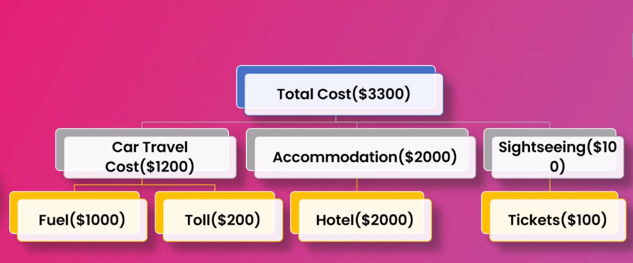
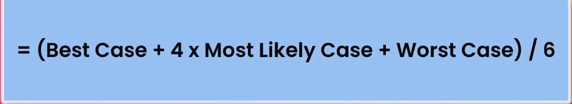

# SDLC(software developement life cycle)

# Section 1

## Software Development

Software development is more than coding it is more like problem solving and automating the task

it consist of 

- Requirement gathering
- Finding solution
- Implement the solution
- Testing
- Deployment
- Maintenance

## Software Engineer

Process of designing creating testing and maintaining software 
it is the systematic approach of development operations and maintaining software 

it is made of agile ,waterfall ,devops ,software designing ,programming ,scrum ,testing ,product management ,version control

all this is interrelated 

## Product Management

it usually means the planning ,coordinating and overseeing the development of the product

it is describe to check for scope schedule budget of the product 

it is a complex process required comm skills leadership problem solving skills understanding of sw

### How project ideas emerges

Need for the organistion 

Gap in the market

Personal requirement 

→ the main goal of this to automate task or to solve a problem 

### After the idea is finalized

The first thing will be checked is whether we have the resources 
with example there is yummy food they want to make their food available online so they will collab with third party it service comapny 
based on the certifications if they will provide required CIA eg of certificates are iso ,iso/iec ,soc 2
company need to change this in time checking the experience of the company check for it has all technology required for the product 

# Section 2

## Types of Software Development

### 1.Front-end

it is the user interaction page from which user can access whatever they want

Front-end should be easily accessible interactive and usable 
it should check how fast work can be done in less time in less clicks
it is also called client side development as well it can be done using 

- js
- css
- html

### 2. Back-end

it is the engine that works behind the doors to make apis database and front-end workable 

it operates creation and maintenance of server side logic that works behind the scene 

it should be scalable efficient and security oriented 

### 3.Application Programming Interface(API)

API allows different software to communicate with each other it acts as a digital glue that connects modern web 

There are two types or a way the APIS are used 

- Architectural Apis
1. REST Api it uses https for get post update delete 
2. SOAP it is old technology that uses xml as communication medium (simple object access protocal) 
3. GraphQl uses the technology to provide only required graphical data it is a query language 
4. gRPC is remote procedure call framework use programming languages to connect via apis 
5. websockets it allows bidirectional real time communication between the server
- Programmatically

 it uses different programming languages to create endpoints among them

### 4.Data Science

data science is the development uses data to understand different goals and objective needs to be done or required to achieve goal

based on understanding of the data we can predict the future aspects we need to know 

it consist of 
- statistical analysis
- programming
- data visualisation
- machine learning
- storytelling

### 5. Mobile-App

it is basically developing different application for mobile platform like ios and android 

it is of two types native and hybrid 
in native the code written for android and ios will be different and it will be ios specific 
whereas in ios it will b single code for ios and android although this cost efficient but the performance will reduce in this type  

### 6. Desktop

installing the individual application on desktop based on requirement but this same thing nowadays we can do via browser 

### 7. Cloud Computing

We cannot store every data on our system as there is risk of memory erase stolen hard disk and all so better keep data on cloud it is sever only that allows use to store our data with proper security 

it uses aws docker kubernatives and many more this techs to work 

### 8. Full-stack

full stack developer is the one who has knowlegde of each and every other development like front-end back-end mobile api etc 

### 9.Game development

creating a game who will have graphic designer programmer producers

programming languages used for this is 
→c++
→unity
→unreal engine

### 10. Embedded system

it is a microprocessor or controller that is used in other devices to perform specific tasks  

c programming is the mostly used for the creating of firmware than assembly language is the other one that is used

### 11. Progressive Web apps

pwa are type of web application only but it is more efficient than native apps 

it uses cache optimally resulting fast less buffer comparatively
it can provide limited  services without internet also where the native apps cant 

accessible over wide range of devices where native apps are particularly work on the given specified devices 
it uses technologies like 
service workers which enables all the services like native app

web apis for apis 

web app manifest is json file that provide meta data of pwa

### 12. open source SWD

open source software is sharing software openly for all user in collaborative manner 

where anyone can view modify changes as per needs 

which could have been done by single individual can work with many with the open source

### 13. Enterprise App

this are the customized app created to help businesses
like for hr tools , project management etc 

### 13.Ecommerce App

it is apps for the online shopping apps 

where we can buy products online track their orders 
it need knowledge of mobile development front end backend database testing etc

### 14.Database management system

it use organize data and also we can efficiently find whatever required in simple queries 
two types of databases

1.relational where everything is organized in tabular form 

2.non relational where data is spread all over eg.internet this are unstructured databses

3.object oriented database where data is stored using oops concept

4.document database where unstructure database is stored 

### 15.AI/ML

it uses algorithm to act like human and perform task there are different modals on which we can train the algorithm to get required automated output 

# Section 3

## Analysis and planning phase of SDLC

it is the identifying and defining the problem that the software product will solve 

defining the requirements and specification for the product 
plan how it will be done 

this consist of 

- high level requirement gathering where determining the requirements and specification software should meet
- feasibility means assessing whether a software project can realistically be developed and successfully implemented
- project scope here it is defined what will be included and what will excluded from the final product
- project plan this includes creating plan to how to use all the resource and can create timelines etc to get required outcome
- risk assesment where checking what kind of risk can trouble project outcome
- cost it shpuld be cost efficient

this block is major block to understand the problem and check what are the requirements and specification and for planning 

we can use use case diagram and flow chart to understand the flow of working how product will work 

creating a project plan where 
schedule table as well to schedule task to complete the project on time

SOW will have all the plans what e will do to launch this project which is statement of work everything will be written into it 

### challenges

1.gathering complete and accurate information 

2.change in requirements

3.understanding complexity and required time

# Section 4

## Cost estimation

there are 4 type of cost estimation

### 1.Bottom-up

it is a technique where the cost is broken down into individual application and then combined together 

it can be time consuming and resource intensive

### 2.Top-down

in this estimating overall cost through high level of understanding and then broke down the cost into simple components 

it may be quick to work with but it will not have all the specific details

### 3.Three point

also called pert method

it uses three estimation for best case most likely and worst where based on data  

it uses the avg formula to understand which case likely to happen 

this helps product manager to understand the project plan better

### 4.Analogous

it will work on the past outcome 

like if u want a eCommerce app and then company will look on to similar projects done in past and the budget it took for different features  

### 5.Parametric

it is made of historical data and statistical model 

relation between cost and project parameter it uses mathematical model and not estimation 

# Section 5

## Requirement gathering phase

collection of the requirement for the software product 

where Requirements are high level statements  which captures details from stakeholders 

this is written in normal natural language

whereas the specifications is more technical and detailed it provides blueprint to the dev team 

mostly written in tech language 

**How Requirements are captured?**

- using elicitation techniq
- engage stakeholders
- user persona
- user stories
- analyse and validdate requirement

requirements will be basically the functionality provided by stakeholders how it should be

non functional feasibility and all 

user interaction 

system and business requirements

SRS software Requirement and Specification document consisting of every interaction defined and will be signed by stakeholder to move forward with project

# Section 6

## UML-unified Modelling language