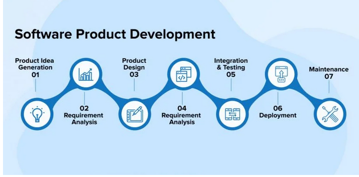
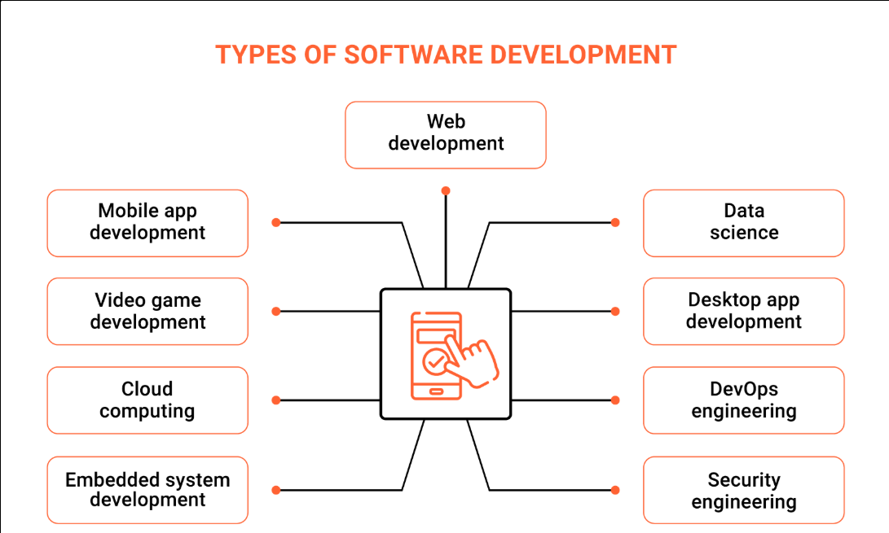
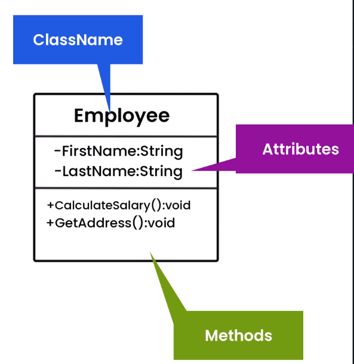
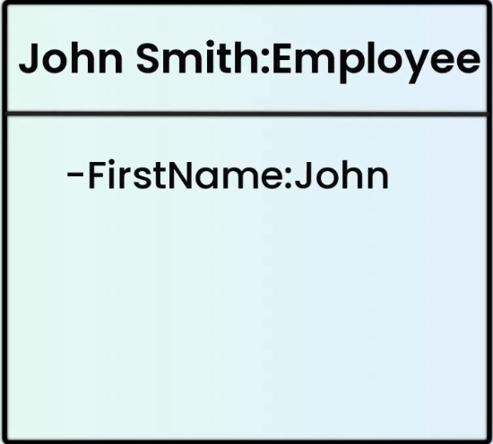
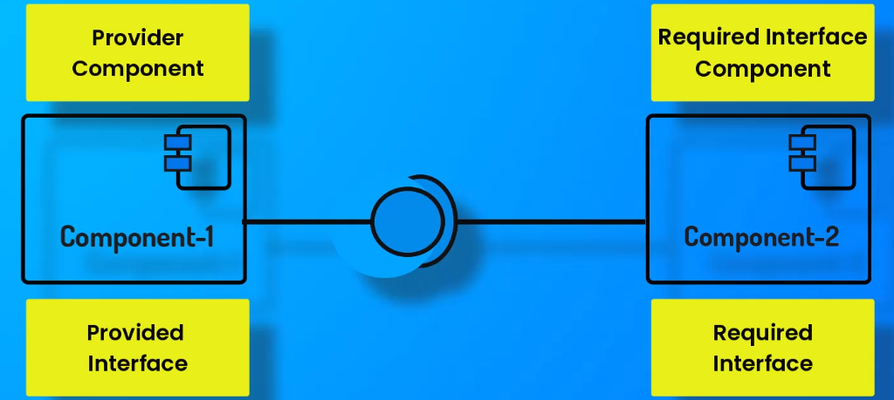
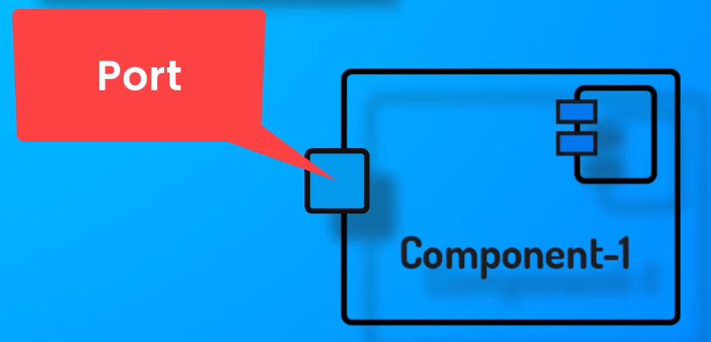
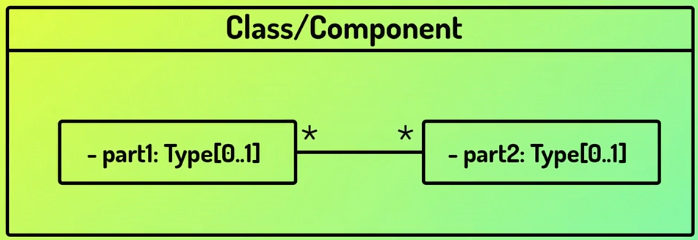
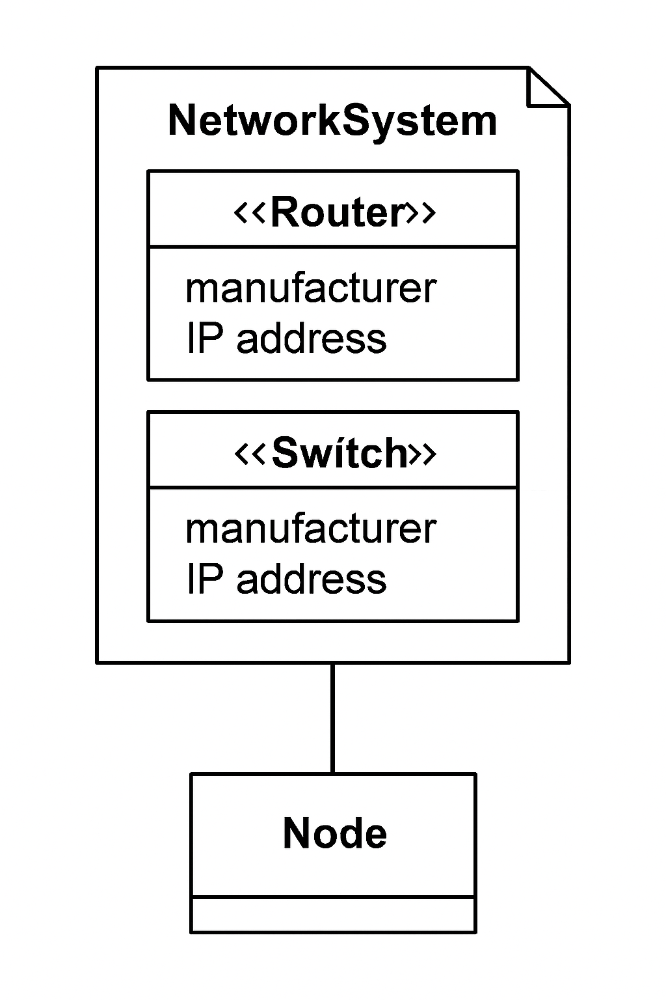

# SDLC (Software Development Life Cycle)

---

## Section 1

### 🔹 Software Engineer

- A **software engineer** is responsible for designing, creating, testing, and maintaining software.
- The role involves a **systematic approach** that includes development, operations, and continuous maintenance.
- Key methodologies and practices such as **Agile, Waterfall, DevOps, Scrum, Software Design, Programming, Testing, Product Management, and Version Control** are all interconnected to make the software development process effective.

---

### 🔹 Software Development

- Software development is more than just **writing code**; it is essentially about **problem-solving and automating tasks**.
- The process typically consists of:
    - Requirement gathering
    - Finding solutions
    - Implementing the solution
    - Testing the software
    - Deploying it for users
    - Maintaining and upgrading the system

---

### 🔹 Product Management

- **Product management** refers to planning, coordinating, and overseeing the development of a software product.
- It involves checking the **scope, schedule, and budget** to ensure successful delivery.
- Strong communication, leadership, and problem-solving skills are essential for a product manager.

**How project ideas emerge:**

- Need within an organization
- Gap in the market
- Personal requirements
- Ultimately, the goal is to **automate tasks or solve a specific problem**.

**After finalizing the idea:**

- The first step is to check for **resources and feasibility**.
- Example: If a company like *Yummy Food* wants to go online, they may collaborate with an IT service company.
- Before collaboration, certifications like **ISO, ISO/IEC, SOC 2** are checked along with company expertise, technology availability, and relevant experience.

---

## Section 2

### 🔹 Types of Software Development

1. **Front-End Development**
    - Focuses on the **user interface and experience** (client-side).
    - Should be **accessible, interactive, and efficient**, ensuring tasks can be completed quickly with minimal clicks.
    - Uses technologies like **HTML, CSS, JavaScript**.
2. **Back-End Development**
    - Manages **server-side logic, APIs, and databases**.
    - Ensures scalability, efficiency, and security.
    - Acts as the “engine” that powers the front-end.
3. **API Development**
    - APIs act as **digital glue** that connects different software systems.
    - Two ways of use: **Architectural APIs** (REST, SOAP, GraphQL, gRPC, WebSockets) and **Programmatic APIs** (built using different programming languages).

    

4. **Data Science Development**
    - Uses data to derive insights, predict outcomes, and make decisions.
    - Involves **statistical analysis, programming, data visualization, machine learning, and storytelling**.
5. **Mobile App Development**
    - Builds applications for iOS and Android.
    - Two types: **Native apps** (separate codebases for iOS & Android) and **Hybrid apps** (single codebase but reduced performance).
6. **Desktop Development**
    - Applications installed directly on desktops.
    - Many such functions are now accessible via web browsers.
7. **Cloud Computing Development**
    - Stores data securely on the **cloud instead of local devices**.
    - Uses technologies like **AWS, Docker, Kubernetes**, ensuring scalability and security.
8. **Full-Stack Development**
    - A full-stack developer has knowledge of both **front-end and back-end development**, along with APIs, databases, and mobile technologies.
9. **Game Development**
    - Involves **graphics design, programming, and production**.
    - Technologies used: **C++, Unity, Unreal Engine**.
10. **Embedded Systems Development**
    - Development of software for **microprocessors and microcontrollers** embedded in devices.
    - Languages commonly used: **C and Assembly**.
11. **Progressive Web App (PWA) Development**
    - PWAs combine the best of web and native apps.
    - They work offline, load faster, and are accessible across devices.
    - Use **service workers, web APIs, and web app manifests**.
12. **Open Source Development**
    - Involves building software that is **openly shared, modifiable, and collaborative**.
    - Encourages community contributions.
13. **Enterprise App Development**
    - Focuses on creating custom apps for businesses, such as **HR tools or project management apps**.
14. **E-commerce App Development**
    - Specialized apps for **online shopping, order tracking, and payments**.
    - Requires expertise in mobile, front-end, back-end, database, and testing.
15. **Database Development**
    - Organizes and manages data efficiently.
    - Types:
        - Relational (tabular format)
        - Non-relational (unstructured, internet-scale)
        - Object-oriented (uses OOP principles)
        - Document databases (for unstructured data)
16. **AI/ML Development**
    - Involves building models that can **mimic human intelligence**.
    - Uses algorithms and training data to perform automated tasks and predictions.

---

## Section 3

### 🔹 Analysis and Planning Phase of SDLC

- This phase identifies the **problem** the software will solve and defines **requirements and specifications**.
- It involves:
    - **High-level requirement gathering** to define features.
    - **Feasibility analysis** to check if the project is realistic.
    - **Project scope** to define inclusions and exclusions.
    - **Project plan** with timelines and resource allocation.
    - **Risk assessment** to identify possible hurdles.
    - **Cost considerations** for efficiency.
- Tools such as **use case diagrams and flowcharts** help in understanding workflow.
- A **Statement of Work (SOW)** documents the project plan, schedule, and scope.

**Challenges:**

1. Gathering complete and accurate information
2. Changes in requirements
3. Estimating time for complex projects

---

### Real-Life Example: Food Delivery App

- **Requirements:** Restaurant listings, food ordering, payments, tracking.
- **Feasibility:** Check GPS integration, budget, delivery partner availability.
- **Scope:** In – user app, restaurant dashboard, delivery app, admin panel. Out – drone delivery.
- **Plan:** 6 months for MVP, small dev team with testers & PM.
- **Risks:** Partner delays, peak traffic issues, payment downtime.
- **Cost:** Dev ₹20L, infra ₹5L/year, marketing ₹10L.

---

## Section 4

### 🔹 Cost Estimation Methods

1. **Bottom-up Estimation**
    - Breaks down costs into smaller components and combines them.
    - Accurate but time-consuming and resource-intensive.

    

2. **Top-down Estimation**
    - Estimates overall project cost at a high level and then divides into components.
    - Faster but less detailed.
3. **Three-point Estimation (PERT Method)**
    - Considers **best-case, most likely, and worst-case** scenarios.
    - Uses averaging to identify realistic expectations.

    

4. **Analogous Estimation**
    - Uses **historical data** from similar projects for cost prediction.
    - Example: Using past e-commerce app budgets to estimate a new one.
5. **Parametric Estimation**
    - Based on **historical data and statistical models**.
    - Relates cost with project parameters using mathematical models.

---

## Section 5

### 🔹 Requirement Gathering Phase

- **Requirements** → What the customer *wants* (simple language).
- **Specifications** → How developers will *build it* (technical details).

**How requirements are captured:**

- Stakeholder meetings, surveys, interviews
- User personas (who will use it)
- User stories (what they need)
- Validation with stakeholders

**Types of requirements:**

- **Functional:** What the system does → *“App should allow users to order food.”*
- **Non-functional:** Quality → *“Orders must be processed in < 3 sec.”*
- **System/Business:** Broader → *“App must support iOS & Android.”*

---

###  Real-Life Example: Online Shopping App

- A business wants an app for **clothes shopping**.
- **Functional:** App should have *search bar, cart, payments*.
- **Non-functional:** App should load in *under 2 seconds*.
- **System:** Must support *UPI & card payments*.
- **Business:** Should handle *10,000 users during sales*.

 All requirements are documented in an **SRS (Software Requirement Specification)**, which the client signs before development starts.

---

## Section 6

### 🔹 UML (Unified Modeling Language)

- UML is a **standardized modeling language** used to visualize, specify, construct, and document software systems.
- It helps in representing **workflows, system design, and interactions** through diagrams like **use case, class, sequence, and activity diagrams**.

## Types of diagrams

%202541b364d39780018157cca2823a0ac9/image.png)

### Structure Diagrams

Structure diagrams illustrate the **static aspects** of a system—how elements relate to each other at rest.

1. **Class Diagram**
    - Shows classes, their attributes, operations, and relationships. Central for object-oriented design.
2. **Object Diagram**
    - Snapshot of instances (objects) in a system at a particular moment; shows example data structures.
3. **Component Diagram**
    - Depicts the logical components/modules, their interfaces, and dependencies, supporting modular design.
4. **Composite Structure Diagram**
    - Breaks down internal structure of classes (classifiers) and collaborations.
5. **Deployment Diagram**
    - Models the runtime deployment of software (artifacts) onto hardware nodes.
6. **Package Diagram**
    - Shows how model elements are grouped into packages and inter-package dependencies.
7. **Profile Diagram**
    - Allows customization of UML models by specifying stereotypes, tagged values, and constraints.

---

### Behavior Diagrams

Behavior diagrams illustrate the **dynamic aspects** of a system—how it behaves and interacts over time.

1. **Activity Diagram**
    - Represents workflows and activities (like a flowchart showing process logic).
2. **Use Case Diagram**
    - Models functionality from a user's perspective, showing actors and their interactions with the system.
3. **State Machine Diagram**
    - Shows lifecycle of an object, the states it goes through, and what triggers transitions.

---

### Interaction Diagrams (Sub-type of Behavior Diagrams)

Interaction diagrams focus on how components or objects collaborate and exchange messages.

1. **Sequence Diagram**
    - Shows object interactions arranged in a time sequence (who calls whom and in what order).
2. **Communication Diagram** (formerly Collaboration Diagram)
    - Emphasizes relationships between objects and the messages they pass.
3. **Interaction Overview Diagram**
    - Mixes elements from activity and sequence diagrams to give a high-level view of control flow.
4. **Timing Diagram**
    - Focuses on the timing constraints and changes in state or condition of objects over time.

### Tools used for creating such diagrams

- **Visual Paradigm:**
    
    A comprehensive UML tool supporting all UML diagram types. Provides powerful modeling, code generation, and collaboration features.
    
- **StarUML:**
    
    Open-source UML modeling tool supporting UML 2.x standards. Allows easy diagram creation with extensibility through plugins.
    
- **Lucidchart:**
    
    Web-based diagramming tool offering intuitive drag-and-drop UML diagram creation with real-time collaboration.
    
- **Draw.io (Diagrams.net):**
    
    Free, web-based diagramming tool supporting UML diagrams. Integrates with cloud storage and has offline capabilities.
    
- **Enterprise Architect (Sparx Systems):**
    
    A powerful commercial UML modeling and design tool used for enterprise-level projects with extensive features in modeling, simulation, and documentation
    

### Class Uml diagram

1. **Class**
    - Represents a blueprint or template for objects (instances).
    - Depicted as a rectangle divided into three compartments:
        - **Top compartment:** Contains the class name (centered, bold, first letter capitalized)
        - **Middle compartment:** Lists the attributes (properties/data members) of the class
        - **Bottom compartment:** Lists the operations (methods/functions) the class can perform.
2. **Attributes**
    - Describe the properties or data of the class.
    - Usually shown with visibility (+ public, - private, # protected), name, type, and optionally default values or multiplicity,
3. **Operations (Methods)**
    - Describe the behavior or functions of the class.
    - Include visibility, method name, parameters, and return type.
4. **Relationships Between Classes**
    - **Association:** General "uses-a" relationship indicating interaction.
    - **Aggregation:** A "has-a" relationship where parts can exist independently.
    - **Composition:** Stronger "has-a" where parts cannot exist without the whole.
    - **Inheritance (Generalization):** "Is-a" relationship where a subclass inherits from a superclass.
    - **Realization:** Implementation of an interface by a class.
    - **Dependency:** Represents a "uses" relationship where one class depends on another.
5. **Visibility Notations**
    - Symbols indicating access level:
        - **`+`** Public (accessible everywhere)
        - **`-`** Private (within class only)
        - **`#`** Protected (within class and subclasses)
        - **`~`** Package (within package/module).
        
        
        

---

### Purpose of a UML Class Diagram

- Helps visualize the static structure of an application by showing how classes relate.
- Facilitates communication among developers and stakeholders.
- Serves as a blueprint for coding and design.
- Useful for both conceptual modeling and detailed design of object-oriented systems.

### Object uml diagram

it is the snapshot taken at some instance of a time

### Key Characteristics of UML Object Diagrams

- **Objects:** Represent specific instances of classes. Each object is shown as a rectangle containing the object name and class name
- **Attributes:** Objects display attribute values at the time the snapshot is taken, showing the object's state.
- **Links:** Represent relationships between objects, which are instances of associations defined in class diagrams.
- **Purpose:** Used to visually illustrate how objects interrelate, to verify class diagrams, understand system behavior at runtime, or model examples/test cases.

### Differences from Class Diagrams

- Class diagrams show the blueprint with classes, attributes, operations, and static relationships.
- Object diagrams show instantiated objects with actual data values and current links at a point in time.
- Object diagrams provide a concrete "snapshot" view of the system's structure during execution.

### Component uml diagram

It is a structural diagram used to visualize the organization, modular parts (components), and relationships within a software system

1. **Component**
    - Represents a modular part of the system encapsulating functionality.
    - Can be a software module, collection of classes, or subsystem.
    - Shown as a rectangle with the stereotype **`<<component>>`** or with a small component icon.
2. **Interfaces**
    - Define a set of operations that components provide or require.
    - **Provided Interface:** Services a component offers, shown as a "lollipop" circle attached to the component.
    - **Required Interface:** Services needed by a component, shown as a "socket" (half circle) that connects to a provided interface.
    
    
    
3. **Ports**
    - Interaction points on the boundary of a component where interfaces are accessed. Represented as small squares on the component boundary

4.**Relationships and Connectors**

- Dependency (dashed arrow): One component relies on another.
- Association (solid line): Permanent relationship between components.
- Assembly Connector: Connects a required interface of one component to a provided interface of another, showing communication paths.

### Package uml diagram

Package Diagram is a type of structural diagram used in UML to visualize the organization and grouping of model elements such as classes, interfaces, components, and other packages within a system

### **Key Components of Package Diagrams**

- **Package:**
    
    A container for related UML elements like classes, interfaces, or even other packages. Depicted as a tabbed folder icon with the package name on it.
    
- **Packageable Element:**
    
    Individual elements inside a package, such as classes or components.
    
- **Dependencies:**
    
    Directed relationships showing how one package depends on or influences another. Dependencies are illustrated with dashed arrows.
    
- **Package Import:**
    
    A relationship where one package imports the contents of another, indicated by a dashed arrow with an open arrowhead.
    
- **Package Merge:**
    
    Indicates that the contents of one package are merged with another to combine their elements.
    

---

### Deployment uml diagram

Deployment Diagram is a structural diagram that illustrates the physical deployment of software components on hardware nodes.

### Key Components of a UML Deployment Diagram

- **Nodes:**
    
    Represent physical hardware or software execution environments where artifacts are deployed, such as servers, workstations, routers, or virtual machines. Nodes are depicted as three-dimensional boxes or cubes.
    
- **Artifacts:**
    
    Physical files or software components deployed on nodes, including executable files, libraries, databases, or configuration files. Artifacts are usually shown as rectangles with a folded corner or cylinder icons.
    
- **Relationships:**
    - **Dependencies:** Dashed arrows indicating that one artifact relies on another.
    - **Associations:** Solid lines showing deployment relationships between nodes and artifacts or between nodes.
    - **Communication Paths:** Lines representing communication links like network connections between nodes.
- **Deployment Specifications:**
    
    Details about hardware and software setup, including configurations and interaction protocols.
    

---

### Example Use Case

A deployment diagram for a web application might show:

- A Web Server Node hosting the web application artifact.
- An Application Server Node hosting business logic components.
- A Database Server Node where the database artifact is deployed.
- Communication paths between the web server, application server, and database server nodes.

## Composite uml diagram

Composite Structure Diagram is a type of structural UML diagram that shows the internal structure of a classifier (such as a class, component, or deployment node) and the interactions between its parts at runtime

### Key Components of a Composite Structure Diagram

- **Structured Classifier:**
    
    A classifier like a class or component that contains internal parts and ports.
    
- **Parts:**
    
    Instances or roles of classes that are contained within the structured classifier. Parts represent the building blocks that make up the internal structure.
    
- **Ports:**
    
    Interaction points on the boundary of a classifier or part, through which communication with other parts or the environment occurs. Ports may specify provided or required interfaces.
    
- **Connectors:**
    
    Links or communication pathways that connect parts or ports, allowing interactions among them.
    

## Example Scenario

Imagine a **Smartphone** as a class (structured classifier). Inside this class, there are several parts working together:

- **Screen** (part: handles display)
- **Battery** (part: supplies power)
- **Processor** (part: runs apps and system)
- **Camera** (part: takes photos)

Each part communicates with one another through connectors:

- The **Processor** connects to the **Screen** to display images.
- The **Processor** connects to the **Battery** to get power.
- The **Processor** connects to the **Camera** to capture photos.

Ports represent interaction points on the smartphone where other devices or users can interact, like:

- A **Charging Port** connected to the battery for charging.
- A **Headphone Port** connected to the processor for audio output

## Profile uml diagram

A Profile Diagram in UML is a specialized structural diagram used to extend and customize the standard UML language to fit specific domains, platforms, or methodologies. It provides a mechanism to add new building blocks, properties, and semantics tailored to particular needs without changing the core UML metamodel.

### Key Concepts of Profile Diagrams

- **Profile:**
    
    A package that contains a set of extensions (stereotypes, tagged values, constraints) aimed at customizing UML for a specific domain or platform.
    
- **Stereotypes:**
    
    Custom model elements derived from existing UML elements but with additional semantic meaning. They are shown with guillemets (<< >>), such as **`<<Entity>>`** or **`<<Service>>`**. Stereotypes can add domain-specific properties and graphical symbols to UML elements.
    
- **Metaclasses:**
    
    Standard UML elements (like Class, Component, Interface) that the stereotypes extend or customize.
    
- **Tagged Values:**
    
    Attributes added to stereotypes to hold additional data or properties specific to the customization.
    
- **Constraints:**
    
    Rules and conditions applied to stereotypes or model elements, often expressed in Object Constraint Language (OCL), to enforce correct usage.
    

### Example

Suppose you are modeling a network system and want to represent network-specific elements like routers or switches:

- Define stereotypes like **`<<Router>>`**, **`<<Switch>>`** that extend the UML **`Node`** metaclass.
- Add tagged values such as **`manufacturer`** or **`IP address`** to these stereotypes.
- Use these stereotypes in your model to clearly indicate network components with domain-specific semantics.

## Use case uml Diagram

A Use Case Diagram in UML is a behavioral diagram that illustrates the functional requirements of a system from the user's perspective. It shows how different types of users (actors) interact with the system to achieve specific goals (use cases)

### Key Elements of Use Case Diagrams

- **Actors:**
    
    Represent users or external systems interacting with the system. Depicted as stick figures or named roles outside the system boundary.
    

1. Primary Actor

- The main user or external entity that initiates an interaction with the system to achieve a goal.
- Usually a human user but can also be an external system.

2. Secondary Actor

- An actor that provides a service or support to the system or primary actor.
- They are not the initiators but assist in completing the use case (e.g., a payment gateway in an e-commerce system).

- **Use Cases:**
    
    Represent functionalities or services provided by the system. Displayed as ovals inside the system boundary labeled with the use case name.
    

**1.**Business Use Case

- Represents a business process that the organization performs, often capturing high-level goals beyond a single system.
- Focuses on organizational-level interactions rather than software system specifics.

- **System Boundary:**
    - A rectangle that defines the scope or boundary of the system being modeled.
    - Use cases reside inside this boundary, showing what the system does, while actors remain outside.

## Activity uml diagram

An Activity Diagram in UML is a behavioral diagram that models the workflow or the sequence of activities and actions in a system or process. It is similar to a flowchart and is used to represent the dynamic aspects of the system, focusing on the flow of control or data.

### Key Components of Activity Diagrams

- **Activity (Action):**
    
    Represents a single step or task in the process, depicted as a rounded rectangle.
    
- **Initial Node:**
    
    Indicates the starting point of the workflow, shown as a filled black circle.
    
- **Final Node:**
    
    Marks the end of the workflow, shown as a filled black circle surrounded by an outer circle.
    
- **Decision Node:**
    
    Represents a branching point where the flow diverges based on conditions, shown as a diamond shape.
    
- **Merge Node:**
    
    Combines multiple alternative flows back into one, also shown as a diamond shape.
    it does not wait both incoming side to come together and doesnt synchronize them
    
- **Fork Node:**
    
    Splits the flow into concurrent parallel paths, depicted as a thick horizontal or vertical bar.
    
- **Join Node:**
    
    Synchronizes parallel paths back into one, also a thick bar.
    it wait for both incoming nodes and synchronize them
    
- **Control Flow:**
    
    Arrows showing the direction of flow from one activity to another.
    
- **Object Flow:**
    
    Arrows depicting the flow of objects or data between activities.
    
- **Swimlanes:**
    
    Vertical or horizontal partitions that represent different actors, departments, or systems responsible for performing actions.
    

### Example Use Case: Online Order Processing

- Initial Node → Browse Products → Add to Cart → Place Order → Decision (Payment Method: Credit Card or PayPal) → Payment → Final Node.

