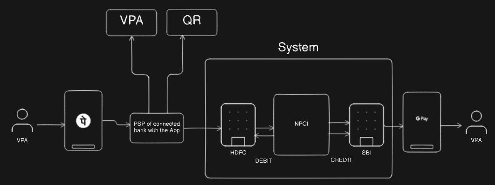
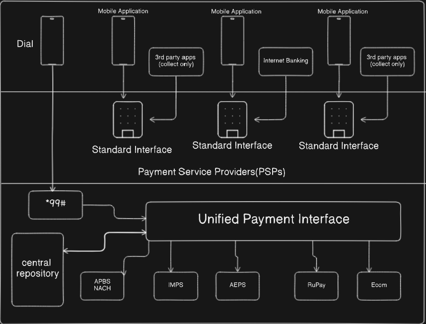

# UPI

The UPI (Unified Payments Interface) system design works as a real-time inter-bank payment system that enables instant fund transfer between bank accounts via mobile or web interfaces, orchestrated by the National Payments Corporation of India (NPCI). The core design includes user interfaces (mobile apps, web, USSD), a centralized UPI switch managed by NPCI that routes transaction requests between banks, and backend banking systems that verify account details, balances, and complete settlements securely and instantly.

## Problem Statement

The problem statement of UPI was to solve the fragmentation, complexity, and limited reach of digital payment systems in India, which hindered financial inclusion and the widespread use of cashless transactions. Before UPI, digital payments were slow, costly, and lacked interoperability across banks and platforms. UPI was created to provide a simple, instant, secure, and interoperable payment platform accessible 24/7 via mobile devices, reducing dependence on cash and physical cards while enabling easy peer-to-peer and merchant payments across the country.

## Key Components

## 1. User Interface (Mobile & Web Applications)

- This is the front-end platform where users interact with UPI services, typically via smartphone apps like Google Pay, PhonePe, or bank-specific apps.
- It provides features like creating Virtual Payment Addresses (VPA), initiating send/receive payments, scanning QR codes, viewing transaction history, and managing profiles.
- The UI ensures a seamless, user-friendly experience with secure input of credentials, PIN, or biometric authentication.

---

## 2. Payment Service Providers (PSPs)

- PSPs are banks or authorized fintech entities that facilitate routing of UPI transactions for their customers.
- They handle user registration, account linking, authentication, transaction validation, and communication with the UPI central switch.
- PSPs ensure compliance with banking regulations, maintain user account data, and manage transaction processing on behalf of the bank’s customers.

---

## 3. UPI Central Switch (Managed by NPCI)

- The core of the UPI ecosystem, the NPCI-operated central switch routes all transaction requests between payer and payee PSPs in real time.
- It provides services like transaction authorization, message routing, settlement instruction generation, and reconciliation between banks.
- The switch ensures interoperability, enabling transactions across any two PSPs in the network, regardless of the app or bank.

---

## 4. Banking Backend Systems (Issuer and Acquirer Banks)

- **Issuer Bank:** The payer’s bank, responsible for verifying account balance, debiting the transaction amount, and sending transaction confirmation.
- **Acquirer Bank:** The payee’s bank, responsible for crediting the beneficiary’s account upon transaction approval.
- Both bank cores work with the UPI switch to update accounts securely and reconcile transaction data.

---

## 5. Security Modules

- These modules enforce security protocols across the UPI ecosystem by implementing end-to-end encryption, multi-factor authentication (MPIN, biometrics), and device binding.
- They continually monitor for suspicious activity using real-time fraud detection systems and ensure transaction integrity.
- Compliance modules ensure adherence to regulatory security standards such as PCI-DSS and data protection laws.

---

## 6. Notification and Alert Systems

- This component sends real-time transaction alerts, OTPs, and security notifications to users via SMS, email, or in-app messaging to enhance transparency and security.

---

## 7. Settlement and Clearing Systems

- Backend systems like IMPS, NACH, AEPS, and others are integrated for the final settlement of funds between banks, ensuring instant or batch-wise clearing based on transaction type.

## Functional Requirements

- **User Registration and Authentication:** Users must register and securely authenticate using PIN or biometrics to access UPI services.
- **Bank Account Linking:** Users can link multiple bank accounts to their UPI ID for seamless transactions.
- **Virtual Payment Address (VPA) Management:** Create and manage VPAs to make payments without sharing bank details.
- **Money Transfer:** Supports peer-to-peer and merchant payments instantly via UPI.
- **Transaction History:** Users can view past transactions with details like status and timestamps.
- **Notifications:** Real-time alerts for payment success, failure, or requests ensure users stay informed.
- **Payment Requests:** Users can request money from others easily through UPI.
- **QR Code Payments:** Generate and scan QR codes for quick, contactless payments.
- **Bill Payments:** Support for paying utility bills and recurring expenses through UPI.

## Non-Functional Requirements

- **Scalability:** Must handle millions of users and huge transaction volumes efficiently.
- **Performance:** Process transactions with low latency for instant payments.
- **Reliability:** Ensure continuous availability with failover and minimal downtime.
- **Security:** Implement strong encryption, multi-factor authentication, and fraud detection.
- **Consistency:** Guarantee transaction accuracy and prevent duplicates or errors.
- **Compliance:** Follow regulatory guidelines and protect user data privacy.
- **Usability:** Provide a simple, user-friendly interface accessible to all user types.

## UPI Capacity Estimation

- **Users:** Around 100 million registered users with about 10 million daily active users.
- **Transactions:** Roughly 50 million transactions per day with an average of 5 transactions per user daily.
- **Data Volume:** Each transaction averages about 500 bytes, resulting in approximately 25 GB of data generated daily, scaling to around 9 TB annually.
- **Peak Load:** Peak transaction rates can reach up to 7,000 transactions per second, requiring systems to handle high concurrency with low latency.
- **Server Requirements:** To process peak loads efficiently, hundreds to thousands of servers are deployed for API gateways and backend processing to support up to hundreds of thousands of requests per second.

## High Level Diagram

Here’s a step-by-step explanation of each component and step in the process:

## Step 1: User Initiation with VPA

- The **sender** initiates a payment request using their chosen UPI app (such as PhonePe or GPay) and enters the recipient’s Virtual Payment Address (VPA) or scans a QR code for payment.
- The VPA acts as a unique identifier for the recipient without sharing sensitive bank details.

## Step 2: PSP (Payment Service Provider) Processing

- The sender's UPI app connects with the **PSP (Payment Service Provider)**, which could be the bank supporting the user's app.
- Here, the PSP validates the user's VPA/QR, checks account linkage, and prepares the transaction request.

## Step 3: Routing to Issuer Bank (e.g., HDFC)

- The transaction is forwarded from the PSP to the sender’s **issuer bank** (e.g., HDFC for debit).
- The issuer bank verifies the sender’s account, checks for sufficient funds, and authorizes the transaction debit.

## Step 4: Transaction Routing via NPCI

- The validated transaction is routed to the **NPCI (National Payments Corporation of India)**, which operates the UPI infrastructure.
- NPCI acts as a clearinghouse, forwarding the request, ensuring security, and managing transaction logs.

## Step 5: Forwarding to Beneficiary Bank (e.g., SBI)

- NPCI routes the payment request to the **beneficiary’s bank** (e.g., SBI for credit).
- The beneficiary bank verifies the recipient’s VPA/account and processes the credit for the transaction.

## Step 6: Credit Confirmation to Recipient

- Once the funds are credited, the beneficiary’s PSP (connected with the recipient’s UPI app, e.g., GPay) updates the transaction status.
- The recipient is notified via app notification, and funds are immediately available in their account.

## Step 7: End User Receives Money

- The **recipient** receives the credited funds, visible both within the GPay app and in the linked bank account, completing the UPI transaction lifecycle.

## Low Level Diagram

## 1. User Access Channels

- **Mobile Application**: Users initiate or receive payments via UPI-enabled banking/third-party apps (e.g., PhonePe, Google Pay). These apps offer endpoints for sending, receiving, and requesting money using the UPI rails.
- **3rd Party Apps (Collect Only)**: Billers, merchants, or service providers use these apps only to generate “collect” requests. They can’t send payments but can request money for bills or services.
- **Internet Banking**: UPI access is also integrated into bank internet portals, letting users perform UPI actions via desktops/laptops.
- **Dial**: Users without internet/smartphones can dial *99# (USSD) from basic mobile phones, entering payment instructions directly.

---

## 2. Standard Interface/PSPs (Payment Service Providers)

- All types of client apps interact with their bank (or sponsoring institution) through a standardized API/interface. The standard ensures interoperability—any UPI app can transact with any bank that is a PSP.
- **Usage:**
    - Authenticates user credentials and verifies linked accounts.
    - Interprets and validates UPI payment requests (including P2P, collect, bill payments).
    - Handles session, PIN entry, VPA management, and user notifications.
    - Communicates requests and responses reliably with the central UPI switch.

---

## 3. Unified Payments Interface (Central Switch/System)

- This is the heart of the ecosystem, managed by NPCI.
- **Usage:**
    - Routes all interoperable payment instructions between issuing and beneficiary PSPs (banks/apps).
    - Handles end-to-end authorization, settlement initiation, status tracking, and notification updates.
    - Ensures security, maintains transaction logs, and supports regulatory reporting.
    - Integrates with multiple backend payment channels and services.
    - Ensures all players (banks, fintech, billers, users) talk in a “unified language” for seamless digital payments.

---

## 4. Backend Payment Rails and Ancillary Services

### 1. IMPS (Immediate Payment Service)

- **Purpose:** IMPS enables instant, real-time fund transfers between bank accounts across India, 24/7.
- **Role in UPI:** UPI often uses IMPS as the underlying settlement engine for the fast transfer of money between the payer's and payee's bank accounts in real time.
- **Capabilities:** Supports immediate debit and credit operations with confirmation delivered within seconds.
- **Usage:** Ideal for small to medium-value transactions, ensuring funds are available instantly to recipients, making UPI payments seamless.

---

### 2. AEPS (Aadhaar Enabled Payment System)

- **Purpose:** AEPS allows basic banking transactions using Aadhaar biometric authentication, targeted especially for financial inclusion.
- **Role in UPI:** UPI integrates AEPS to support transactions authenticated through Aadhaar biometrics, helping rural and underbanked populations transact digitally.
- **Capabilities:** Supports balance enquiry, cash deposit, withdrawal, and fund transfer via biometric-enabled banking outlets.
- **Usage:** Enables customers without smartphones or digital literacy to leverage secure digital payments and banking through biometric verification.

---

### 3. APBS / NACH (Aadhaar Payments Bridge System / National Automated Clearing House)

- **Purpose:** These systems handle bulk, automated, low-value credit transactions like government subsidies, salaries, pensions, and recurring payments.
- **Role in UPI:** UPI connects with APBS/NACH to automate large-scale credit disbursements systematically and integrate such payments into the UPI platform.
- **Capabilities:** Facilitates scheduled bulk payments and direct benefit transfers (DBTs) from government and businesses.
- **Usage:** Ensures timely and direct credit of funds to beneficiaries’ bank accounts via UPI, enhancing government-to-person and business-to-person transfers.

---

### 4. RuPay

- **Purpose:** RuPay is India’s domestic card payment network operating debit, credit, and prepaid card transactions.
- **Role in UPI:** RuPay integration allows UPI to support merchant payments and ATM-like card transactions linked to UPI handles, thus broadening acceptance.
- **Capabilities:** Supports card-on-UBI transactions, e-commerce, and merchant payments where UPI can interface with card credentials.
- **Usage:** Provides an additional channel for digital payments and enables frictionless card-based transactions through the UPI ecosystem.

---

### 5. Ecom (E-commerce Payment Channels)

- **Purpose:** Dedicated channels for handling online payments and settlements with merchants and service providers.
- **Role in UPI:** Supports integration of UPI with e-commerce platforms, allowing instant online checkout experiences.
- **Capabilities:** Handles secure payment authorization, settlement, and refund management for online transactions.
- **Usage:** Enables customers to pay with UPI for online shopping, bill payments, subscriptions, and service bookings instantly.

---

## 5. Central Repository

- Stores master user records: account linkage, authentication tokens, VPA mappings, and transaction histories.
- Provides a source of truth for verifying identities, resolving disputes, tracing payments, and supporting audits.
- Integrates with payment rails and UPI core for data consistency across the entire digital ecosystem.

---

## Security

## 1. End-to-End Encryption

- All data transmitted between the user’s device, Payment Service Providers (PSPs), and the NPCI central switch is encrypted using strong cryptographic algorithms (e.g., AES, TLS).
- Encryption ensures that sensitive information such as payment details, authentication credentials, and personal data cannot be intercepted or tampered with during transit.

---

## 2. Multi-Factor Authentication (MFA)

- Users must authenticate each transaction using multiple factors, typically a combination of something they know (UPI PIN) and something they have (registered device).
- Biometric factors such as fingerprint or facial recognition further strengthen authentication security on supported devices.
- OTPs (One-Time Passwords) may be used for sensitive operations or initial registration.

---

## 3. Device Binding and Registration

- UPI apps are securely bound to a registered mobile device during the onboarding process using unique device IDs and SIM linkage.
- Transactions initiated from unregistered devices or unrecognized locations trigger additional verification or are blocked, reducing unauthorized access risks.

---

## 4. Secure PIN Management (MPIN)

- The UPI PIN (Mobile Personal Identification Number) is securely stored and managed only on the user’s device.
- It is never transmitted or stored in plain text on PSP or NPCI servers.
- PIN verification is done locally or via secure trusted execution environments to prevent interception.

---

## 5. Transaction Limits and Controls

- UPI enforces predefined transaction limits (per transaction and daily aggregate) to mitigate risk from fraudulent or accidental large transfers.
- The system can impose dynamic risk-based limits depending on user profile, transaction history, and device reputation.

---

## 6. Real-Time Fraud Monitoring and Analytics

- The system continuously monitors transaction patterns for anomalies, duplicate requests, or suspicious behaviors using AI and machine learning models.
- Suspicious transactions can be flagged for manual review, temporarily blocked, or require additional authentication.

---

## 7. Secure Infrastructure and Practices

- Servers, APIs, and databases operate within hardened infrastructure with network segmentation, firewalls, DDoS protection, and secure coding practices to resist attacks.
- Regular security audits, penetration testing, and compliance checks (e.g., PCI-DSS) are performed to identify and fix vulnerabilities.

---

## 8. Regulatory Compliance and Data Privacy

- UPI aligns with national and international standards for data protection (e.g., India’s IT Act, GDPR where applicable).
- User data is processed and stored securely, with strict access controls and audit trails to prevent unauthorized access or leakage.

---

## 9. Transaction Confirmation and Alerts

- Every transaction triggers immediate alerts to users via SMS or app notifications, enabling quick detection of unauthorized activity.
- Users can promptly report and block cards or accounts if suspicious transactions are detected.

---

## 10. Secure APIs and Standard Protocols

- Communications between UPI entities (PSPs, banks, NPCI) use standardized, secure API protocols ensuring authentication, authorization, and encryption.
- Data integrity checks such as message signing and validation protect against replay attacks or data tampering.

## Challenges

## 1. **Scalability and Performance**

Handling hundreds of millions of users and tens of millions of daily transactions demands constant upgrades to infrastructure to maintain low latency and high availability without failures or downtimes.

## 2. **Security Threats and Fraud**

Phishing, social engineering, SIM swapping, and unauthorized access attempts continue to pose risks, requiring ongoing improvements in fraud detection and user education.

## 3. **System Downtime and Transaction Failures**

Outages due to NPCI system issues or network failures at banks/PSPs can lead to transaction declines, affecting user confidence in reliability.

## 4. **User Awareness and Adoption**

While penetration is high among urban users, rural and less tech-savvy populations still face barriers due to limited smartphone/internet access and digital literacy challenges.

## 5. **Interoperability Complexity**

Integrating thousands of banks, PSPs, apps, and payment rails with consistent performance and security presents significant technical and orchestration complexity.

## Conclusion

In conclusion, the Unified Payments Interface (UPI) represents a transformative, open, and interoperable digital payment infrastructure that has revolutionized how financial transactions occur in India. Its scalable architecture, built on real-time payment rails like IMPS, enables instant, secure, and cost-effective payments across banks and platforms 24/7. UPI's design facilitates ease of use, broad accessibility (including smartphones and feature phones via USSD), strong security, and seamless integration with government and commercial payment systems. Its success lies in enabling multi-party transactability, simplifying authentication, supporting diverse payment methods, and fostering a highly inclusive digital economy. UPI continues to expand globally by adopting open APIs, layered security, and cross-border connectivity, positioning it as a leading model for digital payment innovation worldwide.