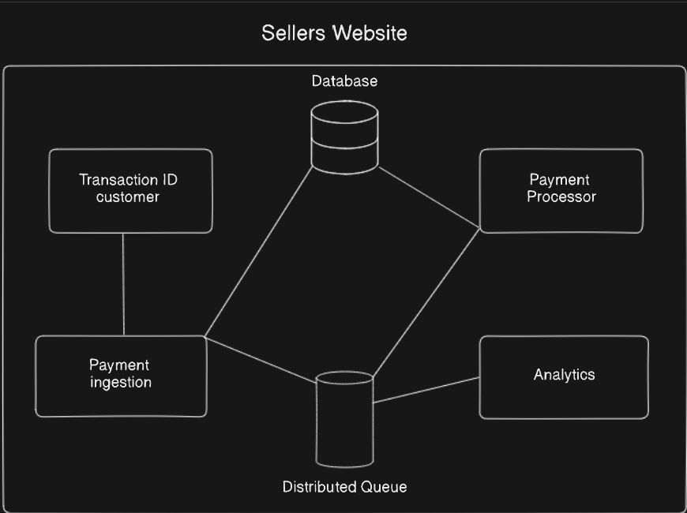
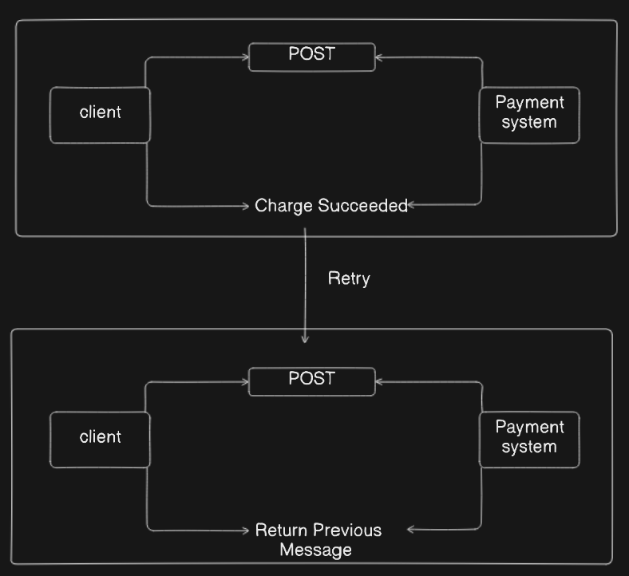

# Online Banking System

An online banking system is a digital platform that enables customers to access and manage their bank accounts over the internet through secure websites or mobile applications. It allows users to perform a wide range of financial activities such as checking account balances, transferring funds, paying bills, applying for loans, and managing investments without physically visiting a bank branch.

## Problem statement

Traditional banking methods required customers to physically visit bank branches for every transaction or service, which was time-consuming, inconvenient, and limited by branch hours and location. This led to long queues, restricted banking access especially in remote areas, higher operational costs for banks, and delays in processing financial activities.

With the increasing internet penetration and digital technology advancements, there was a crucial need for a secure, convenient, and accessible banking platform that operates 24/7, enabling users to perform transactions from anywhere at any time. Online banking emerged to address these challenges by providing instant access to various banking services, reducing dependency on physical branches, enhancing operational efficiency, and promoting financial inclusion.

In essence, online banking was required to modernize banking services, improve user experience, and support the growing demand for digital financial management in a fast-paced world.

## Key Components

## Presentation Layer (Front-end)

- User Interface (UI): The web or mobile app interface where customers and bank employees interact with the system for tasks like balance checks, transfers, and bill payments.
- Notification Service: Delivers alerts and updates to users about transactions, account changes, or system messages.

## Middleware Layer

- Authentication Service: Manages secure user login and authorization, often with multi-factor authentication.
- Integration Framework: Facilitates communication and data exchange between the front-end and backend components, including API management.
- Orchestration Engine: Coordinates various service calls to fulfill complex user requests in a seamless manner.

## Backend Layer

- Core Banking System: Handles fundamental banking functions such as account management, transaction processing, loan management, and payment systems.
- Database Management System (DBMS): Stores all customer data, transaction histories, and account details securely.
- Fraud Detection and Risk Management: Monitors transactions and activities to detect and prevent fraudulent behavior.
- Customer Relationship Management (CRM): Manages customer information, support tickets, and personalized banking services.
- Loan Management System (LMS): Oversees loan application processing, approvals, disbursements, and repayments.
- Logging and Monitoring: Keeps detailed logs for transaction auditing, troubleshooting, and compliance purposes.
- Security Infrastructure: Implements encryption, access control, intrusion detection, and other security protocols to protect data and system integrity.

## Functional Requirements

1. **User Registration and Profile Management**
    
    Users must be able to securely register, create, and manage their profiles, including updating personal information and preferences.
    
2. **User Authentication and Authorization**
    
    The system should verify user identity using passwords, OTPs, or biometrics and authorize access to account features based on user roles.
    
3. **Account Management**
    
    Users should be able to view account balances, transaction history, and manage multiple accounts within the bank.
    
4. **Funds Transfer**
    
    Support for transferring money between accounts (intra- and inter-bank), both immediate (IMPS/RTGS) and scheduled transfers.
    
5. **Bill Payments and Recharge**
    
    Allow customers to pay utility bills, mobile recharges, and other recurring payments seamlessly from their accounts.
    
6. **Transaction History and Statements**
    
    Maintain a detailed record of all transactions and allow users to download or view account statements.
    
7. **Notification Service**
    
    Send timely alerts and notifications for transactions, suspicious activities, account changes, and updates via SMS, email, or in-app messages.
    
8. **Customer Support and Query Handling**
    
    Provide integrated helpdesk or chat support for resolving user issues and responding to queries within the app or web portal.
    

## Non-Functional Requirements

1. **Security**
    
    Ensure data privacy and security through encryption, secure protocols (HTTPS), multi-factor authentication, and fraud detection measures.
    
2. **Performance and Scalability**
    
    System must handle high volumes of simultaneous users and transactions efficiently, maintaining fast response times and scaling as user base grows.
    
3. **Reliability and Availability**
    
    Provide 24/7 uptime with disaster recovery, fault tolerance, and backup solutions to guarantee continual service without downtime.
    
4. **Usability and Accessibility**
    
    Design user-friendly interfaces that are intuitive and accessible to users of all levels, including compliance with accessibility standards (e.g., screen readers).
    
5. **Regulatory Compliance**
    
    Adhere to banking regulations and standards such as KYC, AML, PCI-DSS, and GDPR to ensure lawful operation and data governance.
    
6. **Maintainability and Extensibility**
    
    System architecture must allow easy updates, bug fixes, and addition of new features without disrupting existing services.
    

## Capacity Estimation

Capacity estimation for an online banking system involves analyzing system usage, transaction volumes, and resource requirements to ensure the system can handle expected loads efficiently and reliably. Key factors and metrics used in capacity estimation include:

- **Traffic Volume:** Number of transactions or requests per second (TPS/QPS) and monthly or daily active users. For example, a system handling 100 million transactions per month translates to about 38.5 transactions per second.
- **Transaction Types:** Percentage of transactions that are new user registrations, payments, or other operations, influencing resource consumption.
- **Storage Requirements:** Estimated based on average transaction size and data retention periods. For example, at 7 MB per second, storage could reach 221 TB annually.
- **Concurrency:** The number of simultaneous users the system must support without performance degradation.
- **Performance Metrics:** Response time, error rates, and throughput to maintain user experience and system reliability.
- **Scalability:** The system’s ability to add resources vertically or horizontally to accommodate growth or peak loads.
- **Failure Allowance:** Extra capacity to handle unexpected events like hardware failure or errors, often around 5%.

## High Level Diagram

## Step 1: Transaction Initiation and Generation of Transaction ID

- When a customer buys something on the seller’s website, a unique **Transaction ID** is generated to represent this particular transaction.
- This ID is linked to the customer’s account or identity to track the payment process and status throughout the system.

## Step 2: Payment Ingestion

- The transaction details, including the Transaction ID and customer information, are sent to the **Payment Ingestion** module.
- This component validates the payment data, ensures all required fields are present, and formats the payment request for processing.
- It acts as the entry point to the backend payment processing system.

## Step 3: Writing to Database

- After validation, the Payment Ingestion module writes key transaction details to the **Database** for persistent storage.
- This ensures that transaction records are safely stored and can be queried or audited later.
- The database contains information such as customer data, transaction IDs, payment amount, time, and status.

## Step 4: Enqueuing to Distributed Queue

- The transaction is then pushed to a **Distributed Queue**.
- This queue acts as a messaging system that decouples the ingestion process from downstream services.
- It provides reliability, scalability, and allows asynchronous processing by decoupling producers (Payment Ingestion) and consumers (Payment Processor and Analytics).

## Step 5: Payment Processing

- The **Payment Processor** service consumes the transaction messages from the distributed queue.
- It interacts with external payment gateways or banking APIs to authorize and complete the actual money transfer.
- After receiving a success or failure response, it updates the transaction status in the database accordingly.

## Step 6: Analytics Processing

- Simultaneously, the **Analytics** service also consumes transaction messages from the distributed queue.
- It performs real-time data analysis to generate valuable insights such as sales trends, customer purchase behavior, and fraud detection.
- Analytics may trigger alerts or reports based on this processed data.

## Step 7: Confirmation and Notification (Implicit)

- Though not explicitly shown, typically in such systems, after the Payment Processor completes, the customer and seller receive confirmation notifications.
- These notifications could be delivered via email, SMS, or app alerts, confirming the transaction status.

## Low Level Diagram

## Step 1: Initial Transaction Request

- **Client Initiates Payment**
    - The client (such as a user's browser, mobile app, or backend) sends a POST request to the payment system endpoint.
    - The POST request contains transaction details (amount, customer info, card/bank data, etc.) needed to process the payment.
- **Payment System Processing**
    - The payment system receives the request, validates all transaction information, and attempts to execute the transaction (e.g., crediting the seller, charging the customer’s account).
    - Upon successful charge, the payment system prepares a success response.
- **Charge Succeeded Response**
    - If the payment is processed successfully, the payment system returns a “Charge Succeeded” message in the response to the client.
    - The client receives this response and proceeds (showing confirmation to the user, updating records, etc.).

---

## Step 2: Retry Mechanism If POST Fails or Client Uncertain

- **Client Retry Scenario**
    - For any reason (timeout, network failure, or uncertainty about the result), the client might not receive the success response and decides to retry by sending another identical POST request to the payment system.
    - This scenario is common in distributed systems to ensure a transaction is not lost due to transient failures.
- **Idempotent Handling by Payment System**
    - The payment system receives this duplicate POST request. Good payment systems are designed to recognize repeated requests with the same transaction ID.
    - Instead of re-processing the payment (which would risk double charging), the system performs idem potency checks using the transaction’s unique identifier.
- **Return Previous Message**
    - The payment system returns the previous result/status already associated with that transaction. In this case, it sends back “Charge Succeeded” again, confirming no additional charge was made and the initial transaction was successful.
    - The client can safely process this response without risk of duplicating the transaction or payment.

## Security

## 1. User Authentication and Authorization

- **Multi-Factor Authentication (MFA):** Users must verify identity through multiple factors like passwords, OTPs (one-time passwords), biometrics, or security tokens. This greatly reduces the risk of unauthorized access even if a password is compromised.
- **Strong Password Policies:** Enforcing complex passwords with a mix of uppercase, lowercase, digits, and symbols, and disallowing reuse of old passwords enhances account security.

## 2. Data Encryption

- **Transport Layer Security (TLS):** All communications between client and server are encrypted using SSL/TLS protocols to prevent interception or man-in-the-middle attacks.
- **Database Encryption:** Sensitive data stored in databases such as user credentials, payment details, and transaction histories is encrypted to prevent unauthorized access if storage is compromised.
- **End-to-End Encryption:** Ensures sensitive data like credit card details remain protected from point of entry to the payment processor.

## 3. Secure Payment Processing

- **PCI DSS Compliance:** Online banking systems comply with Payment Card Industry Data Security Standards to securely handle cardholder data and transactions, reducing fraud risks.
- **Tokenization:** Replacing sensitive card details with tokens reduces exposure of actual data during transactions and storage.

## 4. Fraud Detection and Prevention

- **Real-Time Monitoring:** AI-based and rule-based systems monitor transactions for unusual or suspicious activity patterns that could indicate fraud.
- **Behavioral Analytics:** Analyzing customer behavior to flag anomalies and prevent identity theft or account takeover.

## 5. Intrusion Detection and Prevention

- **Firewalls and IDS/IPS:** Systems are protected by firewalls and intrusion detection/prevention systems that monitor and block malicious traffic or attacks.
- **Regular Security Audits:** Penetration testing and vulnerability scanning help identify and fix weaknesses proactively.

## 6. Session and Access Management

- **Automatic Session Timeout:** Sessions are terminated after inactivity to prevent unauthorized use if a user leaves a device unattended.
- **Role-Based Access Control (RBAC):** Only authorized personnel or systems can access sensitive functions or data, minimizing insider risks.

## 7. Customer and Employee Awareness

- **Security Alerts and Notifications:** Customers receive notifications for transactions, login attempts, or changes to security settings, aiding quick detection of unauthorized activity.
- **Employee Training:** Continuous education on cybersecurity practices reduces insider threats and ensures staff can effectively respond to incidents.

## 8. Secure Infrastructure and Compliance

- **Regular Patching and Updates:** Systems are maintained with the latest security patches to prevent exploitation of known vulnerabilities.
- **Legal and Regulatory Compliance:** Adherence to local and international regulations, including GDPR, PCI-DSS, and others to protect customer rights and data.

## Challenges

## 1. Security and Fraud Risks

- Cyberattacks, phishing, hacking, and fraudulent transactions remain significant threats despite advanced security measures.
- Users’ weak security habits (e.g., poor passwords, unsecured networks) increase vulnerability.
- Fraud tactics include vishing, phishing emails or SMS, fake apps, and misuse of digital payment requests.

## 2. Technical Issues and System Downtime

- Unplanned outages, server failures, or network issues cause system unavailability affecting user transactions.
- Downtime reduces customer trust and can lead to financial losses.
- Maintaining system stability at scale while ensuring fast transaction processing is challenging.

## 3. Legacy System Integration

- Many banks operate on outdated core systems that are not compatible with modern technologies.
- Integrating legacy systems with new digital platforms creates complexity and hampers agility.
- This makes transitioning to faster, scalable infrastructure difficult.

## 4. Customer Adoption and Experience

- Some customers prefer traditional banking and may distrust online channels.
- Customers expect fast, seamless, and personalized digital experiences, which can be hard to deliver.
- Automated customer service bots may frustrate users seeking human assistance.

## 5. Compliance and Regulatory Challenges

- Banks must comply with evolving regulations like KYC, AML, data privacy laws, and payment standards.
- Regulatory complexity increases costs and operational risk.

## 6. Data Privacy and Protection

- Protecting customer data from breaches, leaks, and misuse is an ongoing challenge.
- Maintaining strong encryption, access controls, and monitoring is essential.

## Conclusion

an online banking system is a critical and complex digital platform that offers customers convenient and 24/7 access to banking services. While such systems provide immense benefits in terms of accessibility, efficiency, and customer empowerment, they face substantial challenges, especially in the areas of security, technical reliability, and user experience.

Robust security measures—including multi-factor authentication, encryption, fraud detection, and regulatory compliance—are vital to protect sensitive customer data, prevent cyberattacks, and maintain trust. Technical challenges like system downtime, legacy system integration, and scalability must be continuously addressed to ensure seamless and reliable service. Additionally, evolving customer expectations and the complexity of digital transformation pose ongoing operational and strategic difficulties.