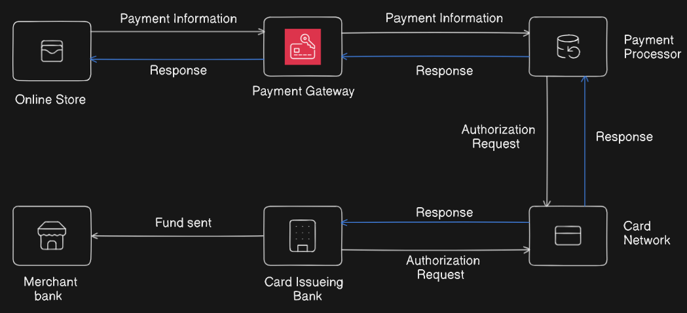
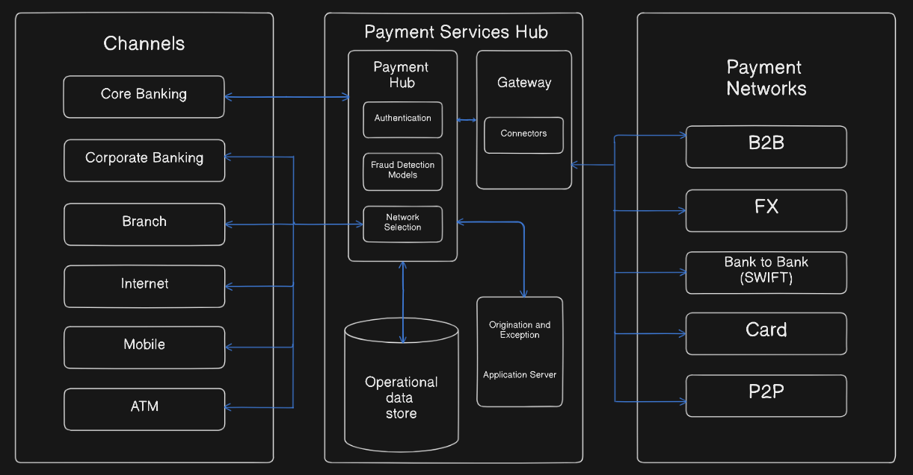

# Payment Gateway

A payment gateway acts as a middle layer, processing payment requests, validating customer details, encrypting sensitive data, transferring funds, and returning payment status updates. Its main purpose is to ensure transactions are fast, reliable, and secure for both the user and the merchant.

## Problem Statement

Payment gateways today often operate within complex, multi-intermediary ecosystems resulting in high transaction fees, delayed settlement, and fragmented user experiences. Challenges include PCI DSS compliance, fraud detection, optimizing authorization throughput, and ensuring global payment method support. Emerging digital payment solutions must integrate instant settlement, minimize operational friction, and enhance transparency while maintaining compliance with payment regulations and adapting to evolving customer expectations.

## Key Components

## 1. User Interaction Layer

**Payment Request Interface**

- The front-end checkout form or page where customers enter their payment details (e.g., credit card, wallet, or net banking credentials).
- Ensures a seamless, intuitive, and secure user experience, often embedded as an iframe, pop-up, or full merchant page.

**API/SDK Integration**

- Provides well-documented application programming interfaces (APIs) and software development kits (SDKs) that allow merchants or platforms to securely connect their applications/websites with the payment gateway.
- Handles communication, data transfer, and formatting for different transaction types.

---

## 2. Core Processing Layer

**Transaction Routing**

- Validates the payment details and routes transaction data to the appropriate card networks, acquiring banks, or processors for further authorization.
- Handles logic for payment method selection (e.g., cards, UPI, wallets), currency conversion, and geographic routing.

**Payment Processor Integration**

- Acts as a bridge between the payment gateway and banks/card networks to facilitate actual fund transfers and settlements.
- Receives responses on transaction status and manages callbacks for approvals or rejections.

**Response Handling**

- Interprets and formats transaction results from banks or processors and delivers real-time feedback to both customers (e.g., “Payment Successful,” “Declined”) and merchants’ backends.
- Ensures idempotency and correct handling of retries or duplicate messages.

---

## 3. Security & Compliance Layer

**Encryption and Security Layer**

- Implements SSL/TLS encryption for all communications, ensuring that sensitive payment details are never transmitted in plain text.
- Uses tokenization to replace card details with unique tokens, reducing the risk of leaks in case of system breaches.

**Fraud Detection and Prevention**

- Applies advanced anti-fraud measures including rule-based filtering, machine learning, risk scoring, and behavioral analytics.
- Flags, declines, or holds suspicious transactions (e.g., high-value, mismatched geolocation, unusual behavior).

**Compliance and Regulation Module**

- Ensures adherence to regulatory standards like PCI DSS for card data, GDPR for data privacy, and local banking/anti-money laundering laws.
- Handles audit logging, consent management, and automated reporting for compliance purposes.

---

## 4. Supporting Services Layer

**Multi-method & Multi-currency Support**

- Provides broad support for different payment instruments (credit cards, debit cards, wallets, UPI, net banking) and enables seamless multi-currency transactions for global ecommerce.
- Manages fallback strategies and alternate methods if a preferred payment type is unavailable.

**Reporting & Reconciliation Tools**

- Offers dashboards and tools for merchants and admins to view transaction history, settlements, refunds, chargebacks, and automated reconciliation of funds.
- Supports dispute resolution with clear tracking, documentation, and status updates for every transaction.

---

## Functional Requirements

1. **Payment Processing**
    - Accept and process payments via multiple methods (credit/debit cards, wallets, net banking, UPI).
    - Facilitate multi-currency transactions and conversions.
2. **Transaction Authorization**
    - Validate payment details, authenticate customers, and securely communicate with banks or payment processors to authorize transactions.
3. **Transaction Status Communication**
    - Send real-time responses about transaction success, failure, or pending status to both customers and merchants.
4. **Refund and Chargeback Handling**
    - Process refunds and chargebacks initiated by customers or merchants and update transaction records accordingly.
5. **User Authentication and Security**
    - Protect transaction data using encryption and tokenization.
    - Support multi-factor authentication for users during payment authorization.
6. **Integration API/SDK**
    - Provide APIs or SDKs that merchants can use to integrate payment gateway services into web or mobile applications.
7. **Logging and Audit Trail**
    - Maintain detailed logs of all transactions and system activities for troubleshooting and compliance.
8. **Fraud Detection and Prevention**
    - Analyze transactions to detect suspicious patterns and block fraudulent activities in real time.

---

## Non-Functional Requirements

1. **Security**
    - Comply with industry standards such as PCI DSS, GDPR and ensure data encryption at rest and in transit.
    - Provide robust fraud detection and prevention mechanisms.
2. **Performance and Scalability**
    - Process transactions with low latency, supporting high volumes especially during peak times without degradation.
    - Scale horizontally and vertically to accommodate growth in users and transaction loads.
3. **Availability and Reliability**
    - Ensure high availability, targeting minimal downtime with failover and disaster recovery systems in place.
    - Guarantee transactional integrity and idempotency in payments (no duplicate charges).
4. **Usability**
    - Offer a user-friendly interface for both end users and merchant administrators.
    - Provide clear error messages and feedback for failed or rejected transactions.
5. **Compliance and Regulatory**
    - Ensure the system adheres to relevant financial regulations and data protection laws across geographies.
6. **Maintainability and Extensibility**
    - The system should allow easy updates, bug fixes, and addition of new features or payment methods with minimal disruption.
7. **Auditability**
    - Support detailed audit logs and reporting for regulatory compliance and internal monitoring.

## Capacity Estimation

## 1. Transaction Volume

- Estimate the number of payment transactions processed per second (TPS) during peak and average times.
- Consider peak loads such as sales events or holidays that dramatically increase traffic.

## 2. Concurrent Users

- Calculate the maximum number of simultaneous users making payments or interacting with the system.

## 3. Data Throughput and Storage

- Assess the volume of data processed per transaction, including logs, encryption overhead, and metadata.
- Estimate database storage needs for transaction records, audit logs, and reconciliation data over time.

## 4. Latency Requirements

- Define acceptable response times for transactions to ensure smooth user experience.

## 5. Redundancy and Failover

- Include additional capacity for failover nodes and load balancing for high availability.

## 6. Scalability

- Plan for future growth and the ability to scale horizontally (adding servers) or vertically (upgrading hardware) as transaction loads increase.

## 7. Testing and Monitoring

- Conduct load and stress testing to validate performance under expected peak loads.
- Implement monitoring to proactively track system performance and adjust capacity as needed.

## High level Diagram

## Step 1: Customer Initiates Payment on Online Store

- Customer adds items to cart and proceeds to checkout.
- Customer enters payment details (card number, expiry, CVV, billing address).
- The online store front-end performs basic validation (e.g., required fields filled, basic format checks).
- Payment info is securely encrypted on client side or during transmission using SSL/TLS.
- Encrypted payment info is sent via API call to the **Payment Gateway**.

---

## Step 2: Payment Gateway Receives Payment Information

- Gateway decrypts the payment info securely.
- Performs validation checks such as valid card number format (Luhn check), expiry date validity, and supported card type.
- Checks merchant account status and transaction limits.
- Prepares a transaction payload encapsulating merchant ID, transaction amount, payment method, and customer info.
- Forwards the sanitized **Payment Information** to the **Payment Processor**.

---

## Step 3: Payment Processor Processes the Transaction

- Receives payment payload from gateway.
- Performs fraud detection checks using rule engines and heuristics (e.g., velocity checks, IP geolocation).
- Logs transaction details for auditing.
- Prepares an **Authorization Request** message conforming to card network protocols, including encrypted card data, amount, merchant ID, and other metadata.
- Sends the authorization request to the **Card Network** (Visa, Mastercard, etc.).

---

## Step 4: Card Network Forwards Authorization Request

- Card network acts as a mediator routing the request to the correct **Card Issuing Bank**.
- Uses card BIN (Bank Identification Number) to identify the issuing bank.
- Adds network-specific headers and security tokens to the request.
- Forwards the authorization message securely to the issuing bank’s processing systems.

---

## Step 5: Card Issuing Bank Validates and Responds

- Verifies cardholder identity, card validity, and available credit/funds.
- Checks blacklist or fraud flags linked to the card or customer.
- Reserves the transaction amount (place a hold) but does not transfer funds yet.
- Generates an authorization response indicating approval or decline.
- Sends the response back to the **Card Network**.

---

## Step 6: Card Network Sends Response to Payment Processor

- Receives authorization response from issuing bank.
- Maps bank response codes to standardized messages (e.g., Approved, Insufficient Funds, Card Expired).
- Forwards the result back to the **Payment Processor**.

---

## Step 7: Payment Processor Sends Response to Payment Gateway

- Receives the authorization result.
- Applies any additional business logic (e.g., analytics, risk scoring).
- Updates transaction status logs (approved/declined).
- Sends a response to the **Payment Gateway** with transaction outcome.

---

## Step 8: Payment Gateway Sends Response to Online Store

- Receives transaction status.
- Sends response to the merchant’s online store system via API.
- The online store displays appropriate message to customer (e.g., “Payment successful” or “Payment declined, try again”).

---

## Step 9: Settlement of Funds to Merchant Bank (Post-Transaction Process)

- The issuing bank batches approved transactions and transfers funds to the merchant bank, minus interchange fees.
- Settlement is done through the card network clearinghouses, often once daily.
- Merchant bank credits the store’s account with funds.

## Low Level Diagram

---

## Step 1: Payment Initiation via Channels

- Each **Channel** (Core Banking, Corporate Banking, Branch, Internet, Mobile, ATM) serves as an entry point capturing payment requests from users or bank employees.
- Internally, user inputs are validated (e.g., account number format, sufficient balance checks).
- Secure session management establishes user identity and authenticity before permitting payment initiation.
- Payment requests are formatted into a standard internal message that the Payment Services Hub can process.
- Basic risk and fraud flags could be applied at channel level (e.g., geo-restrictions, blacklisted accounts).

---

## Step 2: Payment Services Hub Intake

### 2.1 Authentication Module

- Verifies user credentials received from channels via token validation or password check.
- Supports multi-factor authentication like OTPs or biometric checks for transaction approval.
- Logs authentication attempts and maintains session tokens for faster re-validation in ongoing flows.

### 2.2 Fraud Detection Models

- Runs layered fraud analysis including rule-based detection (high amount, frequency caps) and AI/machine learning models analyzing historical behavior.
- Scores each transaction for risk and flags suspicious ones for manual review or automated declines.
- Continuously updates fraud models with new data.

### 2.3 Network Selection

- Based on transaction type (domestic/international, card, transfer), selects an optimal payment network.
- Factors network availability performance, cost, regulations, and transaction characteristics.
- Updates routing logic dynamically to failover to alternate networks if the primary is down.

---

## Step 3: Operational Data Store

- Centralized database storing all transactions, authentication logs, fraud flags, routing decisions, and system statuses.
- Supports ACID properties to ensure data integrity and consistency.
- Enables audit trail, reporting, and reconciliation for financial and compliance teams.
- Handles high throughput and concurrency with partitioning/sharding for scalability.

---

## Step 4: Gateway and Connectors

### Gateway

- Acts as the secure interface between the payment hub and external payment networks.
- Validates outgoing messages against protocol standards to prevent malformed or incomplete requests.
- Encrypts and signs payloads for confidentiality and integrity.

### Connectors

- Multiple connectors translate internal messages into network-specific formats (ISO 8583 for cards, SWIFT for bank transfers, proprietary APIs for wallets).
- Handles protocol negotiation, retries, and fallbacks according to network SLAs.
- Monitors connection health and load-balances requests across multiple endpoint servers per network.

---

## Step 5: Origination and Exception Handling (Application Server)

- Manages transaction lifecycle orchestration including initiation, fulfillment, and exception processing.
- Detects issues such as authorization failures, timeouts, duplicates, or compliance holds.
- Coordinates retries, manual intervention alerts, or alternative workflows for exceptions.
- Logs all exception data into operational storage and may trigger audit workflows.

---

## Step 6: Payment Networks Processing

- Each payment network (B2B, FX, Bank to Bank/SWIFT, Card, P2P) has its own internal authorization, clearing, and settlement systems.
- Networks apply additional anti-fraud, limits, currency conversions, and comply with jurisdictional regulations.
- Transaction finalization includes funds reservation and settlement schedules.
- Sends status updates and error codes back via connectors to the payment services hub.

---

## Step 7: Response Flow Back to Originating Channel

- Responses include approval, decline, pending, or exception statuses.
- The hub updates the operational data store with final transaction states.
- Channels receive clear responses to update user interfaces or trigger customer notifications.
- For declined or exceptions, channels may offer retry options or alternative payment methods.

## Security

## 1. Channel Security

- **User Authentication:** Channels enforce robust user authentication, including multi-factor authentication (MFA) like OTP, biometrics, or hardware tokens to verify identity before any transaction initiation.
- **Secure Sessions:** Channels maintain secure sessions with strong encryption (TLS/SSL) to prevent session hijacking or man-in-the-middle (MitM) attacks.
- **Input Validation & Sanitization:** All user inputs (card details, account numbers) are validated and sanitized to prevent injection attacks and data corruption.

---

## 2. Payment Services Hub Security

## Authentication Module

- Validates user tokens or credentials beyond the channel layer, enforcing centralized authentication policies and revoking compromised credentials.

## Fraud Detection Models

- Employ machine learning models and heuristic rule engines to detect anomalous transactions indicative of fraud attempts.
- Performs velocity checks (e.g., too many transactions in short time) and geographic checks (improbable travel or location overlaps).

## Network Selection

- Uses secure routing algorithms that prioritize trusted payment networks and avoid risky or unverified routes.
- Implements encrypted tunnels or VPNs for sensitive inter-network communication.

## Operational Data Store

- Encrypts data at rest using AES-256 or similar strong encryption standards.
- Implements strict access controls, role-based access, and audit trails to prevent insider threats.
- Applies database activity monitoring to detect suspicious queries or unauthorized data access.

---

## 3. Gateway & Connectors Security

- **End-to-End Encryption:** All data packets transmitted between the gateway and external payment networks are encrypted with strong asymmetric or symmetric encryption algorithms.
- **Certificate Pinning:** Ensures the payment gateway only communicates with genuine payment networks and avoids spoofing attacks.
- **Tokenization:** Sensitive card details are replaced with tokens that cannot be reversed outside the secure gateway environment, minimizing stored sensitive data.
- **Secure Protocol Compliance:** Adheres to standards like PCI DSS, TLS 1.3+, and latest cryptographic standards to enforce data confidentiality and integrity.
- **Intrusion Detection/Prevention Systems (IDS/IPS):** Monitors network traffic for suspicious patterns or attack signatures.

---

## 4. Application Server (Origination and Exception Handling)

- Implements strict input validation, authorization checks, and session management to avoid business logic abuse.
- Handles exceptions and retries securely without leaking sensitive information.
- Applies logging and masking (such as hiding full card numbers) in logs to protect data privacy.
- Conducts regular code and security audits to identify vulnerabilities.

---

## 5. Payment Networks

- Authenticate and encrypt communications as per their respective protocols (e.g., ISO 8583 for cards, SWIFT standards).
- Include their own fraud detection, anti-money laundering (AML) controls, and compliance frameworks.

---

## Cross-Cutting Security Measures

- **Continuous Monitoring and Alerts:** Real-time monitoring systems detect intrusions, anomalous behavior, or system failures, enabling swift incident response.
- **Regular Penetration Testing:** Security teams simulate attacks on the system to identify and fix vulnerabilities.
- **Patch Management:** Timely application of security patches and updates for all components avoids exploitation of known vulnerabilities.
- **Comprehensive Logging and Forensics:** Detailed logs stored securely allow forensic investigation if security incidents occur.
- **Data Privacy Regulations Compliance:** The entire system is designed to comply with GDPR, PCI DSS, HIPAA (if applicable), and other regional data protection laws.

## Challenges

---

## 1. Security Threats and Fraud

- Constant threat from cyberattacks such as hacking, phishing, DDoS attacks, and data breaches.
- Sophisticated fraud attempts requiring real-time detection and automated prevention mechanisms.
- Ensuring PCI DSS compliance and securely handling sensitive cardholder data remain complex and costly.

## 2. Reliability and Uptime

- Maintaining high availability during peak loads and ensuring zero downtime for critical financial transactions.
- Handling failures gracefully without losing transaction data or causing duplicate payments.
- Managing failovers and disaster recovery efficiently.

## 3. Integration Complexity

- Supporting seamless integration with diverse banking systems, card networks, wallets, and payment methods.
- Adapting to continuously evolving APIs, protocols, and standards from multiple financial networks.
- Managing versioning, backward compatibility, and interoperability between different systems.

## 4. Latency and Performance

- Processing thousands of transactions per second with minimal delay to ensure a smooth customer experience.
- Real-time communication and settlement requirements impose strict performance constraints.
- Balancing security checks and fraud detection with low latency processing.

## 5. Regulatory Compliance

- Complying with multiple regional and international regulations (KYC, AML, GDPR, PSD2).
- Handling complex legal requirements around data privacy, transaction reporting, and audit trails.
- Continuously adapting to new regulations and standards.

## 6. User Experience and Accessibility

- Ensuring a seamless, friendly payment flow across various devices, networks, and geographies.
- Handling transaction failures transparently and offering easy retry or alternative payment methods.
- Bridging digital divide where some users have limited connectivity or access to modern payment technologies.

## 7. Scalability and Cost

- Scaling systems dynamically to handle varying volumes without overprovisioning expensive infrastructure.
- Managing costs associated with maintaining multiple payment network connectors and processing fees.
- Planning for future growth and technology shifts efficiently.

## Conclusion

In summary, a payment gateway system is a secure and efficient digital infrastructure designed to facilitate the transfer of payment information between customers, merchants, banks, and payment networks. It acts as a reliable intermediary, ensuring that transactions are properly authenticated, authorized, and settled while protecting sensitive data through encryption and compliance with industry standards like PCI DSS. The system offers multi-channel support, dynamic routing, and advanced fraud detection to provide a seamless user experience. Its architecture must be scalable, resilient, and adaptable to evolving payment methods and regulatory requirements. Overall, the payment gateway enables smooth, secure, and timely financial transactions that build trust between buyers and sellers in the digital economy.