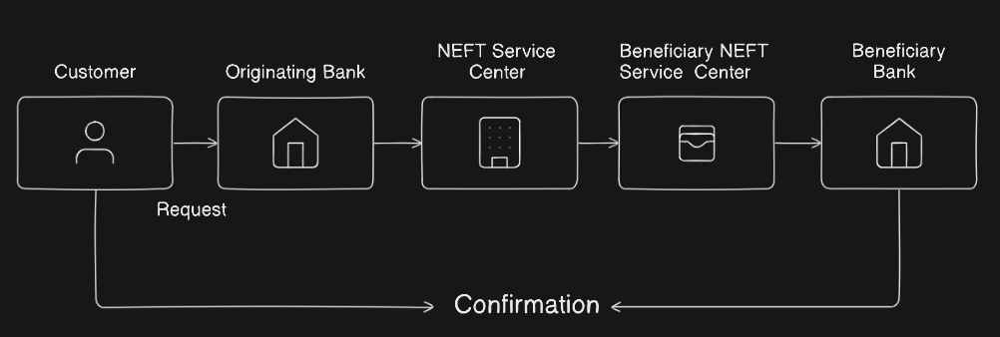
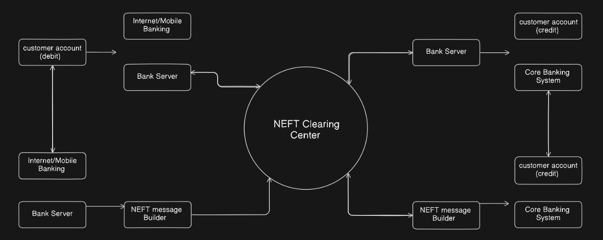

# NEFT

NEFT is a nationwide electronic funds transfer system in India, maintained by the Reserve Bank of India (RBI). It enables bank customers to transfer money from one bank account to another within the country using a secure, centralized clearing process. Initiated in 2005, NEFT operates on a deferred settlement basis with transactions processed in batches multiple times a day, typically every half hour, ensuring reliable fund transfers without requiring real-time settlement. This system is accessible through various channels such as internet banking, mobile banking, and bank branches, making it convenient for both individuals and corporations. There are no minimum or maximum limits on transaction amounts, and NEFT supports nearly all banks in India, providing pan-India payments coverage.

### Problem Statement

Conventional batch-based fund transfer systems face inherent latency, batching inefficiencies, and limited settlement finality that restrict their utility for time-sensitive payments. NEFT offers near-real-time interbank electronic funds transfers but operates within defined clearing windows, affecting end-to-end speed. To enhance transaction efficiency and widen access, NEFT must evolve to support 24/7 availability, reduce processing times, and improve user experience, while maintaining robust fraud detection and regulatory compliance.

## Key components

1. **Originating Bank/Branch:**
    
    The bank or branch where the remitter (sender) initiates the NEFT transaction by submitting payment instructions.
    
2. **NEFT Service Centre (Pooling Centre):**
    
    The originating bank routes the transaction message to its designated NEFT Service Centre, responsible for consolidating and forwarding NEFT messages.
    
3. **NEFT Clearing Centre (Processing Centre by RBI):**
    
    The central processing facility operated by the Reserve Bank of India (RBI) that receives batch-wise transaction data from all NEFT Service Centres, sorts messages by beneficiary bank, and prepares accounting entries for debit and credit.
    
4. **Beneficiary Bank’s NEFT Service Centre:**
    
    The receiving bank’s NEFT Service Centre receives sorted messages from the RBI NEFT Clearing Centre to process incoming payments for its customers.
    
5. **Beneficiary Bank/Branch:**
    
    The beneficiary bank branch credits the funds to the beneficiary’s account as per transaction details.
    
6. **Communication Network:**
    
    Secure messaging system (such as SFMS - Structured Financial Messaging System) used for transmitting NEFT messages between banks and RBI.
    
7. **Operational Systems:**
    
    Includes banking Core systems and ledgers in respective banks to update accounts and record transaction history.
    
8. **Settlement Mechanism:**
    
    RBI facilitates settlement of funds between banks based on net debit/credit positions arising from NEFT transactions in batches.
    

## Functional Requirements

1. **Fund Transfer Initiation:**
    - Allow customers to initiate electronic fund transfers from their account to any beneficiary’s account in India.
2. **Transaction Processing:**
    - Validate transaction details including remitter and beneficiary information before processing.
    - Support batch processing of transactions multiple times during the day.
3. **Account Crediting/Debiting:**
    - Debit funds from the remitter’s account and credit the beneficiary's account accurately as per the transactions.
4. **Acknowledgments and Notifications:**
    - Provide confirmation or failure messages to remitter and beneficiary banks.
    - Notify users about transaction status through various channels.
5. **Transaction Reversal and Exception Handling:**
    - Handle return and reversal of failed or rejected transactions efficiently.
    - Manage exceptions such as invalid account numbers or insufficient funds.
6. **Audit and Logging:**
    - Maintain detailed logs of all transactions for audit and regulatory compliance.
7. **Interbank Settlement:**
    - Facilitate net settlement among banks through the Reserve Bank of India at scheduled intervals.

---

## Non-Functional Requirements

1. **Security:**
    - Ensure confidentiality, authenticity, and integrity of transaction data using encryption and secure communication protocols.
    - Comply with regulatory security standards and banking guidelines.
2. **Reliability & Availability:**
    - Provide high availability and fault tolerance to handle transactions 24/7 with minimal downtime.
    - Ensure data consistency for transactions across multiple batches and retries.
3. **Performance:**
    - Process and clear transactions within defined batch timings.
    - Handle peak loads and large transaction volumes efficiently.
4. **Scalability:**
    - Scale the system to accommodate increasing number of transactions and participating banks over time.
5. **Usability:**
    - Support easy integration with various banking channels (branches, internet banking, mobile banking).
6. **Compliance:**
    - Ensure adherence to legal and regulatory requirements such as RBI policies, KYC norms, and anti-money laundering (AML) rules.

## Capacity estimation

## 1. Transaction Volume

- Average and peak number of transactions per batch and per day (NEFT operates in half-hourly batches currently).
- Estimations should consider growth trends in digital payment adoption and banking customers.

## 2. Batch Size and Processing Time

- Number of transactions processed in each half-hour batch.
- The system should complete clearing and settlement processes within stipulated batch timeframes to maintain timely fund transfers.

## 3. Concurrent Connections and Messaging Load

- Number of banks and service centers connected simultaneously submitting and receiving transaction data.
- Message volume in SFMS or other secure banking communication formats.

## 4. Data Storage and Throughput

- Amount of data (transaction details, audit logs) stored and retrieved per day.
- Database I/O capacity to support fast writes and reads for confidentiality and compliance.

## 5. Network & Security Infrastructure

- Bandwidth requirements for secure encrypted transmission between banks and RBI.
- Firewalls, intrusion detection, and monitoring systems capable of handling expected traffic.

## 6. Redundancy and Failover

- Additional capacity to support disaster recovery mechanisms ensuring zero data loss and business continuity.

## High Level Diagram

1. **Customer / Remitter Initiates Payment**
    - The individual or organization (remitter) wants to transfer funds to another bank account anywhere in India.
    - They provide beneficiary details (name, bank account number, IFSC code) and amount.
    - Initiation happens through Internet Banking, Mobile Banking, ATM, or visiting their bank branch.
2. **Originating Bank / Branch**
    - The remitter’s bank branch or digital channel receives the transfer request.
    - It validates basic details like account status, balance availability, and input correctness.
    - Formats and forwards the request internally to the bank’s designated **NEFT Service Centre** (Pooling Centre) where multiple customer requests are collected.
3. **Originating NEFT Service Centre (Pooling Centre)**
    - Pools together all NEFT requests received from its bank branches or channels.
    - Organizes these requests into batches for efficient processing.
    - Periodically (every half hour or as defined) forwards these batched transactions to the **NEFT Clearing Centre** managed by RBI.
4. **NEFT Clearing Centre (RBI)**
    - Acts as the central processing unit for NEFT transactions across India.
    - Receives batches from all participating pooling centres.
    - Sorts and matches transactions by the beneficiary’s bank to prepare net debit/credit instructions for settlement.
    - Sends settlement instructions to respective beneficiary banks’ pooling centres.
5. **Beneficiary NEFT Service Centre**
    - Acts as the gateway for the beneficiary bank to receive incoming transactions.
    - De-batches the received transactions for individual processing.
    - Passes the instructions to credit beneficiary customer accounts.
6. **Beneficiary Bank / Branch**
    - Credits the recipient's bank account with the transferred funds as per instruction.
    - Updates ledgers and sends confirmation internally within the bank.
7. **Confirmation Flow**
    - Confirmation messages travel back through the same path (beneficiary pooling centre → RBI clearing centre → originating pooling centre → originating bank/branch).
    - The remitter receives notification of successful or failed transaction status.

## Low Level Diagram

## Step 1: Customer Account (Debit Side)

- The customer (remitter) who wants to transfer funds logs into their **Internet/Mobile Banking** application using secure credentials and multi-factor authentication.
- Within the app, they enter required details: beneficiary account, IFSC, and transfer amount, and submit the request.
- The Internet/Mobile Banking platform performs basic form validation and checks that mandatory details are filled out.

---

## Step 2: Debit Request Handling by Bank Server

- The request is securely transmitted to the **Bank Server**, which acts as the backend heart of the bank’s operations.
- The Bank Server checks the customer's account status, available balance, holds, and KYC status.
- If validation succeeds, the Bank Server debits the specified amount from the remitter’s account and updates the database.
- The user receives an in-app or SMS confirmation that the account has been debited.

---

## Step 3: NEFT Message Formation

- Once the debit is successful, the **Bank Server** prepares an NEFT payment instruction, containing all data in a structured format.
- The request is passed to the **NEFT Message Builder**, a dedicated system module or service.
- The NEFT Message Builder formats the request into a standardized, secure NEFT message (such as SFMS)—this includes remitter info, debit reference, beneficiary details, and amount.
- Security mechanisms, like message signing and encryption, are applied to protect data integrity.

---

## Step 4: Sending to NEFT Clearing Center

- The formatted NEFT message is securely sent from the **Bank Server** (via the Message Builder) to the **NEFT Clearing Center**—operated by RBI.
- The Clearing Center collects NEFT messages from all participating banks within a defined settlement window.

---

## Step 5: NEFT Clearing Center Processing

- The Clearing Center sorts all incoming messages, batching them by destination (beneficiary) bank.
- Settlement is performed—RBI’s internal system marks amounts to be credited and debited among banks.
- Each NEFT message, including your transaction, is now ready to be routed to the beneficiary bank’s infrastructure for further processing.

---

## Step 6: Forwarding to Beneficiary Bank

- The NEFT message is routed from the Clearing Center to the **Bank Server** of the beneficiary bank.
- The receiving bank, upon message receipt, validates the encoded beneficiary account number and details.
- The NEFT message is sent to the **NEFT Message Builder** (if applicable) or directly passed to the bank’s core systems for processing.

---

## Step 7: Crediting the Beneficiary Account

- The **Core Banking System** of the beneficiary bank picks up the transaction instruction.
- It locates the beneficiary’s account, confirms it is active and capable of receiving funds, and then credits the appropriate amount.
- The transaction is recorded in the beneficiary account’s ledger.

---

## Step 8: Confirmation and Final Notifications

- The Core Banking System generates a transaction confirmation.
- A notification (SMS, email, or push notification) is sent to the beneficiary confirming fund receipt.
- Simultaneously, an acknowledgment is routed back through bank servers, eventually updating the remitter’s original bank and app, completing the fund transfer loop.

## Security

## 1. Customer Authentication and Access Control

- Customers authenticate via strong methods including multi-factor authentication (password + OTP/biometrics) on Internet/Mobile Banking platforms.
- Sessions are encrypted using TLS/SSL to secure data during transmission.

## 2. Secure Bank Server Processing

- Bank servers enforce strict access control and role-based permissions to prevent unauthorized access to customer data and transaction processing modules.
- Input sanitization and validation prevent injection attacks or malformed requests.

## 3. Message Security - NEFT Message Builder

- Messages are constructed using standardized financial communication protocols such as SFMS (Structured Financial Messaging System) or ISO 20022, ensuring interoperability and security.
- Messages include digital signatures for authentication and integrity verification.
- End-to-end encryption prevents interception or tampering during transmission to the NEFT Clearing Center.

## 4. NEFT Clearing Center Security (RBI)

- Operates with strict physical and network security controls, including firewalls, intrusion detection/prevention systems (IDS/IPS), and regular security audits.
- Implements role segregation to ensure least privilege access.
- Stores sensitive transaction data securely with encryption at rest and robust backup/recovery processes.

## 5. Secure Communication Channels

- Uses encrypted VPNs or dedicated leased lines between banks and the clearing center to protect data in transit.
- Employs mutual authentication between endpoints to prevent man-in-the-middle (MitM) attacks.

## 6. Core Banking Security

- Beneficiary banks apply similar strong internal security controls on their core banking systems to securely credit customer accounts.
- Transaction logs are immutable and regularly audited to detect anomalies and fraudulent activity.

## 7. Monitoring and Incident Management

- Continuous real-time monitoring of all network and application layers to detect intrusions, suspicious activity, or abnormal transaction patterns.
- Immediate alerting and incident response plans to counter and mitigate security breaches.

## 8. Regulatory Compliance

- Ensures compliance with PCI DSS where applicable, RBI guidelines, data protection laws (such as India’s IT Act), and banking regulations.
- Implements audit trails and logging for accountability and legal requirements.

## Challenges

## 1. Processing Delays

- NEFT operates on a batch processing basis, which can lead to delays, especially outside business hours or during holidays.
- Customers sometimes experience waiting times before funds are credited, unlike instant payment systems.

## 2. Transaction Failures and Errors

- Errors due to incorrect beneficiary details (IFSC, account number) often cause transaction rejections and require manual intervention.
- Handling failed transactions, refunds, and chargebacks efficiently while maintaining transparency is complex.

## 3. Scalability and Load Management

- Increasing transaction volumes, due to rising digital payments, demand scalable infrastructure and efficient batch processing.
- Peak loads during festivals or business cycles require careful capacity planning to avoid system congestion.

## 4. Security Threats

- Constant threats of cyberattacks, phishing, and fraud attempts necessitate robust continuous monitoring and advanced fraud detection.
- Ensuring data privacy and secure transmission against interception or tampering is critical.

## 5. Integration Complexity

- Banks and participating financial institutions have heterogeneous systems making seamless integration and message standardization challenging.
- Maintaining backward compatibility while adopting newer messaging standards requires careful coordination.

## 6. Regulatory Compliance

- NEFT operations must comply with evolving RBI regulations, KYC norms, anti-money laundering (AML) rules, and data protection laws.
- Regular audits and controls add complexity and operational overhead.

## 7. User Awareness and Accessibility

- Some customers lack awareness of NEFT timings, limits, and processes, leading to user dissatisfaction.
- Ensuring accessibility to payments in rural or low connectivity areas is limited by infrastructural constraints.

## Conclusion

The NEFT (National Electronic Funds Transfer) system is a critical nationwide electronic payment system maintained by the Reserve Bank of India (RBI). It allows individuals, firms, and corporates to electronically transfer funds on a one-to-one basis across any two NEFT-enabled bank accounts in India.

NEFT works on a deferred net settlement (DNS) basis where transactions are processed in batches at fixed intervals (currently half-hourly, 48 batches a day). The system was introduced to enable quick, secure, and cost-effective interbank fund transfers compared to earlier paper-based methods like cheques and demand drafts. It supports pan-India coverage and offers round-the-clock availability, including holidays and weekends.

There is no minimum or maximum amount limit for fund transfers (except cash-based remittances which have specific limits). NEFT automates validation, authorization, clearing, and settlement, all recorded with audit trails for transparency and regulatory compliance. Notifications are sent to both sender and receiver about transaction status. It is widely popular due to ease of use, reliability, and comprehensive bank participation.