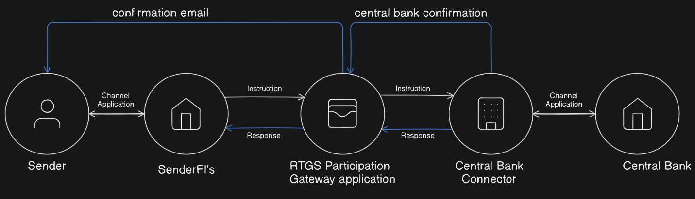
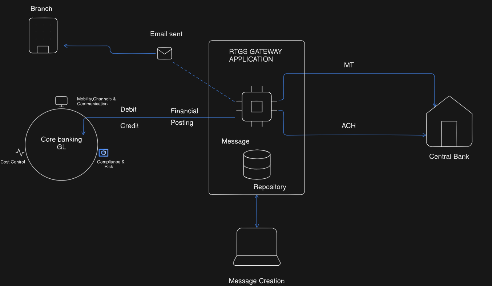

# RTGS

## RTGS (Real-Time Gross Settlement) Overview

RTGS stands for Real-Time Gross Settlement, a system where fund transfers are processed individually and continuously in real time without batching. Managed by the Reserve Bank of India (RBI), it is primarily used for large-value transactions with a minimum transfer limit of ₹2 lakhs and no upper limit. RTGS ensures immediate and irrevocable settlement of funds, allowing quick transfer of money between banks on a transaction-by-transaction basis. It is available 24/7, providing a safe, secure, and reliable mode of transferring urgent and high-value payments nationwide.

## Problem Statement

Legacy large-value payment systems suffer from delayed settlement, credit and liquidity risks, and limited operational hours that constrain modern commerce. RTGS systems seek to deliver immediate, irrevocable settlement of high-value funds transfers in central bank money with continuous availability. Despite improvements, RTGS implementations contend with infrastructure costs, cybersecurity threats, and challenges in interoperability and real-time liquidity management, which must be addressed to fully realize its potential in stabilizing the financial ecosystem.

---

## Key Components

## 1. Member Banks

These are the banks authorized by the Reserve Bank of India (RBI) to participate in the RTGS system. Member banks act as intermediaries for fund transfers initiated by their customers. They have dedicated infrastructure and platforms to interface with the RTGS system. The role of member banks includes validating, processing, and forwarding RTGS payment instructions between customers and the central RTGS system.

---

## 2. Member Interface (MI)

This refers to the hardware and software environment located within member banks that facilitates communication with the RBI’s central RTGS system. It includes payment processing applications, secure network connections, firewalls, and encryption tools. The MI handles the creation, submission, receipt, and acknowledgment of payment messages in real-time, ensuring all messages are correctly formatted and securely transmitted.

---

## 3. RTGS Central System

Operated by RBI, this is the core infrastructure responsible for real-time processing, clearing, and settlement of RTGS transactions. It handles each transaction individually (gross settlement) and continuously without batching. The central system debits and credits the respective banks’ reserve accounts instantly to reflect transfers. It maintains transaction logs, manages settlement status, and ensures finality with no settlement risk.

---

## 4. Settlement Accounts

Each member bank maintains a current account with the RBI used for settlement purposes. When a transaction is processed, funds are debited from the remitter’s bank’s settlement account and credited to the beneficiary’s bank’s settlement account in real time. This ensures the irrevocable and immediate transfer of funds between banks at the central bank level.

---

## 5. Structured Financial Messaging System (SFMS)

SFMS is the standardized protocol used by banks and RBI to exchange RTGS messages securely. It resembles the ISO 20022 messaging standard and ensures uniform message formats that support transaction details, authentication, and encryption. SFMS ensures interoperability and reduces risk of data corruption or tampering during message transmission.

---

## 6. Transaction Queue and Prioritization

The RTGS system maintains queues of incoming payment requests. Transactions are processed on a first-come-first-served basis but may also be prioritized based on value, urgency, or sender preferences. The queuing system ensures efficient handling during peak periods, preventing overload and enhancing throughput without sacrificing immediate processing.

---

## 7. Exception and Duplicate Handling

This module detects transaction anomalies such as duplicate payment requests, invalid account numbers, or insufficient funds. It initiates automatic rejection or returns, notifying participating banks and customers accordingly. Exception handling ensures the system remains accurate, prevents erroneous debits or credits, and supports operational resilience.

---

## 8. Liquidity Management Mechanisms

RTGS requires banks to maintain sufficient funds in their settlement accounts. To facilitate smooth operations, RBI provides intra-day liquidity support and credit limits through mechanisms such as collaterals or overdraft facilities. Liquidity management prevents transaction failures due to lack of funds and optimizes funds usage across the banking system during the day.

---

## 9. Audit and Monitoring Systems

These systems continuously log all RTGS transactions and system activities, enabling transparency and regulatory compliance. Monitoring tools detect unauthorized access, performance bottlenecks, and suspicious transaction patterns. Detailed audit trails help in dispute resolution, forensic investigations, and maintaining overall system integrity and trust.

---

## Functional Requirements

1. **Real-Time Transaction Processing:**
    - Process individual high-value transactions immediately upon receipt without batching.
    - Ensure instant fund settlement between remitter and beneficiary banks.
2. **Transaction Validation:**
    - Validate transaction details such as remitter and beneficiary account information, amount limits (minimum ₹2 lakhs), and sufficient balance before execution.
3. **Authentication and Authorization:**
    - Authenticate users initiating transfers and authorize the transaction based on regulatory and internal policies.
4. **Fund Settlement:**
    - Debit the remitter’s bank settlement account and credit the beneficiary’s bank settlement account in real-time to ensure irrevocable payment.
5. **Message Handling:**
    - Use standardized messaging protocols (SFMS or ISO 20022) for secure transmission of transaction instructions.
6. **Exception Management:**
    - Identify and handle exceptions such as invalid accounts, duplicate transactions, or technical failures with appropriate notifications and reversal mechanisms.
7. **Audit Logging and Reporting:**
    - Maintain comprehensive logs of all transactions and system activities for audit and regulatory compliance.
8. **Notification:**
    - Provide real-time status updates to participants (banks and customers) about transaction success or failure.

---

## Non-Functional Requirements

1. **Security:**
    - Ensure confidentiality, integrity, and authenticity of transaction data using encryption, secure communication channels, and compliance with financial regulations.
2. **Availability:**
    - Provide high system availability (24/7 operation) with minimal downtime to process transactions at any time.
3. **Scalability:**
    - Scale according to increasing transaction volumes and participating banks without degradation of performance.
4. **Performance:**
    - Deliver low latency processing to enable near-instant transfer and settlement of funds.
5. **Reliability:**
    - Ensure fault tolerance with mechanisms for recovery, retry, and failover to prevent loss or duplication of transactions.
6. **Compliance:**
    - Meet all applicable regulatory standards including RBI mandates, KYC, AML, and PCI DSS guidelines.
7. **Usability:**
    - Support seamless integration with multiple banking channels like internet banking, mobile apps, and branch banking systems.

## Capacity Estimation

## 1. Transaction Volume

- Estimate the average and peak number of RTGS transactions per day and per hour.
- Consider growth trends in digital payments and increased adoption by corporates and banks.
- For example, handling tens or hundreds of thousands of transactions daily requires robust scaling.

## 2. Real-Time Processing Requirements

- Since RTGS processes transactions individually with immediate settlement, infrastructure must support high throughput and low latency to avoid bottlenecks.
- Systems must handle concurrent transaction processing without delays.

## 3. Network and Communication Bandwidth

- Sufficient bandwidth to support secure, encrypted messaging between member banks and the central system with minimal latency.
- Redundancy and failover capabilities to maintain uninterrupted communication.

## 4. Database Throughput

- High-performance database systems capable of managing rapid transaction recording, audit logging, and settlement updates with ACID compliance.
- Efficient indexing and query handling to support real-time reconciliation and reporting.

## 5. Hardware and Infrastructure

- Scalable servers, load balancers, and storage to accommodate transaction spikes, especially during business hours or month-end financial settlements.

## 6. Disaster Recovery and Failover Capacity

- Backup and failover systems able to take over immediately in case of hardware/software failures without transaction loss.

## 7. Security Systems Capacity

- Adequate processing power for real-time encryption, decryption, and fraud detection without impacting transaction speed.

## High Level Diagram

---

## 1. Sender

- The process begins with the **Sender** (this could be an individual, business, or institution) who wants to transfer funds using RTGS.
- The sender accesses their bank’s interface via a **Channel Application**—this could be Internet Banking, Mobile Banking, or a branch software system.
- After entering the beneficiary details, amount, and authorization credentials, the sender initiates a payment instruction.

---

## 2. Sender Financial Institution (Sender FI’s)

- The sender’s bank or financial institution (FI) receives the payment request through its **Channel Application**.
- The system first **validates** the sender’s account (checks sufficient funds, correct details, compliance checks like KYC/AML, etc.).
- If validated, the bank’s system forwards the payment instruction to the **RTGS Participation Gateway Application**.
- The bank may send an initial acknowledgment to the sender confirming receipt of the instruction or provide status updates via email or in-app notifications.

---

## 3. RTGS Participation Gateway Application

- This is a specialized, secure gateway system within the sender’s bank, designed for direct communication with the central RTGS infrastructure.
- The **RTGS Participation Gateway Application** formats the payment instruction into a standard protocol/message as per RTGS requirements.
- It sends the instruction (with all the transaction details and security credentials) to the central bank’s systems via the **Central Bank Connector**.
- Waits for a **response** from the central infrastructure.
- The gateway also manages confirmations, error handling, retries, and logs of outgoing instructions and incoming responses.

---

## 4. Central Bank Connector

- This component serves as an integration layer between the commercial bank’s RTGS gateway and the actual **Central Bank** settlement system.
- It receives instructions from participating banks, validates the integrity and compliance of messages, and forwards them to the Central Bank’s internal clearing and settlement engine.
- Processes responses/confirmations from the central system and transmits them back through the same chain.
- Offers a standardized way to interact with the Central Bank irrespective of the bank’s internal systems.

---

## 5. Central Bank

- The **Central Bank** (like the RBI in India) is the authority operating the RTGS system.
- Receives transaction instructions through its settlement interface.
- Debits the sending (remitting) bank’s settlement account and credits the beneficiary bank’s settlement account instantly, thus completing final settlement.
- Updates its ledgers and records the transaction.
- Sends a **central bank confirmation** back through the Central Bank Connector and further upstream.
- Final confirmation and transaction status may also be relayed directly or indirectly to the sender—as an email, SMS, or system notification.

---

## Notifications and Confirmations

- **Confirmation Email:** Once settlement is complete, a confirmation is sent to the sender detailing the status of the transaction.
- **Central Bank Confirmation:** Another confirmation is generated by the Central Bank, acknowledging the settlement, which is forwarded back to the originating sender via the participating entities and potentially the channel app.

## Low Level Diagram

## 1. Transaction Initiation at Branch

- The process starts when a customer visits the **branch** and requests a high-value fund transfer using RTGS, or the request is initiated from any banking channel (in person, online, via app).
- The branch user enters all transaction details—amount, senders’ and receivers’ accounts—into the banking system.

---

## 2. Posting to Core Banking GL

- The transaction is handed off to the **Core Banking General Ledger (GL)** system.
- The GL system is responsible for maintaining all bank account ledgers, performing debits/credits, and ensuring cost control and risk compliance.
- It checks that the sender’s account is eligible, verifies sufficient balance, and applies compliance rules (AML/KYC checks, transaction limits, internal security flags).

---

## 3. Debit/Credit and Financial Posting

- If everything is valid, the **debit** operation is performed on the sender’s account and the transaction is posted for processing.
- The system also preps for a **credit** operation for the receiver to be performed after successful settlement.
- A financial posting entry is created in the ledger as a traceable record of the transaction.

---

## 4. Email Confirmation (Optional but Shown)

- An **email confirmation** is sent immediately to the branch or user to confirm that the transaction has been received for processing.
- This gives near-real-time assurance and audit trail for both customers and bank operators.

---

## 5. Hand-off to RTGS Gateway Application

- The approved and posted transaction is sent to the **RTGS Gateway Application**—this is a special middleware software that interfaces with the national RTGS network.
- The RTGS Gateway Application receives financial messages from the core system, sanitizes them, formats them for RTGS standards, and ensures compliance with regulatory messaging rules.

---

## 6. Message Creation

- The Gateway creates a formal **RTGS message** in internationally standardized formats (such as MT for SWIFT, or ACH for Automated Clearing House payments).
- These contain all transaction details: sender/receiver account information, amount, purpose, timestamps, and security features.
- The message is logged into a **repository** for audit, recovery, and compliance purposes.

---

## 7. Transmission to Central Bank

- The RTGS Gateway then instantly transmits the message to the **Central Bank** (typically the RBI in India) via secure channels.
- Depending on the type of transaction/message, it sends either an MT (SWIFT) or ACH message.
- The message includes all transactional data needed by the Central Bank for settlement.

---

## 8. Settlement at Central Bank

- The **Central Bank** RTGS system receives the message, checks funds availability in the sending bank’s settlement account, and immediately settles the amount.
- Upon successful settlement, the funds are debited from the sender bank’s central account and credited to the beneficiary bank’s central account.
- The Central Bank marks final and irrevocable settlement, ensuring transaction completion.

---

## 9. Backflow (Not directly shown but implied)

- Once the transaction is settled, confirmation messages are sent back—bank systems and possibly the branch are notified.
- The ledger is updated again to reflect final credit into the beneficiary’s account.
- Any issues (e.g., insufficient funds, compliance failures) would trigger failure protocols, notifications, and possibly reversal postings.

## Security

## 1. Core Banking GL Security

- **Access Control:** Only authorized personnel and secure channels (branch, online) can initiate transactions, protected by authentication (passwords, biometrics, multi-factor).
- **Compliance Checks:** In-built compliance and risk modules perform KYC, AML, fraud checks, and monitor for suspicious patterns before debits/credits are posted.
- **Audit Trail:** Every operation in the ledger is logged, with immutable records for forensic and compliance audits.

## 2. RTGS Gateway Application Security

- **Message Validation:** Messages are validated for format, completeness, and compliance with regulatory and payment network standards.
- **Encryption:** Financial messages to and from the repository and during creation are encrypted; only authorized processes and users can access raw data.
- **Sandboxing & Access Control:** Message handling modules operate under role-based access controls, reducing insider risk and minimizing privilege exposure.

## 3. Secure Messaging & Channel Protections

- **Transport Security:** Messages sent to the central bank use secure, encrypted protocols (TLS/SSL, VPNs, or dedicated leased lines) to prevent interception and tampering.
- **Standardization:** Use of SWIFT MT and ACH message types means global security standards are applied—digital signatures, certificate-based authentication, and message integrity controls.
- **Repository Protections:** Message repositories use database encryption, backup, and disaster recovery strategies to safeguard against leaks or corruption.

## 4. Central Bank Interactions

- **Endpoint Authentication:** Only verified gateway applications of participating banks can interact with central bank RTGS endpoints, which are strictly monitored and whitelisted.
- **Settlement Integrity:** The central bank validates each message before allowing debit/credit in settlement accounts, ensuring funds aren't transferred unless all compliance checks pass.
- **Real-Time Monitoring:** Transactions are continuously monitored for anomalies, failed attempts, duplicates, or suspicious links.

## 5. Notification & Email

- **Confirmation Security:** Email notifications include only non-sensitive details and are sent through secure channels to authorized recipients.
- **End-to-End Logging:** Every notification and status message is recorded for future auditing and traceability.

## Challenges

---

## 1. High Security Threats

- RTGS systems are targets for cyberattacks, fraud, and insider threats due to the large sums processed.
- Ensuring end-to-end encryption, secure authentication, and real-time anomaly detection is complex and resource-intensive.

## 2. Integration Complexity

- Banks run heterogeneous core banking and middleware solutions; integrating them seamlessly with the RTGS gateway, message repositories, and central bank connectors can involve significant technical challenges.
- Any mismatch in message formats (e.g., SWIFT MT, ACH), compliance data, or protocol can lead to transaction failures and delays.

## 3. Real-Time Availability & Reliability

- RTGS must guarantee nearly 100% uptime and ultra-low latency. Outages, hardware or software failures, or network disruptions directly impact business and trust in financial systems.

## 4. Exception & Error Handling

- Duplicate transactions, erroneous or incomplete payment instructions, and mismatched reconciliation create operational burdens.
- Managing transaction rollbacks and reverse postings, especially in cross-bank errors, requires robust automated and manual intervention mechanisms.

## 5. Compliance and Regulatory Burden

- RBI and international regulations (KYC, AML, audit requirements, settlement integrity) are continuously evolving. Keeping gateway applications and processes compliant at all times is challenging.

## 6. Scalability and Performance

- Growing transaction volumes—especially during peak business hours—demand scalable infrastructure.
- Message creation, posting, repository management, and real-time settlement all need robust scaling and resource management.

## 7. Operational Transparency

- Maintaining comprehensive audit trails for every transaction and system event, while ensuring privacy, is complex and can impact performance.

## 8. User Awareness

- Customers and bank operators must understand RTGS timings, usage limits, and error resolution processes, else risk transaction delays and dissatisfaction.

## Conclusion

The Real-Time Gross Settlement (RTGS) system is a transformative payment infrastructure that processes high-value transactions individually and instantaneously using central bank reserves, thereby eliminating settlement risks present in traditional batch-clearing systems. It provides immediate payment finality, reducing systemic risks such as Herstatt risk and enabling secure, irrevocable transfer of funds that meet modern commerce requirements. The system’s evolution to continuous 24x7 operations and adoption of ISO 20022 standards demonstrate its alignment with contemporary banking needs. Despite challenges like high costs, cybersecurity threats, and liquidity management complexities, RTGS remains central to financial stability, facilitating critical transactions including government securities trading. Future advancements should focus on cross-border interoperability, cost-efficiency through cloud solutions, integration with emerging technologies like blockchain and central bank digital currencies, and fortified cybersecurity. Overall, RTGS is a foundational pillar of modern financial systems, ensuring monetary stability and supporting economic growth in an increasingly digital and interconnected world.