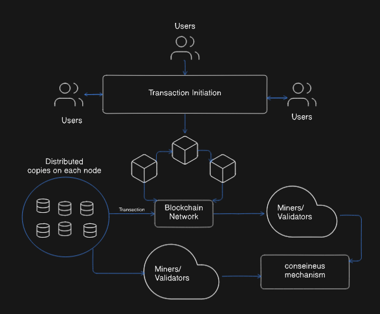
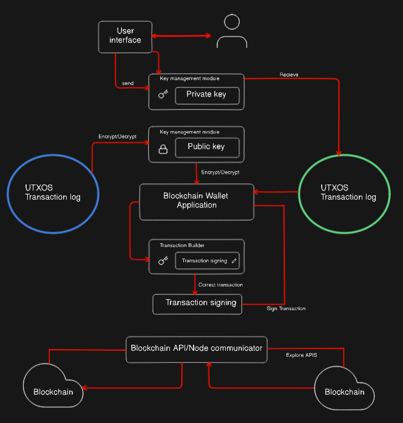

# Blockchain Wallets

**Blockchain wallets** are sophisticated software applications that enable users to **securely store, manage, and transact cryptocurrencies and digital assets** across various blockchain networks. Unlike traditional wallets that store physical currency, blockchain wallets store the **public and private cryptographic keys** necessary to access and control cryptocurrency holdings on distributed ledgers.

The fundamental principle underlying blockchain wallets is that **cryptocurrencies are not actually stored within the wallet itself**. Instead, they exist as **transaction records on the blockchain**, while the wallet maintains the cryptographic keys that prove ownership and enable spending rights. Each wallet consists of a **public key** (similar to a bank account number for receiving funds) and a **private key** (equivalent to a password for authorizing transactions).

Modern blockchain wallets have evolved beyond simple key storage to become comprehensive **digital asset management platforms**. They provide intuitive interfaces for transaction management, support multiple cryptocurrencies simultaneously, integrate with decentralized applications (DApps), and offer advanced security features including multi-factor authentication and biometric verification.

## Problem Statement

Traditional digital wallets face considerable challenges related to key management complexity, interoperability across diverse blockchain networks, and security risks including key theft and loss. User experience hurdles and the need for seamless transaction execution limit adoption. Blockchain wallets aim to provide secure, easy-to-use access to decentralized digital assets while ensuring transaction integrity, privacy, and cross-chain compatibility, but current solutions must overcome scalability constraints, regulatory uncertainties, and stringent security demands.

## Key components

## **Core Wallet Engine Components**

**Key Management System**: The foundation of any blockchain wallet, responsible for **generating, storing, and managing cryptographic key pairs**. This component ensures secure creation of private keys using cryptographically secure random number generators and manages key derivation for hierarchical deterministic (HD) wallets.

**Transaction Manager**: Handles the **creation, validation, and broadcasting of transactions** to blockchain networks. This component constructs transaction objects, calculates fees, manages unspent transaction outputs (UTXOs), and coordinates with network nodes for transaction propagation.

**Multi-Chain Support Module**: Enables the wallet to **interact with multiple blockchain protocols** simultaneously, handling different address formats, transaction structures, and consensus mechanisms. This component abstracts blockchain-specific complexities and provides unified interfaces for diverse networks.

**Balance Tracker**: Monitors and calculates **real-time asset balances** across all supported blockchains by querying network nodes and maintaining local transaction history. This component handles balance synchronization and provides accurate portfolio valuations.

## **Security Infrastructure Components**

**Encryption/Decryption Engine**: Implements **advanced cryptographic algorithms** including AES-256 for data encryption and secure storage of private keys. This component ensures all sensitive data remains encrypted both at rest and in transit.

**Digital Signature Module**: Manages the **creation and verification of digital signatures** using elliptic curve cryptography (ECC) algorithms like secp256k1. This component ensures transaction authenticity and non-repudiation.

**Authentication System**: Provides **multi-factor authentication** including biometric verification, hardware security keys, and time-based one-time passwords (TOTP). This component prevents unauthorized access to wallet functions.

## **Network Interface Components**

**Blockchain Connectivity Layer**: Establishes **secure connections to blockchain networks** through full nodes, light nodes, or API gateways. This component handles network communication protocols and maintains connection resilience.

**Smart Contract Interface**: Enables **interaction with decentralized applications** and smart contracts through standardized protocols like JSON-RPC. This component handles contract calls, event monitoring, and transaction execution.

**Cross-Chain Bridge Connector**: Facilitates **interoperability between different blockchain networks** through bridge protocols and atomic swap mechanisms.

## Functional and Non-Functional Requirements

## **Functional Requirements**

**Key Generation and Management**: System must **generate cryptographically secure key pairs** using industry-standard algorithms (RSA, ECC) with sufficient entropy. The system must support hierarchical deterministic (HD) wallet structures per BIP-32 standards and enable secure key backup through mnemonic seed phrases.

**Multi-Currency Transaction Processing**: Wallet must **support transaction creation, signing, and broadcasting** for multiple cryptocurrency networks including Bitcoin, Ethereum, and ERC-20 tokens. Each transaction requires proper fee estimation, input/output management, and network-specific formatting.

**Balance and Portfolio Management**: System must **accurately track balances across all supported networks** in real-time, provide historical transaction data, and calculate portfolio values in multiple fiat currencies. The system must handle complex scenarios including pending transactions and reorganizations.

**DApp Integration**: Wallet must **connect securely with decentralized applications** through standardized protocols (WalletConnect, Web3), support smart contract interactions, and provide transaction approval workflows.

**Backup and Recovery**: System must enable **secure wallet backup through encrypted seed phrases** and provide recovery mechanisms that restore full wallet functionality from backup data.

## **Non-Functional Requirements**

**Performance and Scalability**: System must **process transactions within 2-5 seconds** for standard operations, support concurrent users without degradation, and handle high transaction volumes during network congestion. The wallet must optimize resource usage and provide responsive user interfaces.

**Security Standards**: Implementation must follow **industry security best practices** including end-to-end encryption, secure key storage, protection against common attack vectors (phishing, malware), and regular security audits. The system must comply with OWASP security guidelines.

**Availability and Reliability**: Wallet must maintain **99.9% uptime availability**, provide graceful degradation during network issues, and implement robust error handling with user-friendly error messages. The system must support offline functionality for basic operations.

**Usability and Accessibility**: Interface must be **intuitive for both novice and expert users**, support multiple languages, comply with accessibility standards (WCAG), and provide comprehensive help documentation. The system must minimize user errors through clear UI/UX design.

**Regulatory Compliance**: System must **implement KYC/AML procedures** where required, support regulatory reporting capabilities, handle tax calculation assistance, and maintain audit trails for all transactions. The wallet must adapt to evolving regulatory requirements.

## Capacity Estimation

## 1. User Load and Concurrent Sessions

- Estimate the expected number of active users accessing wallet services concurrently including login, transaction signing, key retrieval, and metadata queries.
- Account for peak times and geographical distribution to size authentication servers and API gateways.

## 2. Authentication and Token Handling

- Capacity of OAuth2 provider integration (e.g., Google OAuth2) to handle authentication requests securely and quickly.
- Token generation, validation, and refresh processes must support high throughput and low latency.

## 3. Key Management and Local Storage

- Handling device keys and node keys requires secure storage and fast retrieval mechanisms.
- Local storage on user devices must be optimized for performance and limited storage capacity.

## 4. Metadata Storage and Database Throughput

- IPFS and associated databases must support rapid metadata fetch and storage operations.
- MongoDB data nodes need sufficient IOPS (Input/output operations per second) to deal with distributed database queries, writes, and replication activities.

## 5. Node Network Scalability

- Nodes communicating over gRPC must sustain concurrent network I/O and inter-node synchronization without bottleneck effects.
- System must scale horizontally by adding more nodes as user base and transaction volume grow.

## 6. Latency and Response Time

- Low latency for wallet operations like key retrieval, signing, and transaction confirmation is critical for user experience.
- Network latency between client, metadata storage, nodes, and databases must be minimized.

## 7. Security and Reliability Overhead

- Capacity must also allow for cryptographic processing, secure communication, and redundancy without performance degradation.

---

## High level Diagram

## 1. Users & Transaction Initiation

- **Participants**: End users, wallets, or applications.
- **Actions**:
    1. A user opens their wallet or DApp and requests a transfer of value or invocation of a smart contract.
    2. The wallet constructs a **transaction payload** containing fields such as sender address, recipient address, amount, nonce (for account-based chains), optional data (e.g., contract call, metadata), and a timestamp.
    3. The user reviews and confirms details (amount, fees, recipient). Upon confirmation, the wallet signs the payload with the user’s **private key**, producing a **signed transaction** ready for broadcast.

**Key Details**:

- Wallets often compute an **optimal fee** based on current network conditions or allow the user to set a custom fee.
- At this point, the transaction remains local until broadcast.

---

## 2. Broadcast to Blockchain Network

- **Node Communicator**: Wallet or client software runs a **full node** or connects to remote nodes via RPC/HTTP/WebSocket.
- **Propagation**:
    1. The signed transaction is submitted to one or more nodes using an RPC call like **`eth_sendRawTransaction`** or **`sendrawtransaction`**.
    2. Each node that receives it performs a **basic validity check** (correct format, valid signature, sufficient balance, correct nonce).
    3. Valid transactions enter the node’s **mempool** (unconfirmed transaction pool).
    4. Nodes share new mempool entries with their peers, rapidly propagating the transaction across the entire network via a **gossip protocol**.

**Key Details**:

- Mempool size and policy (minimum fee threshold, eviction rules) vary per node.
- Nodes may apply **rate limiting** to prevent spam or DoS attacks.

---

## 3. Distributed Copies on Each Node

- **Replication**: Once in the mempool, every full node holds a copy of the pending transaction.
- **Local Ledger**: Nodes maintain a **pending-state trie** or UTXO cache reflecting these unconfirmed changes.
- **Peer Synchronization**: When new blocks are mined, nodes update their ledger copy atomically—removing confirmed mempool entries and applying new state changes.

**Key Details**:

- Nodes prune old unspent outputs or bloom filters to manage storage.
- Lightweight clients use **SPV proofs** or **light client protocols** to track transaction inclusion without storing full blocks.

---

## 4. Miners / Validators Collect Transactions

- **Block Constructors**:
    - In Proof-of-Work (PoW) networks, **miners** pick transactions from the mempool to include in the next candidate block.
    - In Proof-of-Stake (PoS) or BFT networks, **validators** are selected to propose or attest to blocks based on stake or round-robin algorithms.
- **Selection Criteria**:
    1. **Fee Priority**: Transactions offering higher fees are prioritized to maximize miner/validator rewards.
    2. **Size Constraints**: Each block has a maximum size or gas limit, so only a subset of transactions can fit.
    3. **Dependency Ordering**: Transactions referencing outputs from other unconfirmed transactions must be ordered to satisfy dependencies.

**Key Details**:

- Validators run economic slashing logic to penalize double-signing or equivocation.
- Miners use specialized hardware (ASICs, GPUs) and mining pools to increase effective hash power.

---

## 5. Consensus Mechanism

- **Consensus Algorithm**: Ensures all honest nodes agree on a single, linear chain of blocks. Common protocols include:
    - **Proof of Work (PoW)**: Miners solve a computational puzzle (hash below target) to propose a block.
    - **Proof of Stake (PoS)**: Validators are pseudorandomly selected based on their stake; they vote on block validity.
    - **Byzantine Fault Tolerant (BFT)**: Validators run multi-round voting (pre-prepare, prepare, commit) to finalize each block.
- **Block Finalization**:
    1. A proposed block is broadcast; peer nodes validate its proof (PoW nonce, PoS signature, transaction correctness).
    2. In PoW, each node continues mining atop the highest-work chain. A block becomes increasingly “final” as more blocks are built on top of it (confirmation depth).
    3. In PoS/BFT, finality is often immediate after a quorum of validator signatures—no risk of reorg after finalization.

**Key Details**:

- **Fork Handling**: Temporary forks resolve by choosing the longest (highest-work) or highest-quorum chain.
- **Reorganization**: Nodes may roll back unfinalized blocks if a better chain emerges.

---

## 6. Block Commitment & Ledger Update

- **State Transition**:
    1. Each transaction in the newly finalized block is applied to the node’s local ledger:
        - **UTXO Model**: Consume inputs (mark them spent), create new outputs.
        - **Account Model**: Deduct balances, increment nonces, apply smart contract state changes.
    2. Nodes update their **Merkle root** or **state trie root** to reflect the post-block state.
- **Persistence**:
    - Blocks and updated state are written to on-disk databases (LevelDB, RocksDB, LMDB).
    - Full transaction receipts—including logs and events—are stored for indexing and historical queries.

**Key Details**:

- Nodes prune old state or archive it to maintain a manageable storage footprint.
- Light clients can request specific state proofs (Merkle proofs) to verify account balances without full state.

---

## 7. Finality to User & Distributed Copies

- **User Notification**:
    - Wallets monitor block height and transaction confirmations. Once a transaction reaches a preconfigured confirmation threshold (e.g., 6 blocks for Bitcoin or finality event in PoS), the wallet marks it as “confirmed.”
    - Notifications trigger UI updates, alerts, or backend callbacks for services reliant on payments.
- **Global Distribution**:
    - Every full node now holds an identical, canonical copy of the updated ledger.
    - Clients, explorers, and indexers can query any node to retrieve the confirmed transaction and its associated block data.

**Key Details**:

- Confirmation thresholds balance security (protection against reorgs) with user experience (faster receipt of funds).
- Some networks implement **instant-finality payments** via payment channels or sidechains for near-instant settlement.

## Low Level Diagram

1. **User Interface (UI)**
    
    The UI is what you see and interact with: balance displays, buttons to send or receive funds, and forms to enter addresses and amounts. It checks your inputs immediately (for example, making sure an address is the right length) to prevent mistakes before anything is sent to the wallet core.
    
2. **Key Management – Private Key Storage**
    
    Your private key is like a super-secure password that proves ownership of your funds. The wallet generates it once, encrypts it using your passphrase (or your device’s built-in security), and stores it in a protected area. When you need to sign a transaction, it decrypts the key in memory just long enough to sign and then erases it again.
    
3. **Key Management – Public Key & Address Generation**
    
    From your private key, the wallet derives a public key. It then converts that into a shorter “address” string (using hashing and encoding)—this is what you give out to receive payments. Hierarchical wallets can generate many different addresses from the same master private key, keeping your funds organized without re-entering a key each time.
    
4. **Local Transaction Log (UTXO or Account)**
    
    To know what you can spend, the wallet keeps a local record. In UTXO-based chains (like Bitcoin), it tracks each unspent coin output. In account-based chains (like Ethereum), it tracks your balance and a counter (“nonce”) of how many transactions you’ve sent. This log is kept up to date by regularly fetching new block data from the network.
    
5. **Transaction Builder**
    
    When you initiate a send, the builder component selects which coins or what balance to use, determines an appropriate fee based on current network congestion, and assembles all of that into an unsigned transaction object, formatted exactly as the blockchain expects.
    
6. **Transaction Signing**
    
    The wallet hashes the unsigned transaction data (turning it into a fixed-size fingerprint) and then uses your private key to generate a digital signature. This signature proves you authorized the transaction without revealing your private key itself.
    
7. **Final Transaction Assembly**
    
    After signing, the wallet double-checks that the signed transaction is complete and valid: inputs cover outputs plus fees, the signature matches your public key, and data fields conform to protocol rules. It then packages it into the final raw form ready for broadcast.
    
8. **Blockchain API / Node Communicator**
    
    This component opens a connection (via HTTP or WebSocket) to one or more blockchain nodes. It sends your signed transaction into the network’s unconfirmed transaction pool (the “mempool”) and handles any errors returned—retrying or reporting mistakes like “not enough funds” back to the UI.
    
9. **Real-Time Updates & Persistence**
    
    Once broadcast, your transaction is stored locally with a “pending” label. The communicator listens for new blocks (through subscriptions or polling). When your transaction appears in a confirmed block, the wallet updates its status to “confirmed” and adjusts your displayed balance accordingly.
    
10. **Ongoing Synchronization & Maintenance**
    
    Even when you’re not actively sending, the wallet continues to fetch new block information periodically. This keeps your local UTXO set or account state accurate. It also prunes old or spent data to conserve space and runs integrity checks to catch any mismatches or potential security issues.
    

## **Security in the System**

**Cryptographic Security Framework**
**Private Key Protection**: Implementation of **Hardware Security Modules (HSMs)** and secure enclaves for private key storage, ensuring keys never exist in plain text in system memory. Advanced wallets utilize **multi-party computation (MPC)** protocols to distribute key material across multiple cosigners, eliminating single points of failure.Architecture diagram of a secure multi-party computation (MPC) wallet employing cosigners, message brokers, and cryptographic modules within an EKS cloud environment 

**Advanced Encryption Standards**: Utilization of **AES-256 encryption** for data at rest and **TLS 1.3 for data in transit**. Implementation of **elliptic curve cryptography (ECC)** with curves like secp256k1 and Ed25519 for digital signatures, providing quantum-resistant security properties.
**Key Derivation and Management**: Implementation of **hierarchical deterministic (HD) wallets** using BIP-32/BIP-44 standards for deterministic key generation from master seeds. **Key stretching algorithms like PBKDF2 or Argon2** strengthen seed phrase security against brute-force attacks.

**Authentication and Access Control**

**Multi-Factor Authentication (MFA)**: Integration of **biometric authentication, hardware tokens, and behavioral analysis** to verify user identity. Implementation of **time-based one-time passwords (TOTP)** and **WebAuthn standards** for passwordless authentication.
**Zero-Knowledge Authentication**: Advanced systems implement **zero-knowledge proofs** to verify user authorization without exposing sensitive credentials. This approach enhances privacy while maintaining strong security guarantees.

**Role-Based Access Control (RBAC)**: Implementation of **granular permission systems** that restrict access to specific wallet functions based on user roles and authentication levels. **Multi-signature schemes** require multiple authorized parties to approve high-value transactions.

**Network and Application Security**

**Secure Communication Protocols**: All network communications utilize **certificate pinning, perfect forward secrecy, and encrypted channels** to prevent man-in-the-middle attacks. **API rate limiting and DDoS protection** safeguard against network-based attacks.

**Anti-Malware and Anti-Phishing Protection**: Integration of **real-time threat detection systems** that identify malicious websites, applications, and social engineering attempts. **Application sandboxing** isolates wallet processes from potentially compromised system components.

**Code Security and Auditing**: Implementation of **secure coding practices, static analysis tools, and regular penetration testing**.Process involved in secure crypto wallet development highlighting key steps including requirements, wallet type, key management, authentication, encryption, and security auditing 

**Smart contract auditing** for DApp integrations ensures interaction safety. **Continuous security monitoring** detects and responds to emerging threats.Process involved in secure crypto wallet development highlighting key steps including requirements, wallet type, key management, authentication, encryption, and security auditing 

## **Challenges**

**Scalability and Performance Challenges**
**Network Congestion Impact**: Blockchain wallets suffer from **underlying network scalability limitations**, particularly during high-traffic periods when transaction fees spike dramatically and confirmation times extend significantly. Bitcoin's 7 TPS and Ethereum's ~30 TPS create bottlenecks that directly impact wallet usability.

**Multi-Chain Complexity**: Supporting multiple blockchain networks introduces **significant technical complexity** as each network has different transaction formats, fee structures, and confirmation requirements. **Resource consumption increases exponentially** with each additional supported blockchain.

**Real-Time Data Synchronization**: Maintaining **accurate balance information across multiple networks** requires constant synchronization with blockchain nodes, creating high bandwidth and processing demands. **API rate limiting from service providers** further constrains real-time data availability.

**Security and Trust Challenges**

**Private Key Management Risks**: The fundamental challenge of **"not your keys, not your crypto"** places enormous responsibility on users to securely manage private keys. **Human error in key management** represents the largest security risk, with lost or compromised keys resulting in permanent asset loss.

**Social Engineering and Phishing**: Sophisticated **phishing attacks specifically target wallet users** through fake applications, malicious websites, and social engineering schemes. **The irreversible nature of blockchain transactions** makes users particularly vulnerable to these attacks.

**Smart Contract Vulnerabilities**: Integration with DApps exposes wallets to **smart contract bugs and exploits**. **Cross-chain bridge vulnerabilities** have resulted in billions of dollars in losses, highlighting the risks of interoperability solutions.

**Regulatory and Compliance Challenges**

**Evolving Regulatory Landscape**: **Rapidly changing cryptocurrency regulations** across different jurisdictions create compliance challenges for wallet developers. **KYC/AML requirements** vary significantly between countries, complicating global wallet deployment.

**Privacy vs. Compliance Balance**: Regulatory requirements for **transaction monitoring and reporting** conflict with blockchain's privacy principles. **Tax reporting obligations** add complexity to wallet functionality while maintaining user privacy.

**Cross-Border Operation Complexity**: Operating wallets across multiple jurisdictions requires **compliance with diverse legal frameworks**, each with different requirements for licensing, data protection, and consumer protection.

**Interoperability and Technical Challenges**

**Blockchain Fragmentation**: The lack of **standardized protocols between different blockchain networks** creates significant interoperability challenges. Each blockchain's unique **consensus mechanisms, transaction formats, and smart contract platforms** require custom integration approaches.

**Cross-Chain Security Risks**: **Bridge protocols and atomic swaps** introduce new attack vectors including **wormhole attacks, collusion attacks, and double-spending risks**. **The complexity of cross-chain transactions** increases the likelihood of user errors.

**Technical Debt and Maintenance**: Supporting multiple blockchain protocols creates **significant technical debt** as wallet developers must continuously update integrations for network upgrades, protocol changes, and security patches across all supported networks

**User Experience and Adoption Challenges**

**Complexity for End Users**: **Steep learning curves** associated with understanding private keys, transaction fees, and blockchain concepts deter mainstream adoption. **Technical terminology and concepts** remain barrier for non-technical users.

**Transaction Cost Unpredictability**: **Fluctuating gas fees and network congestion** make transaction costs unpredictable, complicating user experience and budgeting. **Failed transactions still consuming fees** create user frustration.

**Limited Merchant Acceptance**: **Restricted cryptocurrency acceptance** by merchants limits wallet utility for everyday transactions. **Price volatility** further discourages use of cryptocurrencies for regular commerce.

## **Conclusion**

Blockchain wallet systems represent a **paradigm shift in digital asset management**, successfully addressing fundamental limitations of traditional financial infrastructure while introducing revolutionary capabilities for user-controlled finance. These systems have evolved from simple key storage mechanisms to comprehensive **digital asset management platforms** that support multi-chain operations, DApp integrations, and advanced security features.
**Key achievements** include the democratization of financial services through **permissionless access**, elimination of traditional intermediaries, and provision of **24/7 global transaction capabilities**. The implementation of sophisticated security frameworks using HSMs, MPC protocols, and advanced cryptography has established new standards for protecting digital assets while maintaining user sovereignty.Architecture diagram of a secure multi-party computation (MPC) wallet employing cosigners, message brokers, and cryptographic modules within an EKS cloud environment