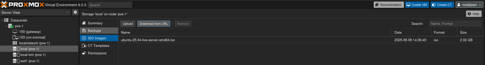
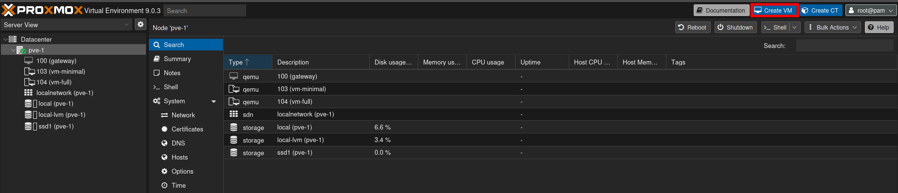
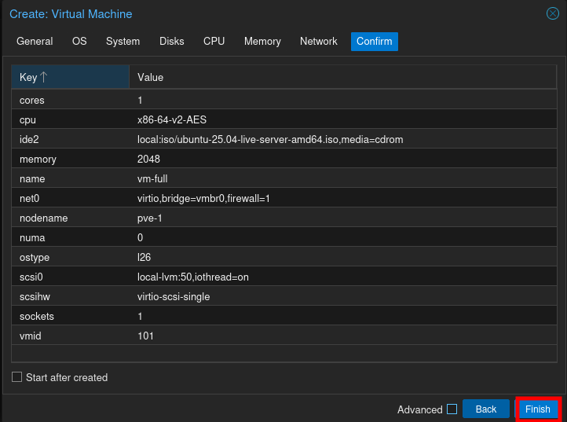
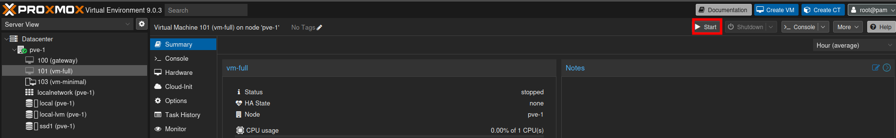
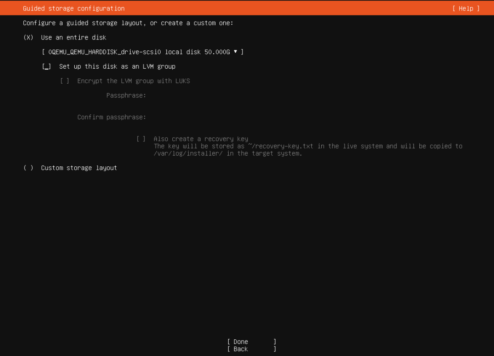
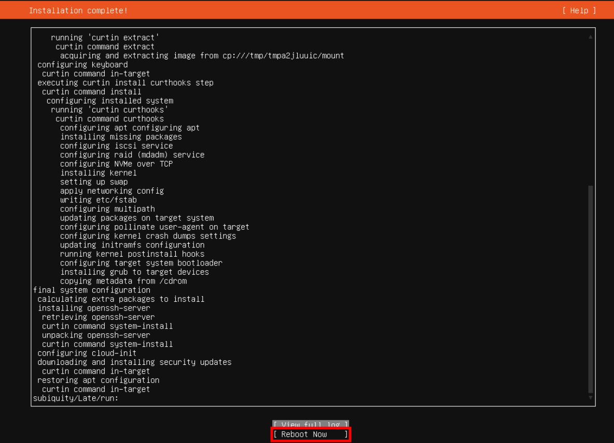
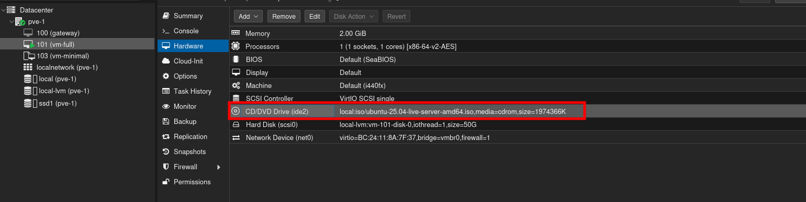
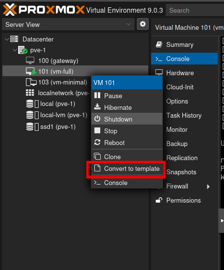
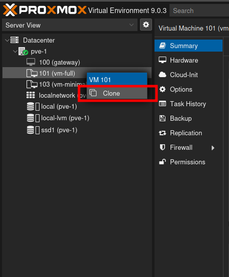

# How to create Virtual Machine and take their snapshots

---

## step 1 : Download the template for the Vm

### → Go to ubuntu website copy the download link url by pressing right click on the download button and copy that url

### → Open proxmox dashboard select local(name) you'll see iso templates for vms and ct templates for cts. As we are using vms we will click on iso.

### → Click on download from url and paste that url here
→ Your download will start and there will be a template as we can see in the above images.

## step 2: Click create VM at top right corner of proxmox dashboard inside the main node

## step 3 : VM configuration

→ Add that iso image template from dropdown

## step 4 : Start the VM

## step 5 : Go to console and start installing VM

## → Now wait until it gets installed

## step 6 : Reboot VM after it is installed

## step 7 : Go to hardware and remove media disk

### → Now come back to console and press enter

## step 8 : Create template of this VM

→ Creating a template of this VM allows us to clone as many VMs as we want from a single VM template.

## step 9 : Clone the VM to get more VMs

## step 10 : Cloning VM

