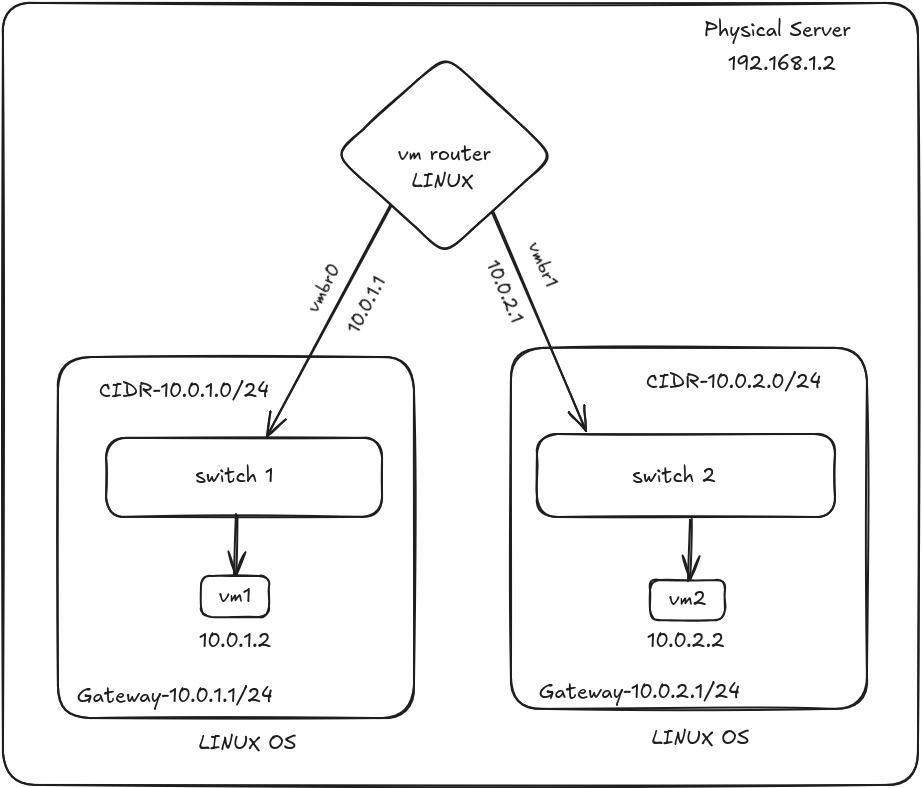
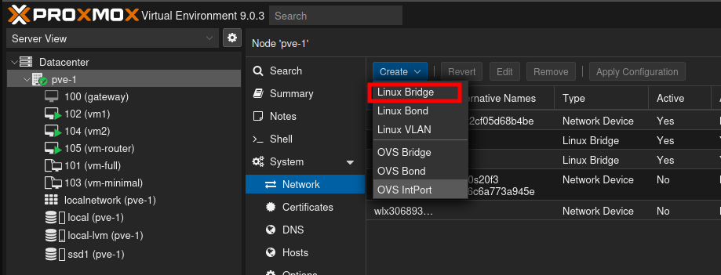
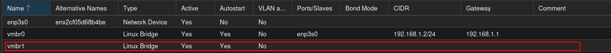
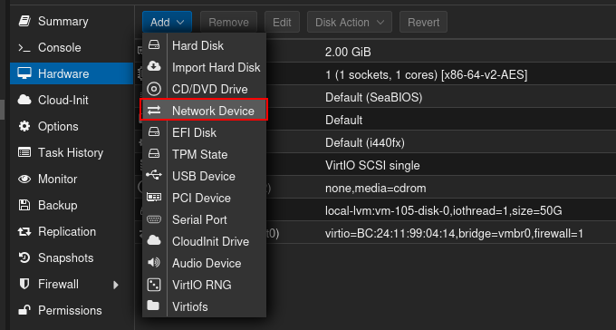
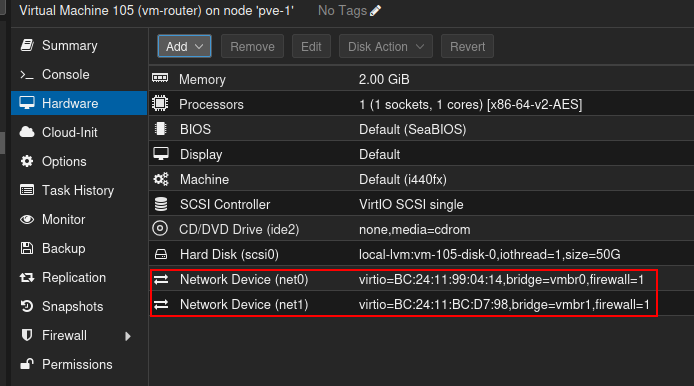

# Configuring Linux Router

## Introduction

### 

Creating a Linux router VM in Proxmox, connecting two networks and enabling routing between virtual machines

## **Prerequisites**

- Proxmox
- Configured Vms with Cli

## Tech Specification

Given newtork as follows:
10.0.1.0/24 - CIDR       BlockA - Network A
10.0.2.0/24 -  CIDR      BlockB - Network B

VMs,
VM1 - 10.0.1.2
VM-Router (vmbr0 - 10.0.1.1, vmbr1- 10.0.2.1)
VM2 - 10.0.2.2

## Architecture diagram

**Here there is a single vm router connect to to different vms that are on different networks
The job of the vm router is to act like a bridge to fill that communication gap between two vms so one vm can ping other vm over different network** 



## Setup

- **Start all the vms ie vm1 vm2 and vm-router**
- **Add a link bridge in main node as vmbr1** 
→ Go to main node 
→Open Network Settings
→Create linux bridge



now use command to activate that interference port,

```bash
ip link set dev vmbr1 up
```

→Restart the networking services 

```bash
systemctl restart networking
```

→ Restart pve node , your bridge will be active 



- **Setup Vms** 
→connect the vm1 with vmbr0, vm2 with vmbr1 as per the diagram
→Go to vm1 hardware settings then click on network devices and select bridge vmbr0


      →Do the same for vm2 linking it with vmbr1


- **Setting up vm-router**
→ Go to settings hardware setttings of vm-router 
→Click on add , to add the new device 
Router vm should have two interfaces that will connect both the vms and will create a brigde for them to connect using the linux bridge



There will be a new device created and two interfaces will be created one with vmbr0 and other with vmbr1
Note- if it is showing both the interfaces for vmbr0 click on one of the interfaces and change to vmbr1



## Deployment

- **Open console of the all 3 vms and log in**
- **Check all the interface active/up or not using,**

```bash
ip add
```

→check for both the vms 

- **Configuring IPs to vms**
→Now we have to configure the vms we have to give static ip addresses for both the vms
→open terminal for vm1 open command given below

```bash
sudo nano /etc/netplan/50-cloud-init.yaml
```

→ Enter this configuration given below

VM 1

```bash
network:
  version: 2
  ethernets:
    ens18:
      addresses: [10.0.1.2/24]
      gateway4: 10.0.1.1
 
```

VM 2

```bash
network:
  version: 2
  ethernets:
    ens18:
      addresses: [10.0.2.2/24]
      gateway4: 10.0.2.1
       
```

save the config using ctrl + x then Y and enter 

Now save this configuration using 

```bash
sudo netplan apply
```

Check if ips are configured using 

```bash
ip add
```

- **Configuring vm-router**

check the status of interfaces of the vm by using 

```bash
ip add
```

there will be one interface which we added as new network device will be down by default we need to make that active as well as we have to configure IPs for the interfaces 

→ Edit configuration of the vm-router as given below

```bash
network:
  version: 2
  ethernets:
    ens18:
      addresses:
         [10.0.1.1/24]
    ens19:
      addresses:
         [10.0.2.1/24]
```

save this configuration 

→ To apply the changes done in the configuration use

```bash
sudo netplan apply
```

and then check again the status of the interfaces whether they are up or down using ip add 

- **Enabling port forwarding in router**

→Activate IP forwarding so the router can pass traffic between networks

```bash
sudo sysctl -w net.ipv4.ip_forward=1
```

To make this forwarding permanent even after the reboot we can use commands 

```bash
echo "net.ipv4.ip_forward=1" | sudo tee -a /etc/sysctl.conf
sudo sysctl -p
```

- **Allowing traffic to flow**

→Change rules  for forwarding in Iptables

```bash
sudo iptables -A FORWARD -i ens18 -o ens19 -j ACCEPT
sudo iptables -A FORWARD -i ens19 -o ens18 -j ACCEPT
```

→now u configured the port forwarding we can check pinging of the devices  

- **Pinging devices**

→ vm1 to vm2 
from vm1 ping vm2 

```bash
ping 10.0.2.2
```

→vm2 to vm1
from vm2 to vm1

```bash
ping 10.0.1.1
```

## Troubleshooting

### 1. VMs Cannot Ping Each Other Across Subnets

- Check VM NICs: Make sure VM1 is on vmbr0 and VM2 is on vmbr1.
- Verify VM-Router NICs: Router should have one NIC on each bridge .
- Static IPs & Gateways: Confirm VMs have correct IPs/subnet masks and the gateway set to the router VM (e.g., VM1: gateway 10.0.1.1, VM2: gateway 10.0.2.1).

### 2. **Router VM Cannot Ping VMs**

- Netplan IPs: Ensure both router VM interfaces have correct IP assignments (no duplicate default gateway).
- Interface States: Use ip add in router VM—both interfaces must be UP.
- Bridge Assignment: Double-check that each router VM NIC is mapped to correct bridge in Proxmox hardware.

### 3. **Firewall Blocks Ping**

- Disable On Linux: sudo ufw disable (on each VM).
- Windows: Turn off from Control Panel.

## 4. **Wrong Network/Subnet Assignment**

- Ensure each VM is on correct subnet and points to the proper gateway.

## FAQS

**Q1: Why do I need two bridges?**

A: To create two isolated subnets (networks) so the router VM can provide true gateway functionality between them.

**Q2: Do I need to add a default gateway in Netplan for the router VM?**

A: No. The router VM is bridging two subnets and does not require a default gateway unless one interface is to route to the internet.

**Q3: Where should I run IP forwarding and iptables commands?**

A: Only inside the router VM—not on the host or endpoint VMs.

**Q4: How can I make sure my bridge is active?**

A: On the Proxmox host: **`ip link show vmbr1`**. If “DOWN,” use **`ip link set dev vmbr1 up`**.

**Q5: My VM shows “interface down.” What’s wrong?**

A: The bridge may not exist or be inactive. Confirm bridge setup in Proxmox GUI and restart networking.